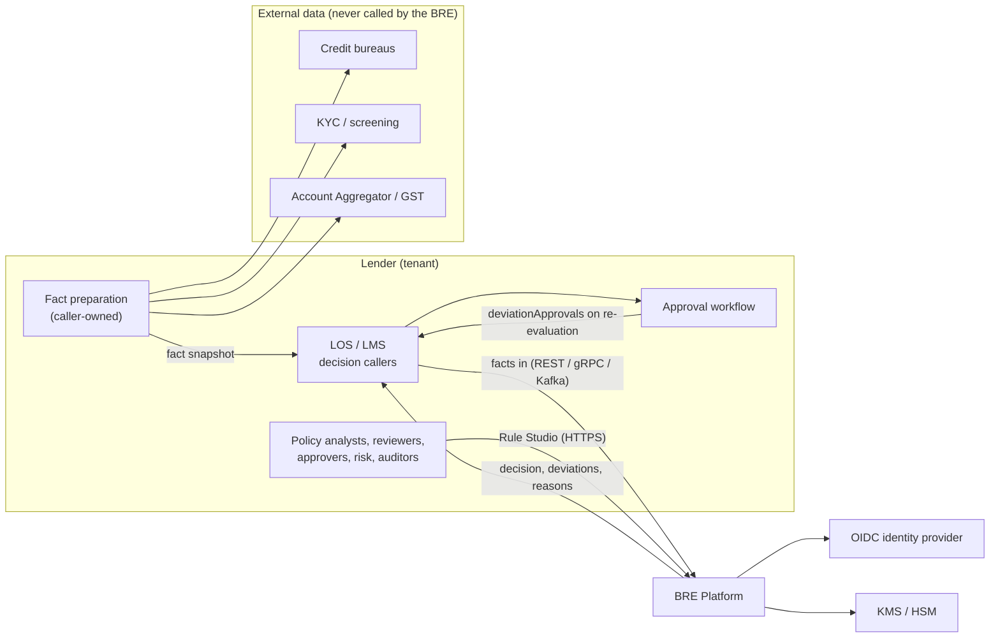
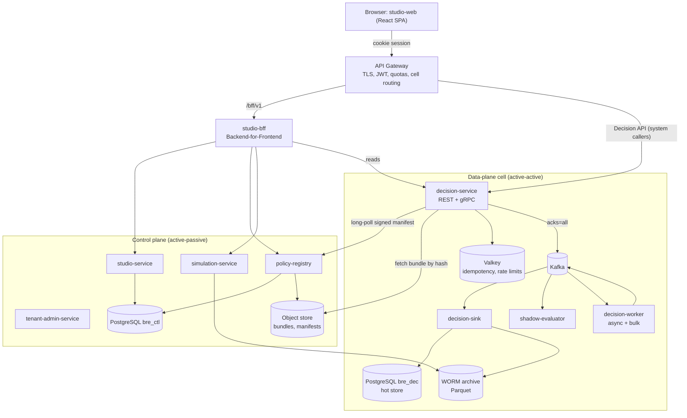
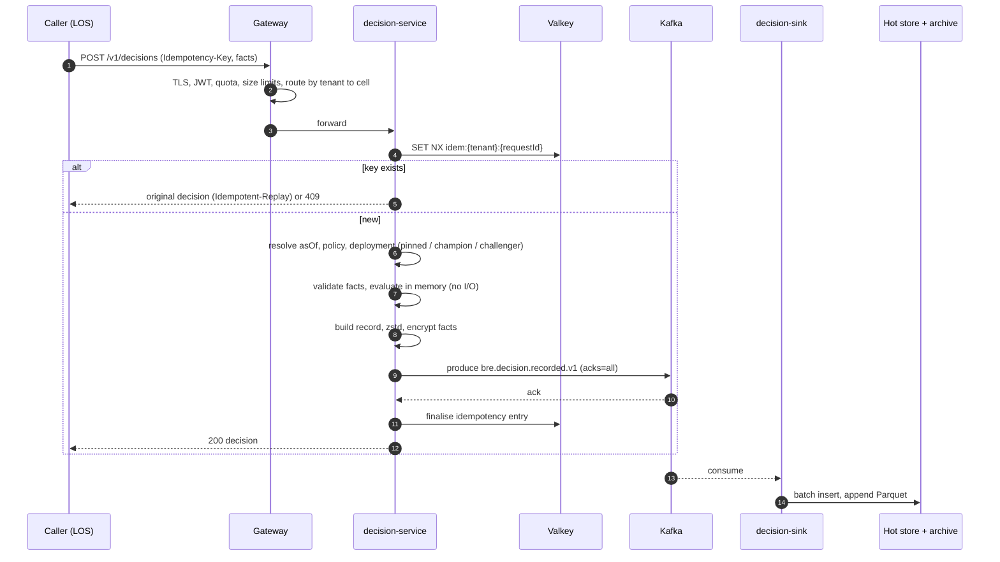
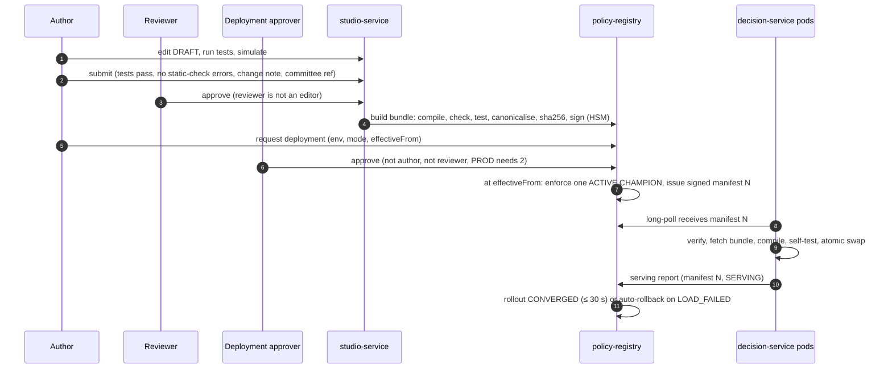
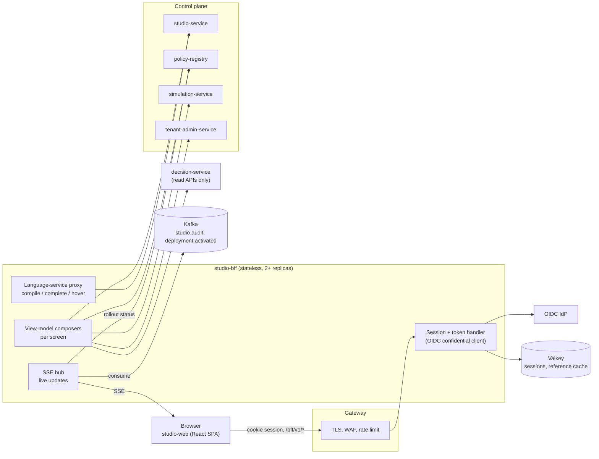
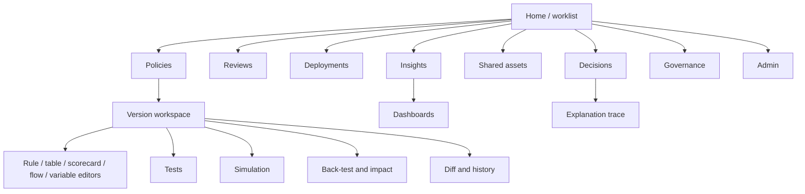

# BRE Platform: Technical Requirements Document (TRD)

| | |
|---|---|
| **Document** | `BRE_TRD_v1.0.md` |
| **Version** | 1.1-draft |
| **Date** | 2026-10-06 |
| **Status** | Draft for engineering review |
| **Product** | BRE Platform: a multi-tenant business-rules and credit-decisioning engine for Indian lenders |
| **Audience** | Architects, backend, frontend, SRE, QA and security engineers who build and run the platform |
| **Owners** | Tech Lead / Architect *(placeholder)* · Engineering Manager *(placeholder)* · Security Lead *(placeholder)* |

> **This document stands alone.** It holds every technical decision, contract, algorithm, data structure and target needed to build the BRE Platform. You do not need any other document to read or implement it. It consolidates the Draft 2 specification set in `docs/BRE_PRD/draft2/` (`00` Decisions, `01` PRD, `02` Architecture, `03` LLD, `04` Authoring Guide, `05` Build Plan). Where this TRD summarises, those documents hold extra worked examples and full DDL. **If the two ever disagree, raise it; `00_Decisions_and_Canonical_Terms.md` is the tie-breaker until this TRD is corrected.**

### Sign-off

| Role | Name | Decision | Date |
|---|---|---|---|
| Tech Lead / Architect | | | |
| Engineering Manager | | | |
| Security Lead | | | |
| SRE Lead | | | |
| Product Owner | | | |

### Change log

| Version | Date | Summary |
|---|---|---|
| 1.0-draft | 2026-10-06 | First consolidated, standalone TRD built from Draft 2. |
| 1.1-draft | 2026-10-06 | Added §13 Rule Studio UI and Backend-for-Frontend (BFF): architecture, BFF endpoints, information architecture, 17 screen specifications, interaction designs, front-end architecture, UI targets and validation placement. Decision D16. Later sections renumbered. |

---

## Contents

1. Purpose and scope
2. Requirements this design must meet
3. Key technical decisions
4. System architecture
5. Component specifications
6. Decision model and outcome semantics
7. BEL: the rule expression language
8. Compiler, evaluator and static checks
9. Policy format, bundles and signing
10. Bundle distribution and activation
11. Data design
12. API specification
13. Rule Studio UI and Backend-for-Frontend (BFF)
14. Events and messaging
15. Security and privacy
16. Scalability and performance
17. Resilience and disaster recovery
18. Observability
19. Deployment and environments
20. Technology stack
21. Error catalogue
22. Configuration
23. Testing and verification
24. Implementation plan
25. Risks, assumptions and open points
26. Traceability
27. TRD conformance self-check
28. Glossary

---

## 1. Purpose and scope

### 1.1 What is being built

The BRE Platform is the system of record for **credit policy**. Lenders' policy analysts author policy as versioned, testable, signed assets. Loan origination systems (LOS) then call the platform to get a **decision** for an application at each stage of the loan journey.

The platform has two planes:
- the **control plane**, where policy is authored, tested, approved, signed and deployed;
- the **data plane**, where decisions are made at high volume by stateless servers that hold compiled policy in memory.

Every decision is recorded durably before the response returns, and can be replayed exactly years later.

### 1.2 In scope

| Area | Included |
|---|---|
| Decision engine | `bre-engine-core`: the BEL language, compiler, evaluator, static checks, explanation trace |
| Decision execution | Synchronous REST and gRPC; asynchronous (Kafka and REST ingress); bulk jobs |
| Policy lifecycle | Authoring APIs, maker-checker review, signed bundles, deployments, rollback, champion/challenger, shadow |
| Testing tools | Stored test cases, coverage, simulation, back-testing, impact analysis |
| Governance | Reason codes, authority matrix (deviation approvals), regulatory parameter register, protected-attribute controls, audit trail |
| Platform | Multi-tenancy, cells, quotas, identity, encryption and key management, observability, deployment |
| Rule Studio | The React web application for business users, served through its own Backend-for-Frontend (`studio-bff`, §13) |

### 1.3 Out of scope

| Excluded | Where it lives instead |
|---|---|
| Fetching data from bureaus, KYC, screening, Account Aggregator or core banking | The caller's systems; optional **Fact Connectors** (a separate, later component). The BRE never calls them. |
| Running the deviation-approval workflow (inboxes, approvers) | The caller's LOS / workflow. The BRE only computes which approvals are needed and validates approvals sent back. |
| Pricing, limit reservation, exposure booking | Separate pricing and limit-management systems |
| Customer-facing UI and letters | The lender's systems, using the BRE's reason codes |
| Stateful fraud velocity counting | A fraud / feature service; the BRE consumes its signals as facts |

### 1.4 Phasing

| Phase | Scope |
|---|---|
| **1 (MVP)** | MFI group lending (JLG and SHG); engine; control plane; Kafka-first data plane; Rule Studio core; multi-tenancy |
| **2** | Retail and MSME; scorecards; COLLATERAL scope; back-testing, impact analysis, shadow; gRPC; compact mode packaging; bulk and async |
| **3** | Champion/challenger; starter policy packs; Fact Connectors; DMN import/export; embedded SDK; webhooks; two-region active-active as the SaaS default |

---

## 2. Requirements this design must meet

### 2.1 Functional capabilities (summary)

| Area | Must support |
|---|---|
| **Decision model** | Policies per product line × stage × segment; immutable versions; typed variables (input and derived); parameters; reference lists; rules; decision tables with hit policies; scorecards; flows with knockout stages; per-entity scopes (application, party, group, member, household, collateral) with aggregation; computed outputs |
| **Outcomes** | Rule statuses PASS, DEVIATION, REFER, FAIL, NOT_APPLICABLE, DATA_MISSING, ERROR. One overall decision: DECLINE, REFER, APPROVE_WITH_DEVIATION, APPROVE. **Fail-closed**: errors and missing data never approve. |
| **Deviations** | Authority matrix by deviation type, product line, amount band and segment; routing HIGHEST_ONLY or EACH; approvals bound to a value and an expiry, sent back as facts |
| **Lifecycle** | DRAFT → IN_REVIEW → APPROVED → ARCHIVED; segregation of duties; signed bundles; deployments with approvals per environment; scheduled activation; one-action rollback; expedited change |
| **Execution** | Sync REST and gRPC; idempotency; schema validation; durable-before-respond; async; bulk; dry-run (non-PROD) |
| **Testing** | Test cases with coverage gates; simulation with full trace; back-test; impact analysis; shadow; champion/challenger |
| **Audit** | Immutable decision records; explanation by replay; hash-chained audit trail; reason codes with customer text; masking with audited unmask |
| **Integration** | OpenAPI 3.1, gRPC, CloudEvents over Kafka, Java SDK, fact JSON Schema |
| **Administration** | Tenants, environments, cells, quotas, users and roles, BYOK, data residency |
| **Governance** | Protected attributes locked from logic without an approved override; regulatory parameter register; model register for scorecards; consent and purpose enforcement |

### 2.2 Non-functional targets

These targets are per region and per cell unless stated.

| ID | Requirement | Target |
|---|---|---|
| NFR-PERF-01 | Server-side latency, 100-rule policy, facts ≤ 64 KB, **including the durable write** | p50 ≤ 20 ms; p99 ≤ 100 ms |
| NFR-PERF-02 | Large case: 1,000 rules, facts ≤ 1 MB (a 40-member JLG group) | p99 ≤ 250 ms |
| NFR-PERF-03 | Studio live-compile feedback | ≤ 500 ms for a 1,000-rule version |
| NFR-SCALE-01 | Throughput | 5,000 decisions/s sustained, 10,000/s burst per cell; linear by adding pods, then cells |
| NFR-SCALE-02 | Bulk | ≥ 1,000,000 decisions/hour per cell, without breaching NFR-PERF-01 for online traffic |
| NFR-SCALE-03 | Back-test | 1,000,000 decisions in ≤ 30 min |
| NFR-SCALE-04 | Policy size | ≤ 2,000 rules/tables per version; ≤ 100,000 entries per list |
| NFR-AVAIL-01 | Decision API availability | 99.95% monthly (one region); 99.99% (two regions active-active) |
| NFR-AVAIL-02 | Control plane | 99.5%. A control-plane outage must not affect decisioning. |
| NFR-DR-01 | Recovery | RPO 0 for acknowledged decisions on broker, node or AZ failure; on permanent region loss RPO ≤ 5 s (or 0 in Sync-DR mode). Data-plane RTO ≤ 1 min; control-plane RTO ≤ 30 min. |
| NFR-OPS-01 | Activation and rollback convergence | ≤ 30 s p99 across all pods |
| NFR-SEC | Security | OIDC + MFA for approvers; mTLS between services; envelope encryption; signed bundles; no code execution from authored content |
| NFR-PRIV | Privacy | PII masked everywhere; raw Aadhaar rejected; crypto-shredding for erasure |
| NFR-COMP-01 | Retention | Hot store 90 days (facts 14 days); WORM archive 10 years default (per tenant); security logs ≥ 180 days in India |
| NFR-COMP-02 | Residency | All tenant data and backups in India |
| NFR-MAINT-01 | Engine conformance | 100% of the conformance suite on every build |
| NFR-MAINT-02 | Replay compatibility | A new engine version replays 100% of an archived sample of decisions identically, or the change is versioned and gated |

---

## 3. Key technical decisions

| ID | Decision | Rationale | Rejected alternatives |
|---|---|---|---|
| D1 | **Multi-tenant from day one.** `tenant_id` on every row, key, event, metric and log line. Same artifacts for SaaS (India) and single-tenant installs. | Cheap to build in, very expensive to retrofit. | Single-tenant only |
| D2 | **Facts in, decision out.** The decision is a pure function of `(facts, bundle, asOf)`. The BRE never calls external systems. | Exact replay, simulation and back-testing; single-digit-ms evaluation; regulated data stays out of the engine. | BRE fetching bureau/KYC data inline (breaks the latency budget, causes repeat bureau pulls, leaks PII into caches) |
| D3 | **Own decision model and own expression language, BEL**: typed, decimal-native, sandboxed, FEEL-inspired. Executed by `bre-engine-core`, a pure Java library. | Safety (no host calls by construction), exact money arithmetic, control of the authoring experience, latency. | SpEL (arbitrary code execution); CEL (no decimal type); Drools DRL (not business-friendly); KIE DMN runtime (heavy, escape hatches, less UX control) |
| D4 | **MVP vertical: MFI group lending.** | Hardest entity model (group → members → households). | Retail first |
| D5 | **Control plane / data plane split with signed, content-addressed bundles.** Activation is an atomic pointer flip; pods converge within 30 s. **No policy data is read from a database or cache on the hot path.** | Atomic switches, instant rollback, tamper evidence, no hot-path dependencies. | Redis rule cache with TTL (stale rules, Kafka-dependent invalidation) |
| D6 | **Kafka-first decision log** (`acks=all`, RF 3, `min.insync.replicas=2`, idempotent producer) before responding. Sinks fill a PostgreSQL hot store, a WORM archive and analytics. **Compact mode** writes PostgreSQL first with an outbox. One port: `DecisionLog`. | The write path is the scaling bottleneck; Kafka scales it horizontally. | Synchronous per-rule rows in PostgreSQL (8.6 billion rows/day at target load) |
| D7 | **Explanations regenerated by replay**, not stored. | About 10× less storage; still exact. | Storing full traces |
| D8 | **Determinism**: `BigDecimal` everywhere; no wall clock (only `asOf`); no randomness; engine version pinned per decision. | Exact replay; simulation parity by construction. | — |
| D9 | **Separate rule-status and decision enums; fail-closed precedence.** | Closes the fail-open defect class. | Single PASS/DEVIATION/FAIL enum |
| D10 | **Deviation approval workflow stays outside the BRE**; approvals return as value-bound facts. | The BRE stays stateless. | BRE-owned approval inbox |
| D11 | **Stack**: Java 25, Spring Boot 4.x, PostgreSQL 17+, Kafka 4.x (KRaft), Valkey (optional), S3-compatible storage, Kubernetes, OpenTelemetry, OIDC, KMS/HSM, React + TypeScript. **Maven Central and npm only.** | Current LTS versions; no proprietary licences. | — |
| D12 | **REST/JSON and gRPC** for decisions; **CloudEvents** over Kafka for events. | gRPC for high-volume callers, REST for everyone else. | REST only |
| D13 | **India-only data; data plane active-active across two regions; control plane active-passive.** | Residency and availability. | Single region |
| D14 | **Cells**: tenants are mapped to independent data-plane cells. | Blast-radius limits and linear scale-out. | One shared cluster |
| D15 | **UUIDv7 decision IDs** carrying cell and shard locator bits. | Time-ordered index locality; direct routing for lookups. | Random UUIDv4; lookup tables |
| D16 | **Backend-for-Frontend (BFF)** for the Rule Studio: the browser talks only to `studio-bff`, which holds tokens server-side, composes screen-shaped view models and streams live updates. No business logic in the BFF. | Token security for a browser app; one call per screen; UI contract decoupled from service APIs; live rollout and job progress. | SPA calling every service directly with tokens in the browser |

---

## 4. System architecture

### 4.1 System context



### 4.2 Containers



### 4.3 Control plane and data plane

| | Control plane | Data plane |
|---|---|---|
| Purpose | Author, test, review, sign and deploy policy; administer tenants | Make and record decisions |
| Components | `studio-web`, `studio-bff`, `studio-service`, `policy-registry`, `simulation-service`, `tenant-admin-service` | `decision-service`, `decision-worker`, `decision-sink`, `shadow-evaluator` |
| Traffic | Low (humans, jobs) | High (system callers) |
| State | `bre_ctl` database; object store for bundles and manifests | In-memory compiled bundles; Kafka; hot store; archive |
| Availability | 99.5%, active-passive | 99.95–99.99%, active-active |
| **Trust boundary** | Signs bundles (tenant key) and pointer manifests (registry key) in the HSM | Accepts only **verified** signed bundles and manifests. Never reads `bre_ctl`. |

Only two things cross the boundary: **signed bundles** (fetched by hash) and **signed Active Pointer Manifests** (long-polled). A control-plane outage stops policy changes but never stops decisions.

### 4.4 Synchronous decision flow (Kafka-first)



**The 200 is sent only after Kafka acknowledges the record on at least two replicas.** If Kafka cannot acknowledge in time, the API returns `503 decision-log-unavailable` and **no decision is returned**.

### 4.5 Authoring to production



---

## 5. Component specifications

### 5.1 Libraries

| Module | Responsibility | May depend on | Must not depend on |
|---|---|---|---|
| `bre-engine-core` | IR model, BEL lexer/parser/type-checker, compiler, evaluator, decision logic, explainer, static checks | JDK 25, `re2j` | Spring, Jackson, logging backends, any I/O, the clock, randomness |
| `bre-ir-json` | IR ↔ JSON, PSF (YAML 1.2) ↔ IR, BRE-JCS canonical JSON | engine-core, Jackson, `snakeyaml-engine` | Spring |
| `bre-bundle` | Bundle format, hashing, Ed25519 sign/verify, trust store | engine-core, ir-json, JDK security | Spring |
| `bre-fact-model` | Canonical fact JSON Schema, single-pass fact reader, field classification, prohibited-data detector | engine-core, Jackson, JSON Schema validator | Spring |
| `bre-crypto` | Envelope encryption, key hierarchy, masking | JDK crypto, `zstd-jni`, a KMS port | engine-core |
| `bre-contracts` | OpenAPI 3.1, `.proto`, AsyncAPI 3.0, event schemas | — | — |
| `bre-platform-common` | Tenant context, UUIDv7, problem+json, OTel helpers, PII log guard | Spring (optional) | — |
| `bre-sdk-java` | REST and gRPC client; optional embedded engine | contracts | Spring (core SDK) |

**ArchUnit rules enforced in CI:**
1. Nothing under `dev.bre.engine..` imports `java.time.Clock`, `System.currentTimeMillis`, `Instant.now`, `LocalDate.now`, `Random` or `ThreadLocalRandom`.
2. No logging call receives a facts document, a record value or a JSON node.
3. Engine exceptions carry fact **paths** and **types**, never values.
4. No service imports another service's internal packages.

### 5.2 Services

| Service | Plane | Responsibility | Inbound | Outbound | State | Scaling unit |
|---|---|---|---|---|---|---|
| `decision-service` | Data | Sync Decision API; policy resolution; bundle cache; evaluation; durable write; reads for GET | REST, gRPC | Kafka (`recorded`, `deviation.raised`), Valkey, registry (manifest), object store (bundles), KMS (cached), hot store (reads) | Compiled bundles in memory (LRU) | Pods per cell (HPA) |
| `decision-worker` | Data | Async requests and bulk jobs | Kafka `requested.v1`; REST async ingress via decision-service | Kafka transactional produce; object store (bulk files) | None | KEDA on lag / queue depth |
| `decision-sink` | Data | Kafka → hot store, WORM archive, analytics feed | Kafka `recorded.v1` | PostgreSQL, object store | Consumer offsets | KEDA on lag (≤ partitions) |
| `shadow-evaluator` | Data | Re-evaluates recorded decisions against SHADOW bundles | Kafka `recorded.v1` | Hot store `shadow_results` | Bundle cache | KEDA; paused under CPU pressure |
| `studio-service` | Control | Authoring API: policies, versions, assets, tests, simulation, reviews, audit | REST | `bre_ctl`, `simulation-service`, Kafka/outbox (`studio.audit`) | `bre_ctl` | 2+ replicas |
| `policy-registry` | Control | Bundle build/sign/store; deployments; manifests; long-poll endpoint; serving reports; rollout status; auto-rollback | REST, pod reports | HSM/KMS, object store, `bre_ctl` | `bre_ctl`, object store | 2+ replicas, leader-elected scheduler |
| `simulation-service` | Control | Simulations, back-tests, impact analysis (replay pool) | REST, job queue | Archive (read), KMS (decrypt under restriction) | Job state in `bre_ctl` | Worker pool |
| `tenant-admin-service` | Control | Tenants, environments, cells, quotas, settings, routing table | REST | `bre_ctl`, gateway (signed routing table) | `bre_ctl` | 2 replicas |
| `studio-bff` | Control | Backend-for-Frontend for the Rule Studio: OIDC token handler and session, screen view-model composition, language-service proxy, SSE live updates (§13) | Browser (`/bff/v1`, cookie session) | studio-service, policy-registry, simulation-service, tenant-admin-service, decision-service read APIs (on behalf of the user), Valkey, Kafka (consume) | Sessions in Valkey (pods stateless) | 2+ replicas (HPA) |
| `studio-web` | Control | React + TypeScript SPA; Monaco BEL editor | Browser | **`studio-bff` only** | None | Static / CDN |

### 5.3 Concurrency inside `decision-service`

- One virtual thread per request.
- A **CPU bulkhead** (a semaphore of about 2 × cores) wraps evaluation and encoding, so bursts queue briefly instead of thrashing.
- I/O waits (the Kafka ack, Valkey) happen outside the bulkhead.
- A request reads the serving state **once** at its start, so a bundle swap never affects a request in flight.

---

## 6. Decision model and outcome semantics

### 6.1 Concepts

| Concept | Definition |
|---|---|
| **Tenant** | A lender (bank, NBFC, NBFC-MFI, HFC, SFB) |
| **Environment** | DEV, UAT, PROD (configurable per tenant) |
| **Product line / Stage / Segment** | Tenant-configured codes, e.g. `MFI_JLG` / `CREDIT_UW` / `NTB`. Never enums. |
| **Policy** | `(tenant, policyCode)`; serves product line(s), a stage and an optional segment |
| **PolicyVersion** | Immutable once out of DRAFT. Holds variables, rules, decision tables, scorecards and a flow. Pins exact versions of shared assets and one fact schema. |
| **Shared assets** | Tenant-level, independently versioned: Parameter Set, Reference List, Reason Code Catalogue, Authority Matrix, Fact Schema |
| **Bundle** | Compiled, signed, content-addressed artifact of an approved PolicyVersion plus its pinned assets; identified by `bundleHash` (`sha256:…`) |
| **Deployment** | Append-only record that makes a bundle live for `(tenant, env, policyCode)` with a mode and `effectiveFrom` |
| **Deployment mode** | `CHAMPION` (live decision), `CHALLENGER(trafficBasisPoints)` (live decision for a deterministic slice), `SHADOW` (evaluated asynchronously; never affects outcomes) |
| **Variable** | Typed named value: `INPUT` (from a fact path) or `DERIVED` (BEL expression). Variables form a DAG; cycles are compile errors. |
| **Parameter** | Typed named constant, maker-checked and effective-dated (`param.X`) |
| **Reference List** | Named value set (`list.X`), ≤ 100,000 entries in a bundle |
| **Rule** | `code`, `name`, `scope`, optional `when`, `check`, `onFail` (status, reasonCode, deviationType, measure, worseWhen), `onMissing`, optional `outputs`, `priority` |
| **Decision Table** | Inputs; ordered rows of unary tests → outcome/outputs; hit policy `FIRST`, `UNIQUE`, `PRIORITY` or `COLLECT(SUM|MIN|MAX|COUNT|LIST)` |
| **Scorecard** | Characteristics with bins → points; base score; optional scaling; top-N adverse reasons |
| **Flow** | Ordered stages of steps; a `KNOCKOUT` stage stops the flow on any FAIL |
| **Scope** | `APPLICATION`, `PARTY` (role filter), `GROUP`, `MEMBER`, `HOUSEHOLD`, `COLLATERAL`. Per-entity steps run once per matching entity. |
| **Aggregation** | `WORST` (default), `ALL_MUST_PASS`, `THRESHOLD(count|percent, status) -> status`, `NONE` |

### 6.2 Rule statuses and the decision

**RuleStatus:** `PASS`, `DEVIATION`, `REFER`, `FAIL`, `NOT_APPLICABLE` (the `when` precondition was false), `DATA_MISSING`, `ERROR`.

- `onMissing` (per rule): `REFER` (default), `FAIL`, `NOT_APPLICABLE`, or `USE_DEFAULT(true|false)`, a Boolean that stands in for the unknown `when`/`check` result. Input defaults are written with `coalesce` in a variable instead.
- `onError` is **not configurable**: an error always yields `ERROR`, which counts as REFER and raises a system alert.

**Decision precedence (first match wins):**

| # | Condition | Decision |
|---|---|---|
| 1 | Any `FAIL` | `DECLINE` |
| 2 | Otherwise any `REFER`, `DATA_MISSING` or `ERROR` | `REFER` |
| 3 | Otherwise any `DEVIATION` not covered by a valid approval | `APPROVE_WITH_DEVIATION` |
| 4 | Otherwise | `APPROVE` |

- `NOT_APPLICABLE` is ignored.
- A deviation covered by a valid approval is annotated `DEVIATION_APPROVED` and counts as PASS.
- `stpEligible` is true only for `APPROVE` with no `DEVIATION_APPROVED` annotation.
- **Fail-closed guarantee:** no combination of ERROR, DATA_MISSING, REFER or FAIL can produce APPROVE. A property test over 10⁶ random combinations runs in CI.

```text
decide(compiledPolicy, facts, asOf):
  steps = []
  for stage in flow.stages:
     for step in stage.steps: steps.append(evalStep(step))      # per-entity eval, coverage/authority, aggregation
     if stage.knockout and any(s.aggregated == FAIL for s in this stage):
         every remaining step -> NOT_APPLICABLE, reason SYS_SKIPPED_KNOCKOUT
         break
  S = [s.aggregated for s in steps if s.aggregate != NONE]
      + [ERROR for s in steps if s.aggregate == NONE and any entity is ERROR]
  decision = DECLINE if FAIL in S
        else REFER if S ∩ {REFER, DATA_MISSING, ERROR} ≠ ∅
        else APPROVE_WITH_DEVIATION if DEVIATION in S
        else APPROVE
  stpEligible = decision == APPROVE and no DEVIATION_APPROVED annotation
```

### 6.3 Aggregation

Severity order (also used by WORST): **FAIL 6 > ERROR 5 > DATA_MISSING 4 > REFER 3 > DEVIATION 2 > PASS 1 > NOT_APPLICABLE 0.**

```text
E  = effective statuses of the step's entities (covered deviations count as PASS)
E' = E without NOT_APPLICABLE
WORST:          NA if E' empty else max severity of E'
ALL_MUST_PASS:  NA if E' empty
                else PASS if all PASS
                else FAIL if any of {FAIL, REFER, DEVIATION}
                else WORST(E')            # only DATA_MISSING/ERROR remain → REFER-class, never DECLINE
THRESHOLD(metric, op, value, S, result):
                NA if E' empty
                k = number of entities in E' with status in S
                m = k (COUNT) or 100·k/|E'| (PERCENT, whole-number percentages)
                if compare(m, op, value): return max(result, WORST(E'))   # never weaker than WORST
                else: return WORST(E')
NONE:           contributes nothing to the decision, except that any ERROR entity contributes ERROR
```

### 6.4 Deviations and the authority matrix

For every entity result whose raw status is DEVIATION:

```text
level = resolveAuthority(deviationType, productLine, segment, authorityAmount)
if authorityAmount missing: → DATA_MISSING (DATA_MISSING_AUTHORITY_AMOUNT)
if level is none:           → REFER (DEV_NO_AUTHORITY) + alert
if covered(result, entity, deviationApprovals, asOf, level): effective PASS, annotate DEVIATION_APPROVED
else: effective DEVIATION, requiredLevel = level

covered: first approval in input order such that
  ruleCode, deviationType, entityType and entityRef all match;
  expiresOn present and asOf ≤ expiresOn;
  measure and approvedValue present, and the measure is not worse than approvedValue
     (worseWhen HIGHER: measure ≤ approvedValue; LOWER: measure ≥ approvedValue; categorical: equal);
  rank(approvedLevel) ≥ rank(level)
Approvals never cover FAIL.
```

**Authority resolution.** Matrix entries are `(deviationType, productLine | '*', segment | '*', amountAbove, amountUpTo, level)`, with a band `amountAbove < amount ≤ amountUpTo`. Candidates match the type, product line, segment and band; the highest specificity (`2·[productLine exact] + [segment exact]`) wins. Bands for one key cannot overlap (database exclusion constraint). A compile-time check (CHK-011) verifies full coverage of `[0, ∞)` for every deviation type and product line the policy can emit.

**Routing mode** (copied into each Authority Matrix version for exact replay):
- `HIGHEST_ONLY`: one approval at the highest level required, covering all uncovered deviations;
- `EACH`: one approval per uncovered deviation.

Authority levels are tenant-defined and ordered (for example `L1 < L2 < L3 < CREDIT_HEAD < CRO < MD`). **No hierarchy is ever hard-coded.**

### 6.5 Policy resolution, pinning and `asOf`

| Topic | Rule |
|---|---|
| **Resolution** | Explicit `policyCode`, or resolved from `(productLine, stage, segment)` with the most specific match winning (an exact segment beats `*`). At most one ACTIVE CHAMPION may exist per `(tenant, env, productLine, stage, segment)`; the registry rejects any deployment that would create two. |
| **Pinning** | `pinning: "LATEST"` (default) or `{ "bundleHash": … }`. A pin is honoured only if the bundle was an ACTIVE CHAMPION in that environment within `grandfatherWindowDays` (default 90), measured from the server's `receivedAt`, never from the caller's `asOf`. Otherwise `422 pinned-bundle-not-allowed`. The BRE never looks up earlier decisions to decide this. |
| **`asOf`** | Defaults to `receivedAt`. Date functions use the tenant time zone (default `Asia/Kolkata`). The resolved `asOf` and time zone are stored in the decision. |
| **Champion/challenger** | Bucket = `hash(tenantId, applicationRef, experimentId) mod 10000`; a challenger serves buckets `[bucketFrom, bucketTo)`. The same application always gets the same arm. |

### 6.6 Reason codes

- A reason code has `code`, internal text, customer text per language, a category (`KNOCKOUT`, `CREDIT`, `KYC`, `FRAUD`, `AFFORDABILITY`, `COLLATERAL`, `POLICY`) and an `adverse` flag.
- **Customer reasons are produced only for DECLINE**: the adverse codes of FAIL results, ordered by `(priority, stage, step)`, de-duplicated, at most `customerReasonLimit` (default 4), excluding system codes, rendered in the request `locale` with an English fallback.
- **Internal reasons** (every non-PASS code) are always returned. A REFER is not a rejection, so it carries no customer reasons.

---

## 7. BEL: the rule expression language

BEL is the only way policy logic is expressed. It is **typed, decimal-native, deterministic and sandboxed**: it has no host calls, no reflection, no loops, no recursion and no user-defined functions, and its functions come from a closed registry.

### 7.1 Lexical structure

| Token | Definition |
|---|---|
| Identifier | `[A-Za-z_][A-Za-z0-9_]*`, case-sensitive, ≤ 64 characters |
| Integer | `[0-9]+` with optional `_` separators (`200_000`); > 2⁶³ − 1 is a compile error |
| Decimal | `DIGITS "." DIGITS`; no exponent; `2..3` lexes as `2`, `..`, `3` |
| String | `"…"` with escapes `\" \\ \n \r \t \uXXXX`; ≤ 4,000 characters; NFC-normalised |
| Operators | `+ - * / = != < <= > >=` |
| Punctuation | `( ) [ ] , . ..` |
| Reserved words | `and or not in between if then else true false it asOf param list rule table scorecard missing` |
| Rounding modes | `HALF_UP HALF_EVEN HALF_DOWN UP DOWN CEILING FLOOR` (only as the third argument of `round`) |

There are no comments in BEL. Single quotes are not string delimiters, because the policy file format (YAML) uses them.

### 7.2 Grammar

```ebnf
expression      = conditional ;
conditional     = "if" , expression , "then" , expression , "else" , expression | disjunction ;
disjunction     = conjunction , { "or" , conjunction } ;
conjunction     = negation , { "and" , negation } ;
negation        = "not" , negation | comparison ;
comparison      = additive , [ compTail ] ;                         (* non-associative *)
compTail        = compOp , additive
                | [ "not" ] , "in" , inTarget
                | [ "not" ] , "between" , additive , "and" , additive ;
compOp          = "=" | "!=" | "<" | "<=" | ">" | ">=" ;
inTarget        = listLiteral | range | postfix ;
additive        = multiplicative , { ( "+" | "-" ) , multiplicative } ;
multiplicative  = unary , { ( "*" | "/" ) , unary } ;
unary           = "-" , unary | postfix ;
postfix         = primary , { "." , IDENT | "[" , expression , "]" } ;
primary         = literal | listLiteral | call | IDENT | "(" , expression , ")" ;
call            = IDENT , "(" , [ expression , { "," , expression } ] , ")" ;
listLiteral     = "[" , [ expression , { "," , expression } ] , "]" ;
range           = ( "[" | "(" ) , additive , ".." , additive , ( "]" | ")" ) ;
literal         = INTEGER | DECIMAL | STRING | "true" | "false" ;
```

Precedence, lowest to highest: `if-then-else` · `or` · `and` · `not` · comparison/`in`/`between` · `+ -` · `* /` · unary `-` · postfix (`.`, `[ ]`, calls). `a < b < c` is a syntax error.

**Unary tests** (decision-table cells and scorecard bins):

```ebnf
unaryTests = "-" | unaryTest , { "," , unaryTest } ;     (* "," = OR *)
unaryTest  = "missing" | compOp , additive | range | [ "not" ] , "in" , inTarget | additive ;
```

| Test | Matches a present value when | Missing value |
|---|---|---|
| `-` | always | **no match** |
| `missing` | never | matches |
| `-, missing` | always | matches |
| `< e` … `!= e`, ranges `[a..b]` `(a..b)` `[a..b)` `(a..b]`, `in …`, bare `e` | the test is TRUE | no match |

A row matches when every cell matches. Right-hand sides may be literals, `param.X`, `list.X` or APPLICATION-scope variables.

### 7.3 Types

`Decimal`, `Integer`, `Boolean`, `Text`, `Date`, `DateTime`, `Period`, `Enum`, `List<T>`, `Record`. The only implicit conversion is Integer → Decimal. Money is a Decimal in INR with scale 2; all arithmetic is decimal.

### 7.4 References and scopes

| Reference | Meaning |
|---|---|
| Fact paths | `application.requestedAmount`, `group.cycleNumber` |
| Scope variables | `party`, `member`, `group`, `household`, `collateral` (the current entity in a per-entity step) |
| Scope collections | `parties`, `members` (parties with role MEMBER, in `group.memberPartyRefs` order), `households`, `collaterals`. A per-entity derived variable is a **virtual field** of its entity record, so `sum(members.memberUnsecuredOutstanding)` works in a GROUP rule. |
| Variables | By name |
| `param.X`, `list.X` | Parameters (effective at `asOf`) and reference lists (compiled to hash sets) |
| Result references | `scorecard.CODE.score`, `scorecard.CODE.reasons`, `table.CODE.<output>`, `rule.CODE.<output>`. They join the dependency DAG. They may reference only an earlier stage or an earlier step in the same stage. A reference to a knocked-out step yields missing. |
| `asOf` | The decision date in the tenant time zone |
| `it` | The current element inside a filter `list[…]` or an `any`/`all` lambda |

### 7.5 Binding evaluation semantics

These rules are binding. The conformance suite tests every one of them.

| # | Semantics |
|---|---|
| S1 | **Unknown `when`**: `onMissing` applies (default DATA_MISSING → REFER). It never yields NOT_APPLICABLE. |
| S2 | **Empty lists**: `sum`, `count`, `distinctCount` → 0; `any` → false; `all` → true; `min`, `max`, `avg`, `first` → missing. **Strict propagation**: if any projected element is missing, `sum`, `min`, `max`, `avg` and `distinctCount` return missing. |
| S3 | **Filters are fail-closed**: if a filter predicate is unknown for **any** element, the filtered list is missing. To include or exclude elements with missing fields, authors write total predicates, e.g. `isMissing(it.status) or it.status in list.OPEN`. `any`/`all` use Kleene three-valued logic. *(This deliberately departs from FEEL, which drops such elements and could under-count debt.)* |
| S4 | **Projections through nested lists flatten**: `member.bureauReports.tradelines` is one list. A missing list-valued field makes the whole projection missing. |
| S5 | **`-` matches only present values**. No matching row: if any input was missing → `onMissing`; otherwise → `ERROR` (`EVAL_TABLE_NO_MATCH`). |
| S6 | **WORST ordering**: FAIL > ERROR > DATA_MISSING > REFER > DEVIATION > PASS > NOT_APPLICABLE. |
| S7 | **THRESHOLD** denominator excludes NOT_APPLICABLE; covered deviations do not count; when met, the result is never weaker than WORST. `percent` uses whole numbers; other percentage parameters are fractions (0.50). |
| S8 | **Deviation coverage** as in §6.4. |
| S9 | **Division by zero** → ERROR. `measure` is evaluated only when the check fails. `outputs` are always evaluated; an unknown output is reported as missing and does not change the status. |
| S10 | **Dates**: completed months and years with `java.time.Period` semantics (a 29 February birthday completes on 1 March in a common year). `dpdHistory[].month` is the first day of the month. |
| S11 | **Scorecard** adverse reasons rank by shortfall from the characteristic's maximum points (shortfall > 0 only; ties by declaration order). A present value matching no bin → ERROR. |
| S12 | **Knockout**: skipped steps are NOT_APPLICABLE with reason `SYS_SKIPPED_KNOCKOUT`. |
| S13 | **Visibility**: a per-entity variable is a scalar in its own and narrower scopes; wider scopes read it through scope collections. |

**Three-valued logic** (U = unknown):

| and | T | F | U | | or | T | F | U |
|---|---|---|---|---|---|---|---|---|
| **T** | T | F | U | | **T** | T | T | T |
| **F** | F | F | F | | **F** | T | F | U |
| **U** | U | F | U | | **U** | T | U | U |

`not U = U`. `and`/`or` short-circuit left to right, so `income > 0 and emi / income <= param.FOIR_CAP` is safe. Arithmetic, comparison, `between` and `in` return missing if any operand is missing, except that `x in [...]` is TRUE when `x` equals a present element. `if U then a else b` → missing (it never falls through to `else`).

### 7.6 Decimal semantics

- All values are `BigDecimal`. Division uses an internal scale of 10 with HALF_EVEN rounding.
- `round(x, scale, mode)` rounds explicitly; `scale` may be negative (`-3` rounds to thousands).
- **Comparisons use unrounded values** unless the author rounds. A FOIR of 0.500004 against a cap of 0.5 "exceeds".
- Decimals compare with `compareTo`, so `212500.00 = 212500`.
- `0.1 + 0.2 = 0.3` is TRUE.

### 7.7 Function registry (closed)

| Function | Signature | Missing behaviour | Fuel |
|---|---|---|---|
| `isMissing(x)` | `T → Boolean` | never unknown | 1 |
| `coalesce(a, b, …)` | first present argument (lazy) | all missing → missing | 1 per argument evaluated |
| `round(x, s, MODE)` | `Num, Int, MODE → Decimal` | missing → missing | 1 |
| `abs`, `floor`, `ceil` | numeric | missing → missing | 1 |
| `count(l)` | `List → Integer` | `[]` → 0 | 1 |
| `sum(l)` | `List<Num> → Num` | S2 | 1 + n |
| `min`, `max` | `List<Num|Date|DateTime>`; list literals allowed | S2 | 1 + n |
| `avg(l)` | `List<Num> → Decimal` | S2 | 1 + n |
| `distinctCount(l)` | `List<scalar> → Integer` | S2 | 1 + 2n |
| `any(l, λ)`, `all(l, λ)` | Kleene, short-circuit | `[]` → false / true | 1 + n·c(λ) |
| `first(l)` | first element | `[]` → missing | 1 |
| `date`, `dateTime`, `period` | string literal → constant | — | 0 |
| `toDate`, `year`, `month` | date helpers (tenant time zone) | missing → missing | 1 |
| `monthsBetween`, `daysBetween`, `ageInYears` | `(Date, Date) → Integer` | missing → missing | 1 |
| `addMonths`, `addDays` | `(Date, Integer) → Date` | missing → missing | 1 |
| `startsWith`, `endsWith`, `contains` | case-sensitive text | missing → missing | 1 + ⌈len/64⌉ |
| `matches(t, "re")` | RE2J full match, compiled once; input > 10,000 chars → ERROR | missing → missing | 1 + ⌈len/64⌉ |
| `upper`, `lower`, `trim`, `length` | text helpers (`Locale.ROOT`, code points) | missing → missing | 1 |

### 7.8 Cost model and fuel

- Every AST node costs 1 fuel unit; collection functions add per-element costs as listed; a filter costs `1 + n + n·c(predicate)`; `x in list.NAME` costs 1.
- Each decision has one fuel meter (default limit 1,000,000). When fuel runs out, the current component and **every component not yet evaluated** become `ERROR` (`EVAL_FUEL_EXHAUSTED`), never NOT_APPLICABLE, so the outcome stays fail-closed.
- Any list larger than `max-list-size` (default 10,000) is rejected at the API (`413 facts-too-large`) or becomes `ERROR` (`EVAL_LIST_TOO_LARGE`) at runtime.
- The compiler estimates worst-case cost per expression from the fact schema's `maxItems`; one expression over the limit is error BEL-018, a policy total over the limit is warning CHK-020.

### 7.9 Runtime evaluation error codes

These appear on rule results (`status = ERROR`, `reasonCode = SYS_ERROR`), never as HTTP errors. Each raises a system alert and carries the expression span and fact **path**, never a value.

| Code | Cause |
|---|---|
| `EVAL_DIV_ZERO` | Division by zero |
| `EVAL_OVERFLOW` | Integer overflow, or `floor`/`ceil` out of range |
| `EVAL_FUEL_EXHAUSTED` | Fuel limit reached |
| `EVAL_LIST_TOO_LARGE` | List over the cap |
| `EVAL_TEXT_TOO_LONG` | Text function input over 10,000 characters |
| `EVAL_TABLE_NO_MATCH` | Inputs present, no row matched |
| `EVAL_TABLE_UNIQUE_VIOLATION` | More than one row matched under `UNIQUE` |
| `EVAL_SCORECARD_NO_BIN` | Present value, no bin matched |
| `EVAL_PARAM_NOT_EFFECTIVE` | No parameter value effective at `asOf` |
| `EVAL_REFERENCE_ERROR` | A referenced component errored for that entity |
| `EVAL_INTERNAL` | Engine defect (P1 alert) |

---

## 8. Compiler, evaluator and static checks

### 8.1 Pipeline

| # | Stage | Output | Errors |
|---|---|---|---|
| 1 | Decode | PSF YAML or IR JSON → `PolicyIr`, validated against the IR JSON Schema | PSF-001..003 |
| 2 | Resolve assets | Pinned refs → asset snapshot (parameter tables by effective window, list hash sets, reason catalogue, authority matrix, fact schema) | Unknown or unapproved asset version |
| 3 | Parse | Every BEL text → AST | BEL-001, 012, 013 |
| 4 | Bind | Identifiers → symbols; scope and namespace checks | BEL-002, 006, 014, 016, 019, 022, 023, 025, 026 |
| 5 | Type-check | Typed AST | BEL-003..011, 020, 021, 024, 027 |
| 6 | Dependency graph | Variables and result references → DAG; topological order | BEL-015 (cycle) |
| 7 | Static checks | Findings (§8.4); ERROR findings block submit and approval | CHK-xxx |
| 8 | Cost estimate | Worst-case fuel per expression and component | BEL-018, CHK-020 |
| 9 | Lower | Typed AST → closure tree → `CompiledPolicy` | — |
| 10 | Test | Every test case through stages 1–9 and the evaluator | CHK-021 |
| 11 | Bundle | BRE-JCS canonical bytes → `bundleHash` → Ed25519 signature | — |

- The **studio** runs stages 1–8 on every edit (debounced) for live diagnostics.
- A **data-plane pod** runs stages 1–6, 8 and 9 on load, then a **load-time self-test** (all test cases by default, or only `smoke: true` cases). A failure marks the bundle `LOAD_FAILED`, and the pod keeps serving its previous state.

### 8.2 Evaluation

- **Closure tree.** Each AST node lowers to a Java closure over pre-resolved slots; constants are folded; reference lists become hash sets; regex patterns are pre-compiled. A later bytecode stage is possible without changing semantics.
- **Per-entity iteration.** The evaluator builds scope instances (application; parties filtered by step roles; group; members; households; collaterals). Derived variables are memoised per scope instance in topological order.
- **Components** produce `EntityResult { entityType, entityRef, status, reasonCode, deviationType?, measure?, worseWhen?, requiredLevel?, outputs, errorCode? }`.
- **Explanation trace.** Recorded only when requested (zero cost otherwise): variable values, rule paths, matched rows, aggregation steps and the precedence applied. Regenerated on demand by replaying stored facts against the stored bundle with the same engine version; the replayed decision must equal the stored one (`replay.matched = true`), or an alert fires.

### 8.3 Determinism contract

1. The same `(facts, bundle, asOf, engineVersion)` always yields byte-identical results.
2. No clock reads, no randomness, no environment-dependent locale or time-zone behaviour (the tenant time zone travels in the bundle and the request).
3. Map iteration order never affects results; all arrays that matter are ordered by definition.
4. A semantic change to the engine increments `engineVersion` and must pass the replay-compatibility gate (NFR-MAINT-02).

### 8.4 Static checks

| Check | What it finds | Severity |
|---|---|---|
| CHK-001 / 002 | Decision-table **overlaps** (under `UNIQUE`) and **gaps** (inputs with no matching row) | ERROR |
| CHK-003 | Unreachable rows (shadowed under `FIRST`) | WARN |
| CHK-005 | Unused variables, parameters or lists | WARN |
| CHK-008 | DEVIATION rule without `deviationType` / `measure` / `worseWhen` | ERROR |
| CHK-010 | `all(...)` over a possibly empty list (vacuous truth) | WARN |
| CHK-011 | Authority matrix does not cover `[0, ∞)` for an emitted deviation type | ERROR |
| CHK-014 | Protected field used without an approved governance override | ERROR |
| CHK-019 | Filter predicate reads an optional field without an explicit missing guard (S3) | WARN |
| CHK-020 | Policy cost estimate above the fuel limit | WARN |
| CHK-021 | Failing test case | ERROR |

**Gap and overlap algorithm.** Each input column's domain is modelled as an **interval domain** (numbers, dates) or an **enumerated domain** (Enum, Text with a known list, Boolean), plus a distinguished `missing` point. Each row is a box (the Cartesian product of its cells' sets). Rows are subtracted in order from the universe box: whatever remains after all rows is the **gap set**, reported as concrete counter-example regions such as `vrm ∈ {"F"}` or `score ∈ [600..650)`. For `UNIQUE`, pairwise box intersection reports overlaps. For `FIRST`, a row whose box is fully covered by earlier rows is unreachable. Cells that reference a non-constant expression are treated as opaque and produce a WARN instead of a proof.

---

## 9. Policy format, bundles and signing

### 9.1 Policy Source Format (PSF v1)

PSF is the human-readable YAML form of a PolicyVersion. It maps 1:1 to the IR. The studio imports and exports it, and diffs are shown in it.

```yaml
policy: MFI_JLG_CREDIT_UW
version: 3
productLines: [MFI_JLG]
stage: CREDIT_UW
factSchema: lending-facts@1.0.0
assets:
  parameterSet: MFI_PARAMS@7
  referenceLists: [UNSECURED_ACCOUNT_TYPES@2, OPEN_TRADELINE_STATUSES@1]
  reasonCodes: CORE_REASONS@5
  authorityMatrix: MFI_DOP@3

variables:
  - name: proposedAmount
    type: Decimal
    expr: coalesce(application.approvedAmount, application.recommendedAmount, application.requestedAmount)
  - name: memberUnsecuredOutstanding
    scope: MEMBER
    type: Decimal
    expr: >
      sum(member.bureauReports.tradelines[
            (isMissing(it.status) or it.status in list.OPEN_TRADELINE_STATUSES)
        and it.accountType in list.UNSECURED_ACCOUNT_TYPES].currentBalance)

rules:
  - code: MFI_INDEBTEDNESS_CAP
    name: Member indebtedness within cap
    scope: MEMBER
    check: memberUnsecuredOutstanding + proposedAmount / count(group.memberPartyRefs) <= param.INDEBTEDNESS_CAP
    onFail:
      status: DEVIATION
      reasonCode: AFF_INDEBTEDNESS_CAP
      deviationType: INDEBTEDNESS_CAP
      measure: memberUnsecuredOutstanding + proposedAmount / count(group.memberPartyRefs)
      worseWhen: HIGHER
    onMissing: REFER
    outputs:
      totalIndebtedness: memberUnsecuredOutstanding + proposedAmount / count(group.memberPartyRefs)

decisionTables:
  - code: GRP_VRM_CATEGORY
    scope: GROUP
    hitPolicy: FIRST
    inputs:
      - { name: vrm, expr: group.villageRiskCategory }
    rows:
      - { when: ['missing'],      then: { status: REFER, reasonCode: DATA_VRM_MISSING } }
      - { when: ['in ["A","B"]'], then: { status: PASS } }
      - { when: ['= "C"'],        then: { status: DEVIATION, deviationType: VRM_CATEGORY_C, reasonCode: POL_VRM_C } }
      - { when: ['in ["D","E"]'], then: { status: FAIL, reasonCode: POL_VRM_DE } }
      - { when: ['-'],            then: { status: REFER, reasonCode: POL_VRM_UNKNOWN } }

flow:
  stages:
    - name: KNOCKOUT
      knockout: true
      steps:
        - { ref: SCREENING_HIT, roles: [MEMBER], aggregate: WORST }
    - name: ELIGIBILITY
      steps:
        - { ref: GRP_VRM_CATEGORY }
        - { ref: MFI_INDEBTEDNESS_CAP, aggregate: "THRESHOLD(percent >= 20, DEVIATION) -> REFER" }

tests:
  - name: VRM C raises a deviation
    asOf: 2026-10-01
    facts: { $ref: fixtures/jlg_vrm_c.json }
    expect:
      decision: APPROVE_WITH_DEVIATION
      rules: { GRP_VRM_CATEGORY: DEVIATION }
```

### 9.2 IR design rules

1. The IR is the compiled-from form of a PolicyVersion. Expressions are stored as **BEL source text** (short, auditable); every pod re-type-checks them against the pinned fact schema on load.
2. Every default is explicit in the IR (`onMissing.policy = "REFER"`, `aggregate.kind = "WORST"`, `knockout = false`).
3. **Decimals are JSON strings** wherever they appear as data. JSON numbers are allowed only for integers within ±(2⁵³ − 1).
4. Array order is significant for table rows, scorecard bins, flow stages and steps. Every other array is sorted by `name`/`code` before hashing.

### 9.3 Canonical JSON and hashing (BRE-JCS)

BRE-JCS is RFC 8785 with one change: only integer JSON numbers are permitted (decimals are strings), emitted in base 10 with no exponent, sign, leading zeros or fraction. A non-integer number is rejected (`CANON-001`). Keys use UTF-16 code-unit ordering, minimal escaping, UTF-8 output.

```text
bundleHash = "sha256:" + lowercase-hex( SHA-256( BRE-JCS( {"manifest": M, "ir": I, "assets": A} ) ) )
```

Rebuilding an approved version always produces a byte-identical bundle (reproducible build).

### 9.4 Bundle format `bre-bundle/1`

One JSON document (`application/vnd.bre.bundle+json`, zstd in transit and at rest):

| Field | Content |
|---|---|
| `format` | `"bre-bundle/1"` |
| `bundleHash` | As above |
| `manifest` | `tenantId`, `policyCode`, `policyVersion`, `createdAt`, `engine {irVersion, minVersion}`, `factSchema {code, version, hash}`, `assets[] {kind, code, version, hash}`, `authors`, `approvals`, `staticCheck {errors, warnings}`, `tests {total, passed, smoke}` |
| `ir` | The PolicyVersion IR |
| `assets` | Fact schema, parameter set (values as strings, effective-dated; `effectiveTo` exclusive), reference lists, reason codes, authority matrix (with its routing mode) |
| `signatures[]` | `{kid, alg: "Ed25519", role: "ORIGIN" | "IMPORT", sig}` |

**Signing.** The signed message is `UTF-8("bre-bundle/1:") ‖ UTF-8(bundleHash)` (domain separation). `ORIGIN` is added by the approving registry; `IMPORT` is a countersignature by a registry that imported the bundle after verifying `ORIGIN` against its trusted-exporter list. Private keys live in the KMS/HSM, one signing key per installation, rotated yearly.

**A pod accepts a bundle only if:**
1. the recomputed hash equals `bundleHash`;
2. it carries a valid `ORIGIN` or `IMPORT` signature from a `kid` in the pod's trust store for its own installation;
3. `manifest.tenantId` matches the pointer's tenant;
4. `engine.minVersion` ≤ the pod's engine version and the `irVersion` is supported;
5. every asset hash recomputes.

---

## 10. Bundle distribution and activation

### 10.1 Active Pointer Manifest

A signed, monotonically versioned document per cell listing everything its pods may serve.

```json
{
  "format": "bre-manifest/1",
  "cellId": 7,
  "manifestVersion": 48213,
  "issuedAt": "2026-10-01T03:30:00.215Z",
  "entries": [
    {
      "tenantId": "t_acme", "environment": "PROD", "policyCode": "MFI_JLG_CREDIT_UW",
      "timeZone": "Asia/Kolkata", "pinningAllowed": true,
      "resolutionKeys": [ { "productLine": "MFI_JLG", "stage": "CREDIT_UW", "segment": "*" } ],
      "champion":    { "deploymentId": "0192e8d0-…", "bundleHash": "sha256:3f6c…" },
      "challengers": [ { "deploymentId": "0192e9aa-…", "bundleHash": "sha256:7a1b…",
                         "experimentId": "MFI_JLG_CREDIT_UW:EXP-1", "bucketFrom": 0, "bucketTo": 1000 } ],
      "shadows": [],
      "servable": [
        { "bundleHash": "sha256:3f6c…", "deploymentId": "0192e8d0-…", "championUntil": null },
        { "bundleHash": "sha256:9d2e…", "deploymentId": "0192c111-…", "championUntil": "2026-08-14T05:00:00Z" }
      ]
    }
  ],
  "signature": { "kid": "manifest-cell7-2026-01", "alg": "Ed25519", "sig": "…" }
}
```

- Signed message: `UTF8("bre-manifest/1:") ‖ SHA-256(BRE-JCS(manifest without "signature"))`.
- `servable` lists every bundle that is, or was within `grandfatherWindowDays`, the ACTIVE champion. A pin is honoured iff its hash is in `servable` and `championUntil` is null or `receivedAt − championUntil ≤ grandfatherWindowDays`.
- Every manifest is also written to the object store as `manifests/<cellId>/<version>.json` and `manifests/<cellId>/latest.json` (the **manifest mirror**).

### 10.2 Long-poll

`GET /v1/active-pointers?cell=7` with `If-None-Match: "<version>"` and `Prefer: wait=30` returns `304` after at most 30 s, or `200` with the new manifest and `ETag`. Pods poll continuously with jitter.

### 10.3 Pod algorithm

```text
state: AtomicReference<ServingState>   # immutable: manifestVersion, routes, resolution index, compiled bundles

onManifest(m):
  verify signature (current + previous manifest kid)              else reject + alert
  if m.manifestVersion <= state.manifestVersion: ignore           # monotonic, anti-replay
  needed = champions ∪ challengers ∪ shadows of m                 # pinned bundles load lazily on first use
  for h in needed \ cache (parallel ≤ 4):
      bytes = GET /v1/bundles/{h}  (fallback: object store)
      verifyBundle(bytes, h, tenant)                               # §9.4
      cp = compile(ir, assets)                                     # §8.1 stages 1–6, 8, 9
      selfTest(cp)
  if any failed: report(LOAD_FAILED); keep current state; return
  state.set(new ServingState(m, ...))                              # atomic swap
  report(SERVING, m.manifestVersion)
```

- A request reads `state.get()` once, so a swap never produces a mixed policy.
- **Pods never compare clocks.** The registry's scheduler issues the manifest at `effectiveFrom`.
- Bundle cache: LRU by hash (default 256 compiled bundles or 2 GiB). Bundles in the current manifest are never evicted; pinned-only bundles are evicted after 24 h unused.

### 10.4 Rollout status and automatic rollback

Pods POST a serving report `{podId, cellId, manifestVersion, status, bundleHashes, failures}` on every change and at least every 10 s. Live pods are those reporting within 30 s.

| Status | Condition |
|---|---|
| `CONVERGED` | Every live pod reports `manifestVersion ≥ N` and `SERVING` |
| `IN_PROGRESS` | Not yet converged, age(N) ≤ 30 s |
| `STALLED` | Age(N) > 30 s without convergence (alert) |
| `FAILED` | Any live pod reports `LOAD_FAILED` for N |

On `FAILED`, the registry creates rollback deployments restoring the previous champion (`reason = "AUTO: LOAD_FAILED"`, pre-approved under the tenant's emergency setting, with a post-implementation review raised), issues manifest N+1, and all pods converge to it. Convergence latency is published as `bre_deployment_convergence_seconds`.

### 10.5 When the registry is unreachable

| Situation | Behaviour |
|---|---|
| Running pod loses the registry | Keeps serving its last verified manifest indefinitely; `bre_manifest_age_seconds` alerts at > 120 s. Uncached pinned bundles are fetched from the object store, else `503 bundle-unavailable`. |
| Tenant or policy not in the manifest | `422 no-active-deployment` if the manifest is fresh; `503 bundle-unavailable` while it is older than 5 minutes (it may be missing new tenants). |
| New pod boots without the registry | Loads `latest.json` from the mirror and verifies it. With neither registry nor mirror, readiness stays false and the pod takes no traffic. |

---

## 11. Data design

### 11.1 Stores and systems of record

| Store | Holds | System of record for | Retention |
|---|---|---|---|
| PostgreSQL `bre_ctl` (control plane) | Tenants, environments, policies, versions, assets, test cases, reviews, bundles index, deployments, manifests, serving reports, simulations, audit log | All policy and governance state | Indefinite (bundles kept ≥ the decision archive retention) |
| Object store `bundles/`, `manifests/` | Signed bundles (by hash) and signed manifests | Bundle bytes | As above |
| Kafka `bre.decision.recorded.v1` (per cell) | Every decision record | **Decisions, in Kafka-first mode** | 7 days (replay buffer for sinks) |
| PostgreSQL `bre_dec` (per cell, hot store) | Decision headers and results; facts (separate table); shadow results; idempotency keys; jobs; outbox; principal keys | Decisions in compact mode; fast reads in both modes | Headers/results 90 days; facts 14 days |
| WORM archive (Parquet + zstd, Object Lock compliance mode) | Every decision with facts and results | Long-term audit record | 10 years default, per tenant; standard tier 12 months, then cold tier |
| Analytics (ClickHouse or the tenant's lakehouse) | Pseudonymised decision data | — | 3 years |
| Valkey (per cell) | Idempotency keys (7 days), response cache (15 min), rate-limit counters | Nothing (ephemeral) | TTL |

### 11.2 Control-plane schema `bre_ctl`

| Table | Purpose / key columns |
|---|---|
| `cells`, `tenants`, `environments`, `role_assignments` | Tenancy, cell placement, per-environment settings (`min_deployment_approvers`, `dry_run_allowed`, time zone) |
| `policies`, `policy_resolution_keys`, `resolution_index` | Policy identity and `(productLine, stage, segment)` resolution |
| `asset_versions`, `asset_version_reviews` | Versioned shared assets with maker-checker |
| `parameters`, `parameter_values` | Typed parameters; effective-dated values (`effective_to` exclusive); `REGULATORY` tag, source reference and review date |
| `reference_list_meta`, `reference_list_items` | Reference lists |
| `reason_codes` | Code, texts per language, category, adverse flag |
| `authority_matrix_meta`, `authority_levels`, `authority_entries` | Ordered levels; entries with non-overlapping amount bands (exclusion constraint); pinned routing mode |
| `fact_schemas` | Versioned fact JSON Schemas with classification tags |
| `governance_overrides`, `governance_override_approvals` | Approved protected-attribute use |
| `policy_versions` | `(tenant_id, policy_code, version)` PK; `status` ∈ DRAFT, IN_REVIEW, APPROVED, ARCHIVED, DISCARDED; `ir jsonb`; `bundle_hash`; `row_version`. A trigger rejects edits outside DRAFT and illegal transitions. |
| `policy_version_editors`, `policy_version_pins`, `test_cases`, `compile_reports`, `policy_version_reviews` | SoD evidence, pinned assets, tests, latest diagnostics, reviews |
| `bundles` | `(tenant_id, bundle_hash)` PK; origin BUILT/IMPORTED; object key; signatures |
| `deployments`, `deployment_approvals` | Mode, traffic buckets, `effective_from`, status, expedited, `rollback_of`. **Exclusion constraints:** at most one ACTIVE CHAMPION per `(tenant, env, policy)`; challenger buckets never overlap (both deferrable to commit). |
| `pointer_manifests`, `serving_reports` | Issued manifests; latest report per pod |
| `simulation_runs` | Simulations, back-tests, impact analyses |
| `audit_log`, `audit_chain_heads` | Hash-chained, append-only audit trail (`hash = SHA-256(prev_hash ‖ canonical(event))`); no UPDATE/DELETE grants |

**Policy version immutability (excerpt):**

```sql
CREATE TABLE bre_ctl.policy_versions (
  tenant_id           text        NOT NULL,
  policy_code         text        NOT NULL,
  version             integer     NOT NULL CHECK (version >= 1),
  status              text        NOT NULL DEFAULT 'DRAFT'
                      CHECK (status IN ('DRAFT','IN_REVIEW','APPROVED','ARCHIVED','DISCARDED')),
  ir                  jsonb       NOT NULL,
  fact_schema_code    text        NOT NULL,
  fact_schema_version text        NOT NULL,
  bundle_hash         text        CHECK (bundle_hash ~ '^sha256:[0-9a-f]{64}$'),
  submitted_at        timestamptz,
  approved_at         timestamptz,
  row_version         bigint      NOT NULL DEFAULT 1,
  created_by          text        NOT NULL,
  created_at          timestamptz NOT NULL DEFAULT now(),
  updated_at          timestamptz NOT NULL DEFAULT now(),
  PRIMARY KEY (tenant_id, policy_code, version),
  CHECK ((status IN ('APPROVED','ARCHIVED')) = (bundle_hash IS NOT NULL AND approved_at IS NOT NULL))
);
-- trigger: if OLD.status <> 'DRAFT' and ir/fact_schema changed -> RAISE; allowed transitions only:
-- DRAFT→IN_REVIEW, IN_REVIEW→DRAFT, IN_REVIEW→APPROVED, DRAFT→DISCARDED, APPROVED→ARCHIVED
```

**One active champion (excerpt):**

```sql
CONSTRAINT one_active_champion EXCLUDE USING btree (tenant_id WITH =, env_code WITH =, policy_code WITH =)
  WHERE (status = 'ACTIVE' AND mode = 'CHAMPION') DEFERRABLE INITIALLY DEFERRED
```

### 11.3 Data-plane schema `bre_dec` (per cell)

**Partitioning.** Decision tables are partitioned `RANGE (decision_date)` (one partition per UTC day), each day sub-partitioned `HASH (tenant_id)` with modulus 8 (modulus 1 in dedicated cells). Every primary key includes `decision_date` and `tenant_id`, as PostgreSQL requires. `decision_date` is the UTC date of the UUIDv7 timestamp, so a lookup by ID prunes to one partition. Retention drops whole day partitions; there is never a bulk DELETE. Partitions are pre-created 7 days ahead.

```sql
CREATE TABLE bre_dec.decisions (
  tenant_id             text        NOT NULL,
  decision_date         date        NOT NULL,
  decision_id           uuid        NOT NULL,
  request_id            text        NOT NULL CHECK (length(request_id) BETWEEN 1 AND 128),
  application_ref       text        NOT NULL CHECK (length(application_ref) BETWEEN 1 AND 128),
  env_code              text        NOT NULL,
  policy_code           text        NOT NULL,
  policy_version        integer     NOT NULL,
  bundle_hash           text        NOT NULL,
  deployment_id         uuid        NOT NULL,
  mode                  text        NOT NULL CHECK (mode IN ('CHAMPION','CHALLENGER')),
  pinned                boolean     NOT NULL,
  engine_version        text        NOT NULL,
  as_of                 timestamptz NOT NULL,
  as_of_date            date        NOT NULL,
  time_zone             text        NOT NULL,
  received_at           timestamptz NOT NULL,
  completed_at          timestamptz NOT NULL,
  latency_us            integer     NOT NULL CHECK (latency_us >= 0),
  decision              text        NOT NULL CHECK (decision IN ('DECLINE','REFER','APPROVE_WITH_DEVIATION','APPROVE')),
  stp_eligible          boolean     NOT NULL,
  reason_codes          text[]      NOT NULL DEFAULT '{}',
  customer_reason_codes text[]      NOT NULL DEFAULT '{}',
  deviation_types       text[]      NOT NULL DEFAULT '{}',
  required_levels       text[]      NOT NULL DEFAULT '{}',
  error_count           smallint    NOT NULL DEFAULT 0,
  fuel_used             integer     NOT NULL,
  results_envelope      bytea       NOT NULL,        -- zstd(protobuf DecisionResults), encrypted
  source_partition      integer,                     -- Kafka lineage
  source_offset         bigint,
  PRIMARY KEY (tenant_id, decision_date, decision_id),
  CHECK (NOT stp_eligible OR decision = 'APPROVE')
) PARTITION BY RANGE (decision_date);
CREATE INDEX decisions_by_application ON bre_dec.decisions (tenant_id, application_ref, received_at DESC);
CREATE INDEX decisions_by_request     ON bre_dec.decisions (tenant_id, request_id);

CREATE TABLE bre_dec.decision_facts (              -- 14-day default retention
  tenant_id          text  NOT NULL,
  decision_date      date  NOT NULL,
  decision_id        uuid  NOT NULL,
  facts_envelope     bytea NOT NULL,                -- non-identifying facts, tenant data key
  principal_envelope bytea NOT NULL,                -- identifying field groups, one key per data principal
  facts_hmac         bytea NOT NULL,                -- integrity over canonical facts
  fact_schema        text  NOT NULL,
  PRIMARY KEY (tenant_id, decision_date, decision_id)
) PARTITION BY RANGE (decision_date);
```

Other `bre_dec` tables: `shadow_results`, `idempotency_keys` (hash-partitioned; authoritative in compact mode), `decision_jobs`, `decision_job_chunks`, `decision_job_items` (failed items only), `async_failures`, `outbox` (compact mode), `sink_offsets`, `principal_keys`, `erasure_log`.

**Why results are one envelope, not rows per rule.** At 5,000 decisions/s × 100 rules, per-rule rows would mean 500,000 inserts/s. Per-rule analytics are served from the analytics store instead.

### 11.4 Tenant isolation in the database

- Every tenant table has `tenant_id` and **row-level security** (`FORCE ROW LEVEL SECURITY`), with policies `tenant_id = current_setting('app.tenant_id')`.
- Every transaction starts with `SET LOCAL app.tenant_id = …`. Application roles have no `BYPASSRLS`; only the sink and the erasure service roles do, and they are separate principals.
- An automated cross-tenant read suite runs in CI.

### 11.5 Optimistic locking

Every mutable control-plane row has `row_version`. Mutations require `If-Match: W/"<row_version>"`; a mismatch returns `412 precondition-failed`.

---

## 12. API specification

### 12.1 Conventions

| Item | Rule |
|---|---|
| Authentication | OAuth 2.0 bearer JWT: OIDC for users, client credentials for systems; mTLS service to service. **The tenant comes from the token**, never from the body or path. |
| Scopes | `decisions:evaluate`, `decisions:read`, `decision-jobs:submit`, `bundles:read`, `decisions:dry-run`. Studio and registry use RBAC roles (§15.2). |
| `Idempotency-Key` | Required on every creating POST; 1–128 characters `[A-Za-z0-9._:-]`. On `/v1/decisions` it is the `requestId`. For 7 days, a repeat with the same fingerprint returns the original response with `Idempotent-Replay: true`; a different fingerprint returns `409 idempotency-key-reused`. |
| Tracing | W3C `traceparent` accepted, propagated and recorded; every response carries `traceparent` and `X-Request-Id` |
| Content | JSON (UTF-8); body ≤ 1 MiB by default (per tenant, max 4 MiB); `gzip`/`zstd` accepted |
| Numbers | Request decimals as JSON numbers (parsed exactly) or strings. **Responses always serialise Decimals as strings.** |
| Pagination | `?limit=` (default 50, max 200), `?cursor=` (HMAC-signed, 24 h) → `{"items": [...], "next": "…"}` |
| Versioning | `/v1`; additive changes only. Unknown top-level fields are rejected; unknown fact fields are rejected unless under `ext`. 12 months' notice before retiring a version (`Deprecation`, `Sunset` headers). |
| Errors | RFC 9457 `application/problem+json` (§21) |

### 12.2 Decision API

| Method | Path | Purpose | Phase |
|---|---|---|---|
| POST | `/v1/decisions` | Synchronous decision | 1 |
| GET | `/v1/decisions/{decisionId}` | Fetch a decision | 1 |
| GET | `/v1/decisions?applicationRef=&from=&to=` | List decisions for an application | 1 |
| GET | `/v1/decisions/{decisionId}/explanation` | Trace, regenerated by replay | 1 |
| POST | `/v1/decisions:async` | Asynchronous decision; `202 Accepted` with `decisionId` | 2 |
| POST | `/v1/decision-jobs` | Bulk job over an input file in object storage | 2 |
| GET | `/v1/decision-jobs/{jobId}` | Job status and summary | 2 |
| gRPC | `bre.decision.v1.DecisionService/Evaluate`, `/Get` | Same semantics as REST | 2 |

**`POST /v1/decisions` request body:**

| Field | Type | Required | Meaning |
|---|---|---|---|
| `policyCode` | string | no | Explicit policy; else resolved from the facts' product line, stage and segment |
| `pinning` | `"LATEST"` or `{ "bundleHash": … }` | no | Grandfathering (§6.5) |
| `asOf` | RFC 3339 date-time | no | Default `receivedAt` |
| `locale` | BCP 47 tag | no | Customer reason language (default `en`) |
| `dryRun` | boolean | no | Evaluate without recording; non-PROD only, needs `decisions:dry-run` |
| `factSchemaVersion` | semver | no | Caller's schema version |
| `facts` | object | yes | Canonical lending facts (§12.3) |

**Response `200`** (abridged; a business DECLINE is also a 200):

```json
{
  "decisionId": "0192f3a1-7c4e-7a10-8b2c-3d4e5f607182",
  "state": "COMPLETED",
  "requestId": "LOS-7f3c9e2a-0001",
  "applicationRef": "APP-2026-000123",
  "decision": "APPROVE_WITH_DEVIATION",
  "stpEligible": false,
  "policy": { "policyCode": "MFI_JLG_CREDIT_UW", "version": 3, "bundleHash": "sha256:3f6c…",
              "deploymentId": "0192e8d0-…", "mode": "CHAMPION", "pinned": false },
  "engineVersion": "1.4.2",
  "asOf": "2026-10-01T10:15:00+05:30", "asOfDate": "2026-10-01", "timeZone": "Asia/Kolkata",
  "latencyMicros": 11840,
  "steps": [
    { "stage": "ELIGIBILITY", "ref": "MFI_INDEBTEDNESS_CAP", "kind": "RULE",
      "aggregate": "THRESHOLD(percent >= 20, DEVIATION) -> REFER", "status": "DEVIATION",
      "aggregation": { "thresholdMet": false, "metric": "16.6666666667", "threshold": "20" },
      "entities": [
        { "entityType": "MEMBER", "entityRef": "P-0001", "status": "PASS", "outputs": { "totalIndebtedness": "90000" } },
        { "entityType": "MEMBER", "entityRef": "P-0003", "status": "DEVIATION", "reasonCode": "AFF_INDEBTEDNESS_CAP",
          "deviationType": "INDEBTEDNESS_CAP", "measure": "215000", "worseWhen": "HIGHER", "requiredLevel": "L2" }
      ] }
  ],
  "deviations": [ { "ruleCode": "MFI_INDEBTEDNESS_CAP", "deviationType": "INDEBTEDNESS_CAP",
                    "entityType": "MEMBER", "entityRef": "P-0003", "measure": "215000",
                    "worseWhen": "HIGHER", "requiredLevel": "L2", "reasonCode": "AFF_INDEBTEDNESS_CAP" } ],
  "requiredApprovals": [ { "level": "L2", "routingMode": "HIGHEST_ONLY", "deviationIndexes": [0] } ],
  "outputs": {},
  "reasons": { "internal": ["AFF_INDEBTEDNESS_CAP"], "customer": [] },
  "warnings": [],
  "fuelUsed": 2214,
  "dryRun": false
}
```

To clear the deviation, the LOS obtains an L2 approval and re-evaluates with this added to `facts`:

```json
{ "deviationApprovals": [ { "deviationType": "INDEBTEDNESS_CAP", "ruleCode": "MFI_INDEBTEDNESS_CAP",
  "entityType": "MEMBER", "entityRef": "P-0003", "approvedValue": "215000", "approvedBy": "u_bm_221",
  "approvedLevel": "L2", "approvalRef": "APR-99120", "approvedAt": "2026-10-01T12:05:00+05:30",
  "expiresOn": "2026-10-31" } ] }
```

The re-evaluation returns `APPROVE`, `stpEligible: false`, with `DEVIATION_APPROVED` on P-0003. If P-0003's measure later rises above 215,000, the deviation is raised again.

**Status codes for `POST /v1/decisions`:** 200 (any decision) · 400 · 401/403 · 404 `policy-not-found` · 409 idempotency · 413 · 422 (schema violation, prohibited data, policy not resolved, no active deployment, pinned bundle not allowed) · 429 quota · 503 `bundle-unavailable` / `decision-log-unavailable` (**no decision returned**).

### 12.3 Canonical fact schema (lending-facts v1, abridged)

```text
application { applicationRef, productLine, productCode, stage, segment?, channel, branchCode,
              requestedAmount, recommendedAmount?, approvedAmount?, tenureMonths, repaymentFrequency,
              proposedMonthlyInstalment?, emiPerLakh?, purpose }
parties[]   { partyRef, principalRef?, role (APPLICANT|CO_APPLICANT|GUARANTOR|PROMOTER|DIRECTOR|MEMBER),
              type (INDIVIDUAL|NON_INDIVIDUAL), dateOfBirth?, gender? [protected], householdRef?,
              proposedAmount?, proposedMonthlyInstalment?, kyc{status, verifiedAt, method},
              income{monthlyGross?, monthlyNet?, verified, source}, declaredObligations[],
              bureauReports[]{bureau, scoreType, score?, noHit, pulledAt,
                 tradelines[]{lenderRef, accountType, lenderType, ownership, sanctionedAmount, currentBalance,
                              instalmentAmount?, overdueAmount, status, openedOn, closedOn?, reportedOn,
                              dpdHistory[]{month, dpd}}, enquiries[]{date, purpose, amount}},
              screening{sanctionsHit, pepHit, negativeListHit, matchScore?},
              bankStatement?{source, monthsCovered, avgMonthlyBalance, avgMonthlyCredits, bounceCount, salaryCredits[]},
              ext{} }
group?      { groupRef, type (JLG|SHG), formedOn, cycleNumber, memberPartyRefs[], meetingFrequency,
              centreRef?, villageRiskCategory?, ext{} }
households[]{ householdRef, memberPartyRefs[], annualIncome, monthlyRepaymentObligations, ext{} }
collaterals[]{ collateralRef, type, marketValue, valuationDate, ownerPartyRefs[], ext{} }
business?   { constitution, vintageMonths, sectorCode, gstTurnover12m?, bankingTurnover12m?, financials[]{…} }
portfolio?  { sectorExposure{sectorCode, currentAmount, limitAmount, asOf} }
deviationApprovals[] { deviationType, ruleCode, entityType, entityRef, approvedValue, approvedBy,
                       approvedLevel, approvalRef, approvedAt, expiresOn }
consent     { consentRef, purposeCode }
```

**Fact rules (validated at the API, before evaluation):**
- Money is a decimal in INR, scale 2.
- **Raw Aadhaar numbers are rejected** (`422 prohibited-data`, value never echoed); send a vault reference. PAN only as a token or encrypted.
- `principalRef` is a stable pseudonymous customer ID used for erasure; never a PAN or mobile number.
- Fields tagged `protected` (e.g. `gender`) cannot be used in logic without an approved governance override.
- The schema is versioned (semver) and published as JSON Schema, with tenant extensions under `ext{}` and classification tags (`pii`, `protected`, `regulated`, `aadhaar`).

### 12.4 Studio and registry APIs

| Area | Endpoints (prefix `/v1/studio` unless shown) |
|---|---|
| Policies and versions | `policies`, `policies/{code}/versions`, `…/versions/{n}` (GET, PATCH in DRAFT), `…/versions/{n}:submit`, `:approve`, `:request-changes`, `:discard`, `:archive`, `:clone`, PSF `:export` / `:import`, `…/diff?from=&to=` |
| Components | `…/versions/{n}/rules`, `decision-tables`, `scorecards`, `variables`, `flow` |
| Testing | `…/versions/{n}/tests` (CRUD), `…/tests:run`, `…/versions/{n}:simulate` (with trace), `batch-simulations`, `backtests`, `impact-analyses` |
| Language service | `…/versions/{n}:compile` (diagnostics), `…:complete` (autocomplete at a cursor), `…:hover` (types) for the Monaco editor |
| Shared assets | `parameter-sets`, `reference-lists`, `reason-codes`, `authority-matrices`, `fact-schemas`, each with versions, `:submit`, `:approve` |
| Governance | `governance-overrides`, `regulatory-register`, `audit` (search) |
| Registry (`/v1`) | `deployments` (create), `deployments/{id}:approve`, `:cancel`, `:rollback`; `bundles/{bundleHash}` (export); `bundles:import`; `active-pointers?cell=` (long-poll); `serving-reports` (pod POST); `deployments/{id}/rollout` (status) |
| Admin (`/v1/admin`) | `tenants`, `environments`, `cells`, `quotas`, `settings`, `erasures` |

Studio and registry mutations require `If-Match`. SoD violations return `403 segregation-of-duties`.

These are the **internal service APIs**. The Rule Studio never calls them from the browser; it calls the BFF (`/bff/v1`, §13.3), which calls them on the user's behalf. Automation and CI tools (for example `bre-cli` publishing PSF) may call them directly with a user or service token.

---

## 13. Rule Studio UI and Backend-for-Frontend (BFF)

The BRE has one user interface, the **Rule Studio**. It is a React single-page app (`studio-web`) served through its own **Backend-for-Frontend** (BFF, also called front-end-for-backend or FBB in this programme), `studio-bff`. The browser talks **only** to the BFF. The BFF composes the control-plane and decision APIs into screen-shaped view models, holds the user's tokens server-side, and pushes live updates to the screen.

System callers (LOS, LMS) never go through the BFF. They call the Decision API directly (§12.2).

### 13.1 Why a BFF

| Concern | Without a BFF | With `studio-bff` |
|---|---|---|
| **Token security** | Access and refresh tokens live in the browser, exposed to XSS | The BFF is a confidential OIDC client. Tokens stay server-side. The browser holds only an `HttpOnly`, `Secure`, `SameSite=Strict` session cookie. This is the pattern recommended for browser apps by the IETF *OAuth 2.0 for Browser-Based Applications* guidance. |
| **Chatty screens** | The home worklist needs 5–6 calls (drafts, reviews, deployments, alerts, rollouts) from the browser | One BFF call per screen; the BFF fans out in parallel inside the cluster |
| **Screen-shaped data** | The SPA joins and reshapes raw service payloads | The BFF returns view models built for each screen |
| **Live updates** | Browser polling against several services | One server-sent-events stream per session (rollout convergence, test runs, back-test progress, review assignments) |
| **API evolution** | Every service change can break the UI | Service APIs evolve behind the BFF; the UI contract (`/bff/v1`) changes only when the UI changes |
| **Masking and unmask** | Each service must render masked views | Services return masked data by default; the BFF never unmasks. Unmask goes through an explicit, audited endpoint. |

**The BFF holds no business logic.** It composes, adapts, caches reference data and enforces session concerns. Every rule, validation, permission and state transition is decided by the owning service. If two screens need the same decision, it belongs in a service, not the BFF.

### 13.2 Architecture



| Aspect | Design |
|---|---|
| Runtime | Spring Boot 4.x (WebFlux, or MVC with virtual threads), Java 25; stateless pods |
| Session | Server-side session in Valkey, keyed by an opaque random ID in the cookie. Idle timeout 30 min, absolute 12 h. Re-authentication (step-up MFA) required for approve, deploy, rollback and unmask, with `max_age` / `acr_values` on the OIDC request. |
| Downstream calls | The BFF forwards the user's access token (on-behalf-of) to services over mTLS, so every service still authorises the **user**, not the BFF. The BFF never uses a privileged service identity to act for a user. |
| CSRF | `SameSite=Strict` cookie plus a per-session CSRF token in a header (`X-CSRF-Token`) on every mutating request |
| Fan-out | Parallel calls on virtual threads, a 2 s per-call timeout, and partial results: a panel whose source is down shows its own error state instead of failing the page |
| Caching | Per-tenant reference data (product lines, stages, roles, reason-code catalogue, fact-schema tree) in Valkey for 5 minutes, invalidated by `bre.studio.audit.v1` events |
| Live updates | `GET /bff/v1/events` (SSE), filtered per user and tenant. Fed by Kafka (`studio.audit`, `deployment.activated`) and registry rollout status. Falls back to 10 s polling when SSE is blocked. |
| Optimistic locking | The BFF passes `ETag` / `If-Match` through unchanged, so a stale edit returns `412` with a merge view |
| Contract | OpenAPI 3.1 at `/bff/v1`; the TypeScript client is generated from it in CI. The UI never calls a service directly. |

### 13.3 BFF endpoints (`/bff/v1`)

| Method | Path | Composes | Screen |
|---|---|---|---|
| GET | `/session` | IdP userinfo + roles + tenant settings + environments | App shell |
| POST | `/session/login`, `/session/logout`, GET `/session/callback` | OIDC authorisation-code flow with PKCE | Login |
| GET | `/home` | My drafts, reviews awaiting me, deployments awaiting my approval, recent activations, alerts (overdue regulatory reviews, drift, ERROR spikes, stalled rollouts) | U1 Home / worklist |
| GET | `/policies?productLine=&stage=&q=` | Policies + latest version per status + active bundle per environment | U2 Policy catalogue |
| GET | `/policies/{code}/versions/{n}/workspace` | Version IR as a tree, compile report, test summary, pinned assets, editors, lock holder | U3 Version workspace |
| PATCH | `/policies/{code}/versions/{n}/components/{kind}/{ref}` | → studio-service (with `If-Match`) | U3–U7 editors |
| POST | `/lang/compile`, `/lang/complete`, `/lang/hover` | → studio-service language service | U4 BEL editor |
| GET | `/policies/{code}/versions/{n}/tables/{ref}/analysis` | Gap and overlap regions + row hit counts (tests and PROD, read-only overlay) | U5 Table grid |
| POST | `/policies/{code}/versions/{n}/tests:run` | → studio-service; progress streamed over SSE | U9 Test runner |
| POST | `/policies/{code}/versions/{n}:simulate` | → simulation-service, with trace | U10 Simulation |
| POST / GET | `/backtests`, `/backtests/{id}` | → simulation-service; progress over SSE | U11 Back-test and impact |
| GET | `/reviews/{code}/{n}` | PSF semantic diff + change note + committee ref + tests + coverage + static checks + impact report + comments | U12 Review |
| POST | `/reviews/{code}/{n}:approve`, `:request-changes`, `/comments` | → studio-service (step-up auth for approve) | U12 Review |
| GET | `/deployments?env=&policy=` | Active pointer, scheduled deployments, pending approvals, challengers, shadows | U13 Deployment console |
| POST | `/deployments`, `/deployments/{id}:approve`, `:rollback` | → policy-registry (step-up auth) | U13 |
| GET | `/deployments/{id}/rollout` | Per-pod serving hash and status; also pushed over SSE | U13 live convergence |
| GET | `/decisions?applicationRef=` · `/decisions/{id}` · `/decisions/{id}/explanation` | → decision-service read APIs (masked) | U14 Decision explorer |
| POST | `/decisions/{id}:unmask` | → decision-service with `X-Unmask-Reason` (step-up auth, audited) | U14 |
| GET | `/dashboards/{kind}` | Metrics queries for operations, outcomes, rule hit rates, deviation MIS, drift | U15 Dashboards |
| GET / POST | `/assets/{kind}` (parameter-sets, reference-lists, reason-codes, authority-matrices, fact-schemas) | → studio-service with maker-checker | U8 Shared assets |
| GET | `/governance` | Regulatory register, overdue reviews, overrides, expedited-change reviews, model register, access reviews | U16 Governance |
| GET / PUT | `/admin/{kind}` (users, roles, environments, stages, product lines, segments, settings, quotas) | → tenant-admin-service | U17 Admin |
| GET | `/events` | SSE stream | All live panels |

Errors pass through as RFC 9457 problems, with a `uiHint` the screen can act on (`RELOAD`, `REAUTH`, `MERGE`, `RETRY_LATER`, `CONTACT_ADMIN`).

### 13.4 Information architecture



| Route | Screen | Roles that see it |
|---|---|---|
| `/` | Home / worklist | All |
| `/policies`, `/policies/:code` | Catalogue, policy overview | Author, reviewer, risk, auditor |
| `/policies/:code/v/:n` | Version workspace (tabs: Components · Flow · Tests · Simulate · Diff · History) | Author (edit in DRAFT); others read-only |
| `/policies/:code/v/:n/backtest` | Back-test and impact (Phase 2) | Risk analyst |
| `/reviews`, `/reviews/:code/:n` | Review inbox, review screen | Reviewer |
| `/deployments`, `/deployments/:id` | Deployment console, rollout detail | Deployment approver, author |
| `/decisions`, `/decisions/:id` | Decision explorer, explanation | Ops, risk, auditor |
| `/assets/:kind` | Shared assets | Author, reviewer |
| `/insights/:dashboard` | Dashboards | Ops, risk |
| `/governance` | Governance | Auditor, compliance |
| `/admin/*` | Admin | Tenant admin |

Navigation shows only what the user's roles allow; a deep link to a forbidden route shows the no-permission state, never a blank page.

### 13.5 Screen specifications

Every screen implements the five standard states:

| State | Behaviour |
|---|---|
| **Loading** | Skeletons in the final layout; no spinners over 300 ms without a skeleton |
| **Empty** | A one-line explanation and the primary action (e.g. "No drafts yet. Create a version from the policy catalogue.") |
| **Error** | Panel-level error with the problem title, `traceId` to copy, and a retry; the rest of the page stays usable |
| **No permission** | Names the role needed and who administers it; never reveals data |
| **Conflict** | On `412`, a three-way merge view (base, mine, theirs) at component level |

| # | Screen | Layout and content | Key actions | Rules |
|---|---|---|---|---|
| U1 | **Home / worklist** | Four panels: My drafts · Awaiting my review · Awaiting my approval · Alerts. A strip of recent activations with rollout status. | Open item; create version; acknowledge alert | Counts update live over SSE |
| U2 | **Policy catalogue** | Table: policy, product lines, stage, segment, latest version and status, active version per environment (pills), last change | Filter; search; open; clone to new DRAFT | Environment pills: green = active and converged, amber = rollout in progress, crimson = rollout failed |
| U3 | **Version workspace** | Left: component tree (variables, rules, tables, scorecards, flow) with error badges. Centre: editor. Right: Problems panel and test summary. Header: status, version, lock holder, Submit. | Edit (DRAFT only); add component; run tests; simulate; submit | Autosave every 2 s of idle; read-only banner outside DRAFT; Submit disabled until tests pass, coverage meets the threshold and there are no ERROR findings, with the reasons listed |
| U4 | **BEL editor** (embedded) | Monaco with BEL syntax highlighting, autocomplete (fact paths, variables, `param.`, `list.`, functions, valid scope variables), inline diagnostics, hover types, go-to-definition; fact-path browser side panel; **policy-sentence preview** under each rule | Type; insert from browser; jump to definition | Diagnostics within 500 ms of pause (debounced `/lang/compile`); protected fields shown with a lock and blocked without an override |
| U5 | **Decision-table grid** | Spreadsheet grid: input columns, output/outcome columns, hit-policy selector. Gap rows shown as virtual crimson rows with the uncovered region; overlaps highlighted. Optional read-only overlay of row hit counts (tests, PROD). | Add, reorder, duplicate rows; edit cells with unary-test autocomplete; fill gap from suggestion | Keyboard-complete editing (arrows, Enter, Tab, Ctrl+D duplicate); cell validation inline |
| U6 | **Scorecard editor** (Phase 2) | Characteristics with bin builders and points; distribution preview from a back-test sample | Add bins; preview | Bin coverage checked including `missing` |
| U7 | **Flow editor** | Vertical lanes for stages; step cards with scope, role filter and aggregation; knockout marker | Drag to reorder; edit step | Changes appear in the PSF diff |
| U8 | **Shared assets** | Per kind: list of versions with status; editor for DRAFT; regulatory parameters show source reference and next review date | Edit, submit, approve (maker-checker) | Approval disabled for the editor; overdue regulatory reviews in amber |
| U9 | **Test runner** | Test list with status; expected-vs-actual diff; coverage heat-map over rules and rows | Run all / one; create from past decision (risk analyst); edit fixture | Progress streamed; failures link to the rule |
| U10 | **Simulation console** | Facts editor (paste, upload, template from schema), version and `asOf` pickers; result with decision, per-entity results and an expandable **trace tree** (variables, row hits, aggregation, precedence); compare two versions side by side | Run; compare; save as test | Masked facts only; trace collapsible by stage |
| U11 | **Back-test and impact** (Phase 2) | Population filters; job progress; transition matrix (old × new decision); deltas by product, branch, segment; flipped list (masked); deviation load by authority level | Start; attach report to submission | Long jobs survive navigation; result link in Home |
| U12 | **Review screen** | PSF semantic diff (changed rules, rows, parameters, pinned assets); change note and committee reference; evidence panels (tests, coverage, static checks, impact); threaded comments on rules and rows | Approve (step-up MFA); request changes with comments | Approve hidden for anyone who edited the version |
| U13 | **Deployment console** | Per environment: active champion, scheduled, pending approvals, challengers and shadows. **Live convergence view**: pods grouped by serving `bundleHash`, with a progress bar to 100% and the 30 s target | Request deployment; approve (step-up); roll back (one click, with reason) | Rollback confirmation names the bundle it returns to; `STALLED` and `FAILED` shown in crimson with the auto-rollback outcome |
| U14 | **Decision explorer** | Search by `applicationRef` or `decisionId`; decision summary; per-entity results; deviations with required level; reasons (internal and customer); masked facts; **explanation** (replayed trace) | Unmask (auditor; reason required; step-up); export dossier (Phase 2) | Replay mismatch shown as a crimson banner |
| U15 | **Dashboards** | Operations (volume, latency, errors), outcomes over time with deployment markers, rule hit rates, deviation MIS, drift (PSI) | Filter by policy, stage, product, branch, period | Read-only |
| U16 | **Governance** | Regulatory parameter register, overdue reviews, protected-attribute overrides, expedited-change reviews, model register, access-review export | Export; open item | Auditor/compliance only |
| U17 | **Admin** | Users and role mappings, environments (approver counts, dry-run), stages, product lines, segments, tenant settings, quotas (read), keys (BYOK) | Edit with confirmation | Every change audited; SoD conflicts warned |

### 13.6 Key interaction designs

**Policy-sentence view.** The BFF asks the language service to render each rule as plain English, so a reviewer can read policy without reading BEL. Example: *"For each member, require member unsecured outstanding plus the member's share of the proposed amount to be at most Indebtedness Cap (₹2,00,000); otherwise DEVIATION (Indebtedness cap exceeded), approval per MFI_DOP."* Rendering is deterministic from the AST, never generated text.

**Decision-table gap fill.** When analysis reports a gap such as `score ∈ [600..650)`, the grid shows it as a virtual row. Choosing *Fill* inserts a real row with that region pre-filled and the outcome left for the analyst to choose. The grid never picks an outcome.

**Live rollout.** After a deployment is approved, U13 subscribes to `rollout` events. The view shows the manifest version, live pods by serving hash and elapsed time against 30 s, and turns green at `CONVERGED`, or crimson at `STALLED` / `FAILED` with the automatic rollback result.

**Concurrent editing.** Opening a DRAFT takes a soft lock shown to others ("Priya is editing"). Edits are optimistic per component; a `412` opens the merge view. Locks expire after 5 minutes without a heartbeat.

### 13.7 Front-end architecture

| Concern | Choice |
|---|---|
| Stack | React 19, TypeScript (strict), Vite; built with Node 22 LTS; served as static assets with CSP and SRI |
| Routing | React Router with role guards driven by `/session` |
| Server state | TanStack Query (caching, retries on idempotent GETs only, background refresh, SSE-driven invalidation) |
| API client | Generated from the BFF OpenAPI in CI; a build fails if the UI uses an endpoint that does not exist |
| Editors | Monaco (BEL language: Monarch tokenizer + completion and diagnostics providers backed by `/lang/*`); Monaco diff editor for PSF |
| Grid | TanStack Table with a virtualised body (1,000+ rows) and a custom keyboard model |
| Forms | Schema-driven forms; validation messages from the backend problem `violations[]`, mirrored client-side only for format (UX only, never authoritative) |
| Styling | Design tokens (colour, type, spacing) with meaning-coded status colours: green active/healthy, amber in progress/caution, crimson failed/risk, steel neutral. Status is always icon + text, never colour alone. |
| i18n | All strings externalised; English at launch |
| Security | No tokens in the browser; cookie session; CSRF header; strict CSP (no inline scripts); masked data only; no PII in browser logs or analytics |
| Accessibility | WCAG 2.1 AA; keyboard-complete table and flow editing; screen-reader labels on all controls |
| Browsers | Current Chrome, Edge, Firefox; desktop ≥ 1366 × 768 (authoring is not supported on mobile) |

### 13.8 UI and BFF non-functional targets

| Target | Value |
|---|---|
| Initial load (cold, 4G-class link) | Largest contentful paint ≤ 2.5 s; JS ≤ 350 KB gzip before Monaco (lazy-loaded) |
| Screen data (BFF composed calls) | p95 ≤ 400 ms |
| Live compile diagnostics | ≤ 500 ms after pause for a 1,000-rule version |
| Table grid | 2,000 rows scroll at 60 fps (virtualised) |
| Rollout view latency | Pod status change visible within 2 s |
| BFF availability | 99.5% (control-plane class); a BFF outage never affects decisioning |

### 13.9 Validation placement

| Input | Backend (authoritative) | UI (UX only) |
|---|---|---|
| BEL expressions | Full compile, type check and static checks in studio-service | Debounced diagnostics from the same backend compile; no client-side parser |
| Decision-table cells | Unary-test parse and gap/overlap analysis in studio-service | Syntax highlighting; backend diagnostics shown inline |
| Parameter values | Type, range and effective-date checks in studio-service | Format hints (decimal, date) |
| Submit gate | Tests, coverage, static checks, change note, committee reference enforced by studio-service | Submit button state mirrors the gate with reasons |
| SoD | Enforced by studio-service and policy-registry | Actions hidden or disabled with an explanation |
| Unmask reason | Required and audited by decision-service | Required field in the dialog |

---

## 14. Events and messaging

### 14.1 Topics

All events use the CloudEvents 1.0 envelope and are keyed `tenantId:applicationRef` (ordering per application). Schemas are registered and evolve backward-compatibly within a major version.

| Topic | Producer → consumers | Encoding | Retention |
|---|---|---|---|
| `bre.decision.recorded.v1` | decision-service, decision-worker → sinks, shadow-evaluator | **Binary mode, protobuf payload** (system of record) | 7 days |
| `bre.decision.requested.v1` | callers (dedicated cells) / decision-service (REST async ingress) → decision-worker | Structured JSON | 3 days |
| `bre.decision.completed.v1` | decision-worker → callers | Structured JSON | 3 days |
| `bre.deviation.raised.v1` | decision-service → lender workflow | Structured JSON | 7 days |
| `bre.deployment.activated.v1` | policy-registry → observers, dashboards | Structured JSON | 30 days |
| `bre.policy.approved.v1` | studio-service → observers | Structured JSON | 30 days |
| `bre.studio.audit.v1` | studio-service, registry → audit archive | Structured JSON | 30 days |
| `<topic>.dlq` | consumers → operators | Original + error headers | 14 days |

**Async ingress.** Shared-cell SaaS tenants never touch platform Kafka; they use `POST /v1/decisions:async`. Dedicated cells and single-tenant installs may produce directly with per-tenant ACLs, and the worker checks the event's tenant claim against the producing principal.

### 14.2 Producer configuration (Kafka-first)

`acks=all`, `enable.idempotence=true`, `max.in.flight.requests.per.connection=5`, `linger.ms=1`, `batch.size=256 KB`, `delivery.timeout.ms=2000` (aligned with the API deadline). Topic: RF 3, `min.insync.replicas=2`, `unclean.leader.election.enable=false`, `compression.type=none` on `recorded.v1` (records are already zstd-compressed and encrypted), `lz4` on the others.

### 14.3 Consumer configuration

- Spring Kafka `DefaultErrorHandler` with exponential back-off (3 attempts) and `DeadLetterPublishingRecoverer`. Schema or validation errors go straight to the DLQ.
- **Never swallow an exception and skip the acknowledgement**; that silently loses the message.
- Consumers are idempotent: the sink de-duplicates on `(tenant_id, request_id)`; the worker uses the CloudEvent `id` (= `requestId`).
- The async worker writes `recorded.v1` + `completed.v1` (+ `deviation.raised.v1`) in one Kafka transaction, then commits its offset.

### 14.4 Compact mode (PostgreSQL first)

The decision record and an `outbox` row are written in one PostgreSQL transaction before responding. A relay publishes outbox rows to Kafka if present, or to signed result webhooks otherwise.

---

## 15. Security and privacy

### 15.1 Authentication

| Actor | Mechanism |
|---|---|
| Users (Rule Studio) | OIDC (Keycloak by default, or the tenant's IdP) via **`studio-bff` as a confidential client** (authorisation code + PKCE). Tokens stay in the BFF; the browser holds an `HttpOnly`, `Secure`, `SameSite=Strict` session cookie plus a CSRF header. **MFA required** for any role that can approve or deploy, with step-up re-authentication for approve, deploy, rollback and unmask. |
| System callers | OAuth 2.0 client credentials; mTLS when the tenant requires it |
| Services | mTLS (service mesh / SPIFFE identities); per-service Kafka and PostgreSQL credentials from the secrets manager |
| Pods → registry | mTLS + signed manifests and bundles (integrity does not depend on transport) |

### 15.2 Roles and segregation of duties

| Role | May |
|---|---|
| `POLICY_AUTHOR` | Edit DRAFT versions and assets; run tests and simulations |
| `POLICY_REVIEWER` | Approve or request changes (never on work they edited) |
| `DEPLOYMENT_APPROVER` | Approve deployments; roll back |
| `RISK_ANALYST` | Back-tests and impact analyses; masked decision reads |
| `AUDITOR` | Read everything including audit; unmask with a recorded reason |
| `OPS_VIEWER` | Dashboards and masked decision lookup |
| `TENANT_ADMIN` | Users, roles, environments, settings |
| `PLATFORM_ADMIN` | Cells, tenants, quotas (operator side) |

**SoD rules:** a reviewer cannot be anyone who edited the version; a deployment approver can be neither the author nor a reviewer. `minPolicyReviewers` (default 1) and `minDeploymentApprovers[env]` (DEV 0, UAT 1, PROD 2) are tenant settings. Violations return `403 segregation-of-duties` and are audited.

### 15.3 Encryption and keys

```text
Platform root signing key (offline HSM, M-of-N)
 ├─ Tenant bundle-signing key (Ed25519, HSM, rotated yearly)  → signs bundles
 └─ Registry manifest-signing key (Ed25519, HSM, yearly)      → signs manifests

Tenant KEK (KMS/HSM; BYOK optional)
 ├─ TDK  tenant data keys, rotated; pre-generated 15 min ahead, cached ≤ 1 h  → facts_envelope, results_envelope
 └─ PKWK principal-key wrapping key
      └─ DPK  one data key per data principal (principalRef)                 → principal_envelope
```

- **Compress, then encrypt** (zstd, then AES-256-GCM), never the reverse.
- Encryption context `{tenant, purpose}` prevents cross-tenant decryption.
- **Crypto-shredding:** deleting a principal's DPK makes their identifying facts unreadable in the hot store and the WORM archive, while decision metadata survives (pseudonymised). Erasure runs only after legal retention, and legal holds take precedence. `POST /v1/admin/erasures` records evidence in `erasure_log` (no key material).
- If KMS is unavailable, cached TDKs keep decisions running for up to about 1 hour; after that the API fails closed (`503 dependency-unavailable`), because an unencrypted record is never written.

### 15.4 PII handling

- Masked views everywhere (for example PAN as `XXXXX1234X`); unmask needs a role, a reason (`X-Unmask-Reason`), and is audited.
- A `PiiScrubbingFilter` in the logging pipeline drops any log event matching Aadhaar (Verhoeff), PAN, mobile or email patterns and increments `bre_log_pii_blocked_total` (alert at > 0).
- Telemetry attributes carry tenant, policy, `bundleHash` and `decisionId`, never fact values.
- Test fixtures are synthetic only; a keyed Bloom filter rejects fixtures that match production `principalRef`s.

### 15.5 Supply chain

Maven Central and npm only; pinned versions; CycloneDX SBOM per artifact; licence scan (no copyleft in shipped artifacts without legal approval); signed container images; dependency vulnerability scan (critical ≤ 7 days, high ≤ 30 days to patch); secrets only from Vault/KMS, rotated ≤ 90 days.

### 15.6 Threat model (STRIDE)

| # | Threat | Category | Mitigation |
|---|---|---|---|
| T1 | Malicious rule author tries to execute code | Elevation | BEL has no host calls, reflection or loops; closed function registry; Jazzer fuzzing; security payload suite (SpEL/OGNL-style) rejected at compile time |
| T2 | Tampered bundle or manifest | Tampering | SHA-256 content addressing; Ed25519 signatures verified by pods; monotonic manifest versions |
| T3 | Cross-tenant data access | Information disclosure | Tenant from token only; RLS; per-tenant keys and encryption context; per-tenant object prefixes; CI isolation tests |
| T4 | Poison payload (deep JSON, huge lists, malformed decimals) | Denial of service | Gateway body and depth limits; streaming decoder limits; schema validation; list cap; DLQ for async |
| T5 | ReDoS or fuel exhaustion | Denial of service | RE2J linear-time regex; input length cap; per-decision fuel limit → fail-closed ERROR |
| T6 | Insider pushes harmful policy | Tampering / repudiation | SoD on review and deployment; committee reference; impact evidence; immutable hash-chained audit; post-activation outcome guardrails |
| T7 | Replay of an old manifest to roll back policy | Tampering | Monotonic `manifestVersion` check in pods |
| T8 | PII leakage via logs or traces | Information disclosure | PII log guard; attribute allow-list; masking |
| T9 | Credential theft for system callers | Spoofing | Short-lived tokens; mTLS option; scopes; per-tenant quotas |
| T10 | Approval forged in `deviationApprovals` | Spoofing | Approvals are bound to rule, entity, value, level and expiry; the LOS is the authenticated caller; every approval reference is recorded for audit |

---

## 16. Scalability and performance

Every figure here is either a target from §2.2, a stated planning assumption, or arithmetic derived from them. Every assumption is verified by the benchmarks in §23.

### 16.1 Workload profiles

| Profile | Shape | Raw facts | Compressed record on the wire |
|---|---|---|---|
| R: retail PL | 2 applicants, 8 tradelines × 24-month DPD each | 20 KB | 5 KB |
| M: MSME term loan | Entity + 3 promoters, 3 years of financials | 60 KB | 13 KB |
| G10: JLG, 10 members | 10 members, 10 households, 6 tradelines each | 75 KB | 16 KB |
| G40: JLG, 40 members | NFR-PERF-02 case | 300 KB | 60 KB |

Blended design mix (MFI-led cell: 60% R, 10% M, 25% G10, 5% G40): mean raw facts ≈ **52 KB**; mean record ≈ **12 KB**.

### 16.2 Capacity model per cell

| Item | Arithmetic | Result |
|---|---|---|
| `recorded.v1` ingress, sustained | 5,000/s × 12 KB | 60 MB/s |
| `recorded.v1` ingress, burst | 10,000/s × 12 KB | 120 MB/s |
| `recorded.v1` partitions | 120 MB/s ÷ 5 MB/s per partition × 2 headroom | **48** |
| Kafka storage (design max, 25 M/day) | 25 M × 12 KB × 7 days × RF 3 | ≈ 6.3 TB |
| Brokers | 2 per AZ × 3 AZs; 8 vCPU / 32 GiB / 4 TB NVMe / 10 GbE | 6 (2.8× disk headroom, > 5× network headroom) |
| Hot store per decision | header 0.4 KB + results 1.5 KB + indexes 0.6 KB; facts 11 KB (14 days) | — |
| Hot store, typical (2 M/day) | 450 GB headers + 308 GB facts | ≈ 0.76 TB, one shard + sync standby |
| Hot store, design max (25 M/day) | 5.6 TB + 3.85 TB | ≈ 9.5 TB, **4 shards** |
| Archive (≈ 12.5 KB/decision) | typical 9.1 TB/year; design max 114 TB/year | 10 years: ≈ 91 TB / ≈ 1.14 PB |
| CPU per decision (blended) | TLS 0.15 + decode 0.21 + validate 0.15 + evaluate 0.40 + record/compress/encrypt 0.24 + Kafka 0.10 + Valkey/encode 0.10 + framework/GC 0.60 | **≈ 1.95 CPU-ms** |
| Pod throughput (2 vCPU) | 2,000 ms ÷ 1.95 ms × 80% | ≈ 820 decisions/s |
| Pods per cell | 5,000/s at 60% CPU → 9; 10,000/s burst → 12; burst after losing 1 of 3 AZs → 18 | HPA max 24 |

Pod shape: 2 vCPU request (no CPU limit, to avoid CFS throttling), 6 GiB memory, 4 GiB heap (bundle LRU 1.5 GiB, in-flight buffers ≈ 52 MB, Kafka producer buffer 64 MB).

### 16.3 Latency budget (NFR-PERF-01)

| # | Step | p50 (ms) | p99 budget (ms) |
|---|---|---|---|
| 1 | Network to gateway + TLS 1.3 (resumed) | 1.0 | 5.0 |
| 2 | Gateway: JWT (cached JWKS), quota, cell routing | 0.5 | 3.0 |
| 3 | Gateway to pod (mTLS, HTTP/2 keep-alive) | 0.3 | 2.0 |
| 4 | Decode (JSON 52 KB, or protobuf) | 0.3 | 3.0 |
| 5 | Idempotency `SET NX` (Valkey) | 0.4 | 3.0 |
| 6 | Deployment selection + bundle lookup (in memory) | 0.01 | 0.1 |
| 7 | Fact validation | 0.2 | 2.0 |
| 8 | Evaluation | 0.4 | 4.0 |
| 9 | Record build, compress, encrypt | 0.3 | 2.0 |
| 10 | **Kafka produce, `acks=all`** (cross-AZ ISR) | 4.0 | 35.0 |
| 11 | Idempotency finalise + response cache | 0.3 | 2.0 |
| 12 | Encode + return | 0.2 | 2.0 |
| 13 | Queueing, GC and scheduling headroom | — | 36.9 |
| | **Total** | **≈ 8** (target ≤ 20) | **100** |

NFR-PERF-02 (G40, 1,000 rules): about 24,000 rule-instance evaluations at 1–2 µs each (25–50 ms) plus decode, validation, compression and Kafka gives **≈ 120 ms p99** against a 250 ms budget. Groups over 40 members may enable intra-request member parallelism (`member-parallelism`, default 1, max 4).

### 16.4 Hot-path engineering

| Technique | Detail |
|---|---|
| In-process compiled bundles | Closure trees in an LRU keyed by `bundleHash`; champions with traffic in the last 24 h are pre-loaded |
| No external reads | Facts arrive in the request; parameters and lists are in the bundle |
| Virtual threads + CPU bulkhead | Virtual thread per request; semaphore (≈ 2 × cores) around evaluation and encoding |
| GC | Generational ZGC; compact object headers; 4 GiB heap |
| Allocation discipline | Streaming decode straight into fact records; reason/rule codes as `int` indexes; pooled zstd contexts; pre-built `BigDecimal` constants. Target ≤ 1.5 MB allocated per G10 decision. |
| JSON vs protobuf | Jackson streaming for REST; protobuf for gRPC (≈ 3–5× cheaper decode); high-volume callers steered to gRPC |
| Warm-up | Java 25 AOT cache built in CI from a training run; readiness gated on the load-time self-test |
| Kafka producer | One shared idempotent producer per pod; `linger.ms=1`; key `tenantId:applicationRef` |

### 16.5 Backpressure, quotas and isolation

| Priority class | Traffic | Runs in | Shed order |
|---|---|---|---|
| P0 | Synchronous online decisions | `decision-service` | Last |
| P1 | Async requests | `decision-worker` (async deployment) | Third |
| P2 | Bulk jobs | `decision-worker` (bulk deployment) | Second |
| P3 | Shadow, back-tests, analytics fan-out | `shadow-evaluator`, `simulation-service` | First |

Controls, outermost first:
1. Gateway per-tenant token bucket (Valkey; local buckets if Valkey is down) → `429` with `Retry-After`.
2. Per-pod adaptive concurrency limit on P0 → `503` with `Retry-After: 1` before CPU saturates.
3. Weighted-fair admission across tenants inside a saturated pod.
4. Physical bulkheads: P0–P3 in separate deployments; bulk and simulation on separate node pools.
5. Kafka-side backpressure: consumers pause partitions; lag absorbs bursts.

Autoscaling: `decision-service` HPA on CPU 60% + in-flight (scale up +100% per 15 s; down −10%/min after 5 min stable; minimum 2 per AZ); workers and sinks KEDA on lag; KEDA cron pre-scaling for known peaks (month-end, campaigns).

### 16.6 Cells

- A **cell** is an independent data plane in a region: decision-service, workers, sink, shadow-evaluator, its own Kafka (or namespace), hot-store shards and Valkey. Cells share only the control plane, the archive namespace and observability.
- Placement: small and medium tenants (≤ 500/s peak) are bin-packed into shared cells at ≤ 60% of capacity at combined peak; large tenants (> 2,000/s or contractual isolation) get a dedicated cell; single-tenant installs are one cell.
- Routing: `tenant-admin-service` publishes a signed `tenantId → cellId` routing table to the gateway.
- **Locating a decision**: the UUIDv7 `decisionId` carries 8 bits of `cellId` and 8 bits of hot-store `shardId` in `rand_b`, so `GET /v1/decisions/{id}` routes directly with no lookup table (46 random bits plus the 12-bit sub-millisecond sequence remain).
- Moving a tenant: provision in the target cell → flip the routing entry (decisions are stateless) → old IDs still resolve by locator bits; list queries fan out across the tenant's cell history for 90 days.
- **Adding a cell is a capacity operation, not an architecture change**; scale-out is linear in cells.

### 16.7 Scaling each store

| Store | First lever | Second lever | Beyond |
|---|---|---|---|
| Kafka | More partitions on new topics | More brokers + Cruise Control rebalance | Split the cell |
| Hot store | Vertical; read replica | Application-level sharding by `hash(tenantId:applicationRef)` with the shard id in the locator bits | Time-bounded resharding: a new shard map from an epoch onward; old rows age out in 90 days, so no data migration |
| Valkey | Cluster mode (3 primaries + 3 replicas) | More shards | Per-cell clusters |
| Object store | Scales natively; prefixes by tenant/date/hour | — | — |
| `bre_ctl` | Small (10⁵–10⁶ rows per tenant); primary + sync standby | Read replicas for studio lists | — |

### 16.8 Performance assessment per change area

| Area | Query shape / N+1 | Index | Cache | Payload | Fan-out | Async | SLA |
|---|---|---|---|---|---|---|---|
| Decision evaluation | No queries on the hot path | — | Compiled bundles in memory | ≤ 1 MiB request (4 MiB max per tenant) | 0 inter-service calls; 1 Kafka produce; 1–2 Valkey ops | Sink, shadow, analytics are async | Budget §16.3 |
| Decision reads (GET) | PK lookup pruned to one partition via locator bits; list by `(tenant_id, application_ref, received_at)` | Both indexes defined | 15-min response cache | Paginated lists | 1 hot-store query | — | p95 < 50 ms |
| Sink writes | Batches of 500 per transaction | PK + 2 indexes only; no JSON indexes | — | — | — | Yes (Kafka) | Lag p99 < 5 s |
| Studio | Tenant-scoped queries with RLS | FK indexes on every child table | — | Paginated | Compile runs in-process | Back-tests are jobs | Compile ≤ 500 ms |
| Back-test | Reads Parquet with hour-partition pruning | — | — | — | Replay pool in parallel | Job | 1 M in ≤ 30 min |

**Conclusion:** the only material latency cost on the decision path is the durable Kafka write, which is the intended trade-off; nothing else on the hot path performs I/O.

---

## 17. Resilience and disaster recovery

### 17.1 Failure modes

| Failure | Detection | Behaviour | Decision RTO / RPO |
|---|---|---|---|
| Kafka cannot reach `min.insync.replicas` | Produce timeouts, `NotEnoughReplicas` | **Fail closed**: `503`, no decision without a durable record; circuit breaker; P1–P3 pause | RTO = Kafka recovery; RPO 0 |
| Hot store down | Sink errors; GET errors | Decisions continue; sinks catch up from Kafka (7-day buffer); GET served from the 15-min response cache, else `503` | Decisions unaffected |
| Policy registry down | Long-poll failures; manifest age | Pods serve the last verified manifest; new pods boot from the signed mirror; activations unavailable; break-glass rollback signs a manifest with the HSM quorum | Decisions unaffected |
| Bad bundle | Load-time self-test; post-activation outcome guardrails (decline, REFER/ERROR and deviation rates vs a 7-day same-hour baseline) | Pod refuses the bundle and keeps the previous one; registry auto-rolls back on `LOAD_FAILED`; guardrail breach pages and offers one-click (or automatic) rollback | Rollback ≤ 30 s |
| Poison request | Validation errors; fuel/cap exceeded | Sync: `422`, or REFER with ERROR; async: DLQ | n/a |
| Slow consumer | Lag | KEDA scales to the partition count; alert if hot-store lag > 5 s p99, page if > 10 min | No loss |
| Valkey down | Client errors | Request proceeds; a duplicate is harmless (deterministic engine; sink de-duplicates); local rate limits | Decisions unaffected |
| AZ loss | Node and zone health | Remaining AZs absorb load (sized in §16.2); Kafka ISR ≥ 2; PostgreSQL fails over to its sync standby | RTO < 1 min; RPO 0 |
| Region loss | GSLB health checks | Active-active: routing stops within 30–60 s; the survivor scales to 100%; acknowledged decisions are replicated cross-region by MirrorMaker 2 (≤ 5 s lag) | RTO ≤ 1 min; RPO ≤ 5 s (0 in Sync-DR mode) |
| KMS unavailable | Client errors | Cached TDKs (prefetched 15 min ahead) for ≈ 1 h, then fail closed (`503`) | Unaffected ≤ 1 h |
| Clock skew | Chrony offset alert > 250 ms | Evaluation never reads the clock; skew affects only `receivedAt` and the default `asOf` near midnight; activation is registry-driven | Negligible |
| Engine defect | Replay-verification mismatch alert | Roll the engine image back (bundles unchanged); affected decisions identified by `engineVersion` | ≈ 10 min |

**Sync-DR mode.** An optional stretched Kafka cluster with `min.insync.replicas` spanning both regions gives RPO 0 on permanent region loss, at about +20–30 ms p99.

### 17.2 Region topology

- Two Indian regions (e.g. Mumbai and Hyderabad) behind a GSLB.
- Data plane active-active: cells in both regions, Kafka mirrored both ways (`recorded.v1`), hot store per region.
- Control plane active-passive: `bre_ctl` primary with sync standby in region A, async replica in region B (RTO ≤ 30 min, RPO ≤ 1 min). Bundles and manifests replicate through the object store.
- Backups: control-plane PITR ≥ 35 days; archive versioned with WORM; quarterly restore tests including decryption; semi-annual DR drills.

---

## 18. Observability

| Signal | What |
|---|---|
| **Metrics** (Prometheus) | RED per endpoint and tenant; USE per pod; `bre_decision_latency_seconds` (histogram, by policy and mode); `bre_decisions_total` by decision; `bre_rule_status_total` by rule and status; `bre_eval_errors_total` by code; `bre_fuel_used`; `bre_deployment_convergence_seconds`; `bre_manifest_age_seconds`; Kafka produce latency and lag; sink lag; cache hit rates; `bre_log_pii_blocked_total` |
| **Traces** (OpenTelemetry) | Gateway → decision-service → Kafka produce; attributes: tenant, policy, `bundleHash`, `decisionId`, mode. Never fact values. |
| **Logs** | Structured JSON; correlation by `traceparent` and `X-Request-Id`; PII guard; retained ≥ 180 days in India for security logs |
| **Business monitors** | Approval / decline / REFER / deviation rate drift vs baseline; PSI on configured key variables; DATA_MISSING and ERROR rate per rule; post-deployment outcome guardrails; daily replay verification (≥ 10,000 decisions per cell, 100% match required) |

| SLO | Target | Alert |
|---|---|---|
| Decision API availability | 99.95% monthly | Multi-window burn-rate alerts (fast 14.4×/1 h, slow 6×/6 h) |
| Decision latency | p99 ≤ 100 ms | p99 > 100 ms for 10 min |
| Convergence | ≤ 30 s p99 | Any `STALLED` rollout |
| Replay fidelity | 100% | Any mismatch (Sev-2) |
| ERROR rate | < 0.1% of decisions | > 0.1% over 5 min pages on-call |

---

## 19. Deployment and environments

### 19.1 Kubernetes layout (per region)

| Namespace | Workloads | Node pool |
|---|---|---|
| `bre-control` | studio-service, policy-registry, tenant-admin-service, studio-bff, studio-web | general |
| `bre-sim` | simulation-service workers | batch |
| `bre-cell-<id>` | decision-service, decision-worker (async and bulk deployments), decision-sink, shadow-evaluator | `decision` (dedicated, no co-tenancy with batch) |
| `bre-data-<id>` | Kafka (Strimzi), Valkey, hot-store PostgreSQL (CloudNativePG), or managed equivalents | stateful (local NVMe) |
| `bre-obs` | OpenTelemetry collector, Prometheus, Grafana, log stack | general |

Workload rules: PodDisruptionBudgets (`maxUnavailable: 1`), topology spread across zones, no CPU limits on latency-critical pods, readiness gated on bundle self-test, GitOps with Argo CD and a Helm chart per cell.

### 19.2 Environments and promotion

DEV → UAT → PROD (configurable per tenant). The **same bundle bytes** run in every environment; promotion is a signed bundle export/import, verified on import. Environment differences are configuration only (endpoints, quotas), never policy.

### 19.3 Compact mode (single-tenant, on-prem)

| Component | Compact choice |
|---|---|
| Decision log | PostgreSQL-first with transactional outbox (`bre.decision-log.mode=POSTGRES`) |
| Kafka | Optional |
| Valkey | Optional (idempotency uses the PostgreSQL unique constraint; rate limits are local) |
| Object store | MinIO with Object Lock |
| Minimum footprint | 3 Kubernetes nodes; control plane with 1 simulation worker; one cell; PostgreSQL primary + standby |

---

## 20. Technology stack

| Layer | Choice | Version | Licence |
|---|---|---|---|
| Language / runtime | Java (Generational ZGC, virtual threads, AOT cache) | 25 LTS | GPLv2+CE |
| Framework (services) | Spring Boot | 4.x | Apache-2.0 |
| Build | Gradle (Kotlin DSL), version catalog, convention plugins | 9.6.x | Apache-2.0 |
| JSON / YAML | Jackson 3, snakeyaml-engine (YAML 1.2) | current | Apache-2.0 |
| Regex | RE2J | current | BSD-3 |
| Compression | zstd-jni | current | BSD |
| Database | PostgreSQL, Flyway (community) | 17+ | PostgreSQL / Apache-2.0 |
| Messaging | Apache Kafka (KRaft), Spring Kafka | 4.x | Apache-2.0 |
| Cache | Valkey (or Redis) | 8.x / 7.x | BSD-3 |
| Object storage | S3-compatible; MinIO on-prem | — | AGPL (MinIO, server only, not shipped in artifacts) / cloud |
| Kubernetes operators | Strimzi, CloudNativePG, KEDA, Argo CD | current | Apache-2.0 |
| Observability | OpenTelemetry, Prometheus, Grafana | current | Apache-2.0 / AGPL (Grafana, operated not shipped) |
| Identity | Any OIDC IdP; Keycloak by default | current | Apache-2.0 |
| Keys | Vault or cloud KMS; HSM in PROD | — | — |
| Frontend | React 19, TypeScript, Vite, Monaco editor, TanStack Query/Table, React Router | current (Node 22 LTS to build) | MIT |
| Backend-for-Frontend | Spring Boot 4.x + Spring Security OAuth2 Client (token handler), server-sent events, Valkey sessions | 4.x | Apache-2.0 |
| Testing | JUnit 5, AssertJ, jqwik, Jazzer, JMH, Gatling, ArchUnit, embedded-postgres, spring-kafka-test, Testcontainers (CI), Playwright, axe | current | Apache-2.0 / EPL / MIT |
| Supply chain | CycloneDX, Spotless, Error Prone, Renovate | current | Apache-2.0 |

All Java dependencies resolve from **Maven Central**, and all web dependencies from **npm**. No private registries or platform plugins.

---

## 21. Error catalogue

Problem `type` URIs are `https://bre.dev/problems/<slug>`. Every body has `type`, `title`, `status`, `detail`, `instance`, `traceId`, and `requestId` when known; retryable problems add `retryable: true` and `Retry-After`.

| Slug | HTTP | Retryable | Meaning |
|---|---|---|---|
| `request-invalid` | 400 | no | Malformed JSON, unknown top-level field, bad header, invalid `asOf`/`pinning`/`locale` |
| `dry-run-not-allowed` | 400 | no | `dryRun` where disallowed or without scope |
| `unauthenticated` | 401 | no | Missing, expired or invalid token |
| `forbidden` | 403 | no | Missing scope or role |
| `segregation-of-duties` | 403 | no | The actor authored, edited or reviewed the subject |
| `tenant-suspended` | 403 | no | Tenant suspended, offboarding or closed |
| `decision-not-found` | 404 | no | Unknown, or beyond hot-store retention (`archived: true` if in the archive) |
| `policy-not-found` | 404 | no | Unknown explicit `policyCode` |
| `job-not-found` | 404 | no | Unknown bulk job |
| `idempotency-key-reused` | 409 | no | Same key, different request fingerprint |
| `idempotency-in-progress` | 409 | yes | The first request with this key is still running |
| `version-not-editable` | 409 | no | Mutation of a non-DRAFT version |
| `invalid-state-transition` | 409 | no | Lifecycle transition not allowed |
| `champion-conflict` | 409 | no | Would create a second ACTIVE CHAMPION for a resolution key |
| `challenger-capacity-exceeded` | 409 | no | Challenger traffic over the free bucket space (max 5,000 bp in total) |
| `precondition-failed` | 412 | no | `If-Match` does not match `row_version` |
| `facts-too-large` | 413 | no | Body over the limit, or a list over `max-list-size` |
| `unsupported-media-type` | 415 | no | — |
| `facts-schema-violation` | 422 | no | Facts fail schema validation (`violations[]`) |
| `prohibited-data` | 422 | no | Raw Aadhaar detected; the value is never echoed |
| `policy-not-resolved` | 422 | no | No policy matches `(productLine, stage, segment)` |
| `no-active-deployment` | 422 | no | Policy resolved, but no ACTIVE CHAMPION in this environment |
| `pinned-bundle-not-allowed` | 422 | no | Pinned bundle not servable, or pinning disabled |
| `validation-failed` | 422 | no | Submit or approve blocked by BEL/CHK errors (`findings[]`) |
| `tests-failed` | 422 | no | Submit blocked by failing tests |
| `asset-not-approved` | 422 | no | A pinned asset version is not APPROVED |
| `bundle-verification-failed` | 422 | no | Hash, signature, tenant or engine-version check failed |
| `quota-exceeded` | 429 | yes | Tenant quota exceeded |
| `rate-limited` | 429 | yes | Per-client rate limit |
| `bundle-unavailable` | 503 | yes | Bundle cannot be loaded, or the manifest is stale for an unknown tenant/policy |
| `decision-log-unavailable` | 503 | yes | Durable write not acknowledged; **no decision returned** |
| `dependency-unavailable` | 503 | yes | KMS / data key unavailable beyond the prefetch window |
| `internal` | 500 | yes | Unexpected server error (P1 alert) |

Evaluation problems (`EVAL_*`, §7.9) are never HTTP errors; they appear on rule results and make the decision REFER (or DECLINE if a FAIL is present). There is always exactly one decision record per accepted request.

---

## 22. Configuration

| Property | Default | Component | Notes |
|---|---|---|---|
| `bre.cell-id` | — (required) | data plane | Must match the manifest |
| `bre.decision-log.mode` | `KAFKA` | decision-service, worker | `KAFKA` or `POSTGRES` (compact) |
| `bre.decision-log.ack-timeout` | `2s` | decision-service | Over → `503 decision-log-unavailable` |
| `bre.kafka.topic-prefix` | `""` | Kafka users | `<cellId>.` when cells share a cluster |
| `bre.engine.fuel-limit` | `1000000` | engine | Per-policy override ≤ 10,000,000 |
| `bre.engine.max-list-size` | `10000` | engine, API | — |
| `bre.engine.max-text-length` | `10000` | engine | — |
| `bre.engine.member-parallelism` | `1` | engine | Max 4 |
| `bre.api.max-body-bytes` | `1048576` | decision-service | Per-tenant override up to 4 MiB |
| `bre.api.idempotency.ttl` | `7d` | decision-service | — |
| `bre.api.idempotency.store` | `VALKEY` | decision-service | `VALKEY` or `POSTGRES` |
| `bre.api.response-cache.ttl` | `15m` | decision-service | Replay responses |
| `bre.bundle.cache.max-entries` / `max-bytes` | `256` / `2GiB` | decision-service | Compiled bundles |
| `bre.bundle.self-test` | `FULL` | data plane | `FULL` or `SMOKE` |
| `bre.manifest.poll-wait` | `30s` | data plane | Long-poll wait |
| `bre.manifest.stale-after` | `5m` | data plane | §10.5 |
| `bre.manifest.report-interval` | `10s` | data plane | Serving heartbeat |
| `bre.crypto.tdk.period` / `prefetch` | `PT1H` / `PT15M` | data plane | Data-key rotation |
| `bre.registry.convergence-timeout` | `30s` | policy-registry | NFR-OPS-01 |
| `bre.registry.trusted-exporters` | `[]` | policy-registry | Other installations' public keys |
| `bre.registry.challenger.max-total-bp` | `5000` | policy-registry | — |
| `bre.sink.batch-size` | `500` | decision-sink | Records per DB transaction |
| `bre.sink.archive.roll` | `5m / 256MB` | decision-sink | Parquet roll policy |
| `bre.jobs.chunk-size` / `lease` / `max-attempts` | `1000` / `60s` / `5` | decision-worker | Bulk jobs |

**Tenant settings** (stored in `bre_ctl`, applied without restart, audited): time zone, product lines, stages, segments, `minPolicyReviewers`, `minDeploymentApprovers[env]`, `grandfatherWindowDays`, routing mode, coverage threshold, retention, languages, consent mandatory per stage, quotas, emergency auto-rollback.

---

## 23. Testing and verification

### 23.1 Test layers

| Layer | Tool | Runs | Gate |
|---|---|---|---|
| Unit | JUnit 5, AssertJ | Every PR | Coverage ≥ 85% on libraries |
| **Engine conformance** | Language-neutral JSON vectors + JUnit runner | Every PR | **100% pass** |
| Property-based | jqwik: fail-closed precedence, decimal algebra, aggregation monotonicity | Every PR | Pass |
| Fuzzing | Jazzer: BEL parser, type checker, PSF decoder | Nightly 1 h; 24 h before release | No crash, hang or escaped exception |
| Integration | Embedded PostgreSQL and Kafka KRaft locally; Testcontainers in CI | PR / nightly | Pass |
| Contract | OpenAPI and JSON Schema validation; buf breaking-change check; AsyncAPI; BFF OpenAPI vs generated TypeScript client | Every PR | Pass |
| UI | Vitest + React Testing Library (components); Playwright end-to-end through the BFF; axe accessibility audit; Lighthouse budget (§13.8) | Every PR (unit) / nightly (E2E) | Pass; no serious axe violations |
| End-to-end journeys | API scripts (author → review → deploy → decide → rollback → replay); Playwright for the studio | Nightly | Pass |
| Micro-benchmarks | JMH: 100-rule policy and G40 | PR smoke, nightly full | Evaluation p99 ≤ 0.5 ms (100 rules), ≤ 50 ms (G40) |
| Load | Gatling at 5,000/s for 1 h; 10,000/s burst; mixed with 1 M/h bulk | Weekly on the PERF cell | NFR-PERF-01/02, NFR-SCALE-01/02 |
| Chaos | Chaos Mesh: broker loss, AZ loss, hot store down, registry down, KMS down, bad bundle | Each milestone from M4 | §17 behaviours; RPO/RTO met |
| Security | Dependency scan, ZAP baseline, cross-tenant RLS suite, expression-safety suite | PR + nightly | No high/critical findings |
| Replay compatibility | Archived decision sample replayed on each new engine version | Every engine release | 100% identical (NFR-MAINT-02) |

### 23.2 Conformance vector format and examples

```json
{
  "id": "S3-filter-unknown-is-missing",
  "expr": "sum(member.bureauReports.tradelines[it.status in list.OPEN].currentBalance)",
  "scope": "MEMBER",
  "facts": { "member.bureauReports": [ { "tradelines": [
              { "status": "ACTIVE", "currentBalance": "50000" },
              { "status": null,     "currentBalance": "90000" } ] } ] },
  "lists": { "OPEN": ["ACTIVE", "OVERDUE"] },
  "expect": { "value": "missing" }
}
```

| ID | Case | Expected |
|---|---|---|
| D-01 | `0.1 + 0.2 = 0.3` | TRUE |
| D-02 | FOIR 0.500004 `<= 0.5` | FALSE (unrounded comparison) |
| D-03 | `round(0.5000049, 4, HALF_UP) <= 0.5` | TRUE |
| L-01 | `missing and false` / `missing or true` | FALSE / TRUE |
| L-02 | `if missing then 1 else 2` | missing |
| A-01 | `sum([])` / `min([])` | 0 / missing |
| A-02 | `sum([1, missing])` | missing |
| F-01 | Filter with one unknown predicate | missing (S3) |
| F-02 | Same filter written `isMissing(it.status) or it.status in list.OPEN` | sum includes the unknown-status tradeline |
| T-01 | `FIRST` table, input missing, no `missing` row | DATA_MISSING (via onMissing) |
| T-02 | `FIRST` table, input present, no row matches | ERROR `EVAL_TABLE_NO_MATCH` |
| T-03 | `UNIQUE` table, two rows match | ERROR `EVAL_TABLE_UNIQUE_VIOLATION` |
| G-01 | THRESHOLD(percent ≥ 20, DEVIATION) → REFER, 2 of 10 members deviate | REFER |
| G-02 | Same, 1 of 10 deviates | DEVIATION (WORST) |
| G-03 | Same, 3 of 10 deviate and 1 FAILs | FAIL (never weaker than WORST) |
| P-01 | Any ERROR with no FAIL | Decision REFER |
| P-02 | ERROR and FAIL | DECLINE |
| V-01 | Approval matches, measure ≤ approved value, unexpired, level sufficient | DEVIATION_APPROVED; APPROVE |
| V-02 | Measure worse than approved value | DEVIATION raised again |
| V-03 | Approval expired at `asOf` | DEVIATION raised again (`EXPIRED`) |
| K-01 | FAIL in a KNOCKOUT stage | DECLINE; later steps NOT_APPLICABLE `SYS_SKIPPED_KNOCKOUT` |
| U-01 | `ageInYears(1996-02-29, 2026-02-28)` | 29 (birthday completes on 1 March) |
| E-01 | Fuel exhausted mid-flow | Current and remaining components ERROR; decision REFER |

The full suite in the LLD (`03_LLD.md` §13) has more than 60 vectors and is imported verbatim into `tests/engine-conformance` before any engine code is written.

---

## 24. Implementation plan

| Milestone | Weeks | Delivers | Exit (demonstrated, not just compiled) |
|---|---|---|---|
| **M0 Foundations** | 1–2 | Repository (`bre-platform`), Gradle build with Java 25 toolchain, CI, ArchUnit rules, conformance harness with every vector pending | Green CI; vectors listed as pending |
| **M1 Engine core** | 2–9 | Values and decimals, BEL parser and type checker, DAG, closure lowering, fuel, semantics S1–S13, components, aggregation, precedence, deviations, static checks, PSF/IR, bundles, fact model, `bre-cli`, JMH | 100% conformance; fail-closed property test; 1 h Jazzer clean; JMH budgets met |
| **M2 Walking skeleton** | 6–10 | Compact-mode decision-service + minimal registry + devstack; first durable, idempotent, replayable decision on a laptop | Demo: JLG group decision end to end, retry idempotent, explanation replays, restart loses nothing, hot policy change |
| **M3 Control plane** | 9–16 | Full studio and registry APIs, assets, SoD, deployments with approvals, rollback, signed manifests, multi-tenancy with RLS, OIDC, audit chain | Journey author → review → PROD → rollback via API by three users; rollback ≤ 30 s across 3 pods |
| **M4 Scale data plane** | 12–20 | Kafka-first log, sinks, WORM archive, KMS adapters and crypto-shredding, Valkey quotas, async and bulk, replay verification, observability, Helm/Argo CD; PERF-cell load and chaos tests | 5,000/s at p99 ≤ 100 ms on a production-like cell; RPO 0 shown under chaos |
| **M5 Rule Studio + BFF** | 10–22 | `studio-bff` (token handler, view models, language proxy, SSE) and the React studio: Monaco BEL editor with live diagnostics, table grid with gap/overlap highlighting, flow editor, diff, test runner, simulation console, review inbox, deployment console, decision explorer | A policy analyst completes the full change journey in the UI with no engineering help |
| **M6 Pilot readiness** | 20–26 | Full MFI JLG/SHG reference policy as the acceptance suite; pen test; DR drill; runbooks; sandbox; parallel run with a pilot lender | Phase 1 exit criteria |

**Local development without Docker:** tests use embedded PostgreSQL (`io.zonky.test:embedded-postgres`) and an in-JVM Kafka KRaft broker (`spring-kafka-test`); CI also runs Testcontainers. Production-scale tests need a real cluster.

---

## 25. Risks, assumptions and open points

### 25.1 Technical risks

| # | Risk | Likelihood | Impact | Mitigation |
|---|---|---|---|---|
| R1 | BEL takes longer than planned or has semantic bugs | Medium | High | Conformance vectors before code; small hand-written grammar; property tests and fuzzing; senior engineers on M1 |
| R2 | A library lags Java 25 or Spring Boot 4 support | Medium | Medium | Verify in M0; per-tool fallbacks; no Lombok (records instead) |
| R3 | Performance targets need real hardware to prove | Medium | High | PERF cell ready by week 14; JMH from week 2 |
| R4 | Kafka-first adds operational load for on-prem lenders | Medium | Medium | Compact mode behind the same port; managed Kafka options |
| R5 | Fail-closed design causes REFER spikes when caller data is poor | Medium | Medium | Deliberate `onMissing` per rule; DATA_MISSING monitors; explicit new-to-credit policies |
| R6 | Key-management error makes archived decisions unreadable | Low | Critical | Key escrow policy, restore drills with decryption, governed key destruction only |
| R7 | Noisy neighbours in shared cells | Medium | Medium | Quotas, weighted-fair admission, bulkheads, dedicated cells |
| R8 | Studio is too technical for analysts | Medium | High | Decision tables first; strong autocomplete; policy-sentence view; usability tests in M5 |

### 25.2 Assumptions

1. Callers can assemble the full fact payload (including bureau tradelines and household data) at each stage.
2. Lenders run their own deviation-approval workflow and send `deviationApprovals` on re-evaluation.
3. Kafka, PostgreSQL, S3-compatible storage, Kubernetes, an OIDC provider and a KMS/HSM are available (managed or self-hosted) in Indian regions.
4. Regulatory thresholds (MFI household income ceiling, repayment-obligation cap, SRO guardrails, LTV slabs) are parameters whose current values compliance confirms; none is hard-coded.

### 25.3 Open points

| # | Point | Needed by |
|---|---|---|
| O1 | Infrastructure for DEV/UAT/PERF (cloud India region or on-prem Kubernetes) | Week 8 |
| O2 | Product name and Java package root (`dev.bre` is a placeholder) | Before M2 |
| O3 | Per-data-principal crypto-shredding vs per-tenant-period keys: required erasure granularity | Phase 2 |
| O4 | Commercial metering model (affects usage metrics) | Phase 1 mid-point |
| O5 | Whether the pilot lender needs on-prem from day one (pulls compact mode into Phase 1) | Phase 1 kickoff |

---

## 26. Traceability

### 26.1 Draft 1 review findings → this TRD

| Finding | Resolved in |
|---|---|
| B1 Arbitrary code execution via SpEL | §3 D3, §7 (sandboxed BEL), §15.6 T1 |
| B2 Errors let loans through | §6.2 fail-closed precedence, §7.8 fuel behaviour |
| B3 Worked example wrong for every input | §6.1 decision tables with hit policies, §9.1 PSF example |
| B4 Who fetches data | §3 D2, §1.3 |
| B5 Rule model too thin | §6.1, §7.4 (collections, scopes, time windows) |
| B6 Audit design contradictory, invalid partition DDL | §3 D6, §11.3, §14 |
| B7 No policy-level versioning or rollback | §6.1, §9, §10 |
| Cache invalidation via Kafka; stale rules | §3 D5, §10 |
| Leader-only Kafka consumers | §5.2 (consumer groups), §16.5 |
| Bureau data cached under PAN keys | §1.3, §15.4 |
| Masked vs encrypted inputs | §15.3 |
| No DR beyond pod restart | §17 |
| Kafka consumer loses messages on caught exceptions | §14.3 |

### 26.2 Capability → section

| Capability | Section |
|---|---|
| Decision model, outcomes, deviations | §6 |
| Rule language | §7 |
| Compile, evaluate, explain, static checks | §8 |
| Lifecycle, bundles, activation, rollback | §9, §10, §11.2 |
| Execution APIs | §12.2, §14 |
| Audit and replay | §8.2, §11, §15 |
| Multi-tenancy and isolation | §11.4, §15, §16.6 |
| Scale and performance | §16 |
| Availability and DR | §17 |

---

## 27. TRD conformance self-check

The Trustt TRD standards target incremental changes to the existing platform. This is a greenfield, independent product, so the guidelines are applied in their adapted, greenfield form.

| # | Guideline | Verdict | Where / why |
|---|---|---|---|
| 1 | Inputs consumed and classified | MET (adapted) | Inputs are the Draft 1 documents, the review and Draft 2; there are no existing use cases to change. All capabilities are new (`ADDED`). |
| 2 | Design laws: reuse first, minimal, no speculative code, simple | MET | Standard open-source building blocks only (§20); ports with one production and one simple adapter each (§3, §5); no speculative extension points |
| 3 | Evidence law: every statement anchored | MET | Every contract, algorithm and number is traceable to the Draft 2 set; capacity figures are derived arithmetic with stated assumptions (§16) |
| 4 | Business logic in the backend | MET | All decisioning lives in `bre-engine-core`; the studio only renders and edits (§5) |
| 5 | Front-end changes minimal | MET | The studio holds no business rules; diagnostics come from the backend compile API through the BFF; the BFF composes and adapts only (§13.1) |
| 6 | Validation in both layers, backend authoritative | MET | §13.9 validation placement: every rule is enforced in the owning service; the UI mirrors format and diagnostics only |
| 7 | Stateless interaction; idempotency stated | MET | Facts-in API; `Idempotency-Key` semantics for every creating POST (§12.1); deterministic engine. The BFF's only state is the login session (Valkey); BFF pods are stateless and every downstream call carries the user's token. |
| 8 | Technical-change taxonomy swept | MET | Backend: API, validation, processing, audit, data, cache, Kafka, cross-service, libraries, external systems (§5, §11–§15, §20). Web: routes (§13.4), services via the BFF (§13.3), components and grid (§13.5–§13.7), packages (§20). Android: N/A (no mobile surface). |
| 9 | Per-service and per-schema breakdown | MET | §5.2 services; §11 schemas `bre_ctl` (control) and `bre_dec` (per cell); one schema per plane |
| 10 | Performance section present | MET | §16, including the per-area assessment table (§16.8) |
| 11 | Existing-use-case impact | N/A | Greenfield product: no existing use cases or production behaviour to regress |
| 12 | Impacted use cases emitted as JSON | N/A | Same reason as 11 |

```
[trd] selfcheck met=10 na=2 missing=0
```

---

## 28. Glossary

| Term | Meaning |
|---|---|
| **AA** | Account Aggregator: consent-based sharing of bank-statement data |
| **BEL** | BRE Expression Language (§7) |
| **BRE-JCS** | Canonical JSON used for hashing (§9.3) |
| **Bundle** | Signed, content-addressed compiled policy (§9.4) |
| **Cell** | Independent data-plane scaling and isolation unit (§16.6) |
| **Champion / Challenger / Shadow** | Deployment modes (§6.1) |
| **Compact mode** | Single-tenant install with a PostgreSQL-first decision log (§19.3) |
| **DPD** | Days past due |
| **DPK / TDK / KEK** | Data-principal key / tenant data key / key-encryption key (§15.3) |
| **FOIR** | Fixed obligation to income ratio |
| **JLG / SHG** | Joint liability group / self-help group (MFI group lending) |
| **BFF / FBB** | Backend-for-Frontend (front-end-for-backend): `studio-bff`, the server-side layer that serves the Rule Studio UI (§13) |
| **Manifest** | Signed Active Pointer Manifest listing what a cell may serve (§10.1) |
| **NTB / ETB / NTC** | New to bank / existing to bank / new to credit |
| **PSF** | Policy Source Format, the YAML form of a policy version (§9.1) |
| **RLS** | PostgreSQL row-level security |
| **SoD** | Segregation of duties |
| **STP** | Straight-through processing (`stpEligible`) |
| **UUIDv7** | Time-ordered UUID (RFC 9562) used for decision IDs |
| **WORM** | Write once, read many (Object Lock) |
