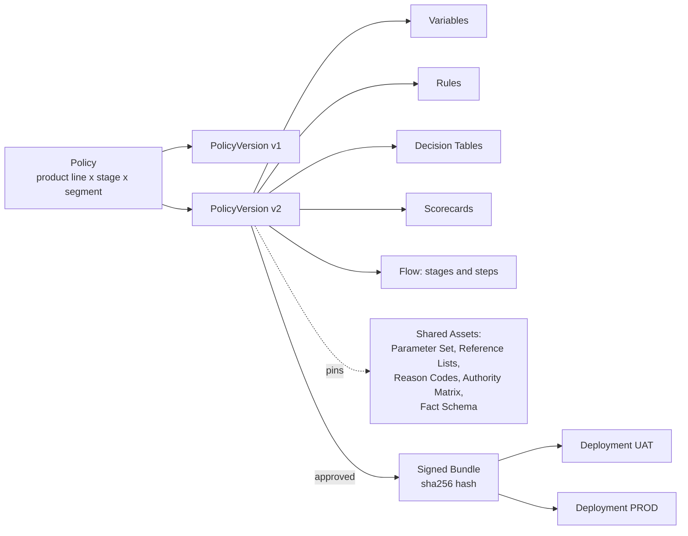
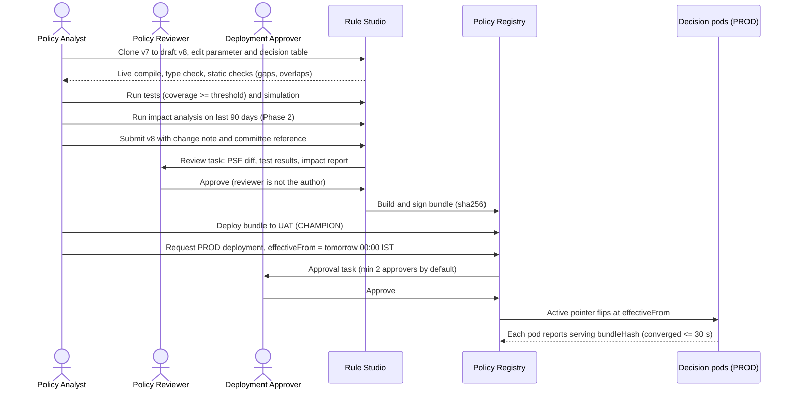
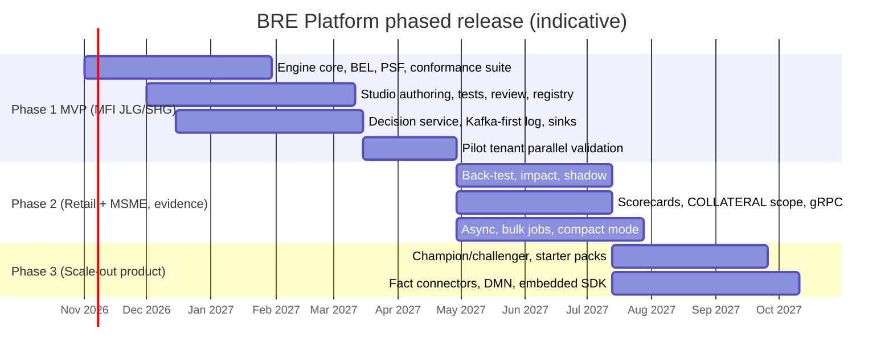

# BRE Platform: Product Requirements Document (PRD)

**Document:** `01_PRD.md` · **Version:** 2.0-draft · **Status:** Draft for review · **Date:** 2026-10-01
**Companion documents:** `00_Decisions_and_Canonical_Terms.md` (binding vocabulary and decisions D1–D15) · `02_Architecture.md` · `03_LLD.md` · `04_Rule_Authoring_Guide.md`
**Supersedes:** `BRE_BRD.pdf` v1.0 (June 2026)

---

## 0. Document control

### 0.1 Ownership

| Role | Name | Responsibility |
|---|---|---|
| Product Owner | *‹Product Owner›* | Owns scope, priorities, release plan |
| Credit Policy Lead | *‹Head of Credit Policy›* | Owns the decision model's fitness for credit policy |
| Risk & Compliance Lead | *‹Chief Compliance Officer / delegate›* | Owns the regulatory requirements (§10) |
| Engineering Lead | *‹Head of Engineering›* | Owns feasibility, NFRs, architecture alignment |
| Information Security | *‹CISO / delegate›* | Owns the security and privacy requirements |
| Audit | *‹Head of Internal Audit›* | Reviews auditability requirements |

### 0.2 Sign-off

| Role | Name | Decision (Approve / Approve with comments / Reject) | Date |
|---|---|---|---|
| Product Owner | | | |
| Credit Policy Lead | | | |
| Risk & Compliance Lead | | | |
| Engineering Lead | | | |
| Information Security | | | |

### 0.3 Change log

| Version | Date | Author | Summary |
|---|---|---|---|
| 1.0 | June 2026 | Engineering Team | Draft 1 BRD |
| 2.0-draft | 2026-10-01 | Product + Engineering | Full rewrite. See the summary of changes below. |

**What changed from Draft 1:**

1. **Product definition added.** The BRE is now a multi-tenant product that can also be deployed for a single tenant (D1). It has personas, KPIs, positioning and a phased release plan.
2. **Facts in, decision out (D2).** The BRE no longer calls bureaus, KYC or core banking. Draft 1 BRD §9.1 upstream "integrations" become facts in the request.
3. **The decision model was rebuilt (§6).** Draft 1 had flat IF-THEN-ELSE rules. Draft 2 adds:
   - versioned **Policies**;
   - typed **Variables**, **Parameters** and **Reference Lists**;
   - **Decision Tables** with hit policies;
   - **Scorecards**;
   - multi-entity **Scopes** with aggregation;
   - a **Flow** with knockout stages.
4. **The outcome model is fail-closed.** `ERROR` and `DATA_MISSING` can never lead to `APPROVE`. This fixes Draft 1's fail-open path (review B2).
5. **Versioning moved up a level.** Draft 1 versioned and activated individual rules. Draft 2 approves at the **policy-version** level and deploys a signed **Bundle** atomically, so rollback and replay are exact (review B7).
6. **The deviation model became data.** An authority matrix decides who must approve. Approvals are bound to the approved value and have an expiry. No role hierarchy is hard-coded (review R7).
7. **New capabilities:** shadow runs, champion/challenger, impact analysis, coverage-gated tests, reason codes for customer communication, and a regulatory and governance section.
8. **NFRs are tighter and measurable.** p99 is 100 ms including the durable write (was 500 ms). 5,000 decisions/s per cell. RPO 0. Activation and rollback converge in 30 s.
9. **Requirements are renumbered** to `FR-<AREA>-nnn` with MoSCoW priority, phase and acceptance criteria. Appendix A maps every Draft 1 ID to its Draft 2 replacement.

---

## 1. Executive summary

The **BRE Platform** is a decisioning product for Indian lenders. Credit policy is written as versioned, testable, auditable assets by the people who own the policy, not hard-coded by developers, and it is executed at high volume by a stateless, deterministic engine.

A lender's origination system (LOS) sends the BRE the **facts** of an application at each stage of the journey. Facts include the applicants, the group and its members, households, bureau tradelines, bank-statement summaries, collateral and business financials. The BRE returns:

- a **Decision**: `DECLINE`, `REFER`, `APPROVE_WITH_DEVIATION` or `APPROVE`;
- per-rule and per-entity results;
- the **deviations** raised and the **authority level** each one needs;
- computed **outputs**, such as eligible amount;
- **reason codes** usable in customer communication.

Every decision is durably recorded before the response returns. Any decision can be **replayed exactly**, years later, against the signed policy bundle that produced it.

**Policy analysts** build and change policy in the **Rule Studio**:
1. author in the studio;
2. test against stored test cases, with coverage measured;
3. simulate, back-test and run an impact analysis on historical decisions;
4. submit for maker-checker review;
5. deploy, with approval, as an immutable, signed bundle;
6. roll back within 30 seconds if needed.

None of this needs a software release.

The MVP (Phase 1) targets **microfinance group lending (JLG and SHG)**. It has the hardest entity model in Indian lending (group → members → households), and the most regulation-driven policy (the RBI microfinance framework and SRO guardrails). Retail and MSME follow in Phase 2. The platform is multi-tenant from Phase 1 (D1): tenant isolation, provisioning and quotas ship in the MVP. Starter policy packs, fact connectors, champion/challenger and two-region active-active as the SaaS default follow in Phase 3.

**Headline targets:**
- policy-change lead time cut from 2–4 weeks to **≤ 1 business day**;
- **≥ 90%** of policy changes made with no engineering involvement;
- p99 decision latency **≤ 100 ms**, including the durable write;
- **5,000 decisions/s** sustained per cell, scaling linearly with more cells;
- **100%** replay fidelity.

---

## 2. Problem and opportunity

### 2.1 Lender pain points

| # | Pain | Consequence |
|---|---|---|
| P1 | Credit policy is hard-coded in LOS services, stored procedures or spreadsheets maintained by IT | A cut-off change takes 2–4 weeks and a full regression cycle. Policy committees decide faster than IT can ship. |
| P2 | The same rule is implemented in several places (LOS, mobile app, batch jobs) | Inconsistent decisions for the same customer. Disputes. Audit findings. |
| P3 | Nobody can say *which version of policy* produced a past decision | Grievance redressal, internal audit and RBI inspections need manual reconstruction. Some answers cannot be produced at all. |
| P4 | No safe way to test a policy change on real history before going live | Changes are made blind. Approval rates swing unexpectedly, and portfolio quality only shows the effect months later. |
| P5 | Deviations are handled on email or paper, with an authority hierarchy that lives in people's heads or in code | Approvals at the wrong level. Approvals reused after the facts changed. Weak evidence for auditors. |
| P6 | Rules fail open: an exception or missing data is silently treated as a pass | Loans approved that policy would have declined. This is a credit-loss and conduct risk. |
| P7 | Rejection reasons are not standardised | Hard to comply with the requirement to communicate rejection reasons in writing (Fair Practices Code). Poor customer experience. |
| P8 | Regulatory thresholds (MFI household income ceiling, repayment-obligation cap, SRO guardrails, LTV caps) are buried in code | Regulatory changes are slow, and it is hard to prove compliance on a given date. |
| P9 | Commercial decision engines are expensive, licensed per decision or per core, and not built for the Indian lending data model | NBFC-MFIs and smaller NBFCs cannot afford them. Banks pay for heavy customisation. |

### 2.2 Market context

| Segment | Characteristics | What they need from a BRE |
|---|---|---|
| **NBFC-MFIs and SFBs (microfinance)** | Very high volume of small-ticket loans. Group lending (JLG/SHG). Field-led origination on tablets. Thin-file borrowers. Policy driven by the RBI microfinance framework and SRO guardrails. | Group/member/household evaluation. Regulatory parameters. Low cost per decision. Quick policy changes when guardrails move. |
| **Banks (retail and MSME)** | Many products, strict IT governance, on-prem preference, maker-checker culture, an internal audit function | Segregation of duties, signed artifacts, replay, an on-prem deployment option, integration with existing LOS. |
| **NBFCs (retail: PL, consumer durable, gold, LAP)** | Digital journeys, high STP ambition, co-lending partnerships | Low latency, champion/challenger, bank-statement (Account Aggregator) facts, reason codes, cost efficiency. |
| **HFCs** | Secured lending, LTV-driven, longer tenures | LTV slabs, age at maturity, collateral scope, income-assessment tables. |

### 2.3 Competitive positioning

| Alternative | Strengths | Gaps this product addresses |
|---|---|---|
| **FICO Blaze Advisor / FICO Decision Modeler** | Mature rules engine, strong decision tables, widely deployed | Licence cost. Generic data model with no Indian lending fact model. Group lending is not first-class. Heavy implementation effort. |
| **Experian PowerCurve (Strategy Management / Originations)** | Strong credit-strategy tooling, bureau ecosystem | Licence cost and bureau ecosystem lock-in. Customisation needs vendor services. Indian MFI group lending is not native. |
| **Provenir** | Modern cloud decisioning, data-orchestration focus | Data orchestration is bundled into decisioning, which conflicts with deterministic replay. Cost. Data-residency fit varies. |
| **Pega Decisioning (Customer Decision Hub)** | Strong at next-best-action and case management | Oriented to marketing and case management rather than credit policy. Heavy platform footprint. |
| **Drools / Apache KIE / DMN (open source)** | Free, standards-based (DMN, FEEL) | Rules are code (DRL) or need DMN modelling skills. No lending model, governance, tenancy, impact analysis or replay out of the box. Assembly required. |
| **In-house code and stored procedures** | Full control | All of the pain points in §2.1. |

### 2.4 Differentiators

1. **An India-native lending fact model:** group, member, household, bureau tradelines, Account Aggregator bank-statement summaries, GST and banking turnover. It comes with **starter policy packs** (Phase 3) for the RBI microfinance framework and SRO guardrails.
2. **Policy as versioned, signed bundles.** Activation is atomic, rollback takes 30 seconds, and **replay is exact** and verifiable years later (D5, D7, D8).
3. **Fail-closed by design.** A missing datum or an engine error can never approve a loan (D9).
4. **A safe, decimal-native expression language (BEL)** that business analysts can read. No code-execution risk, and no floating-point errors on money or ratios (D3).
5. **Impact analysis before every change.** The analyst sees which applications would flip and how the deviation load shifts across authority levels, before approval.
6. **Highly scalable, low cost per decision.** A stateless engine, a cell architecture and a Kafka-first decision log. The same artifacts run as multi-tenant SaaS in India or single-tenant on-prem (D1, D6, D14).
7. **Open dependencies only** (Maven Central and npm). No per-decision licence fees for third-party engines.

---

## 3. Vision, goals, non-goals, KPIs

### 3.1 Vision

> Every lending decision in an institution is made by policy that its owners can read, test, approve and prove. It is executed identically every time, at any volume, and can be explained to a customer, an auditor or a regulator in minutes.

### 3.2 Goals

| ID | Goal |
|---|---|
| G1 | Credit policy owners change policy without software releases, safely and with maker-checker. |
| G2 | Every decision is durable, explainable and exactly replayable. |
| G3 | Decisioning scales horizontally to national-scale volume at low and predictable latency. |
| G4 | Regulatory thresholds are explicit, parameterised, reviewed and provable as of any date. |
| G5 | Policy changes are evidence-based: tested, simulated, back-tested and impact-assessed before approval. |
| G6 | The product serves many lenders (multi-tenant) and is deployable on-prem for a single lender. |

### 3.3 Non-goals

| ID | Non-goal | Where it lives instead |
|---|---|---|
| NG1 | Fetching data from bureaus, KYC, screening, core banking or Account Aggregators | Caller systems in Phases 1–2; optional **Fact Connectors** in Phase 3 (D2). Connectors never sit on the decision hot path. |
| NG2 | Running the deviation-approval workflow (inboxes, approvals, notifications to approvers) | The caller's LOS or workflow system. The BRE computes the required authority and validates returned approvals (D10). |
| NG3 | Pricing (ROI, fees) | A separate pricing engine. It may consume BRE outputs. |
| NG4 | Limit reservation and portfolio exposure accounting | A limit-management or exposure system. The BRE consumes `portfolio` facts supplied by the caller. |
| NG5 | Customer-facing UI and letter generation | LOS and communication systems. The BRE supplies reason codes and customer text. |
| NG6 | Training or hosting ML models | Out of scope for Phases 1–2. Phase 3 may host scorecards and models with model-risk controls. |
| NG7 | Stateful fraud velocity counting ("same mobile on 3 applications in 30 days") | A fraud or feature service. The BRE consumes the resulting signals as facts. |

### 3.4 Success KPIs

Baselines marked *(measure)* are captured during the first pilot tenant's onboarding.

| KPI | Definition | Baseline | Phase-1 target | Phase-3 target |
|---|---|---|---|---|
| K1 Policy-change lead time | From credit-committee approval to live in PROD, median | 2–4 weeks (Draft 1 BRD §2.1) | ≤ 1 business day | ≤ 4 hours |
| K2 No-engineering share | % of PROD policy deployments with no engineering ticket | ~0% *(measure)* | ≥ 70% | ≥ 90% |
| K3 Decision latency | Server-side p99 including durable write, 100-rule policy, ≤ 64 KB facts | 500 ms target (Draft 1) | ≤ 100 ms | ≤ 100 ms |
| K4 Availability | Decision API monthly availability | n/a | 99.95% | 99.99% (two-region active-active) |
| K5 Replay fidelity | % of sampled decisions whose replay matches the stored outcome exactly | n/a | 100% (daily sample ≥ 10,000) | 100% |
| K6 Fail-open incidents | Decisions recorded as APPROVE while any rule was ERROR or DATA_MISSING | Unknown *(measure)* | 0 | 0 |
| K7 Audit-query turnaround | Time to produce a decision dossier for a given application | Days *(measure)* | ≤ 15 minutes | ≤ 5 minutes |
| K8 Pre-change evidence | % of PROD deployments with a back-test or impact analysis attached | ~0% | n/a (Phase 2 capability) | ≥ 95% |
| K9 Rollback time | Rollback requested → all pods serving the previous bundle, p99 | n/a | ≤ 30 s | ≤ 30 s |
| K10 Policy-defect escape rate | Sev-1/Sev-2 incidents caused by a policy change, per quarter | *(measure)* | ≤ 1 | 0 |
| K11 Tenant onboarding | Contract signature → first PROD decision, for an MFI tenant using the starter pack | n/a | n/a | ≤ 10 business days |
| K12 Cost per decision | Infrastructure cost per 1,000 decisions at design load | *(measure)* | Published and tracked | Reduced ≥ 30% from the Phase-1 figure |

---

## 4. Personas and jobs-to-be-done

| Persona | Role (00 §3.12) | Context | Jobs-to-be-done | Pains today |
|---|---|---|---|---|
| **Priya, Policy Analyst** | `POLICY_AUTHOR` | Credit policy team; strong in Excel and credit, no coding | Turn a committee decision into policy the same day. Prove it does what the committee intended. See its effect before it goes live. | Waits weeks for IT. Cannot test. Cannot see impact. |
| **Rajesh, Credit Policy Head** | `POLICY_REVIEWER` | Owns the credit policy document; chairs the credit committee | Review exactly what changed, in readable form, with evidence. Approve or send back with comments. | Reviews screenshots and emails. Cannot see the real logic. |
| **Anita, Risk Analyst** | `RISK_ANALYST` | Portfolio risk; monitors approval rates and early delinquency | Back-test a proposed cut-off. Monitor rule hit rates and drift. Run challenger strategies. | Needs IT to pull data. No champion/challenger. |
| **Vikram, Deployment Approver** | `DEPLOYMENT_APPROVER` | CRO office or change-advisory function | Approve the move to production with committee reference and evidence. Roll back instantly if something goes wrong. | No atomic switch. Rollback means a redeploy. |
| **Meera, Auditor / Compliance** | `AUDITOR` | Internal audit, compliance, RBI inspection support | Reconstruct any decision and the policy behind it. Verify maker-checker and change evidence. Check regulatory parameters as of a date. | Manual reconstruction. Missing evidence. |
| **Suresh, Ops Analyst** | `OPS_VIEWER` | Operations or credit-ops desk | Look up why an application was referred or declined. Spot error and data-missing spikes. | Calls IT for every query. |
| **Arjun, LOS Integration Engineer** | System client (`decisions:evaluate`) | Builds the lender's LOS or mobile backend | Integrate once against a stable, versioned contract. Know exactly which facts to send. Get clear errors. | Contracts change with every rule. Rules duplicated in the LOS. |
| **Kavita, Tenant Admin** | `TENANT_ADMIN` | The lender's IT administrator | Configure users, roles, environments, stages, product lines, approval settings, retention. | Not applicable today. |
| **Platform Operator** | `PLATFORM_ADMIN` | The SaaS operator's SRE team | Provision tenants, assign cells, set quotas, meet SLOs, handle incidents. | Not applicable today. |

---

## 5. Scope by vertical

### 5.1 How to read the policy-check catalogues

The catalogues below are **representative**. They show the kinds of checks each vertical needs and the model constructs each check requires. **They are not a lender's policy.** Every threshold is a **Parameter**, and each tenant sets its own values.

- Values shown as "e.g." are illustrative.
- Values tied to regulation are marked **(confirm current value with compliance)**, because regulators and SROs revise them.

Column key:
- **Scope**: the entity the check runs against (00 §3.2).
- **Construct**: R = Rule, DT = Decision Table, SC = Scorecard, V = Derived Variable, O = Output.
- **Typical outcome**: what failing the check usually yields.

### 5.2 MFI group lending: JLG and SHG (Phase 1, MVP)

**Context:**
- **Who borrows:** collateral-free loans to low-income households, usually through groups. In a **JLG** (joint liability group, typically 4–10 members) members are jointly liable. An **SHG** (self-help group, typically 10–20 members) borrows as a group and on-lends to members.
- **What drives policy:** the RBI microfinance framework sets a household-income ceiling for a loan to qualify as microfinance, and caps the household's total loan repayment obligations as a share of monthly household income. SRO guardrails cap the number of lenders and total indebtedness per borrower.
- **What the BRE must handle:** member-level checks rolled up to group level, and household-level affordability.

| # | Check | Scope | Construct | Parameters (illustrative) | Typical outcome |
|---|---|---|---|---|---|
| M1 | **Household income ceiling for microfinance eligibility**: annual household income ≤ ceiling | HOUSEHOLD | R | `MFI_HH_ANNUAL_INCOME_CEILING` (e.g. ₹3,00,000, *confirm current value with compliance*) | FAIL (not a microfinance loan under this product) |
| M2 | **Household repayment-obligation cap**: (existing monthly obligations + proposed instalment) ≤ cap% × monthly household income | HOUSEHOLD | V + R | `MFI_HH_OBLIGATION_CAP_PCT` (e.g. 50%, *confirm current value with compliance*) | FAIL, or DEVIATION if tenant policy allows a band |
| M3 | **Lender-count guardrail**: distinct lenders with open microfinance tradelines, including this lender if new, ≤ cap | MEMBER | V (`distinctCount`) + R | `MFI_MAX_LENDERS` (SRO guardrail, *confirm current value with compliance*) | FAIL |
| M4 | **Total-indebtedness guardrail**: open unsecured outstanding + proposed amount ≤ cap | MEMBER | V (`sum` over filtered tradelines) + R | `MFI_INDEBTEDNESS_CAP` (SRO guardrail, *confirm current value with compliance*); lists `UNSECURED_ACCOUNT_TYPES`, `OPEN_TRADELINE_STATUSES` | FAIL or DEVIATION per tenant policy |
| M5 | **Bureau delinquency**: no tradeline with DPD ≥ X in the last N months | MEMBER | V (time window) + R | `MFI_DPD_THRESHOLD` (e.g. 60), `MFI_DPD_WINDOW_MONTHS` (e.g. 12) | FAIL |
| M6 | **Write-off / settled / suit-filed history** within window | MEMBER | V + R | `MFI_ADVERSE_STATUS_LIST`, `MFI_ADVERSE_WINDOW_MONTHS` | FAIL or REFER |
| M7 | **No-hit bureau** (thin file) handling | MEMBER | R with `onMissing` | `MFI_NTC_ALLOWED` (Boolean) | PASS, REFER or DEVIATION by policy (never silently FAIL) |
| M8 | **Member age band** at application and at loan maturity | MEMBER | R | `MFI_MIN_AGE`, `MFI_MAX_AGE_AT_MATURITY` | FAIL |
| M9 | **Member KYC status** verified, by an accepted method | MEMBER | R | list `ACCEPTED_KYC_METHODS` | REFER (pending) / FAIL (failed) |
| M10 | **Group size** within band for the group type | GROUP | DT (type × size) | `JLG_MIN_SIZE`, `JLG_MAX_SIZE`, `SHG_MIN_SIZE`, `SHG_MAX_SIZE` | FAIL |
| M11 | **Group vintage**: months since formation ≥ minimum for this cycle | GROUP | DT (cycle × vintage) | `GROUP_MIN_VINTAGE_BY_CYCLE` | FAIL / DEVIATION |
| M12 | **Cycle progression**: loan amount within the band for the group's cycle number | MEMBER | DT (cycle → max amount) | Table rows per cycle | DEVIATION above band, FAIL above hard cap |
| M13 | **Village / area risk category** | GROUP | DT (FIRST hit) | Category rows A–E | PASS / DEVIATION / FAIL. Fixes Draft 1 SHG0003 (review B3). |
| M14 | **One member per household in the same group** (no two members share `householdRef`) | GROUP | V (`distinctCount`) + R | none | FAIL |
| M15 | **Group aggregation**: group outcome derived from member outcomes, e.g. refer the group if ≥ 20% of members deviate | GROUP | Aggregation `THRESHOLD` | `GROUP_MEMBER_DEVIATION_REFER_PCT` | REFER |
| M16 | **Screening knockout**: sanctions or PEP hit on any member | MEMBER (KNOCKOUT stage) | R | none | FAIL (DECLINE) / REFER on PEP per policy |
| M17 | **Eligible amount per member** = min(cycle cap, household affordability-derived cap, requested) | MEMBER | V + O | Cycle table, `MFI_HH_OBLIGATION_CAP_PCT` | Output `eligibleAmount` |
| M18 | **Repayment frequency allowed** for the product (weekly, fortnightly, monthly) | APPLICATION | R | list `MFI_ALLOWED_FREQUENCIES` | FAIL |

**Fact dependencies** (00 §3.9):
- `group` (`type`, `formedOn`, `cycleNumber`, `memberPartyRefs`, `villageRiskCategory`);
- `parties[role=MEMBER]` with `bureauReports.tradelines`, `kyc`, `dateOfBirth`, `householdRef`, `screening`;
- `households[]` with `annualIncome` and `monthlyRepaymentObligations`.

**Who supplies household obligations.** `monthlyRepaymentObligations` may be supplied by the caller, or derived in a policy from bureau tradelines plus `declaredObligations`. The policy states which. Deriving it is the recommended pattern, because then the computation is versioned and reviewed with the rest of the policy.

### 5.3 Retail: PL, HL, LAP, Gold (Phase 2)

| # | Check | Scope | Construct | Parameters (illustrative) | Typical outcome |
|---|---|---|---|---|---|
| RT1 | **Bureau score cut-off** by product and segment, with NTC handling | PARTY (APPLICANT, CO_APPLICANT) | DT (product × score band) | Score bands per product | FAIL / DEVIATION / PASS; NTC routes via `missing` row |
| RT2 | **FOIR** (EMI-to-income): (existing EMIs + proposed EMI) / net monthly income ≤ cap, by income band | APPLICATION (combined income) | V + DT | `FOIR_CAP_BY_INCOME_BAND` (e.g. 50–65%) | DEVIATION / FAIL |
| RT3 | **Income verification source**: verified salary credits from bank statement (Account Aggregator) vs declared income | PARTY | V (`avg` of `salaryCredits`) + R | `INCOME_VARIANCE_TOLERANCE_PCT` | REFER if variance exceeds tolerance |
| RT4 | **LTV slabs** (HL/LAP): loan / collateral market value ≤ slab cap by loan amount | COLLATERAL / APPLICATION | DT (amount band → max LTV) | HL slabs by loan size (*confirm current value with compliance*), LAP caps per policy | FAIL / DEVIATION |
| RT5 | **Gold loan LTV**: loan / eligible gold value ≤ cap | COLLATERAL | DT | `GOLD_LTV_CAP` by ticket size (*confirm current value with compliance*) | FAIL |
| RT6 | **Age at maturity**: applicant age at loan maturity ≤ max, by employment type | PARTY | DT | `MAX_AGE_AT_MATURITY_BY_EMPLOYMENT` | FAIL / DEVIATION |
| RT7 | **Enquiry velocity**: unsecured enquiries in the last 90 days ≤ N | PARTY | V (time window) + R | `MAX_ENQUIRIES_90D` | REFER / FAIL |
| RT8 | **DPD history**: max DPD in the last 12/24 months | PARTY | V + DT | DPD × window grid | FAIL / DEVIATION |
| RT9 | **Banking conduct**: inward cheque/ECS bounces in 6 months ≤ N; average monthly balance ≥ X% of EMI | PARTY | V + R | `MAX_BOUNCES_6M`, `MIN_ABB_TO_EMI_PCT` | REFER / FAIL |
| RT10 | **Employment / business stability** (months in current job or business) | PARTY | R | `MIN_EMPLOYMENT_MONTHS` | DEVIATION |
| RT11 | **Co-applicant rules**: required co-applicant for amount above X; co-applicant also passes bureau checks | APPLICATION / PARTY | R + aggregation | `COAPP_REQUIRED_ABOVE` | FAIL / REFER |
| RT12 | **Eligible amount** = min(FOIR-based, LTV-based, product max, multiplier × income) | APPLICATION | V + O | Product table | Output `eligibleAmount`, `maxTenureMonths` |

### 5.4 MSME: Term Loan and Working Capital (Phase 2)

| # | Check | Scope | Construct | Parameters (illustrative) | Typical outcome |
|---|---|---|---|---|---|
| S1 | **DSCR**: (PAT + depreciation + interest) / (principal + interest due) ≥ min | APPLICATION (business) | V + DT (by sector) | `MIN_DSCR` (e.g. 1.25) | FAIL / DEVIATION |
| S2 | **Current ratio**: current assets / current liabilities ≥ min (WC) | APPLICATION | V + R | `MIN_CURRENT_RATIO` | DEVIATION |
| S3 | **Leverage (TOL/TNW)** ≤ max | APPLICATION | V + R | `MAX_TOL_TNW` | DEVIATION / FAIL |
| S4 | **Interest coverage**: EBITDA / interest ≥ min | APPLICATION | V + R | `MIN_ICR` | DEVIATION |
| S5 | **Turnover triangulation**: GST turnover vs banking turnover variance ≤ tolerance | APPLICATION | V + R | `TURNOVER_VARIANCE_TOLERANCE_PCT` | REFER |
| S6 | **Business vintage** ≥ min | APPLICATION | R | `MIN_VINTAGE_MONTHS` | FAIL |
| S7 | **Promoter / director checks**: bureau, DPD and adverse status for **each** promoter | PARTY (PROMOTER, DIRECTOR) | R + aggregation `WORST` | As retail RT1/RT8 | FAIL / DEVIATION |
| S8 | **Sector exposure headroom**: proposed amount ≤ (sector limit − current exposure), using caller-supplied `portfolio` facts | APPLICATION | R | none (from facts) | REFER / DEVIATION. The BRE does not reserve the limit (NG4). |
| S9 | **Restricted / negative sector** | APPLICATION | R (`in list.RESTRICTED_SECTORS`) | List | FAIL |
| S10 | **WC assessment output**: e.g. turnover-method limit = % of projected turnover | APPLICATION | V + O | `WC_TURNOVER_PCT` | Output `assessedLimit` |

### 5.5 Cross-cutting (all verticals)

| # | Check | Notes |
|---|---|---|
| X1 | **Sanctions / PEP / negative list** | Screening is done upstream. The BRE consumes `screening.sanctionsHit`, `pepHit`, `negativeListHit` and `matchScore` as facts. Usually placed in a `KNOCKOUT` stage. |
| X2 | **Fraud signals** | Device, velocity and identity-mismatch signals arrive as facts (`ext` or a future schema block). The BRE applies thresholds; it does not compute velocity (NG7). |
| X3 | **KYC completeness** | The status and method of each KYC verification. Raw Aadhaar numbers are prohibited (§10.5). |
| X4 | **Dedupe outcome** | Facts from the caller's dedupe service, for example `ext.dedupe.matchType`. |
| X5 | **PSL classification** | A computed output. A decision table maps (product, purpose, borrower category, amount) to a priority-sector category, giving the output `pslCategory`. |
| X6 | **STP eligibility** | Derived by the engine (00 §3.5): `stpEligible = true` only for a clean `APPROVE`. |
| X7 | **Consent presence** | `consent.consentRef` and `purposeCode` must be present when the tenant makes them mandatory (FR-GOV-007). |

### 5.6 Out of scope (all phases unless stated)

- **Data acquisition** from bureaus, KYC, screening, Account Aggregators or GST: the caller supplies facts. Phase 3 adds optional Fact Connectors as a **separate component** that produces fact snapshots. They never sit on the decision hot path.
- **Pricing** (ROI, processing fee, insurance).
- **Limit reservation** and exposure booking.
- **The deviation-approval workflow:** inboxes, approver assignment, notifications to approvers.
- **Customer-facing UI** and letter or notice generation.
- **Collections strategy and early-warning decisioning.** These can reuse the engine through bulk jobs in Phase 3, but need their own fact model and are not specified here.

---

## 6. Decision model overview (business language)

### 6.1 The pieces

| Concept | In plain words | Example |
|---|---|---|
| **Policy** | The rulebook for one decision point: a product line, a stage and optionally a segment | "JLG, credit underwriting" |
| **Policy Version** | One frozen edition of that rulebook. Edited only while in draft. Approved as a whole. | v7 of the JLG underwriting policy |
| **Fact** | Information the lender sends about the application | Member date of birth, bureau tradelines, household income |
| **Variable** | A named value, read from a fact or calculated from other values | `memberUnsecuredOutstanding` = total balance of open unsecured loans |
| **Parameter** | A named threshold, kept separate from logic so it can change under maker-checker without touching rules | `INDEBTEDNESS_CAP` |
| **Reference List** | A named list of values used in checks | `UNSECURED_ACCOUNT_TYPES` |
| **Rule** | One check: *when* it applies, *what* must be true, and *what happens* if it is not | "Member indebtedness ≤ cap, else deviation" |
| **Decision Table** | A grid of conditions and results for multi-branch logic, with a stated hit policy | Village risk A/B → pass, C → deviation, D/E → fail |
| **Scorecard** | Points for characteristics, added into a score, with reasons for the weakest characteristics | Application score |
| **Flow** | The order in which checks run. A *knockout* stage stops early on any FAIL. | Knockout → Eligibility → Scoring |
| **Scope** | Who a check is about: the application, each party, the group, each member, each household, each collateral | Age check runs once per MEMBER |
| **Aggregation** | How per-person results combine into a group or application result | Group refers if ≥ 20% of members deviate |

### 6.2 Outcomes (00 §3.5)

Each check produces one **Rule Status**:

| Status | Meaning |
|---|---|
| `PASS` | The check was satisfied. |
| `DEVIATION` | Eligible only with approval from a stated authority. |
| `REFER` | Needs manual underwriting. |
| `FAIL` | Not eligible. |
| `NOT_APPLICABLE` | The rule's precondition was false. |
| `DATA_MISSING` | A needed fact was absent and the rule's policy for missing data applied. |
| `ERROR` | The engine could not evaluate the rule. Always treated as REFER. |

The application gets **one Decision**. The first matching line wins:

| Precedence | Condition | Decision |
|---|---|---|
| 1 | Any `FAIL` | **DECLINE** |
| 2 | Otherwise any `REFER`, `DATA_MISSING` or `ERROR` | **REFER** |
| 3 | Otherwise any deviation not covered by a valid approval | **APPROVE_WITH_DEVIATION** |
| 4 | Otherwise | **APPROVE** |

> **Fail-closed guarantee:** no combination of errors or missing data can produce `APPROVE`.

### 6.3 Deviations and authority

- A deviating rule names a **deviation type** and a **measure**: the value that breached policy, for example a total indebtedness of ₹2,35,000.
- The tenant's **Authority Matrix** maps deviation type, product line, amount band and (optionally) segment to the **authority level** required, for example `L3`.
- The BRE returns the required approvals. With routing mode `HIGHEST_ONLY` that is one approval at the highest level; with `EACH` it is one approval per deviation.
- The lender's workflow obtains the approvals. On re-evaluation it sends them back as `deviationApprovals`.
- An approval is honoured only while it is unexpired, was granted at a sufficient level, and the current measure is no worse than the approved value. If facts deteriorate after approval, the deviation is raised again.

### 6.4 Reason codes

- Every non-PASS result carries a **reason code**.
- Each code has internal text, customer-facing text per language, a category, and an `adverse` flag.
- Up to four adverse reasons, ordered by rule priority, form the **customer-facing reasons** for a decline. These support the requirement to communicate rejection reasons in writing (§10.1).

---

## 7. User journeys

### 7.1 J1: Policy change, from committee decision to production

**Trigger:** the credit committee lowers the member indebtedness cap and makes the village-risk category C a deviation instead of a pass.

Steps:
1. The analyst **clones** the active version into a new DRAFT (FR-AUTH-009).
2. The analyst edits the parameter set (a new parameter-set version) and the `GRP_VRM_CATEGORY` decision table. The studio compiles on every edit and shows type errors, gaps and overlaps inline (FR-AUTH-003, FR-AUTH-005).
3. The analyst adds or updates **test cases**, runs them, and meets the coverage threshold (FR-TEST-001, FR-TEST-003).
4. *(Phase 2)* The analyst runs an **impact analysis** over 90 days of decisions. It shows which applications flip, the change in approval and refer rates, and the extra deviation load at each authority level (FR-TEST-007).
5. The analyst **submits**. This needs a change note and a committee reference, all tests passing and no static-check errors (FR-LIFE-002, FR-GOV-004).
6. The reviewer sees a **PSF diff**, the test results and the impact report, then approves or requests changes (FR-LIFE-003). On approval the bundle is built and signed (FR-LIFE-004).
7. The analyst deploys to UAT. The LOS team runs its regression suite.
8. A PROD deployment is requested with `effectiveFrom`. The configured number of `DEPLOYMENT_APPROVER`s approve, none of whom is the author (FR-LIFE-006).
9. At `effectiveFrom` the active pointer flips. The deployment console shows each pod converging, and confirms convergence within 30 s (FR-LIFE-008).
10. The analyst watches the **outcome dashboard** for drift over the next days (FR-RPT-002).

### 7.2 J2: LOS requests decisions across the journey (MFI JLG)

| Stage (tenant-configured) | Policy | What the LOS sends | What it does with the Decision |
|---|---|---|---|
| `SOURCING` | `MFI_JLG_SOURCING` | Group, members, basic KYC status, declared household data | DECLINE → stop. REFER → field verification. APPROVE → continue. |
| `KYC` | `MFI_JLG_KYC` | KYC verification results, screening facts | KNOCKOUT on sanctions hit. REFER on pending KYC. |
| `CREDIT_UW` | `MFI_JLG_CREDIT_UW` | Bureau reports per member, households, group vintage and cycle, village risk | APPROVE_WITH_DEVIATION → route `requiredApprovals` to the workflow. Uses `eligibleAmount` per member. |
| `PRE_DISBURSAL` | `MFI_JLG_PRE_DISBURSAL` | Refreshed facts (any bureau refresh is done by the caller), `deviationApprovals[]` | APPROVE → disburse. Re-raised deviation → back to the workflow. DECLINE → hold. |

Each call:
1. The LOS sends `POST /v1/decisions` with a `requestId` (idempotency key), `applicationRef`, the policy selector and the facts (FR-EXEC-001).
2. The BRE validates the facts against the fact schema. If validation fails it returns 422 with field-level errors, and **no decision is made** (FR-EXEC-003).
3. The BRE evaluates the active bundle, records the decision durably, and responds (FR-EXEC-007).
4. If the LOS times out and retries with the same `requestId`, it receives the same decision (FR-EXEC-004).

**Grandfathering** (FR-LIFE-013, 00 §3.7a). Each response carries the `bundleHash` that made the decision, so the LOS can choose for each later call:
- `pinning: LATEST`: evaluate under the policy active at the time of the request;
- `pinning: {bundleHash}`: evaluate under the bundle that made an earlier decision.

The BRE honours a pin only if that bundle was an ACTIVE champion in the environment within `grandfatherWindowDays` (default 90). Whether to pin is part of the lender's credit policy. The BRE stays stateless and never looks up earlier decisions to decide this.

### 7.3 J3: Deviation approval loop

1. At `CREDIT_UW`, member M3 breaches `MFI_INDEBTEDNESS_CAP`. The measure is ₹2,35,000 against a cap parameter of ₹2,00,000. The BRE returns `APPROVE_WITH_DEVIATION` with the required approval `{deviationType: INDEBTEDNESS_CAP, ruleCode, entityRef: M3, measure: 235000.00, requiredLevel: L3}` (FR-DEV-001).
2. The LOS workflow routes the case to an L3 approver, who approves with `approvedValue: 235000.00`, `expiresOn: +30 days`.
3. At `PRE_DISBURSAL` the LOS sends `deviationApprovals[]`. The BRE matches the approval: same type, rule and entity; not expired; level ≥ required; current measure ≤ approved value. The rule result is annotated `DEVIATION_APPROVED`, and the Decision becomes `APPROVE` (FR-DEV-005).
4. Suppose instead that M3 took a new loan before disbursal, so the measure is now ₹2,60,000. The approval no longer covers it. The deviation is raised again for the new measure (FR-DEV-006).
5. If the approval has expired, or was granted below the required level, the deviation is raised again and the response gives the reason (FR-DEV-006, FR-DEV-009).

### 7.4 J4: Emergency rollback

1. After a PROD deployment, the ops dashboard shows the decline rate jumping from 8% to 31% (FR-RPT-004).
2. A `DEPLOYMENT_APPROVER` clicks **Roll back** on the deployment console. This creates a new deployment that points to the previous bundle (FR-LIFE-009).
3. All pods serve the previous bundle within 30 s. The console shows the convergence.
4. Every decision taken during the incident window records the bundle it used, so the affected applications can be listed precisely for re-evaluation (FR-AUD-001).
5. A post-implementation review task is created automatically (FR-LIFE-010).

### 7.5 J5: Back-test and impact analysis before a cut-off change (Phase 2)

1. The risk analyst proposes lowering a retail bureau-score cut-off from 720 to 700.
2. The analyst runs a back-test of draft v12 against PROD decisions from the last 6 months, about 1.2 million (FR-TEST-006). It completes in ≤ 30 min per million (NFR-SCALE-03).
3. The **impact report** (FR-TEST-007) shows:
   - outcome transition matrix (old Decision × new Decision);
   - approval-rate delta by product, branch and segment;
   - the list of flipped applications, masked by default;
   - deviation-load change by authority level;
   - for flipped applications that the lender has since booked, observed early delinquency, if the tenant supplies performance outcomes (Phase 3).
4. The report is attached to the submission as evidence for the reviewer and the committee (FR-GOV-004).

### 7.6 J6: Shadow run, then champion/challenger

1. **Shadow (Phase 2).** v12 is deployed in mode `SHADOW`. Every live decision is re-evaluated against v12 asynchronously, with no effect on latency or outcomes (FR-EXEC-012). After 2 weeks, the shadow diff report confirms the impact analysis on live traffic (FR-TEST-008).
2. **Challenger (Phase 3).** v12 is deployed as `CHALLENGER(1000 bp)`, so 10% of applications are decided by v12. Assignment is deterministic from `hash(tenantId, applicationRef, experimentId) mod 10000` (D8), so a re-evaluation of the same application always uses the same arm (FR-TEST-009).
3. The experiment report compares the arms on approval rate, deviation rate and, when outcome data is supplied, early delinquency. The analyst then promotes the challenger to champion or ends the experiment.

### 7.7 J7: Auditor replays a past decision

1. The auditor searches by `applicationRef` and opens the decision from 14 March (FR-AUD-001).
2. The **explanation** is regenerated by replaying the stored facts against the stored `bundleHash` and `engineVersion`. The replay must match the stored outcome; a mismatch raises an alert (FR-AUD-003, FR-AUD-004).
3. The auditor sees the PolicyVersion, its review and approval trail, the deployment approvals, the parameter values in force, and the committee reference (FR-AUD-005, FR-GOV-004).
4. The facts are masked by default. Unmasking needs a recorded reason and is itself audited (FR-AUD-008).
5. The auditor exports a **decision dossier** (FR-AUD-011).

### 7.8 J8: Regulator or customer-grievance query about a rejection

1. A customer complains that their loan was rejected without a clear reason. The grievance officer looks up the application (`OPS_VIEWER`).
2. The decision shows the **customer-facing reasons**: up to 4 adverse reason codes, with text in the customer's language if configured (FR-AUD-006, FR-AUD-007).
3. The officer can show that the reasons communicated in the rejection letter, which the LOS generated from those codes, match the recorded decision.
4. If a regulator asks for evidence, the dossier provides it: the policy version, its approval evidence, the regulatory parameters as of the decision date, and the replayed explanation.

---

## 8. Functional requirements

**Priority** uses MoSCoW: **M**ust, **S**hould, **C**ould, **W**on't-this-release. **Ph** is the delivery phase (§12).

Each requirement has at least one acceptance criterion. `AC-<AREA>-nnn` shares the number of its FR, with a letter suffix where there are several.

### 8.1 MODEL: decision model

| ID | Requirement | Pri | Ph | Acceptance criteria |
|---|---|---|---|---|
| FR-MODEL-001 | A **Policy** is identified by `(tenant, policyCode)`. It declares the product line(s), the stage and an optional segment. Product lines, stages and segments are tenant configuration, not enums. | M | 1 | AC-MODEL-001: a tenant admin creates stage `FIELD_VERIFICATION` and a policy for it without any deployment of code. |
| FR-MODEL-002 | A **PolicyVersion** is editable only while in `DRAFT`. After that its content is immutable. | M | 1 | AC-MODEL-002: any edit API call on an `IN_REVIEW`, `APPROVED` or `ARCHIVED` version returns 409 and nothing changes. |
| FR-MODEL-003 | A PolicyVersion **pins** exact versions of its Parameter Set, Reference Lists, Reason Code Catalogue, Authority Matrix and Fact Schema. A later change to a shared asset never changes an approved version. | M | 1 | AC-MODEL-003: changing a parameter value creates a new parameter-set version. Decisions under the existing bundle still use the old value. |
| FR-MODEL-004 | **Variables** are typed (00 §3.10). They are `INPUT` (from a fact path) or `DERIVED` (a BEL expression). Dependencies form a DAG, and a cycle is a compile error. | M | 1 | AC-MODEL-004: a version with a cycle `a → b → a` cannot be submitted, and the error names the cycle. |
| FR-MODEL-005 | BEL supports **collection functions** over lists with filters: `sum`, `count`, `min`, `max`, `avg`, `distinctCount`, `any`, `all`, `first`. | M | 1 | AC-MODEL-005: a derived variable summing the `currentBalance` of open unsecured tradelines returns the expected value on the conformance fixture. |
| FR-MODEL-006 | BEL supports **date and time-window** logic using `asOf`, `monthsBetween`, `daysBetween`, `addMonths`, `addDays` and `ageInYears`. Evaluation never reads the wall clock. | M | 1 | AC-MODEL-006: the same facts with different `asOf` values give different windows. The same facts with the same `asOf` always give identical results. |
| FR-MODEL-007 | **Parameters** are typed, named constants in versioned Parameter Sets. Each value is effective-dated and maker-checked, and can be tagged `REGULATORY` with a source reference and review date. | M | 1 | AC-MODEL-007: a parameter change requires a second user's approval before it can be pinned by any PolicyVersion. |
| FR-MODEL-008 | **Reference Lists** are named and versioned, with at most 100,000 entries per list in a bundle. | M | 1 | AC-MODEL-008: importing a list of 100,001 entries is rejected with guidance to supply the check as a fact. |
| FR-MODEL-009 | A **Rule** has `code`, `name`, `scope`, an optional `when`, a `check`, `onFail` (status, reasonCode, optional deviationType, measure, worseWhen), `onMissing`, optional `outputs`, and a `priority` used to order reasons. | M | 1 | AC-MODEL-009: the PSF in 00 §3.14 imports, compiles and evaluates to the expected results. |
| FR-MODEL-010 | **Decision Tables** support hit policies `FIRST`, `UNIQUE`, `PRIORITY` and `COLLECT(SUM, MIN, MAX, COUNT, LIST)`. Rows produce an outcome and/or outputs. | M | 1 | AC-MODEL-010a: the corrected Draft 1 example (village risk A/B→PASS, C→DEVIATION, D/E→FAIL) gives the intended outcome for all five categories. AC-MODEL-010b: under `UNIQUE`, an input matching two rows yields `ERROR`. |
| FR-MODEL-011 | Decision-table cells and scorecard bins use **unary tests** (00 §3.14): comparisons, ranges with open or closed ends, `in`, `-`, `missing`, and `,` meaning OR. | M | 1 | AC-MODEL-011: `[650..750)` matches 650 and 749.99 but not 750. |
| FR-MODEL-012 | **Scorecards** have characteristics with bins and points, a base score and optional scaling, and return the top-N adverse reasons. | S | 2 | AC-MODEL-012: the score equals the base plus the sum of the bin points. The adverse reasons are the N characteristics with the largest shortfall against their maximum points. |
| FR-MODEL-013 | A **Flow** orders stages and steps. A stage marked `KNOCKOUT` stops evaluation after any FAIL in it, and the remaining steps are reported `NOT_APPLICABLE` with reason `SYS_SKIPPED_KNOCKOUT`. | M | 1 | AC-MODEL-013: a sanctions hit in the knockout stage returns DECLINE, and no later-stage rule is evaluated. |
| FR-MODEL-014 | **Scopes** `APPLICATION`, `PARTY` (with a role filter), `GROUP`, `MEMBER` and `HOUSEHOLD` are available in Phase 1; `COLLATERAL` in Phase 2. A per-entity step runs once per matching entity and reports per entity. | M | 1 | AC-MODEL-014: a group of 7 members produces 7 member-level results for each MEMBER-scoped rule, each labelled with its `partyRef`. |
| FR-MODEL-015 | **Aggregations** `WORST` (default), `ALL_MUST_PASS`, `THRESHOLD(count \| percent, status) -> status` and `NONE` combine per-entity results. | M | 1 | AC-MODEL-015: with `THRESHOLD(percent >= 20, DEVIATION) -> REFER`, 2 of 10 deviating members give REFER and 1 of 10 does not. |
| FR-MODEL-016 | Overall **Decision precedence** follows 00 §3.5 exactly, and `ERROR`/`DATA_MISSING` can never produce `APPROVE`. | M | 1 | AC-MODEL-016: a property-based test over 10⁶ random rule-status combinations finds no APPROVE when any status is ERROR, DATA_MISSING, REFER or FAIL. |
| FR-MODEL-017 | **Missing data** is handled per rule through `onMissing` (`REFER` default, `FAIL`, `NOT_APPLICABLE`, `USE_DEFAULT(true|false)`, a Boolean standing in for the unknown check result; input defaults use `coalesce`). `onError` is not configurable: an error always counts as REFER and raises an alert. | M | 1 | AC-MODEL-017: a rule over an absent bureau score, with default settings, returns DATA_MISSING and the Decision is REFER. |
| FR-MODEL-018 | Policies can declare **computed outputs**, for example `eligibleAmount`, `maxTenureMonths`, `pslCategory`, `assessedLimit`, at application or entity level. | M | 1 | AC-MODEL-018: the response contains `outputs.eligibleAmount` per member, equal to min(cycle cap, affordability cap, requested) on the fixture. |
| FR-MODEL-019 | Every non-PASS result carries a **reason code** from the pinned catalogue. Referencing an unknown code is a compile error. | M | 1 | AC-MODEL-019: compilation fails when a rule references `XYZ_UNKNOWN`. |
| FR-MODEL-020 | A rule that can return DEVIATION declares a `deviationType`, a `measure` expression and `worseWhen` (`HIGHER` or `LOWER`). | M | 1 | AC-MODEL-020: a DEVIATION rule without a measure fails the static check. |
| FR-MODEL-021 | The **Fact Schema** is versioned (semantic versioning) and published as JSON Schema. It has tenant extensions under `ext{}` and field tags (`pii`, `protected`, `regulated`). | M | 1 | AC-MODEL-021: a tenant adds `ext.dedupe.matchType` in a minor schema version, and existing policies continue to compile. |
| FR-MODEL-022 | Fields tagged `protected` cannot be referenced in a `check`, `when`, table input, scorecard characteristic or derived variable without an approved **governance override** recorded on the PolicyVersion. | M | 1 | AC-MODEL-022: referencing `party.ext.religion` fails the static check unless an override record with an approver and justification exists. |
| FR-MODEL-023 | All arithmetic is **decimal**. Money is INR with scale 2. Division uses scale 10 with HALF_EVEN. Comparisons use unrounded values unless the author calls `round`. | M | 1 | AC-MODEL-023: `0.1 + 0.2 = 0.3` evaluates true. A FOIR of 0.500004 against a cap of 0.5 is "exceeds" unless rounded. |
| FR-MODEL-024 | **Expression safety:** there are no host calls, reflection, loops, recursion or user-defined functions, and functions come from a closed registry. Fuel and list-size limits produce `ERROR`. | M | 1 | AC-MODEL-024: the security test suite (including SpEL- and OGNL-style payloads) is rejected at compile time, and a deliberately expensive expression hits the fuel limit and yields ERROR (Decision REFER). |
| FR-MODEL-025 | **Starter packs:** prebuilt, parameterised policy templates for MFI JLG/SHG, retail PL and MSME TL, importable as DRAFT. | S | 3 | AC-MODEL-025: importing the MFI pack gives a compiling DRAFT whose tests all pass. |
| FR-MODEL-026 | **DMN 1.x import/export** for decision tables (DMN-compatible hit policies only). | C | 3 | AC-MODEL-026: a FIRST-hit table round-trips through DMN XML without semantic change. |

### 8.2 AUTH: Rule Studio and the BEL editor

| ID | Requirement | Pri | Ph | Acceptance criteria |
|---|---|---|---|---|
| FR-AUTH-001 | A business user can author every MODEL construct in the web studio with no code deployment, and no IDE or command line. | M | 1 | AC-AUTH-001: a `POLICY_AUTHOR` with no engineering access creates, tests and submits a new rule end to end in the studio. |
| FR-AUTH-002 | The BEL editor offers **autocomplete** for fact paths, variables, `param.*`, `list.*`, functions and the scope variables valid at the cursor. | M | 1 | AC-AUTH-002: inside a MEMBER-scoped rule, typing `member.bu` suggests `member.bureauReports`. |
| FR-AUTH-003 | **Live compile:** syntax and type errors are shown inline within 500 ms of the user pausing typing, with a message and the location. | M | 1 | AC-AUTH-003: `member.dateOfBirth > 5` shows "cannot compare Date with Decimal" at that span. |
| FR-AUTH-004 | A **fact-path browser** shows the pinned fact schema as a tree, with types, descriptions, tags (`pii`, `protected`) and a sample value. | M | 1 | AC-AUTH-004: the browser marks protected fields with a lock icon and tooltip. |
| FR-AUTH-005 | A **decision-table grid editor** supports adding, reordering and duplicating rows, and **highlights gaps and overlaps** for the chosen hit policy. | M | 1 | AC-AUTH-005: a numeric input with rows `< 600` and `[650..∞)` shows the gap `[600..650)`. |
| FR-AUTH-006 | A **scorecard editor** with bin builders and a points preview. | S | 2 | AC-AUTH-006: the bins of each characteristic are checked for full coverage of its domain, including `missing`. |
| FR-AUTH-007 | A **flow editor** shows stages and steps visually, with scope, role filter and aggregation editable per step. | M | 1 | AC-AUTH-007: reordering steps updates the PSF, and the change appears in the version diff. |
| FR-AUTH-008 | **PSF import/export** and a **semantic diff** between any two versions, showing changed rules, rows, parameters and pinned assets. | M | 1 | AC-AUTH-008: the diff of v7 against v8 lists exactly the changed table rows and the parameter-set version bump. |
| FR-AUTH-009 | **Clone** any version (including ARCHIVED) into a new DRAFT. | M | 1 | AC-AUTH-009: the clone has a new version number, `DRAFT` status, and provenance `clonedFrom`. |
| FR-AUTH-010 | **Where-used** view: for any variable, parameter, list or reason code, list the rules, tables and policies that use it. | S | 1 | AC-AUTH-010: where-used for `INDEBTEDNESS_CAP` lists every PolicyVersion that pins a parameter set containing it. |
| FR-AUTH-011 | A **static-check report** covering unused variables, unreachable rows, gaps, overlaps, unknown references, protected-attribute use, missing measures on deviation rules, and costly expressions. | M | 1 | AC-AUTH-011: submission is blocked while the report has any ERROR-severity item. |
| FR-AUTH-012 | A **change note** and a **committee reference** are mandatory on submit. Comments can be threaded on any rule or row during review. | M | 1 | AC-AUTH-012: submit without a change note is rejected. |
| FR-AUTH-013 | **Concurrent-edit protection:** optimistic locking, plus an indicator showing who else is editing the version. | M | 1 | AC-AUTH-013: two users saving the same rule from the same base version: the second gets a conflict with a merge view. |
| FR-AUTH-014 | **Search** across policies, rules, parameters and lists by code, name and text. | S | 2 | AC-AUTH-014: searching "indebtedness" returns the matching rules, parameter and reason code. |
| FR-AUTH-015 | Studio UI available in English. Further languages are configurable later. | C | 3 | AC-AUTH-015: UI strings are externalised, and a test locale renders without layout breakage. |
| FR-AUTH-016 | The studio meets **WCAG 2.1 AA**. | S | 2 | AC-AUTH-016: an automated axe audit has no serious violations, and keyboard-only authoring of a rule is possible. |

### 8.3 LIFE: lifecycle, deployment, promotion, rollback

| ID | Requirement | Pri | Ph | Acceptance criteria |
|---|---|---|---|---|
| FR-LIFE-001 | PolicyVersion states and transitions are exactly as in 00 §3.3. Any other transition is rejected. | M | 1 | AC-LIFE-001: `APPROVED → DRAFT` is rejected with 409. |
| FR-LIFE-002 | **Submit** requires: all test cases pass, coverage ≥ the tenant threshold, no ERROR-severity static checks, a change note, and a committee reference. | M | 1 | AC-LIFE-002: with one failing test, submit is rejected and the failing test is listed. |
| FR-LIFE-003 | **Segregation of duties** for version review: the reviewer is not the author, and is not anyone who edited the version. The minimum number of reviewers is set per tenant (default 1). | M | 1 | AC-LIFE-003: an editor of v8 cannot approve v8, and the API returns 403 with a SoD reason. |
| FR-LIFE-004 | Approval builds and signs the **Bundle**: IR plus pinned assets, with a content hash `sha256:…` and an Ed25519 signature. The bundle is immutable and retained for at least the decision-archive retention period. | M | 1 | AC-LIFE-004: re-building an approved version gives a byte-identical bundle hash (a reproducible build). |
| FR-LIFE-005 | A **Deployment** targets `(tenant, environment, policyCode)` with a bundle, a mode (`CHAMPION`, `CHALLENGER(bp)`, `SHADOW`) and an `effectiveFrom`. Deployments are append-only. | M | 1 | AC-LIFE-005: the deployment history for a policy is a complete, ordered, append-only list. |
| FR-LIFE-006 | **PROD deployment approval** needs the tenant-configured number of `DEPLOYMENT_APPROVER`s (default 2), none of them the version's author. | M | 1 | AC-LIFE-006: a PROD deployment with one approval stays `PENDING_APPROVAL`. |
| FR-LIFE-007 | **Scheduled activation:** a deployment becomes ACTIVE at `effectiveFrom` (tenant time zone, default IST), and the previous ACTIVE champion becomes SUPERSEDED. | M | 1 | AC-LIFE-007: a decision with `asOf` before `effectiveFrom` uses the old bundle; at or after, the new one. |
| FR-LIFE-008 | **Atomic activation and convergence:** every pod switches between bundles atomically, with no request ever evaluated against a mix. Convergence completes within 30 s at p99 and is visible per pod. | M | 1 | AC-LIFE-008: under 5,000 decisions/s load, a pointer flip shows all pods on the new hash within 30 s, and zero decisions record an unexpected hash. |
| FR-LIFE-009 | **Rollback** in one action: a new deployment pointing to a chosen previous bundle, converging within 30 s. | M | 1 | AC-LIFE-009: rollback requested → 100% of decisions on the previous hash within 30 s (supersedes Draft 1 AC-006's 60 s). |
| FR-LIFE-010 | **Expedited (emergency) change:** `EXPEDITED` deployments need 2 approvers, skip the scheduling lead time, and auto-create a post-implementation-review task due within 5 business days. | M | 1 | AC-LIFE-010: an expedited deployment without a completed PIR shows as overdue on the governance dashboard. |
| FR-LIFE-011 | **Promotion across environments and installations** by signed bundle export and import. Import verifies the signature and hash and records provenance. | M | 1 | AC-LIFE-011: a bundle with one altered byte fails import with `bundle-signature-invalid`. |
| FR-LIFE-012 | **No environment-specific overrides:** the same bundle bytes run in UAT and PROD. Environment differences may only be tenant configuration outside the bundle (endpoints, quotas). | M | 1 | AC-LIFE-012: the PROD and UAT decision records for the same deployment show the same `bundleHash`. |
| FR-LIFE-013 | **Pinning** per request (00 §3.7a): `pinning: LATEST` (default) or `pinning: {bundleHash}`. A pinned bundle is honoured only if it was an ACTIVE champion in that environment within the tenant's `grandfatherWindowDays` (default 90). Otherwise the request fails with `pinned-bundle-not-allowed`. The tenant can disable pinning per policy. | M | 1 | AC-LIFE-013a: a request pinned to the v7 hash after v8 is activated is evaluated under v7, and the decision records `pinned: true`. AC-LIFE-013b: a pin to a bundle outside the window returns `pinned-bundle-not-allowed`. |
| FR-LIFE-014 | **Archive** versions that are no longer deployable. Their bundles remain retrievable for replay. | M | 1 | AC-LIFE-014: an archived version cannot be deployed, but its decisions replay. |
| FR-LIFE-015 | **Change-freeze windows** per environment, during which non-expedited deployments cannot activate. | C | 2 | AC-LIFE-015: a scheduled deployment inside a freeze window is rejected with the next allowed time. |

### 8.4 EXEC: decision execution

| ID | Requirement | Pri | Ph | Acceptance criteria |
|---|---|---|---|---|
| FR-EXEC-001 | **Synchronous Decision API** `POST /v1/decisions` (REST/JSON, OpenAPI 3.1). | M | 1 | AC-EXEC-001: the reference MFI request returns 200 with a decision matching the conformance fixture. |
| FR-EXEC-002 | **gRPC** `bre.decision.v1.DecisionService/Evaluate` and `/Get` with the same semantics. | S | 2 | AC-EXEC-002: REST and gRPC give identical decision records for the same request. |
| FR-EXEC-003 | **Fact validation** against the pinned fact schema before evaluation. Invalid facts return 422 problem+json with every field error. No decision is recorded. | M | 1 | AC-EXEC-003: a request with `requestedAmount: "abc"` returns 422 naming the JSON pointer of the field. |
| FR-EXEC-004 | **Idempotency:** `requestId` is unique per tenant for 7 days. A repeat with identical content returns the original decision; a repeat with different content returns 409. | M | 1 | AC-EXEC-004: a retried request returns the same `decisionId` and no second record exists. |
| FR-EXEC-005 | **asOf:** the caller may supply `asOf`. If absent, it is set to the receipt time in the tenant's time zone and recorded. | M | 1 | AC-EXEC-005: the recorded `asOf` equals the supplied value when given. |
| FR-EXEC-006 | **Policy resolution** by `policyCode`, or by `(productLine, stage, segment)`. Configuration that would make resolution ambiguous is rejected at deployment time. | M | 1 | AC-EXEC-006: deploying a second policy for the same `(productLine, stage, segment)` is rejected. |
| FR-EXEC-007 | **Durable before respond:** the decision record is durably written (00 D6) before the response. If it cannot be, the API returns 503 with `Retry-After`, and **no decision is returned**. | M | 1 | AC-EXEC-007: with the decision log unavailable, the API returns 503 and no client sees an unrecorded decision. |
| FR-EXEC-008 | The **response** contains `decisionId`, Decision, `stpEligible`, per-rule and per-entity results, deviations with required authority, outputs, customer reasons, `bundleHash`, `engineVersion`, `asOf` and latency. | M | 1 | AC-EXEC-008: the response validates against the published schema. |
| FR-EXEC-009 | **Async decisions.** Shared-cell SaaS tenants call `POST /v1/decisions:async` (202 Accepted with `decisionId`; result via GET or a webhook). Dedicated cells and single-tenant installs may also produce to `bre.decision.requested.v1` and consume `bre.decision.completed.v1`. Ordering per `applicationRef`, idempotency and a DLQ apply in both cases (00 §3.13). | S | 2 | AC-EXEC-009a: a poison message lands in `.dlq` after the configured retries, and later messages are not blocked. AC-EXEC-009b: a shared-cell tenant's async request through REST is decided and retrievable by `decisionId`, and the tenant holds no Kafka credentials. |
| FR-EXEC-010 | **Bulk decision jobs** `POST /v1/decision-jobs` over input files in object storage, producing a results file and a summary. | S | 2 | AC-EXEC-010: a job of 1,000,000 cases completes within 1 hour on one cell (NFR-SCALE-02). |
| FR-EXEC-011 | **Challenger routing** is deterministic per 00 D8. | S | 3 | AC-EXEC-011: the same `applicationRef` is always routed to the same arm within an experiment. |
| FR-EXEC-012 | **Shadow evaluation** runs asynchronously from the decision log and never affects the live response or its latency. | S | 2 | AC-EXEC-012: enabling shadow on a policy changes p99 latency by < 1 ms. |
| FR-EXEC-013 | **Per-tenant rate limits and quotas**, with 429 and `Retry-After`. | M | 1 | AC-EXEC-013: a tenant exceeding its quota gets 429, and other tenants in the same cell keep their latency SLO. |
| FR-EXEC-014 | **Deadlines:** a caller-supplied deadline is honoured (evaluation is abandoned with 504 if it cannot finish in time). Fuel and list limits produce ERROR. | M | 1 | AC-EXEC-014: an expired deadline returns 504 and records no decision. |
| FR-EXEC-015 | **Per-entity results** are reported with `entityType` and `entityRef` (partyRef, groupRef, householdRef, collateralRef). | M | 1 | AC-EXEC-015: every MEMBER-scoped result has `entityRef` equal to a member `partyRef`. |
| FR-EXEC-016 | **Dry-run** (`dryRun: true`) is allowed in non-PROD environments only. It evaluates without recording, for integration testing. | S | 1 | AC-EXEC-016: a dry-run in PROD returns 400. A dry-run in UAT returns a decision marked `dryRun` and writes no record. |
| FR-EXEC-017 | **Embedded evaluation** through `bre-sdk-java`, for callers that must decide in-process (for example, offline-tolerant edge services), using signed bundles and reporting decisions asynchronously. | C | 3 | AC-EXEC-017: embedded and server decisions are identical for the conformance suite. |

### 8.5 DEV: deviations and authority

| ID | Requirement | Pri | Ph | Acceptance criteria |
|---|---|---|---|---|
| FR-DEV-001 | Each deviation in the response has `deviationType`, `ruleCode`, `entityType`, `entityRef`, `measure`, the parameter or bound breached, `reasonCode` and `requiredLevel`. | M | 1 | AC-DEV-001: an indebtedness deviation for member M3 reports M3's `partyRef` and the computed measure. |
| FR-DEV-002 | The **Authority Matrix** is a versioned Shared Asset. It maps `(deviationType, productLine, amount band[, segment])` to an authority level from the tenant's ordered list of levels. No hierarchy is hard-coded. | M | 1 | AC-DEV-002: a tenant adds level `ZONAL_HEAD` between `L3` and `CREDIT_HEAD` without any code change, and routing follows it. |
| FR-DEV-003 | **Routing mode** per tenant: `HIGHEST_ONLY` (one approval at the highest required level) or `EACH` (one per deviation). | M | 1 | AC-DEV-003: two deviations requiring L3 and L4 give one L4 approval under `HIGHEST_ONLY`, and one L3 plus one L4 under `EACH`. |
| FR-DEV-004 | **Unmapped deviation:** if no matrix row matches, the rule's result is REFER with reason `DEV_NO_AUTHORITY`, and an alert is raised. | M | 1 | AC-DEV-004: removing the matrix row for `VRM_CATEGORY_C` makes a category-C group REFER, not APPROVE_WITH_DEVIATION. |
| FR-DEV-005 | **Approval matching:** a `deviationApprovals[]` entry covers a deviation only if all of these hold: deviation type, rule code and entity match; the approval is unexpired at `asOf`; the approved level ≥ the required level; and the current measure is not worse than `approvedValue` per `worseWhen`. A covered deviation is annotated `DEVIATION_APPROVED`. | M | 1 | AC-DEV-005: the J3 fixture gives APPROVE when the measure is ≤ ₹2,35,000 and re-raises the deviation at ₹2,60,000. |
| FR-DEV-006 | Expired or non-matching approvals are ignored and the deviation is raised again. The response says why the approval was not honoured (`EXPIRED`, `LEVEL_INSUFFICIENT`, `MEASURE_WORSE`, `NO_MATCH`). | M | 1 | AC-DEV-006: an approval expired yesterday is reported with `EXPIRED` and has no effect. |
| FR-DEV-007 | Every raised deviation is published on `bre.deviation.raised.v1`. | S | 1 | AC-DEV-007: a consumer receives one event per raised (not covered) deviation, keyed `tenantId:applicationRef`. |
| FR-DEV-008 | The deviation **amount band** is evaluated on a tenant-chosen amount (requested, recommended, approved or eligible), set per matrix. | S | 1 | AC-DEV-008: changing the band basis from requested to approved amount changes the required level on the fixture as expected. |
| FR-DEV-009 | An approval granted at an insufficient level is not honoured (`LEVEL_INSUFFICIENT`). | M | 1 | AC-DEV-009: an L2 approval for an L3 deviation leaves the Decision APPROVE_WITH_DEVIATION. |

### 8.6 TEST: tests, simulation, back-testing, impact, shadow, experiments

| ID | Requirement | Pri | Ph | Acceptance criteria |
|---|---|---|---|---|
| FR-TEST-001 | **Test cases** (facts, `asOf`, expected decision, expected rule statuses and outputs) are stored with the PolicyVersion and run on demand and automatically at submit. | M | 1 | AC-TEST-001: changing a parameter so that an expectation breaks turns that test red, with an expected-versus-actual view. |
| FR-TEST-002 | **Fixture helpers:** generate a skeleton from the fact schema, clone a test, or **create a test from a past decision**. A test created from a decision has its facts masked or tokenised, and creating it needs the `RISK_ANALYST` role. | S | 1 | AC-TEST-002: "Create test from decision" produces a test that passes against the bundle that made the original decision. |
| FR-TEST-003 | **Coverage:** the % of rules that reached each of their possible statuses, and the % of decision-table rows and scorecard bins hit. The tenant sets a minimum coverage for submit (default 80% of rows and bins). | S | 1 | AC-TEST-003: a table row never hit by any test is listed as uncovered. |
| FR-TEST-004 | **Simulation console:** evaluate any DRAFT or approved version on supplied facts and see the full trace: variable values, rule paths, table row hits, aggregation. | M | 1 | AC-TEST-004: the simulation output equals what `decision-service` produces for the same bundle, facts and `asOf`. |
| FR-TEST-005 | **Parity:** studio tests, simulation, back-test, shadow and live decisions all use the same `bre-engine-core` code path and version. | M | 1 | AC-TEST-005: the conformance suite gives byte-identical results through all paths (supersedes Draft 1 AC-007). |
| FR-TEST-006 | **Back-test** a version against stored decisions selected by date range, policy, product line, branch, outcome and segment. Runs as an asynchronous job. | M | 2 | AC-TEST-006: a back-test of 1,000,000 decisions completes in ≤ 30 min (NFR-SCALE-03). |
| FR-TEST-007 | The **impact-analysis report** covers: the outcome transition matrix; approval, refer and decline deltas by dimension; the flipped-application list (masked); the deviation-load delta by authority level; and the rule hit-rate delta. It can be attached to a submission. | M | 2 | AC-TEST-007: the report totals reconcile to the back-test population. |
| FR-TEST-008 | **Shadow diff report** for SHADOW deployments over a chosen window, in the same format as the impact report. | S | 2 | AC-TEST-008: the shadow report for a window equals a back-test of the same window and bundle. |
| FR-TEST-009 | **Champion/challenger experiments:** traffic split in basis points, deterministic assignment, per-arm reporting, promote or stop. | S | 3 | AC-TEST-009: the arm split over 100,000 decisions is within ±1 percentage point of the configured split. |
| FR-TEST-010 | **Batch simulation** of up to 10,000 uploaded cases (CSV or JSON) in the studio, with a summary. | S | 1 | AC-TEST-010: 10,000 cases on a 100-rule policy return within 60 s. |
| FR-TEST-011 | **Dependent-policy regression:** a new version of a shared asset (parameter set, list, reason codes, matrix) triggers the test suites of every DRAFT version that adopts it. The impact on active versions is reported. | M | 1 | AC-TEST-011: publishing a new parameter-set version shows the test results for each policy that would adopt it. |
| FR-TEST-012 | **Back-test data protection:** decrypting facts happens only inside `simulation-service`. Results are shown masked. Access needs `RISK_ANALYST` and is audited. | M | 2 | AC-TEST-012: a `POLICY_AUTHOR` without `RISK_ANALYST` cannot start a back-test. |
| FR-TEST-013 | **Performance outcomes feed (optional):** the tenant can supply loan-performance outcomes (for example DPD at 3 or 6 months on book) keyed by `applicationRef`, used in impact and experiment reports. | C | 3 | AC-TEST-013: the experiment report shows 30+ DPD at 3 months on book per arm when outcomes are supplied. |

### 8.7 AUD: decision record, audit, explanation, reasons

| ID | Requirement | Pri | Ph | Acceptance criteria |
|---|---|---|---|---|
| FR-AUD-001 | Each decision record contains everything listed in 00 §3.7. | M | 1 | AC-AUD-001: a decision fetched by `decisionId` has every field in 00 §3.7 populated, or explicitly null with a reason. |
| FR-AUD-002 | **Immutability:** records are append-only, with a per-partition hash chain, and archived to WORM object storage. The application role has no UPDATE or DELETE privilege on decision data. | M | 1 | AC-AUD-002: a tamper test that modifies a stored record is detected by chain verification. |
| FR-AUD-003 | The **explanation** is regenerated on demand by replay (00 D7): variable values, rule paths, row hits, aggregation steps and the precedence applied. | M | 1 | AC-AUD-003: `GET /v1/decisions/{id}/explanation` returns a trace whose final Decision equals the stored one. |
| FR-AUD-004 | **Replay verification:** a daily sampled replay job (≥ 10,000 decisions per cell) compares replayed and stored outcomes. Any mismatch raises a Sev-2 alert. | M | 1 | AC-AUD-004: injecting a deliberately altered stored outcome produces an alert within one job run. |
| FR-AUD-005 | **Studio audit trail:** every create, update, submit, review, approve, deploy, rollback, unmask and permission change records who, when, what (a diff), why (a note) and from where (IP and client). It is published on `bre.studio.audit.v1`. | M | 1 | AC-AUD-005: the audit trail for a version shows the full sequence from creation to deployment, with diffs. |
| FR-AUD-006 | The **Reason Code Catalogue** has `code`, internal text, customer text per language, `category` and `adverse` (00 §3.8). English is required; additional languages are configurable. | M | 1 | AC-AUD-006: a decline returns customer text in the language requested in the request, falling back to English. |
| FR-AUD-007 | **Customer-facing reasons:** up to 4 adverse reasons (`customerReasonLimit`), ordered by rule priority and taken from FAIL results, included in every **DECLINE** response. A REFER is not a rejection, so it returns internal reasons only. Every response carries the internal reasons (all non-PASS codes). | M | 1 | AC-AUD-007a: a decline with 6 adverse failures returns the 4 highest-priority customer reasons. AC-AUD-007b: a REFER returns internal reasons and no customer reasons. |
| FR-AUD-008 | **Masked by default.** Unmasking fields tagged `pii` needs the `AUDITOR` role (or a tenant-granted unmask permission) and a reason, and is audited. | M | 1 | AC-AUD-008: an `OPS_VIEWER` sees PAN as `XXXXX1234X` and cannot unmask. |
| FR-AUD-009 | **Retention:** hot store 90 days (configurable), archive 10 years by default (configurable per tenant), legal hold per application, purge after retention unless held. | M | 1 | AC-AUD-009: a decision under legal hold survives a retention purge, and one without a hold does not. |
| FR-AUD-010 | **Export** of decisions and audit records (CSV, Excel, Parquet) with filters. Unmasked exports follow the unmask rules. | S | 2 | AC-AUD-010: an export of 100,000 decisions completes as an async job and is downloadable via a signed URL. |
| FR-AUD-011 | **Decision dossier:** a single PDF and JSON per decision containing the masked facts, Decision, reasons, rule results, replayed explanation, policy version, review and deployment approvals, parameter values and committee reference. | S | 2 | AC-AUD-011: the dossier for the J7 fixture contains every listed section. |
| FR-AUD-012 | **Version stamping:** every decision records `engineVersion`, `bundleHash`, `deploymentId`, `mode`, the fact-schema version and `pinned`. | M | 1 | AC-AUD-012: a decision made during a rolling engine upgrade records the engine version that actually evaluated it. |

### 8.8 INT: integration

| ID | Requirement | Pri | Ph | Acceptance criteria |
|---|---|---|---|---|
| FR-INT-001 | Versioned public APIs (`/v1`) are published as OpenAPI 3.1. Breaking changes only arrive in a new major version. | M | 1 | AC-INT-001: a contract test pins the v1 surface, and a breaking change fails the build. |
| FR-INT-002 | **Errors** use RFC 9457 problem+json with stable `type` URIs and the LLD error catalogue. | M | 1 | AC-INT-002: every non-2xx response validates as problem+json with a catalogued `type`. |
| FR-INT-003 | **Events** use CloudEvents 1.0, are documented in AsyncAPI 3.0, and are keyed `tenantId:applicationRef`. Topics are as listed in 00 §3.13. | M | 1 | AC-INT-003: every event on `bre.decision.recorded.v1` validates against its schema. |
| FR-INT-004 | A **Java SDK** (`bre-sdk-java`) for REST and gRPC, with retry only on idempotent calls and with `requestId`. | S | 1 | AC-INT-004: the SDK retries a timed-out evaluate with the same `requestId`, and exactly one decision exists. |
| FR-INT-005 | The **fact schema** is published as JSON Schema, with a validation endpoint or CLI that callers can run in CI. | M | 1 | AC-INT-005: an LOS build fails on a fact payload that does not match the schema. |
| FR-INT-006 | **Webhook** delivery of async results, as an alternative to Kafka, with HMAC signatures and retries. | C | 3 | AC-INT-006: a webhook receiver can verify the signature, and duplicate deliveries carry the same event id. |
| FR-INT-007 | **Fact Connectors:** optional, separate components that fetch bureau, KYC and Account Aggregator data and assemble fact snapshots. They are never on the decision hot path. | C | 3 | AC-INT-007: a decision request assembled by a connector records `factSource` provenance per block. |
| FR-INT-008 | **Authentication:** OAuth 2.0 client credentials for systems, OIDC for users, mTLS between services and for system clients when the tenant requires it. | M | 1 | AC-INT-008: a request without a valid token returns 401, and one without the required scope returns 403. |
| FR-INT-009 | **Correlation:** W3C `traceparent` is accepted, propagated and recorded. | M | 1 | AC-INT-009: the trace id in the caller's span appears in the decision record and the OTel trace. |
| FR-INT-010 | **Deprecation policy:** at least 12 months' notice before retiring an API major version or event version, with `Deprecation` and `Sunset` headers. | S | 1 | AC-INT-010: a deprecated endpoint returns `Deprecation` and `Sunset` headers. |
| FR-INT-011 | A **sandbox tenant** with synthetic fact fixtures and the starter policies, for integrators. | S | 2 | AC-INT-011: a new integrator gets a first successful decision in the sandbox within 1 hour using the docs. |

### 8.9 ADM: tenancy and administration

| ID | Requirement | Pri | Ph | Acceptance criteria |
|---|---|---|---|---|
| FR-ADM-001 | **Tenant provisioning:** create a tenant with its environments, cell assignment, data region, key material and an initial admin. | M | 1 | AC-ADM-001: a new tenant is provisioned by API in ≤ 10 minutes, and it is isolated (no cross-tenant read is possible through any API). |
| FR-ADM-002 | **Cell management:** assign tenants to cells and move a tenant between cells with no lost decisions. | S | 2 | AC-ADM-002: a tenant move completes with zero failed decisions beyond normal retries. |
| FR-ADM-003 | **Environments** are configurable per tenant (default DEV, UAT, PROD), each with its own approval rules. | M | 1 | AC-ADM-003: a tenant adds `PERF` with its own approver count. |
| FR-ADM-004 | **Users and roles** come from OIDC with role mapping (00 §3.12). SoD conflicts (for example the same user holding author and reviewer roles for the same policy) are flagged. | M | 1 | AC-ADM-004: assigning one user both `POLICY_AUTHOR` and `POLICY_REVIEWER` triggers a warning, and per-version SoD is still enforced (FR-LIFE-003). |
| FR-ADM-005 | **Tenant settings:** time zone, product lines, stages, segments, pinning modes, routing mode, reviewer and approver counts, coverage threshold, retention, languages, whether consent is mandatory. | M | 1 | AC-ADM-005: every setting change is audited and takes effect without a restart. |
| FR-ADM-006 | **Quotas:** decisions per second, bulk jobs, back-test concurrency and storage, per tenant. | M | 1 | AC-ADM-006: quota changes apply within 60 s. |
| FR-ADM-007 | **Data residency:** tenant data stays in Indian regions. The region is recorded per tenant. | M | 1 | AC-ADM-007: storage locations for the tenant's data stores are all in Indian regions (verified by configuration audit). |
| FR-ADM-008 | **Bring-your-own-key:** a tenant-managed root key in an HSM or KMS for envelope encryption. | S | 2 | AC-ADM-008: revoking the tenant root key makes the tenant's encrypted facts unreadable (verified in non-PROD). |
| FR-ADM-009 | **Offboarding:** export all tenant data and policies, then crypto-shred after the contractual and legal retention period. | S | 3 | AC-ADM-009: after shredding, no tenant data is decryptable, and the shred is certified in the audit record. |
| FR-ADM-010 | **Compact mode** for single-tenant on-prem installs (00 D6): a PostgreSQL-first decision log with outbox, optional Kafka, and the same artifacts. | S | 2 | AC-ADM-010: the conformance and replay suites pass in compact mode. |

### 8.10 RPT: reporting and monitoring

| ID | Requirement | Pri | Ph | Acceptance criteria |
|---|---|---|---|---|
| FR-RPT-001 | An **operations dashboard** per tenant, policy and stage: volume, latency percentiles, 4xx/5xx and REFER-by-error rates. | M | 1 | AC-RPT-001: the dashboard reflects a load-test spike within 1 minute. |
| FR-RPT-002 | An **outcome dashboard**: Decision distribution over time by product line, stage, branch and segment, with deployment markers. | M | 1 | AC-RPT-002: a deployment marker appears at the activation time, and the outcome mix before and after is visible. |
| FR-RPT-003 | **Rule hit-rate report:** per rule and per row, the PASS, DEVIATION, REFER, FAIL, NOT_APPLICABLE, DATA_MISSING and ERROR rates. | M | 1 | AC-RPT-003: the totals per rule equal the number of decisions that evaluated it. |
| FR-RPT-004 | **Drift alerts:** the approval or decline rate moves more than a configured threshold against a baseline window, and PSI on configured key variables exceeds a threshold. | S | 2 | AC-RPT-004: replaying a known shifted distribution triggers the PSI alert. |
| FR-RPT-005 | **Deviation MIS:** deviations by type, rule, required level, branch and product, with coverage by approvals at later stages. | S | 2 | AC-RPT-005: counts reconcile with the `bre.deviation.raised.v1` events for the period. |
| FR-RPT-006 | **DATA_MISSING and ERROR monitors**, with alerting per rule and per tenant. | M | 1 | AC-RPT-006: an ERROR rate above 0.1% over 5 minutes pages on-call. |
| FR-RPT-007 | **Analytics feed:** decision records (masked or pseudonymised) delivered to the tenant's warehouse or object store in Parquet. | S | 2 | AC-RPT-007: daily files arrive by 02:00 IST with row counts matching the hot store. |
| FR-RPT-008 | **Scheduled reports** by email or download (CSV and PDF). | C | 3 | AC-RPT-008: a weekly rule hit-rate report is delivered on schedule. |

### 8.11 GOV: regulatory and model governance

| ID | Requirement | Pri | Ph | Acceptance criteria |
|---|---|---|---|---|
| FR-GOV-001 | **Protected attributes:** fields tagged `protected` are locked from logic unless a governance override exists (approver, justification, expiry). Overrides are reported on the governance dashboard. | M | 1 | AC-GOV-001: see AC-MODEL-022. The governance dashboard lists active overrides. |
| FR-GOV-002 | **Model register** for scorecards: owner, purpose, development data window, validation date, validator, next review date, approval reference, performance metrics. | S | 2 | AC-GOV-002: a scorecard without a current validation date cannot be deployed to PROD. |
| FR-GOV-003 | **Model monitoring:** PSI on score distribution and characteristics, and Gini/KS when performance outcomes are supplied. | C | 3 | AC-GOV-003: the monthly model-monitoring report is generated automatically for each PROD scorecard. |
| FR-GOV-004 | **Change evidence:** a PROD deployment records the committee reference, change note, test results, static-check report and (Phase 2+) the impact report. | S | 1 | AC-GOV-004: the evidence pack is retrievable from the deployment record. |
| FR-GOV-005 | **Regulatory parameter register:** parameters tagged `REGULATORY` record the source reference (circular or guideline id), effective date and next review date. Overdue reviews alert the compliance role. | S | 1 | AC-GOV-005: a regulatory parameter past its review date appears on the governance dashboard and triggers a notification. |
| FR-GOV-006 | **Access reviews:** periodic export of users, roles and SoD conflicts for certification. | S | 2 | AC-GOV-006: a quarterly access-review export lists every user, role and last login. |
| FR-GOV-007 | **Consent and purpose:** the tenant can make `consent.consentRef` and `purposeCode` mandatory per stage. Requests without them get 422. | M | 1 | AC-GOV-007: with consent mandatory, a request without `consentRef` is rejected. |
| FR-GOV-008 | **Data minimisation report:** fact-schema fields received but never referenced by any active policy. | C | 3 | AC-GOV-008: the report lists unreferenced fields per stage. |
| FR-GOV-009 | **Erasure handling:** erasure requests are recorded. Data is retained while legally required, then crypto-shredded. Legal holds take precedence. | S | 2 | AC-GOV-009: after the retention period, the data subject's facts are unrecoverable and the decision outcome metadata stays pseudonymised. |
| FR-GOV-010 | **Fair-lending analysis:** outcome rates by attribute, where such data is lawfully held for testing, to detect disparate impact. Restricted to the compliance role. | C | 3 | AC-GOV-010: the report runs on the sandbox dataset and is restricted to `AUDITOR`/compliance. |

**Count:** MODEL 26, AUTH 16, LIFE 15, EXEC 17, DEV 9, TEST 13, AUD 12, INT 11, ADM 10, RPT 8, GOV 10. **Total: 147.**

---
## 9. Non-functional requirements

The design point in 00 §4 is binding. This section expands it and states how each NFR is verified. The figures are per region and per cell unless stated.

| ID | Requirement | Target | Verification |
|---|---|---|---|
| NFR-PERF-01 | Server-side decision latency, 100-rule policy, ≤ 64 KB facts, **including the durable write** | p50 ≤ 20 ms, p99 ≤ 100 ms | k6/Gatling at 5,000 decisions/s for 1 h on a production-like cell; measured from server receipt to response flush |
| NFR-PERF-02 | Large case: 1,000 rules, ≤ 1 MB facts (e.g. a 40-member JLG group with full tradelines) | p99 ≤ 250 ms | Same harness, large-case fixture mix |
| NFR-PERF-03 | Studio compile feedback | ≤ 500 ms for a 1,000-rule version | UI performance test |
| NFR-PERF-04 | Simulation of one case with full trace | ≤ 1 s | API test |
| NFR-SCALE-01 | Throughput per cell | 5,000 decisions/s sustained, 10,000/s burst for 5 min. Linear scaling by adding pods, then cells. Planning assumption ≥ 800 decisions/s per 2-vCPU pod, to be confirmed by benchmark. | Scale test at 1×, 2× and 4× pods; efficiency ≥ 85% of linear |
| NFR-SCALE-02 | Bulk decisioning | ≥ 1,000,000 decisions/hour per cell, without breaching NFR-PERF-01 for online traffic in the same cell | Mixed-load test |
| NFR-SCALE-03 | Back-test | 1,000,000 decisions in ≤ 30 min | Job benchmark |
| NFR-SCALE-04 | Policy size | ≤ 2,000 rules/tables per version, ≤ 100,000 entries per list, ≤ 200 versions per policy retained online | Compile and load benchmark |
| NFR-SCALE-05 | Tenants | ≥ 200 tenants per multi-tenant deployment across cells; ≥ 50 small tenants per shared cell | Provisioning and isolation test |
| NFR-AVAIL-01 | Decision API availability | 99.95% monthly with one region; 99.99% with two-region active-active | SLO measurement from synthetic probes and the server success ratio |
| NFR-AVAIL-02 | Studio and control-plane availability | 99.5% monthly. **A control-plane outage must not affect decisioning**; the data plane keeps serving its loaded bundles. | Chaos test: stop the control plane under load, with zero decision errors |
| NFR-DR-01 | Recovery objectives | RPO 0 for acknowledged decisions. Data-plane RTO ≤ 1 min (active-active). Control-plane RTO ≤ 30 min, RPO ≤ 5 min. | Semi-annual DR drill with evidence |
| NFR-DR-02 | Backups | Control-plane database PITR with ≥ 35 days; archive object storage versioned with WORM | Restore test quarterly |
| NFR-SEC-01 | Authentication and authorisation | OIDC for users with MFA required for every role able to approve or deploy. OAuth 2.0 client credentials for systems. RBAC per 00 §3.12. Tenant isolation enforced in every API and store. | Pen test; automated cross-tenant access tests in CI |
| NFR-SEC-02 | Transport | TLS 1.2+ (1.3 preferred) externally. mTLS between services. | Configuration scan |
| NFR-SEC-03 | Encryption at rest | Envelope encryption with per-tenant data keys under a KMS/HSM root. Facts are encrypted at field or blob level, in addition to storage encryption. | Key-management audit |
| NFR-SEC-04 | Artifact integrity | Bundles are signed (Ed25519) and verified before loading. Container images are signed, with an SBOM for every release. | Tamper test; supply-chain scan |
| NFR-SEC-05 | Expression safety | No code execution path from authored content (FR-MODEL-024) | Security test suite; external pen test of the studio |
| NFR-SEC-06 | Secrets | No secrets in images or configuration repositories. Secrets come from a vault or KMS and rotate at least every 90 days. | Secret scanning in CI |
| NFR-SEC-07 | Vulnerability management | Critical CVEs patched in ≤ 7 days and high in ≤ 30 days | Dependency scanning dashboard |
| NFR-PRIV-01 | PII minimisation and masking | `pii` fields are masked in every UI and log. Raw Aadhaar is rejected. PAN is accepted only as a token or encrypted. | Automated log scanning for PII patterns; schema validation tests |
| NFR-PRIV-02 | Erasure | Crypto-shredding is possible per tenant, and per data principal where configured (FR-GOV-009) | Non-PROD shred test |
| NFR-OBS-01 | Telemetry | OpenTelemetry traces, metrics and logs on every request, carrying tenant, policy, bundleHash and decisionId as attributes. PII is never written to telemetry. | Trace sampling review |
| NFR-OBS-02 | SLOs and alerting | SLOs for latency, availability, convergence and replay fidelity, with burn-rate alerts | Alert drills |
| NFR-OPS-01 | Activation and rollback convergence | ≤ 30 s p99 across all pods | Convergence test under load (AC-LIFE-008) |
| NFR-OPS-02 | Zero-downtime upgrades | Rolling upgrades of every component with no failed decisions. The engine version is recorded per decision. | Upgrade under load |
| NFR-OPS-03 | Deployment options | Identical artifacts for SaaS and single-tenant installs; compact mode for small installs | Install test per mode |
| NFR-COMP-01 | Retention | Hot store 90 days. Archive 10 years by default (per tenant). Security logs ≥ 180 days in India. | Retention configuration audit |
| NFR-COMP-02 | Data residency | All tenant data and backups in India | Configuration audit |
| NFR-COMP-03 | Audit-trail completeness | 100% of studio and registry state changes are audited (FR-AUD-005) | Audit-coverage test generated from the API inventory |
| NFR-MAINT-01 | Engine conformance | A versioned conformance suite (BEL semantics, hit policies, aggregation, precedence) passes 100% on every build | CI gate |
| NFR-MAINT-02 | Backward compatibility | A new engine version must replay 100% of the archived sample of previous-version decisions identically, or the engine change is versioned as semantic and gated | Replay regression in CI |
| NFR-MAINT-03 | Open dependencies | Maven Central and npm only, with licences compatible with commercial distribution (no copyleft in shipped artifacts without legal approval) | Licence scan |

---

## 10. Regulatory and governance requirements

Thresholds are **parameters** and are never hard-coded. Specific values are owned by the tenant's compliance function. Where a figure appears below it is illustrative and marked **(confirm current value with compliance)**.

### 10.1 Fair Practices Code: reasons for rejection

- Lenders must convey the main reasons for rejecting a loan application in writing.
- **Product response:**
  - every DECLINE carries up to 4 customer-facing adverse reason codes, with text per language. A REFER carries internal reasons only, because it is not a rejection; if the lender later rejects a referred application, its LOS supplies the reasons for that rejection. (FR-AUD-006, FR-AUD-007);
  - reason codes are maintained, versioned and reviewed in the catalogue;
  - the dossier proves which reasons applied (FR-AUD-011).

### 10.2 RBI microfinance framework

- A microfinance loan is a collateral-free loan to a household whose annual income is within a prescribed ceiling.
- The household's total loan repayment obligations, across microfinance and other loans, are capped as a share of monthly household income.
- Lenders must have a board-approved policy for assessing household income.
- **Product response:**
  - `HOUSEHOLD` scope and household facts (FR-MODEL-014);
  - regulatory parameters `MFI_HH_ANNUAL_INCOME_CEILING` and `MFI_HH_OBLIGATION_CAP_PCT` (illustrative ₹3,00,000 and 50%, **confirm current value with compliance**), tagged `REGULATORY` (FR-GOV-005);
  - catalogue checks M1–M2 (§5.2).
- **SRO and industry guardrails** (lender count, total indebtedness) change periodically. They are separate `REGULATORY` parameters with source references (M3–M4).

### 10.3 RBI digital lending guidelines

Where lending is digital, the guidelines require credit assessment to be auditable and data handling to be controlled.

**Product response:**
- an auditable decision record with replay (FR-AUD-001 to 004);
- facts held only as needed for the purpose, with consent references (FR-GOV-007);
- storage in India (FR-ADM-007);
- the explanation and reasons available for grievance redressal (J8).

The BRE does not itself generate the Key Fact Statement or APR disclosures.

### 10.4 KYC and PMLA record retention

- Records of identity verification and of transactions must be kept for the periods the PMLA rules and the RBI KYC directions prescribe. Typically that is a number of years after the business relationship ends (**confirm current value with compliance**).
- **Product response:** archive retention is configurable per tenant (default 10 years), with legal hold (FR-AUD-009). Retention is chosen to cover the longest loan tenure plus the statutory period.

### 10.5 Aadhaar handling

- Aadhaar numbers must not be stored outside an Aadhaar Data Vault (or equivalent), and should be referenced by reference keys or tokens.
- **Product response:**
  - the fact schema **prohibits raw Aadhaar numbers**, and validation rejects 12-digit values in fields tagged `aadhaar` (00 §3.9);
  - KYC facts carry the verification status, method and a vault reference only.

### 10.6 Digital Personal Data Protection Act, 2023 (DPDP)

| Principle | Product response |
|---|---|
| Lawful processing with consent or legitimate use | `consent.consentRef` and `purposeCode` on requests, mandatory per tenant setting (FR-GOV-007) |
| Purpose limitation and minimisation | The fact schema declares the purpose of each block. Unused-field report (FR-GOV-008). |
| Retention limited to purpose, subject to legal obligations | Retention per tenant with legal hold. Data retained for legal obligations is held for those periods only (FR-AUD-009). |
| Erasure | Erasure requests recorded. Crypto-shredding after legal retention, with outcome metadata kept pseudonymised (FR-GOV-009). |
| Security safeguards and breach notification | NFR-SEC-*. The incident process notifies the tenant (the data fiduciary) promptly so it can meet its notification duties. |
| Processor role | In SaaS, the platform operator acts as a data processor for the lender. A DPA template is part of the commercial pack. |

DPDP Rules and their commencement timelines are tracked by compliance (**confirm current applicability with compliance**).

### 10.7 RBI IT governance and outsourcing of IT services

| Area | Product response |
|---|---|
| Change management | Maker-checker on every policy and parameter change, SoD, an audit trail, emergency change with post-implementation review (FR-LIFE-*) |
| Access control | RBAC, MFA for approver roles, periodic access reviews (FR-GOV-006) |
| Audit trail | Immutable, tamper-evident records (FR-AUD-002, FR-AUD-005) |
| Business continuity | Active-active data plane, DR drills (NFR-DR-*) |
| Outsourcing (SaaS) | Right to audit, data localisation, exit and offboarding support (FR-ADM-009), sub-processor disclosure, and incident reporting obligations in the contract |

### 10.8 CERT-In directions

- Cyber incidents must be reported to CERT-In within the prescribed short window, and ICT system logs kept for the prescribed period within India.
- **Product response:** security logs retained ≥ 180 days in India (NFR-COMP-01, **confirm current value with compliance**), and an incident-response runbook with a reporting timeline that supports tenants' obligations.

### 10.9 Model-risk governance

- Scorecards and any statistical models used in credit decisions need ownership, independent validation, approval, monitoring and periodic review. RBI has published supervisory expectations on model risk in credit (**confirm current status and scope with compliance**).
- **Product response:**
  - a model register (FR-GOV-002) and monitoring (FR-GOV-003);
  - PROD deployment blocked for scorecards without a current validation;
  - the version and parameters of every model are pinned in the bundle and recorded per decision.

### 10.10 Fair lending and protected attributes

- Credit decisions should not discriminate on prohibited grounds such as religion, caste or gender.
- **Product response:**
  - `protected` field tags, with logic use blocked by default (FR-MODEL-022, FR-GOV-001);
  - governance overrides are explicit, approved, time-bound and reported;
  - a fair-lending analysis capability (FR-GOV-010).

### 10.11 Priority-sector lending (PSL) classification

- PSL classification follows the RBI PSL directions.
- **Product response:** classification is a computed output (`pslCategory`) from a decision table (X5). Its criteria are parameterised and reviewed like any regulatory parameter.

---

## 11. Rule Studio UX requirements

### 11.1 Screen inventory

| # | Screen | Primary persona | Key content |
|---|---|---|---|
| U1 | **Home / worklist** | All | My drafts, items awaiting my review or approval, recent deployments, alerts (overdue reviews, drift, ERROR spikes) |
| U2 | **Policy catalogue** | Analyst, Reviewer | Policies by product line and stage, active version per environment, deployment status |
| U3 | **Version workspace** | Analyst | Tree of variables, rules, tables, scorecards and flow; editor pane; problems panel; tests panel |
| U4 | **BEL editor** (embedded) | Analyst | Monaco-based: syntax highlighting, autocomplete, inline type errors, hover types, go-to-definition, fact-path browser side panel |
| U5 | **Decision-table grid** | Analyst | Spreadsheet-like grid; hit-policy selector; gap and overlap highlighting; row hit counts from tests and production (read-only overlay) |
| U6 | **Scorecard editor** (Phase 2) | Analyst | Characteristics, bins, points; distribution preview from a back-test sample |
| U7 | **Flow editor** | Analyst | Visual stages and steps; scope, role filter, aggregation; knockout marker |
| U8 | **Shared assets** | Analyst, Reviewer | Parameter sets (with `REGULATORY` tags and review dates), reference lists (bulk import with validation), reason codes (multi-language), authority matrices (grid editor with level ordering), fact schemas (read-only browser plus extension editor) |
| U9 | **Test runner** | Analyst | Test list; run all; expected-versus-actual diff; coverage heat-map over rules and rows; create from decision |
| U10 | **Simulation console** | Analyst, Risk | Paste or upload facts; choose version and `asOf`; full trace with expandable variable values and row hits; compare two versions side by side |
| U11 | **Back-test and impact** (Phase 2) | Risk | Population filters; job progress; transition matrix; deltas by dimension; flipped list; deviation-load chart; attach-to-submission |
| U12 | **Review screen** | Reviewer | PSF semantic diff; change note; committee reference; test and coverage summary; static-check report; impact report; threaded comments; approve or request changes |
| U13 | **Deployment console** | Deployment Approver, Analyst | Per environment: active pointer, scheduled deployments, approvals pending, **live pod-convergence view** (pods by serving bundleHash), one-click rollback, shadow and challenger status |
| U14 | **Decision explorer** | Ops, Auditor, Risk | Search by `applicationRef` or `decisionId`; decision summary; per-entity results; deviations; reasons; explanation (replayed); masked facts with an audited unmask |
| U15 | **Dashboards** | Ops, Risk | Operations, outcomes, rule hit rates, deviation MIS, drift alerts |
| U16 | **Governance** | Compliance, Auditor | Regulatory parameter register, overdue reviews, protected-attribute overrides, expedited-change PIRs, model register, access reviews |
| U17 | **Admin** | Tenant Admin | Users and role mappings, environments, stages, product lines, segments, tenant settings, quotas (read), keys (BYOK) |

### 11.2 Interaction requirements

1. **Readability first.** Every construct can be viewed as a "policy sentence". For example: *"For each member, when product line is MFI_JLG, require member unsecured outstanding plus share of proposed amount ≤ Indebtedness Cap (₹2,00,000); otherwise DEVIATION (Indebtedness cap exceeded), approval per MFI_DOP."* Reviewers can read policy without reading BEL.
2. **Never lose work.** Drafts autosave. Conflicts produce a merge view (FR-AUTH-013).
3. **Errors are actionable.** Every compile or static-check error links to the exact span or row and suggests a fix where possible.
4. **Evidence travels with the change.** Tests, coverage, static checks and impact reports are attached to the submission automatically and are visible on the review screen.
5. **Production overlays are read-only.** Row hit counts and rule hit rates from PROD can be overlaid on the editor to inform changes, but never edit anything.
6. **Masking everywhere.** PII is masked in every screen. Unmask is explicit, needs a reason, and is audited.
7. **Accessibility:** WCAG 2.1 AA (FR-AUTH-016), keyboard-complete table editing, and colour-independent status indicators. Status is shown by icon plus text as well as colour.
8. **Browser support:** current versions of Chrome, Edge and Firefox, at 1366×768 and above. The studio is a desktop application; mobile is not supported for authoring.

---
## 12. Release plan

*The dates are indicative planning anchors, not commitments. They are re-baselined at the Phase 1 kickoff.*

### 12.1 Phase 1: MVP, MFI group lending (JLG/SHG)

**Scope:**
- MODEL: P1 items, including scopes APPLICATION, PARTY, GROUP, MEMBER and HOUSEHOLD; rules, decision tables, variables, parameters and lists; flow with knockout; outcomes; reasons; deviations; computed outputs.
- AUTH: P1 items.
- LIFE: P1 items, including signed bundles, deployments, rollback, pinning, expedited change and promotion.
- EXEC: sync REST, idempotency, validation, durable-before-respond, quotas, dry-run.
- DEV: all items.
- TEST: tests, coverage, simulation, batch simulation, dependent-policy regression.
- AUD: records, immutability, replay explanation, replay verification, studio audit, reasons, masking, retention.
- INT, ADM, RPT and GOV: P1 items.
- **Reference policy set:** a complete JLG and SHG policy (sourcing, KYC, credit underwriting, pre-disbursal) covering §5.2 M1–M18. It is written in PSF and serves as the acceptance suite.

**Exit criteria:**
1. NFR-PERF-01, NFR-SCALE-01, NFR-OPS-01 and NFR-DR-01 (data plane) are met in a load test on a production-like cell.
2. The conformance suite and AC-MODEL-016 (fail-closed property test) pass. The replay-fidelity job has run for 14 consecutive days at 100%.
3. A pilot tenant has made ≥ 4 weeks of production or parallel-run decisions. Every outcome difference against the tenant's documented policy is explained and resolved.
4. ≥ 3 policy changes have been taken from committee to PROD by tenant users with no engineering ticket (K1, K2).
5. An external penetration test is complete, with no open critical or high findings. The expression-safety suite passes.
6. Security, privacy and compliance sign-off on §10.

### 12.2 Phase 2: Retail and MSME, plus pre-change evidence

**Scope:**
- the Retail (§5.3) and MSME (§5.4) catalogues, with reference policies;
- the `COLLATERAL` scope and scorecards with the model register;
- back-testing, impact analysis and shadow deployments;
- gRPC, async decisions and bulk jobs;
- compact mode, cell moves, BYOK;
- drift alerts and deviation MIS, the analytics feed, exports, the decision dossier;
- search and accessibility;
- erasure handling.

**Exit criteria:**
1. NFR-SCALE-02 and NFR-SCALE-03 are met.
2. A retail or MSME tenant is in production.
3. ≥ 80% of PROD deployments in the quarter have an impact report attached (progress towards K8).
4. The compact-mode install passes the conformance and replay suites.

### 12.3 Phase 3: Scale-out product

**Scope:**
- champion/challenger with a performance-outcomes feed;
- starter policy packs;
- Fact Connectors (bureau, KYC, Account Aggregator) as a separate component;
- DMN import/export;
- the embedded SDK;
- webhooks;
- model monitoring;
- the data-minimisation report;
- fair-lending analysis;
- tenant offboarding;
- two-region active-active as the default for SaaS.

**Exit criteria:**
1. NFR-AVAIL-01 at 99.99% sustained for one quarter with two regions.
2. K11 tenant onboarding ≤ 10 business days with a starter pack.
3. ≥ 1 champion/challenger experiment completed and promoted with outcome evidence.

---

## 13. Risks and mitigations

| # | Risk | Likelihood | Impact | Mitigation |
|---|---|---|---|---|
| RK1 | BEL is too technical for business analysts, so engineering stays in the loop and K2 is missed | Medium | High | Policy-sentence view, decision tables for most logic, an autocomplete-first editor, the Authoring Guide with a cookbook, starter packs, and studio usability tests with real analysts before Phase 1 exit. |
| RK2 | Building our own expression language takes longer or carries semantic bugs | Medium | High | A small closed grammar, a conformance suite written before the engine, property-based tests, and an external review of semantics. DMN/FEEL is kept as the reference semantics. |
| RK3 | Callers send poor or inconsistent facts (for example, pre-computed values that disagree with raw facts) | High | High | A strict fact schema with validation, derived variables computed in the policy (not by callers), DATA_MISSING monitors, and a fact-quality section in the integration guide. |
| RK4 | Fail-closed design causes REFER spikes and operational load when data quality is poor | Medium | Medium | Per-rule `onMissing` set deliberately, DATA_MISSING dashboards, pilot tuning, and an explicit NTC policy. |
| RK5 | Kafka-first logging adds operational complexity for on-prem lenders | Medium | Medium | Compact mode (PostgreSQL-first with outbox) behind the same `DecisionLog` port, plus managed-Kafka options. |
| RK6 | Large JLG/SHG groups with full tradelines exceed latency or memory budgets | Low | Medium | NFR-PERF-02 large-case benchmark, list-size caps, fuel limits, and streaming JSON parsing. |
| RK7 | Regulatory thresholds change faster than tenants update parameters | Medium | High | `REGULATORY` parameter register with review dates and alerts (FR-GOV-005). Starter packs are updated centrally as new parameter-set versions for tenants to adopt. |
| RK8 | Insider misuse: an author pushes harmful policy | Low | High | SoD on review and on PROD deployment, a mandatory committee reference, an immutable audit trail, impact evidence, and drift alerts after deployment. |
| RK9 | Key-management mistakes make archived decisions unreadable | Low | Critical | Key hierarchy runbooks, key escrow per policy, restore drills including decryption, and no destruction of key material without a governance workflow. |
| RK10 | Multi-tenant noisy neighbours | Medium | Medium | Cells, per-tenant quotas, bulkheads, dedicated cells for large tenants. |
| RK11 | Scope creep into data acquisition or approval workflow | Medium | Medium | Non-goals NG1–NG7 enforced at product review. Connectors stay a separate component in Phase 3. |
| RK12 | Competing commercial products are bundled with bureau or LOS deals | Medium | Medium | Lead with India-native MFI depth, total cost of ownership and on-prem flexibility. Publish benchmarks. |

---

## 14. Assumptions and dependencies

### 14.1 Assumptions

| # | Assumption |
|---|---|
| A1 | Callers (the LOS) can assemble the fact payload, including bureau tradelines and household data, at each stage. Where they cannot, the gap is closed by caller work or by Phase-3 connectors. |
| A2 | Lenders run their own deviation-approval workflow and can send `deviationApprovals` back on re-evaluation. |
| A3 | Kafka, PostgreSQL, S3-compatible object storage, Kubernetes, an OIDC provider and a KMS/HSM are available, managed or self-hosted, in Indian regions. |
| A4 | A pilot MFI tenant provides a documented credit policy, anonymised historical applications for parallel validation, and a policy team for UAT. |
| A5 | Customer communication (letters, SMS) is generated by the lender's systems from the BRE's reason codes. |
| A6 | Performance-outcome data (DPD on book) can be supplied by tenants for Phase-3 experiment analysis. |

### 14.2 Dependencies

| # | Dependency | Needed for |
|---|---|---|
| DP1 | The pilot tenant's LOS integration team | Phase 1 exit criterion 3 |
| DP2 | Compliance sign-off on regulatory parameter values and §10 | Phase 1 exit criterion 6 |
| DP3 | An external penetration-testing vendor | Phase 1 exit criterion 5 |
| DP4 | KMS/HSM provisioning in the target environments | NFR-SEC-03 |
| DP5 | Legal: DPA, outsourcing contract clauses and licence review | SaaS launch |

---

## 15. Open questions

| # | Question | Owner | Needed by |
|---|---|---|---|
| OQ1 | Commercial model: per-tenant subscription, per-decision tiers, or per-cell pricing? Affects metering requirements. | Product | Phase 1 mid-point |
| OQ2 | Should the BRE accept and record the caller's *final* decision (for example, an underwriter override of a REFER) for MIS, or is that strictly LOS data? | Product + Credit | Phase 2 |
| OQ3 | Default pinning mode per stage for the MFI reference policy: `PINNED` for pre-disbursal re-checks, or `LATEST`? | Credit Policy | Phase 1 design |
| OQ4 | Which customer languages are needed for reason text at launch (English plus which regional languages)? | Pilot tenant | Phase 1 |
| OQ5 | Per-data-principal crypto-shredding (one key per customer) versus per-tenant-period keys: what erasure granularity is required? | Compliance + Engineering | Phase 2 |
| OQ6 | Should challenger arms be allowed to make *more permissive* decisions in PROD, and under what governance? | CRO | Phase 3 |
| OQ7 | Does the pilot tenant require on-prem from day one (which pulls compact mode into Phase 1)? | Product | Phase 1 kickoff |
| OQ8 | What is the minimum test-coverage threshold to set as the product default (80% proposed)? | Credit Policy + QA | Phase 1 |

---

## 16. Glossary

| Term | Definition |
|---|---|
| **AA** | Account Aggregator: an RBI-regulated framework for consent-based sharing of financial data, such as bank statements. |
| **APPROVE_WITH_DEVIATION** | The Decision when the only exceptions are deviations that need approval (00 §3.5). |
| **Authority level / matrix** | The ordered approver levels, and the mapping of deviations to them (00 §3.6). |
| **BEL** | BRE Expression Language: typed, decimal-native and sandboxed (00 §3.10). |
| **Bundle** | The compiled, signed, content-addressed artifact of an approved PolicyVersion. |
| **Cell** | A data-plane scaling and isolation unit. |
| **Champion / Challenger / Shadow** | Deployment modes: live, live for a traffic slice, or evaluated without effect. |
| **DATA_MISSING** | Rule status when the needed facts are absent and `onMissing` applies. |
| **DoP** | Delegation of powers: the institution's approval-authority framework, expressed in the Authority Matrix. |
| **DPD** | Days past due. |
| **DSCR** | Debt service coverage ratio. |
| **ETB / NTB** | Existing-to-bank / new-to-bank customer. |
| **FOIR** | Fixed obligations to income ratio. Measured against **household** income for microfinance. |
| **Hit policy** | How a decision table chooses among matching rows: FIRST, UNIQUE, PRIORITY or COLLECT. |
| **JLG** | Joint liability group: a small group of borrowers who are jointly liable for each other's loans. |
| **Knockout stage** | A flow stage where any FAIL stops evaluation and declines. |
| **LTV** | Loan to value. |
| **NTC** | New to credit: no bureau history (bureau "no hit"). |
| **PEP** | Politically exposed person. |
| **PSF** | Policy Source Format: the YAML form of a PolicyVersion (00 §3.14). |
| **PSI** | Population stability index: a measure of distribution shift. |
| **PSL** | Priority-sector lending. |
| **SHG** | Self-help group: a group that saves and borrows collectively, often on-lending to members. |
| **SRO** | Self-regulatory organisation, such as the industry body that sets microfinance guardrails. |
| **STP** | Straight-through processing: approval with no manual step. |
| **TOL/TNW** | Total outside liabilities to tangible net worth: a leverage ratio. |
| **Unary test** | A decision-table cell condition such as `< 700` or `[650..750)`. |
| **VRM / village risk category** | A risk classification of a village or area, supplied as a fact. |
| **WORM** | Write once, read many: immutable storage. |

---

## Appendix A: Traceability from Draft 1

| Draft 1 ID | Draft 1 intent | Draft 2 | Notes |
|---|---|---|---|
| FR-001 | Rules created via a web designer | FR-AUTH-001, FR-MODEL-009 | |
| FR-002 | Simple, compound, nested and computed conditions | FR-MODEL-004, 005, 009, 010 | Extended with collection functions, time windows and decision tables |
| FR-003 | rule_code, description, effective_from/to, version | FR-MODEL-001, 002, 007; FR-LIFE-005, 007 | Effective dating moved to **deployments** and **parameter values**, which removes the activation gap (review L8) |
| FR-004 | Categorised by product type, category, stage | FR-MODEL-001; FR-ADM-005 | Product lines and stages are tenant configuration, not enums |
| FR-005 | Versions immutable once active | FR-MODEL-002; FR-LIFE-001 | Immutable once out of DRAFT, at the policy-version level |
| FR-006 | PASS/FAIL/DEVIATION with routing | FR-MODEL-016, 017; FR-DEV-001 to 003 | Full outcome model with fail-closed precedence |
| FR-007 | Evaluate all applicable rules in one request | FR-EXEC-001, 006; FR-MODEL-013 | |
| FR-008 | 500 ms for 100 rules | NFR-PERF-01 | Tightened to p99 ≤ 100 ms **including the durable write** |
| FR-009 | Sync REST and async Kafka | FR-EXEC-001, 002, 009 | Async in Phase 2 |
| FR-010 | Configurable order with dependencies | FR-MODEL-004 (variable DAG), FR-MODEL-013 (flow) | |
| FR-011 | Short-circuit on first FAIL | FR-MODEL-013 | Knockout stages |
| FR-012 | Input schema; missing mandatory → validation error | FR-MODEL-021; FR-EXEC-003; FR-MODEL-017 | Schema validation (422) plus per-rule `onMissing` |
| FR-013 | Deviation specifies escalation role | FR-DEV-001, 002 | Authority Matrix as data |
| FR-014 | Aggregate to highest authority | FR-DEV-003 | Configurable: `HIGHEST_ONLY` or `EACH` |
| FR-015 | Deviation expiry | FR-DEV-005, 006 | Expiry applies to **approvals**, which are bound to the approved value |
| FR-016 | Persist every execution with input, output, timestamp, triggered_by | FR-AUD-001, 002 | One decision record per evaluation, not one row per rule (review B6) |
| FR-017 | Version history auditable | FR-AUD-005 | |
| FR-018 | Export CSV/Excel | FR-AUD-010 | Phase 2 |
| FR-019 | Simulate before activation | FR-TEST-004, 005, 010 | |
| FR-020 | Back-test on historical data | FR-TEST-006, 007, 012 | Phase 2, with impact analysis |
| NFR-001 | < 500 ms P99 for 100 rules | NFR-PERF-01 | Tightened |
| NFR-002 | 1,000 concurrent requests/s | NFR-SCALE-01 | Restated as 5,000/s sustained per cell |
| NFR-003 | 99.95% with zero-downtime deploys | NFR-AVAIL-01; NFR-OPS-02 | 99.99% with two regions |
| NFR-004 | Horizontal scale, stateless pods | NFR-SCALE-01; 00 D14 cells | |
| NFR-005 | RBAC on create, modify, activate | NFR-SEC-01; FR-LIFE-003, 006 | Plus SoD and MFA |
| NFR-006 | Immutable audit log | FR-AUD-002, 005 | Hash chain plus WORM |
| NFR-007 | New rule category without code | FR-MODEL-001, 021; FR-ADM-005 | |
| AC-001 | BA creates and activates a rule without code deployment | AC-AUTH-001, AC-LIFE-008 | |
| AC-002 | Correct PASS/DEVIATION/FAIL for test cases | AC-MODEL-010a, AC-MODEL-016, NFR-MAINT-01 | |
| AC-003 | Executions persisted with audit trail | AC-AUD-001, AC-EXEC-007 | |
| AC-004 | Deviation routes to configured role | AC-DEV-002, AC-DEV-003 | |
| AC-005 | 1,000 concurrent within 500 ms P99 | NFR-PERF-01, NFR-SCALE-01 verification | |
| AC-006 | Rollback within 60 s | AC-LIFE-009 | Tightened to 30 s |
| AC-007 | Simulation predicts production for 100% of cases | AC-TEST-005 | Guaranteed by the single engine code path |

**Dropped from Draft 1:**

| Draft 1 item | Reason |
|---|---|
| Per-rule lifecycle (DRAFT → … → SUPERSEDED per rule) | Replaced by the policy-version lifecycle plus deployments (review B7) |
| Bureau, KYC and VRM calls made by the BRE, and bureau caching (Draft 1 HLD/LLD) | Removed by D2 (review B4). Phase-3 connectors are separate. |
| Raw SpEL `EXPR` operator | Removed for security (review B1). Replaced by BEL. |

---

## Appendix B: Review traceability

| Review finding | Addressed in |
|---|---|
| B1 SpEL code execution | FR-MODEL-024; NFR-SEC-05; 00 D3 |
| B2 Fail-open outcomes | §6.2; FR-MODEL-016, 017; FR-DEV-004; K6 |
| B3 Broken worked example | FR-MODEL-010 (AC-MODEL-010a); catalogue M13; FR-AUTH-005 |
| B4 Who fetches data | 00 D2; NG1; §5.6; FR-INT-007 (Phase 3, separate) |
| B5 Thin rule model | §5 catalogues; §6; FR-MODEL-004 to 018 |
| B6 Audit contradictions and volume | FR-EXEC-007; FR-AUD-001, 002; NFR-DR-01; 00 D6 |
| B7 No policy-level versioning, replay or rollback | FR-MODEL-002, 003; FR-LIFE-004 to 013; FR-AUD-003, 004 |
| R1 Product definition | §1–§4; 00 D1 |
| R2 Studio specification | §11; FR-AUTH-* |
| R3 Rule constructs | FR-MODEL-005 to 012, 018 |
| R4 Multi-entity evaluation | FR-MODEL-014, 015; FR-EXEC-015 |
| R5 Outcome model | §6.2; FR-MODEL-016, 017 |
| R6 Reasons and explainability | §6.4; FR-AUD-003, 006, 007; §10.1 |
| R7 Deviation model | §6.3; FR-DEV-* |
| R8 Shadow and champion/challenger | FR-EXEC-011, 012; FR-TEST-008, 009; J6 |
| R9 Testing and safety before activation | FR-TEST-001 to 007, 011; FR-AUTH-005, 011 |
| R10 Promotion across environments | FR-LIFE-011, 012 |
| R11 Maker-checker | FR-LIFE-003, 006, 010; FR-MODEL-007 |
| R12 Regulatory section | §10 |
| R13 Bureau assumptions | 00 §3.9 bureau-agnostic `bureauReports[]`; §5 catalogues |
| R14 Adjacent decisions | §5.5 X5 (PSL), FR-MODEL-018; NG3, NG4 |
| R15 Document hygiene | §0, §3.4, §8 (MoSCoW, ACs), §12–§16, Appendix A |
| H3 Cache invalidation and rollback | FR-LIFE-008, 009; NFR-OPS-01 (design in `02_Architecture.md`) |
| H4 Bureau or PII in cache | NG1; NFR-PRIV-01 |
| H5 Masking vs encryption | FR-AUD-008; FR-TEST-012; NFR-SEC-03 |
| H6 DR and NFR-002 restatement | NFR-AVAIL-01, NFR-DR-01, NFR-SCALE-01 |
| H8 Stack currency | 00 D11 (details in `02_Architecture.md`) |
| L4 Stages as configuration | FR-MODEL-001; FR-ADM-005 |
| L6 External string references | 00 §3.7 `applicationRef`; FR-EXEC-015 |
| L8 Effective-dating gaps | FR-LIFE-007; Appendix A (FR-003) |
| L9 Decimal precision | FR-MODEL-023 |
| L10 Null semantics | FR-MODEL-017; 00 §3.10 |
| L12 API gaps | FR-EXEC-*, FR-LIFE-*, FR-INT-001, 002 |
| S2 Lifecycle state gaps | FR-LIFE-001 (00 §3.3, §3.4) |
| S3 Mixed product journeys | §7.2 (per-product stage policies) |

Items H1, H2, H7, L1–L3, L5, L7, L11, L13, S1 and S4 are architecture or LLD concerns. They are addressed in `02_Architecture.md` and `03_LLD.md`.

---

## Appendix C: Additions to canonical terms

These terms are introduced by this PRD and are proposed for adoption into `00_Decisions_and_Canonical_Terms.md`.

| Term | Definition | Where used |
|---|---|---|
| `entityType`, `entityRef` on deviations and on `deviationApprovals[]` | Identify which entity (for example, which member) a deviation or approval applies to. Required because per-member deviations are common in group lending. | FR-DEV-001, FR-DEV-005, FR-EXEC-015 |
| **Pinning** `LATEST` \| `{bundleHash}` | Request field (00 §3.7a) selecting the current bundle or an earlier bundle, within `grandfatherWindowDays`. Decision records carry `pinned: true/false`. | FR-LIFE-013, J2 |
| `dryRun` | Request flag, allowed in non-PROD only. Evaluates without recording. | FR-EXEC-016 |
| Approval non-coverage reasons `EXPIRED`, `LEVEL_INSUFFICIENT`, `MEASURE_WORSE`, `NO_MATCH` | Explain why a supplied approval did not cover a deviation. | FR-DEV-006, FR-DEV-009 |
| System reason codes `DEV_NO_AUTHORITY`, `SYS_ERROR`, `SYS_SKIPPED_KNOCKOUT`, `DATA_MISSING_<VAR>` | Reserved reason codes emitted by the engine. | FR-DEV-004, FR-MODEL-013, FR-MODEL-017 |
| Parameter tag `REGULATORY` with `sourceRef`, `reviewDue` | Marks regulation-driven parameters for the governance register. | FR-MODEL-007, FR-GOV-005 |
| `committeeRef` | Credit-committee reference, mandatory on submit and on PROD deployment evidence. | FR-AUTH-012, FR-GOV-004 |
| Field tags `pii`, `protected`, `regulated`, `aadhaar` | Fact-schema field classifications that drive masking, logic locks and validation. | FR-MODEL-021, 022; §10.5 |
| **Starter Pack** | A prebuilt, parameterised set of policies and shared assets for a vertical, imported as DRAFT. | FR-MODEL-025 |
| **Decision dossier** | A per-decision evidence export (PDF and JSON). | FR-AUD-011 |
| **Performance outcomes feed** | Optional tenant-supplied loan performance keyed by `applicationRef`. | FR-TEST-013 |
| Default `asOf` | When absent, the receipt time in the tenant time zone (default `Asia/Kolkata`). | FR-EXEC-005 |
| `factSource` | Per-block provenance recorded when facts are assembled by a Fact Connector. | FR-INT-007 |
