# BRE Platform: Architecture (Draft 2)

> Merges and replaces Draft 1's *High Level Design* and *System Design & Technical Diagrams*.
> Every name, enum, path, topic, role and NFR number comes from `00_Decisions_and_Canonical_Terms.md` (referred to as **00**). Where this document needs a new term, it is listed in Appendix B.

---

## 0. Document control

| Field | Value |
|---|---|
| Document | BRE Platform Architecture (HLD + System Design) |
| Version | 2.0-draft |
| Date | 2026-10-01 |
| Status | Draft for architecture review |
| Supersedes | `BRE_HLD.pdf` v1.0, `BRE_SystemDesign.pdf` v1.0 (June 2026) |
| Depends on | `00_Decisions_and_Canonical_Terms.md` (D1–D15), `01_PRD.md`, `03_LLD.md` |
| Owners | Platform Architecture (author), Security Architecture, SRE, Credit Risk Technology (reviewers) |
| Sign-off required from | Chief Architect, CISO delegate, Head of SRE, Product Owner |

| Version | Date | Change |
|---|---|---|
| 1.0 | 2026-06 | Draft 1: separate HLD and System Design |
| 2.0-draft | 2026-10-01 | Full rewrite. Facts-in engine, control/data-plane split, signed bundles, Kafka-first decision log, cells, capacity model, threat model, failure-mode analysis, ADRs. |

---

## 1. Architecture drivers

### 1.1 Quality attributes (ranked)

The ranking decides trade-offs: when two attributes conflict, the higher one wins.

| Rank | Attribute | Concrete target | Primary NFRs |
|---|---|---|---|
| 1 | **Correctness and fail-closed safety** | A rule that errors or lacks data can never produce `APPROVE`. Identical inputs give identical decisions, always. | D8, D9 |
| 2 | **Auditability and reproducibility** | Any decision can be replayed bit-for-bit for 10 years and proven untampered. | NFR-COMP-01, D7 |
| 3 | **Scalability** | 5,000/s sustained and 10,000/s burst per cell. Linear scale-out by pods, then by cells. | NFR-SCALE-01..03 |
| 4 | **Latency** | p99 ≤ 100 ms, including the durable write, for a 100-rule policy | NFR-PERF-01, NFR-PERF-02 |
| 5 | **Availability** | 99.95% with one region, 99.99% with two regions | NFR-AVAIL-01, NFR-DR-01 |
| 6 | **Security and privacy** | Tenant isolation at every layer, no raw Aadhaar, crypto-shreddable PII, signed policy artifacts | NFR-SEC, NFR-PRIV |
| 7 | **Changeability by the business** | A policy change goes from author to production in hours, not weeks, with no code release | NFR-OPS-01 |
| 8 | **Operability and cost** | One artifact set for SaaS, dedicated cells and compact on-prem installs | D1, D14 |

### 1.2 Constraints

| ID | Constraint | Source |
|---|---|---|
| C1 | All personal data and decision data stay in India. | D13, RBI/CERT-In expectations |
| C2 | Build dependencies come only from Maven Central and npm. Infrastructure components must be open source under a permissive or weak-copyleft licence, or be the customer's own managed service. | D11 |
| C3 | No third-party licensed rule engine. | Draft 1 BRD §10.2, D3 |
| C4 | The BRE never calls bureaus, KYC, screening or core banking. | D2 |
| C5 | Changes to an active policy go through maker-checker; there are no direct edits. | 00 §3.3, 00 §3.4 |
| C6 | Raw Aadhaar numbers are rejected at the edge. PAN is accepted only as a token or encrypted. | 00 §3.9 |
| C7 | Must run on Kubernetes (cloud or on-prem) and also in a reduced compact footprint. | D1, D6 |

### 1.3 Assumptions

| ID | Assumption | If it is wrong |
|---|---|---|
| A1 | Callers (LOS, LMS, the tenant's own orchestration) assemble facts and send them in a single request. | Fact Connectors (Phase 3) assemble facts for the caller, as a separate component. The engine does not change. |
| A2 | A typical retail request carries ≤ 64 KB of facts; a 40-member JLG group carries ≤ 1 MB. | The request size limit and the bulk path absorb larger payloads (§6.1). |
| A3 | Peak-to-average ratio on online traffic is about 15–25×. Peaks follow branch working hours. | Capacity is sized for peak per cell; the model in §6.1 is linear. |
| A4 | Two Indian cloud regions (or two DC sites) are available with an RTT of ≤ 30 ms between them. | Use single-region, three-AZ deployment with a lower availability target (99.95%). |
| A5 | Each tenant runs ≤ 200 active policies and ≤ 2,000 rules per policy version. | The bundle LRU (§6.3) and the per-tenant memory quota bound the footprint. |

---

## 2. System context and containers

### 2.1 System context (C4 level 1)

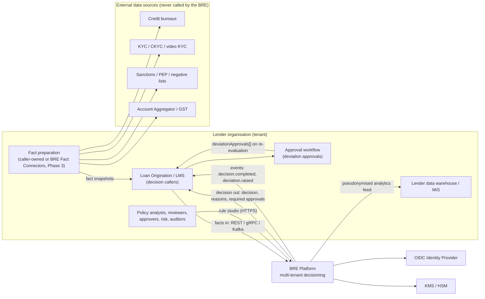

| Actor or system | Interaction with the BRE | Direction |
|---|---|---|
| LOS / LMS (system client) | `POST /v1/decisions`, gRPC `Evaluate`, `bre.decision.requested.v1`. Receives decisions and events. | In and out |
| Fact preparation | Fetches bureau, KYC, screening and AA data **outside** the BRE and hands a snapshot to the caller. | None (outside the BRE) |
| Approval workflow | Runs deviation approvals. Results return to the BRE as `deviationApprovals[]` facts (D10). | Indirect |
| Studio users | Author, test, review, approve and deploy policies. Audit and investigate decisions. | In |
| Lender DWH | Consumes the pseudonymised per-rule analytics feed and the archive extracts. | Out |
| OIDC IdP | User SSO and client-credential tokens | Out |
| KMS / HSM | Key-encryption keys, signing keys | Out |

### 2.2 Containers (C4 level 2)

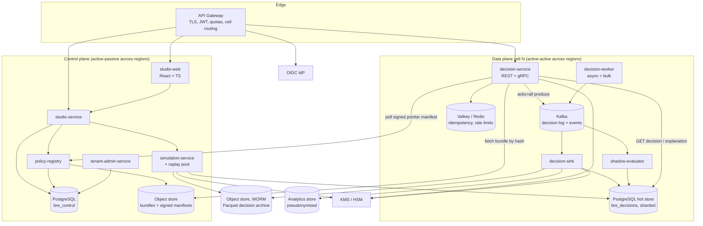

| Container | Plane | Technology | State | Scaling unit |
|---|---|---|---|---|
| API Gateway | Edge | Envoy Gateway (or the customer's gateway) | Stateless; rate-limit counters in Valkey | Replicas per region |
| `decision-service` | Data | Java 25, Spring Boot 4, gRPC, virtual threads | Stateless; in-memory bundle cache | Pods per cell (HPA) |
| `decision-worker` | Data | Java 25, Spring for Apache Kafka | Stateless; consumer-group offsets | Pods per cell (KEDA on lag) |
| `decision-sink` | Data | Java 25, Kafka consumers, Parquet writer | Stateless; offsets plus open Parquet row groups (flushed atomically) | Pods per cell (KEDA on lag) |
| `shadow-evaluator` | Data | Java 25 + `bre-engine-core` | Stateless | Pods per cell (KEDA on lag) |
| `studio-service` | Control | Java 25, Spring Boot 4 | `bre_control` PostgreSQL | 2–4 replicas |
| `policy-registry` | Control | Java 25, Spring Boot 4 | `bre_control` PostgreSQL plus object store | 3 replicas |
| `simulation-service` | Control | Java 25 worker pool | Run state in PostgreSQL, results in the object store | Worker pods (KEDA on queue depth) |
| `tenant-admin-service` | Control | Java 25, Spring Boot 4 | `bre_control` PostgreSQL | 2 replicas |
| `studio-web` | Control | React + TypeScript static bundle | None | CDN or 2 replicas |
| Kafka | Data | Apache Kafka 4.x, KRaft | Durable log | Brokers per cell or cluster |
| PostgreSQL hot store | Data | PostgreSQL 17+ | 90-day serving copy | Shards per cell |
| PostgreSQL `bre_control` | Control | PostgreSQL 17+ | System of record for policy assets | Primary + synchronous standby + cross-region replica |
| Object store | Shared | S3-compatible with Object Lock | Bundles, manifests, archive | Bucket per tenant per purpose |

---

## 3. Control plane and data plane

### 3.1 Responsibilities

| Concern | Control plane | Data plane |
|---|---|---|
| Purpose | Change policy safely | Decide fast, record durably |
| Traffic | Human-scale: about 10–100 req/s across all tenants | Machine-scale: thousands of decisions per second per cell |
| Availability target | 99.5% (NFR-AVAIL-01, Studio) | 99.95% / 99.99% |
| Region model | Active-passive | Active-active |
| Writes | Policy assets, approvals, deployments, audit | Decision records (append-only) |
| Reads policy from | `bre_control` (system of record) | **Only** signed bundles and the signed pointer manifest |
| May call | KMS (signing), object store, OIDC | KMS (data keys), Kafka, Valkey, the object store (bundle fetch) |
| Failure impact | No policy changes can be made; live decisions are **unaffected** | Decisions unavailable for the affected cell or region only |

### 3.2 Trust boundary and what crosses it

Only **two artifacts** cross from the control plane to the data plane. Both are signed, and both are verifiable without trusting the channel they arrived on.

1. **Bundle**: the compiled IR plus every pinned Shared Asset. It is content-addressed by `bundleHash = sha256(canonical bytes)` and signed with the **tenant bundle-signing key** (Ed25519, private key held in the HSM).
2. **Active Pointer Manifest**: for each `(tenant, environment, policyCode)`, the list of current deployments, each with `deploymentId`, `bundleHash`, `mode`, `trafficBasisPoints`, `experimentId` and `effectiveFrom`. Each entry also carries:
   - the policy's resolution keys `(productLines, stage, segment)`, so pods can resolve requests that do not name a `policyCode` (00 §3.7a);
   - the **servable set**: every bundle that was ACTIVE as CHAMPION in that environment within `grandfatherWindowDays`, which pinned requests may use.

   The manifest has a **monotonically increasing `manifestVersion`** and is signed with the **registry manifest key**.

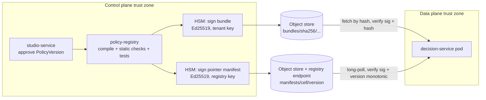

The data plane enforces four rules:
- A pod **never** loads a bundle whose hash or signature does not verify. A failed check raises a security alert and keeps the previous state.
- A pod **never** accepts a manifest with a `manifestVersion` lower than one it has already seen. This prevents replay and rollback attacks on the pointer.
- The data plane has **no network route** to `bre_control`, and no read access to it. A compromised decision pod therefore cannot alter policy.
- Rollback is a *new* deployment and a *new*, higher manifest version (00 §3.4). It is never a version decrement.

---

## 4. Component design

### 4.1 `bre-engine-core` (library)

`bre-engine-core` is the most important component. It is a pure Java library with **no Spring, I/O, clock or randomness**. Every place that evaluates policy embeds it: decision-service, decision-worker, shadow-evaluator, simulation-service, the studio test runner and `bre-sdk-java`. Live decisions and simulations therefore share **one code path**, so simulation parity (Draft 1 AC-007) holds by construction.

#### 4.1.1 Compile pipeline (control plane, at approval)

```mermaid
flowchart LR
    PSF["PSF YAML / studio model"] --> P["Parse<br/>BEL to AST, PSF to model"]
    P --> R["Resolve<br/>fact paths vs FactSchema,<br/>param./list. vs pinned assets,<br/>variables, scopes"]
    R --> T["Type-check<br/>Decimal / Integer / Date ...,<br/>null-flow analysis"]
    T --> G["Dependency DAG<br/>variables + steps,<br/>cycle check, topo order"]
    G --> S["Static checks<br/>table overlaps and gaps,<br/>unreachable rows, protected-attribute use,<br/>cost estimate vs fuel"]
    S --> I["Lower to IR<br/>slot-indexed, constants folded"]
    I --> X["Run Test Cases<br/>all must pass"]
    X --> B["Bundle<br/>IR + pinned assets + manifest,<br/>canonical bytes, sha256, Ed25519"]
```

| Stage | Output | Fails the build when |
|---|---|---|
| Parse | AST with source spans, so errors point at the exact PSF location | Syntax error |
| Resolve | Symbol table; every reference bound to a fact path, variable, `param.`, `list.` or scope variable | Unknown name; a reference to an asset not pinned by this version |
| Type-check | Typed AST; nullability of each node | Type mismatch; Decimal compared with Text; `Date - Integer` |
| DAG | Topological order of derived variables and flow steps | A cycle |
| Static checks | Diagnostics, as errors or warnings | Overlapping rows under `UNIQUE`; an uncovered input region (warning unless the table is declared `complete: true`); a protected attribute used without a governance override; cost estimate above the fuel limit |
| IR | Compact, slot-indexed program per rule, table and scorecard. Literals pre-parsed into `BigDecimal` and `LocalDate`. | — |
| Tests | Pass or fail per Test Case | Any failure (00 §3.2) |
| Bundle | Canonical bytes plus `bundleHash` plus signature | Signing failure |

#### 4.1.2 Evaluation pipeline (data plane, per request)

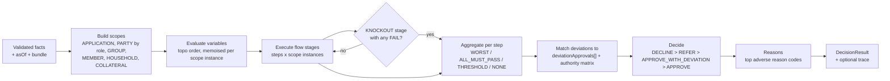

| Concern | Design |
|---|---|
| Execution model | The IR is compiled once per bundle load into a tree of **pre-bound evaluator closures**, giving zero reflection and no parsing on the hot path. A later bytecode generator (ClassFile API, JEP 484) is optional; the closure tree is the baseline. |
| Determinism | No `Clock`, `Random`, `Locale` or `TimeZone` access is reachable from the evaluator. This is enforced by an ArchUnit test plus a deny-list check at build time. `asOf` is an input. Decimal arithmetic follows 00 §3.10. |
| Fail-closed | Every rule result goes through one function, `classify(checkValue, onMissing, error)`. An error yields `ERROR`; an unknown value yields `onMissing`. The decision function implements 00 §3.5 only. A property-based test asserts that no input combination containing `ERROR` or `DATA_MISSING` yields `APPROVE`. |
| Fuel and caps | A step counter is incremented per IR node and per collection element. Exceeding fuel (default 1,000,000) or the list cap (10,000) produces `ERROR` for the current rule and `REFER` for the decision. It never throws out of the engine. |
| Memoisation | Variables are evaluated at most once per `(variable, scope instance)`. Per-member variables in a 40-member group are computed 40 times, not 40 × (number of referencing rules). |
| Trace | Off by default. When `trace=true` (explanations, simulations, tests), every node records its inputs and value into a pre-sized buffer. Trace mode uses the **same** closures with a tracing visitor, so it cannot diverge from live behaviour. |
| Engine versioning | Engine SemVer. A **major** version may change outcomes for the same `(facts, bundle, asOf)`; minor and patch versions must not. A conformance suite enforces this (§15). Every decision records `engineVersion`. |

#### 4.1.3 Public API (shape only; signatures are in the LLD)

| Entry point | Used by |
|---|---|
| `Compiler.compile(psf, pinnedAssets, factSchema) → CompileResult` | policy-registry, studio-service (live diagnostics) |
| `Bundle.load(bytes, trustStore) → LoadedBundle` | All evaluators |
| `LoadedBundle.evaluate(facts, asOf, deviationApprovals, options) → DecisionResult` | decision-service, decision-worker, shadow-evaluator, simulation-service, SDK |
| `LoadedBundle.selfTest() → TestReport` | Pods at load time (§4.2) |
| `Explainer.explain(DecisionResult, trace) → Explanation` | Explanation endpoint, studio |

### 4.2 `decision-service`

| Aspect | Design |
|---|---|
| Responsibilities | Synchronous decisions over REST (`POST /v1/decisions`) and gRPC (`DecisionService/Evaluate`). Decision read (`GET /v1/decisions/{decisionId}`, `GET /v1/decisions?applicationRef=`). Explanation (`GET /v1/decisions/{decisionId}/explanation`, delegated to the replay pool when the engine major differs). |
| Inbound | Gateway (mTLS + JWT with the `decisions:evaluate` / `decisions:read` scopes) |
| Outbound | Kafka (`bre.decision.recorded.v1`, `bre.deviation.raised.v1`); Valkey (idempotency, response cache); policy-registry (manifest long-poll); object store (bundle fetch); KMS (data-key generation and unwrap, cached); hot store (read path only) |
| State | In-memory **Bundle Cache**: an LRU keyed by `bundleHash`, holding a heap budget of compiled bundles. It covers CHAMPION and CHALLENGER bundles, the previous champion (for rollback), and **pinned bundles from the servable set**. Pinned bundles are fetched **by hash on demand** and are the first evicted. The **Pointer Table**: an immutable map `(tenant, env, policyCode) → deployments` plus a resolution index `(tenant, env, productLine, stage, segment) → policyCode`, swapped atomically through an `AtomicReference`. |
| Readiness | A pod reports *ready* only after it has loaded the current manifest, loaded every CHAMPION and CHALLENGER bundle for its cell's tenants, and passed every bundle's **load-time self-test** (the bundle's own Test Cases). |
| Request pipeline | authenticate → resolve tenant (from the token, as a `ScopedValue`) → quota → size and depth limits → decode → idempotency check → resolve `asOf` (default `receivedAt`, in the tenant time zone; 00 §3.7a) → resolve policy and select deployment (§5.8) → validate facts against the bundle's pinned FactSchema → evaluate → build the decision record → compress (zstd) → encrypt (AES-256-GCM, envelope) → produce with `acks=all` → cache the response → reply |
| Concurrency | Virtual thread per request. A **CPU bulkhead** (a semaphore sized at about 2 × available cores) wraps `evaluate()`, so a burst queues briefly instead of thrashing. I/O waits (the Kafka ack, Valkey) run on virtual threads outside the bulkhead. |
| Failure behaviour | If the durable record cannot be written, **no decision is returned**: HTTP 503 with `Retry-After` (fail-closed audit). If evaluation hits an error, the rule is `ERROR` and the decision is `REFER` with HTTP 200 (a business result). See §10. |
| Scaling unit | Pods per cell. HPA on CPU (target 60%) and in-flight requests per pod. |

### 4.3 `decision-worker`

| Aspect | Design |
|---|---|
| Responsibilities | (1) Async decisions: consume `bre.decision.requested.v1` and produce `bre.decision.completed.v1`. (2) **Bulk decision jobs** (`POST /v1/decision-jobs`): read the input file (NDJSON or Parquet) from the tenant's object-store prefix, evaluate, write the result file and record every decision. |
| Consumer model | **Normal Kafka consumer groups.** Every pod consumes its share of partitions; there is no leader election (this fixes review H1). Partition key `tenantId:applicationRef` gives per-application ordering. |
| Error handling | Spring Kafka `DefaultErrorHandler`, with exponential back-off (3 attempts) for transient errors. Deserialisation and validation errors are **not retryable** and go straight to `bre.decision.requested.v1.dlq` through `DeadLetterPublishingRecoverer`. Offsets are committed only after the decision record and the completed event are written in one Kafka transaction (`read_committed`, transactional producer). This fixes review L11. |
| Idempotency | The CloudEvent `id` serves as `requestId`, so a redelivered request re-emits the original decision. |
| Bulk throughput | Bulk jobs are split into chunks of 10,000 records. Chunks run in parallel across worker pods through an internal work queue. Bulk runs in its own deployment with its own HPA, priority class P2 (§6.4). |
| Scaling unit | KEDA on consumer lag and bulk queue depth. Maximum parallelism per topic equals its partition count. |

### 4.4 `decision-sink`

| Aspect | Design |
|---|---|
| Responsibilities | Consume `bre.decision.recorded.v1` (`read_committed`) and fan out to: (a) the **hot store**, as an idempotent upsert keyed by `decisionId`, deduplicated on `(tenant_id, request_id)`; (b) the **WORM archive**, as Parquet files per `tenant/date/hour`, rolled every 5 minutes or 256 MB; (c) the **analytics feed**, as pseudonymised per-rule rows. |
| Exactly-once effect | The hot store uses an upsert, plus an offset table updated in the same PostgreSQL transaction. The archive writes the Parquet file plus a manifest entry, then commits the offset; duplicates are removed at compaction by `decisionId`. Analytics is at-least-once with a `decisionId` dedup key. |
| Lag SLO | p99 ≤ 5 s from produce to hot-store visibility. Kafka retention (7 days) absorbs outages. |
| Scaling unit | KEDA on lag, up to the partition count (48 per cell; §6.1). |

### 4.5 `shadow-evaluator`

| Aspect | Design |
|---|---|
| Responsibilities | For every recorded decision whose `(tenant, env, policyCode)` has a `SHADOW` deployment: decrypt the facts, evaluate against the shadow bundle using the **same `asOf` and deviationApprovals**, and write a diff row (`shadow_results`) plus aggregate counters. |
| Hot-path cost | Zero. The live decision path never waits on shadow evaluation. |
| Sampling | A per-deployment `shadowSampleBasisPoints` (default 10000, i.e. all decisions) bounds the cost during high-volume periods. |
| Scaling unit | KEDA on lag. Runs at priority P3 and is the first workload shed (§6.4). |

### 4.6 `studio-service`

| Aspect | Design |
|---|---|
| Responsibilities | CRUD on DRAFT PolicyVersions and Shared Assets, live compile diagnostics, Test Cases, submit / approve / request changes, segregation-of-duties enforcement (00 §3.3), the audit trail, PSF import/export and diff. |
| Store | `bre_control` PostgreSQL, with RLS by tenant. Optimistic locking (`row_version`) on every editable aggregate. |
| Audit | Every mutation appends to `studio_audit`, which is **hash-chained**: `hash_n = sha256(hash_{n-1} ‖ canonical(event))`. The same event is also emitted to `bre.studio.audit.v1` and archived to WORM storage. The chain head is anchored daily into the WORM archive, so tampering with history is detectable. |
| Calls | `policy-registry` (on approval), `simulation-service` (simulations, back-tests, impact analyses) |

### 4.7 `policy-registry`

| Aspect | Design |
|---|---|
| Responsibilities | Build bundles: compile, static checks, tests, canonical serialisation, `sha256`, sign through the HSM. Store bundles immutably in the object store under `bundles/<tenant>/<sha256>`. Run the Deployment lifecycle (00 §3.4) with approvals. Compute and sign the **Active Pointer Manifest** per cell. Serve the distribution endpoints `GET /v1/active-pointers` (long-poll, `ETag` = `manifestVersion`) and `GET /v1/bundles/{bundleHash}`. Track the **serving report** from each pod to compute convergence. Handle bundle export and import across environments (`/v1/bundles/{bundleHash}`, `/v1/bundles:import`). |
| Scheduled deployments | The registry activates a `SCHEDULED` deployment at `effectiveFrom` by issuing a new manifest version. An optional **pre-staged switch** distributes the manifest early with `effectiveFrom` and lets pods switch on their own (NTP-disciplined) clock, for regulatory cut-overs that must be exact to the second (§10, clock skew). |
| Mirror | Every signed manifest is also written to the object store (`manifests/<cell>/<version>`), so pods can boot while the registry is down. |
| Scaling unit | 3 replicas behind a leader lease for manifest issuance. Reads are served by any replica. |

### 4.8 `simulation-service` (including the replay pool)

| Aspect | Design |
|---|---|
| Responsibilities | **Simulation:** one or more ad-hoc fact sets against a DRAFT or APPROVED version, with trace. **Back-test:** a candidate bundle over archived decisions for a date range and segment filter. **Impact analysis:** champion vs candidate over the same population, broken down by segment, reason and authority level. **Replay pool:** regenerate explanations for decisions recorded under any retained engine major. |
| Execution | A coordinator splits the work by archive partition (`tenant/date/hour`). Workers stream the Parquet files, decrypt, evaluate and write results to the object store. Summary rows go to PostgreSQL. |
| Isolation | Separate node pool; it never shares nodes with decision-service. Read-only access to the archive. Decryption rights are scoped to the tenant and purpose of the run (`purpose=BACKTEST`) and audited. |
| Scaling unit | Worker pods, scaled by KEDA on queue depth. |

### 4.9 `tenant-admin-service`, `studio-web`, gateway

| Component | Key design points |
|---|---|
| `tenant-admin-service` | Tenant registry; **cell registry** (`tenant → cell`, with cell history for migrations); quotas (decisions/s, burst, bulk concurrency, bundle memory); environments; tenant settings such as routing mode (`HIGHEST_ONLY` or `EACH`) and retention. Publishes a signed routing table to the gateway. |
| `studio-web` | Static SPA. Monaco editor with a BEL language server (syntax, completion, diagnostics), using the same parser compiled for the server and exposed over an LSP-style API. CSP and SRI headers; no inline scripts. |
| API Gateway | TLS 1.3. JWT validation with a cached JWKS. Client mTLS for system callers. **Cell routing** from the token's `tenant_id` claim through the routing table. Global token-bucket quotas in Valkey, with per-pod local buckets as fallback. Body limit 1 MiB (configurable to 4 MiB per tenant for large groups), JSON depth limit 32. Inbound `x-bre-*` headers are stripped. |

---

## 5. Key flows

### 5.1 Synchronous decision (Kafka-first; the default mode)

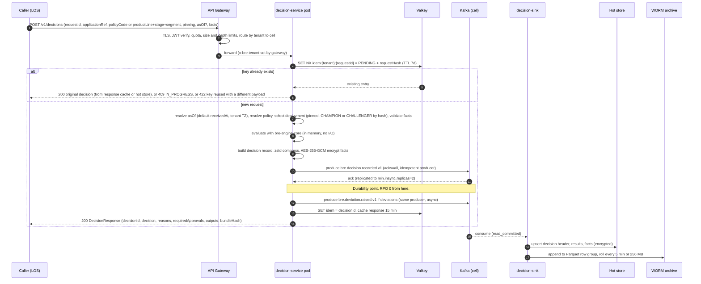

**Where the 200 is returned:** only after the Kafka broker acknowledges the record with `acks=all`. If that acknowledgement does not arrive within the produce timeout (default 2 s), the caller receives **503 with `Retry-After`** and **no decision**. The caller retries with the same `requestId`. Because evaluation is deterministic, a retry produces an identical decision, provided the facts, bundle and `asOf` are the same. A caller that omits `asOf` gets `asOf = receivedAt`, so a retry that crosses midnight in the tenant time zone could evaluate on a different date. Callers that need strict retry equivalence should send `asOf` explicitly.

### 5.2 Compact-mode decision (PostgreSQL-first with transactional outbox)

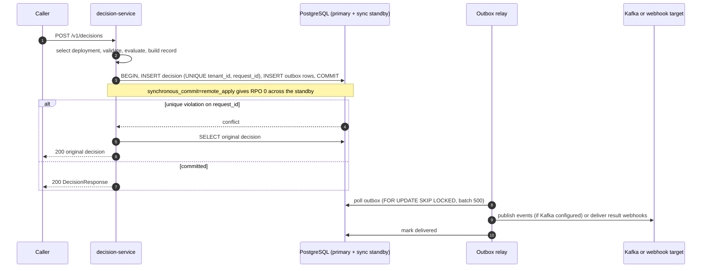

Compact mode fits about **≤ 500 decisions/s and ≤ 2 M decisions/day** (§12.4). Above that, switch to Kafka-first. The `DecisionLog` port hides the difference from the rest of the code.

### 5.3 Asynchronous request and response (Phase 2)

Kafka is Phase 1 infrastructure, because it carries the decision log. The async request API ships in Phase 2 (00 §3.7a). Compact mode needs no Kafka at all.

**Ingress by deployment type** (00 §3.13):
- **Shared-cell SaaS tenants** never touch platform Kafka. They call `POST /v1/decisions:async`. `decision-service` validates the request, produces `bre.decision.requested.v1` itself under its own service principal (tenant taken from the token), and returns `202 Accepted` with the `decisionId`. The result is fetched with `GET /v1/decisions/{decisionId}`, or delivered by signed webhook (Phase 3).
- **Dedicated cells and single-tenant installs** may also produce directly to `bre.decision.requested.v1` with per-tenant ACLs, as in the sequence below. `decision-worker` still verifies the event's tenant claim against the producing principal.

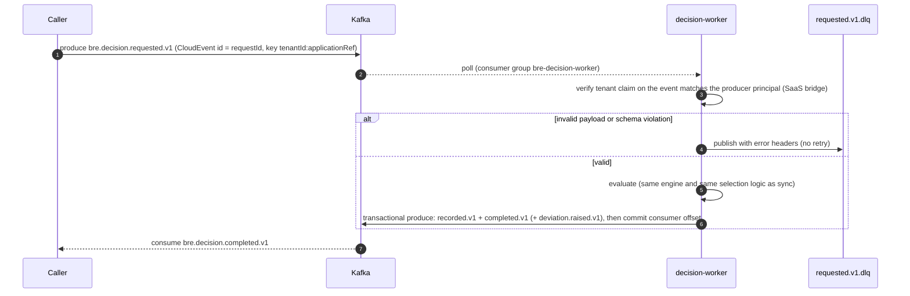

Transient failures (for example a broker leadership change) are retried three times with exponential back-off by `DefaultErrorHandler` before the event goes to the DLQ. DLQ depth above 0 alerts the on-call team. A DLQ replay tool re-publishes events after they have been fixed.

### 5.4 Bulk decision job

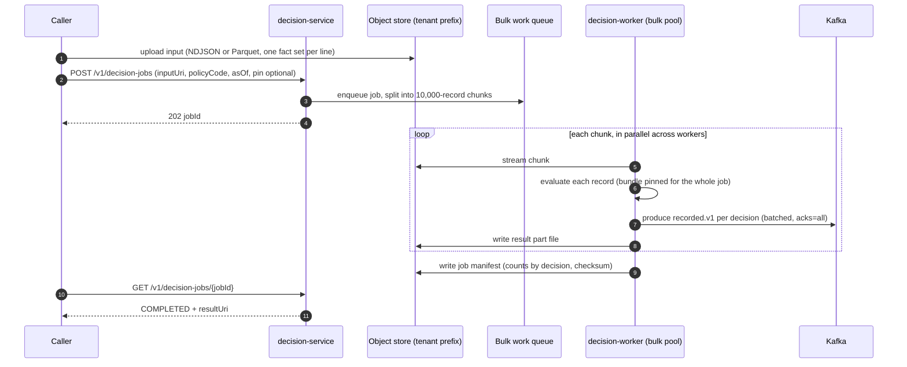

The bundle is **pinned at job submission**, so a deployment change during a long job never mixes policies inside one job. Bulk work runs at priority P2 and is shed before online traffic (§6.4).

### 5.5 Authoring to production convergence

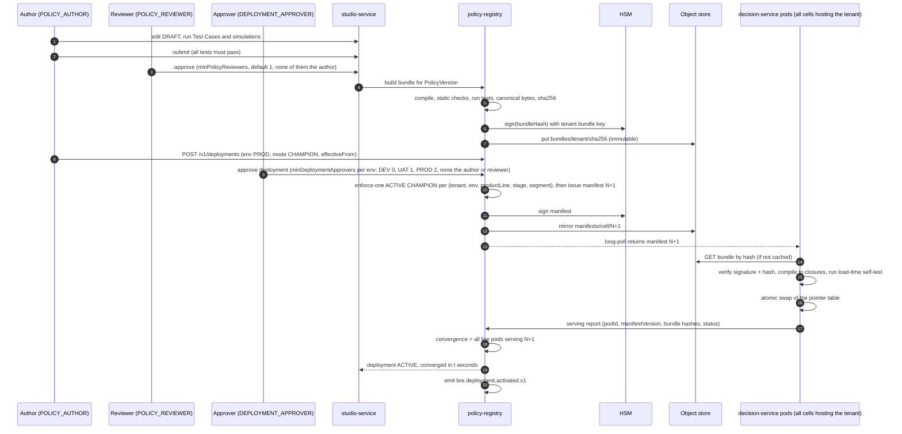

Convergence budget (NFR-OPS-01, ≤ 30 s at p99):

| Step | Typical | p99 budget |
|---|---|---|
| Manifest issue and sign | 50 ms | 500 ms |
| Long-poll wake-up across all pods | < 1 s | 2 s |
| Bundle fetch (≤ 5 MB) | 100 ms | 2 s |
| Verify, compile and self-test | 200 ms | 5 s |
| Serving report | < 1 s | 2 s |
| Headroom (GC pauses, slow nodes, retry) | — | 18.5 s |
| **Total** | **≈ 2 s** | **30 s** |

A pod that fails verification or self-test reports `LOAD_FAILED`, keeps serving the previous manifest, and the registry **halts the rollout** (§10, bad bundle).

### 5.6 Rollback

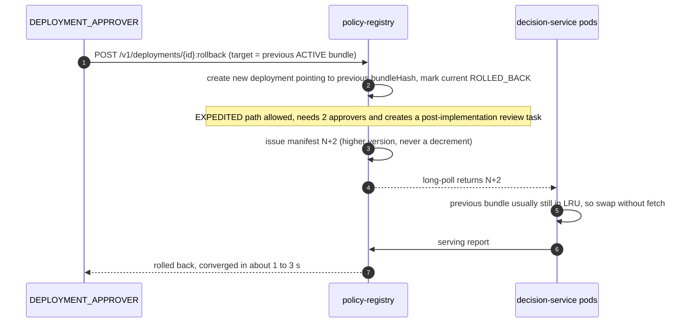

Rollback is fast because the previous champion bundle is normally still in each pod's LRU (§6.3). It is just another pointer flip, with no cache invalidation and no Kafka dependency (this fixes review H3).

### 5.7 Shadow evaluation

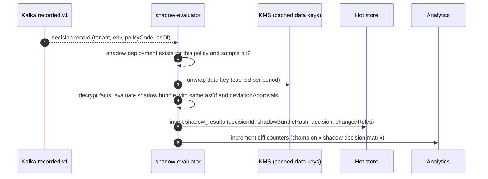

### 5.8 Policy resolution, pinning and champion/challenger assignment

Selection runs inside `decision-service` on every request, in memory, following 00 §3.7a:

1. **Resolve the policy.**
   - If the request names `policyCode`, use it.
   - Otherwise look up `(tenant, env, productLine, stage, segment)` in the resolution index. The most specific match wins: an exact segment beats no segment.
   - If nothing matches, return a `policy-not-resolved` problem.
   - The registry guarantees that each key has at most one ACTIVE CHAMPION, so resolution is never ambiguous.
2. **Apply pinning.** If `pinning` is `{bundleHash}`, the bundle must be in the policy's **servable set**: ACTIVE as CHAMPION in this environment within `grandfatherWindowDays` (default 90). Otherwise return the problem `pinned-bundle-not-allowed`. If the bundle is not in the LRU, the pod fetches it by hash, verifies it and loads it. That one-off cost is about 50–200 ms, after which the bundle is cached. The pinned bundle is used as-is; challengers do not apply to pinned requests.
3. **Champion or challenger** (`pinning = LATEST`). For each `CHALLENGER` deployment, compute `bucket = uint64(sha256(tenantId ‖ applicationRef ‖ experimentId)[0..8]) mod 10000`. If `bucket < trafficBasisPoints`, use the challenger.
4. **Otherwise use the CHAMPION.**

Because the bucket depends on `applicationRef`, every stage of one application lands in the same arm. Replay reproduces the assignment exactly (D8). The chosen `deploymentId`, `mode`, `bundleHash`, `pinning`, and the resolved `asOf` and time zone are written into the decision record.

### 5.9 Explanation by deterministic replay

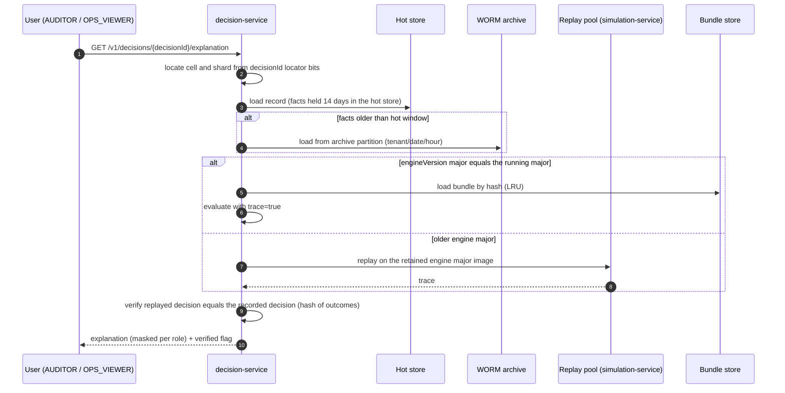

If the replayed outcome differs from the recorded one, that is an **integrity incident**: an alert fires, and the explanation is returned with `verified=false`. With deterministic replay and engine-major retention, this should never happen; the check exists to prove that it has not.

### 5.10 Back-test and impact analysis

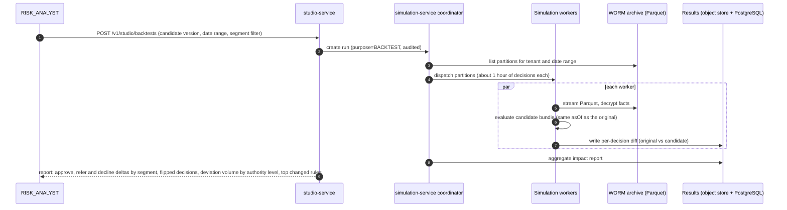

The impact report deliberately includes **deviation volume by authority level**, which is the change in workload for credit officers at each level. This is the operational cost of a policy change, and it is usually missing from back-test reports.

### 5.11 Re-evaluation with `deviationApprovals`

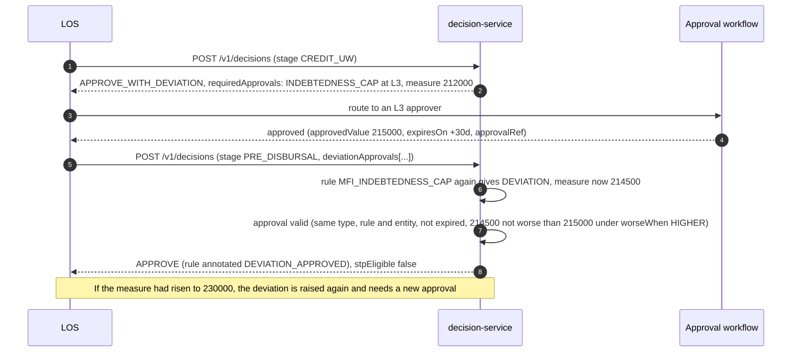

---

## 6. Scalability design

This is the core of the architecture. Every number below is either a target from 00 §4, an assumption stated in §1.3 and listed here, or derived arithmetically from those. Every assumption is to be verified by the benchmarks in §15.

### 6.1 Capacity model

#### 6.1.1 Workload profiles

| Profile | Shape | Raw facts JSON | zstd ratio | Facts compressed | Results raw / compressed¹ | Decision record on the wire² |
|---|---|---|---|---|---|---|
| **R**: retail PL | 1 applicant + 1 co-applicant, 1 bureau report each, 8 tradelines × 24-month DPD history, 6 enquiries | 20 KB | 5 : 1 | 4 KB | 2 KB / 0.5 KB | **5 KB** |
| **M**: MSME term loan | Entity + 3 promoters, 3 fiscal years of financials, GST summary, 4 bureau reports | 60 KB | 5 : 1 | 12 KB | 3 KB / 0.8 KB | **13 KB** |
| **G10**: JLG, 10 members | 10 members, 10 households, 6 tradelines per member | 75 KB | 6 : 1 | 12.5 KB | 10 KB / 2 KB | **16 KB** |
| **G40**: JLG, 40 members (NFR-PERF-02 case) | 40 members, 40 households, 6 tradelines per member | 300 KB | 6 : 1 | 50 KB | 40 KB / 8 KB | **60 KB** |

¹ Results are encoded as full entries for every non-`PASS` result, plus a per-step bitmap over scope instances for `PASS` results. Rule and reason codes are indexes into the bundle's dictionaries.
² Compressed facts + compressed results + about 0.5 KB of cleartext header (ids, tenant, policy, bundleHash, decision, timings).

**Blended design mix** for an MFI-led cell is 60% R, 10% M, 25% G10, 5% G40:

- Mean raw facts = 0.6·20 + 0.1·60 + 0.25·75 + 0.05·300 = **≈ 52 KB** (inside the 64 KB NFR-PERF-01 envelope)
- Mean record = 0.6·5 + 0.1·13 + 0.25·16 + 0.05·60 = 11.3 KB, rounded up to **12 KB**

> **Compress, then encrypt; never the reverse.** Records are zstd-compressed at the application layer **before** AES-GCM encryption. Ciphertext does not compress, so Kafka's own compression is set to `none` on `bre.decision.recorded.v1`. Broker-side compression would waste CPU on random bytes.

#### 6.1.2 Volume design points

| Design point | Online peak | Bulk | Daily total | Notes |
|---|---|---|---|---|
| **Typical cell** | 1,000/s | 0.25 M/h for 4 h | **2 M/day** | Several mid-size lenders sharing one cell |
| **Design-max cell** | 5,000/s sustained, 10,000/s burst (NFR-SCALE-01) | 1 M/h for 8 h (NFR-SCALE-02) | **25 M/day** | One very large bank, or a dense multi-tenant cell |

Online peak-to-average is about 20× (assumption A3). At 25 M/day, the online average is about 200/s, but the cell must still absorb 10,000/s bursts.

#### 6.1.3 Kafka sizing (per cell)

| Item | Arithmetic | Result |
|---|---|---|
| `recorded.v1` ingress, sustained | 5,000/s × 12 KB | **60 MB/s** |
| `recorded.v1` ingress, burst | 10,000/s × 12 KB | **120 MB/s** |
| `requested.v1` ingress (assume 20% async at peak, raw facts) | 1,000/s × 52 KB | 52 MB/s |
| Partitions for `recorded.v1` | 120 MB/s ÷ 5 MB/s per partition (latency-safe produce rate) = 24, × 2 for sink parallelism and growth without re-keying | **48** |
| Partitions for `requested.v1` / `completed.v1` | Sized to consumer parallelism | 24 / 24 |
| `recorded.v1` retention | 7 days: the replay buffer for sinks. The archive is the long-term record. | — |
| `recorded.v1` storage, design-max | 25 M × 12 KB = 300 GB/day × 7 = 2.1 TB × RF 3 | **6.3 TB** |
| `requested.v1` storage, design-max | 5 M async/day × 52 KB = 260 GB/day × 3 days × RF 3 | **2.3 TB** |
| Brokers | 6 (2 per AZ × 3 AZs), each 8 vCPU / 32 GiB / 4 TB NVMe / 10 GbE | — |
| Disk per broker | (6.3 + 2.3) TB ÷ 6 ≈ 1.4 TB on 4 TB | **2.8× headroom** |
| Write per broker, burst | (120 + 52) MB/s × RF 3 ÷ 6 | ≈ 86 MB/s |
| Read per broker, burst | (3 sink groups + shadow) × 120 MB/s + async consumers + replica fetch, ÷ 6 | ≈ 150 MB/s |
| Network headroom | 10 GbE ≈ 1,250 MB/s per broker | **> 5×** |

Typical cell: 24 GB/day on `recorded.v1` → 504 GB at RF 3 over 7 days. Three brokers suffice; six are recommended for AZ-loss headroom.

Producer settings: `acks=all`, `enable.idempotence=true`, `max.in.flight.requests.per.connection=5`, `linger.ms=1`, `batch.size=256 KB`, `delivery.timeout.ms=2000` (aligned with the API's produce timeout). Topic settings: `min.insync.replicas=2`, `unclean.leader.election.enable=false`, `compression.type=none` on `recorded.v1` and `lz4` on the others.

#### 6.1.4 PostgreSQL hot-store sizing (per cell)

| Item | Per decision | Notes |
|---|---|---|
| Header row (ids, tenant, policy, deployment, bundleHash, decision, required approvals summary, timings) | 0.4 KB | Cleartext business metadata, no PII |
| Results blob | 1.5 KB | Compressed; same encoding as the record |
| Indexes (PK, `tenant+applicationRef+created_at`, `tenant+request_id`) | 0.6 KB | Incl. B-tree overhead |
| **Header + results + indexes** | **≈ 2.5 KB** | Kept **90 days** (NFR-COMP-01) |
| Facts (encrypted blob, separate table) | **≈ 11 KB** | Kept **14 days** in the hot store for fast explanation; the archive holds them after that (Appendix B, ambiguity 3) |

| Design point | Headers (90 d) | Facts (14 d) | Total | Layout |
|---|---|---|---|---|
| Typical (2 M/day) | 2 M × 2.5 KB × 90 = **450 GB** | 2 M × 11 KB × 14 = **308 GB** | **≈ 0.76 TB** | 1 shard: primary + synchronous standby |
| Design-max (25 M/day) | 25 M × 2.5 KB × 90 = **5.6 TB** | 25 M × 11 KB × 14 = **3.85 TB** | **≈ 9.5 TB** | **4 shards** of ≈ 2.4 TB each |

The insert rate at design-max burst is 10,000/s ÷ 4 shards = 2,500 rows/s per shard, written by the sink in batches of 500 inside one transaction per batch. That is comfortable for PostgreSQL on NVMe.

**Partitioning** (fixes review B6's invalid DDL):
- Range-partition `decisions` and `decision_facts` by **day** on `created_at`. Each day partition is sub-partitioned by **hash(`tenant_id`)**, modulus 8 (modulus 1 in dedicated cells).
- Every primary key and unique key includes the partition columns: `PRIMARY KEY (decision_id, created_at, tenant_id)`.
- Retention is `DETACH` + `DROP` of whole day partitions. There is never a bulk `DELETE`, so no vacuum storms. A partition-maintenance job pre-creates partitions 7 days ahead.
- Index strategy:
  - the PK, for `GET /v1/decisions/{id}`, made direct by the locator bits (§6.5.4);
  - `(tenant_id, application_ref, created_at DESC)`, for `GET /v1/decisions?applicationRef=`;
  - `(tenant_id, request_id)`, for sink deduplication.
- No index on JSON content: analytics queries go to the analytics store, never the hot store.

#### 6.1.5 Archive sizing (WORM, Parquet)

Facts and results are already compressed and encrypted, so Parquet adds little further compression on those columns. The header columns compress well. Archived size is therefore about **12.5 KB per decision**.

| Design point | Per day | Per year | 10 years (default retention) |
|---|---|---|---|
| Typical (2 M/day) | 25 GB | 9.1 TB | **≈ 91 TB** |
| Design-max (25 M/day) | 312 GB | 114 TB | **≈ 1.14 PB** |

Storage tiering: the standard tier for 12 months (for back-tests and explanations), then an infrequent-access or archive tier for years 2–10. **Object Lock in compliance mode** (WORM) is kept across tier transitions. The layout is `archive/<tenant>/<yyyy>/<mm>/<dd>/<hh>/part-<seq>.parquet` plus a per-hour manifest with checksums, which back-tests use for partition pruning.

#### 6.1.6 Pod sizing for `decision-service`

CPU per decision, blended 52 KB facts:

| Step | CPU-ms |
|---|---|
| mTLS + HTTP/2 framing at the pod | 0.15 |
| JSON decode, 52 KB (streaming Jackson, ≈ 250 MB/s per core) | 0.21 |
| Fact-schema validation (pre-compiled validator) | 0.15 |
| Evaluation (100 rules, member-scoped rules × 10 members for G10) | 0.40 |
| Record build + zstd level 3 + AES-GCM (AES-NI) | 0.24 |
| Kafka produce (serialise, batch, I/O) | 0.10 |
| Valkey round trips (2) and response encode | 0.10 |
| Framework, logging, metrics, amortised GC | 0.60 |
| **Total** | **≈ 1.95 CPU-ms** |

A 2-vCPU pod is therefore ≈ 1,025 decisions/s at 100% CPU, or **≈ 820/s at 80%**. That is consistent with the ≥ 800/s planning assumption in 00 §4.

| Scenario (per cell) | Load | Per-pod operating point | Pods |
|---|---|---|---|
| Sustained, single region | 5,000/s | 615/s (60% CPU) | **9** |
| Burst, single region | 10,000/s | 870/s (85% CPU) | **12** |
| Burst with 1 of 3 AZs lost | 10,000/s on ⅔ of capacity | 870/s | **18** (6 per AZ) |
| Two regions active-active, normal | 50/50 split | 615/s | **6–9 per region** |
| Region failover (survivor takes 100%) | 10,000/s | 870/s | **18** in the survivor (HPA max 24) |

Pod shape: 2 vCPU request (no CPU limit, to avoid CFS throttling) and 6 GiB memory. The 4 GiB heap divides into a bundle LRU of 1.5 GiB, in-flight request buffers (about 200 in flight × 52 KB × 5 object expansion ≈ 52 MB), a 64 MB Kafka producer buffer, and the remainder for Netty, gRPC and the JIT.

### 6.2 Latency budget (NFR-PERF-01)

Server-side, blended request (≤ 64 KB facts, 100-rule policy), **including the durable write**:

| # | Step | p50 (ms) | p99 budget (ms) |
|---|---|---|---|
| 1 | Network to gateway + TLS 1.3 (resumed session) | 1.0 | 5.0 |
| 2 | Gateway: JWT verify (cached JWKS), quota (Valkey), cell routing | 0.5 | 3.0 |
| 3 | Gateway to pod (mTLS, HTTP/2 keep-alive) | 0.3 | 2.0 |
| 4 | Decode (JSON 52 KB, or protobuf) | 0.3 | 3.0 |
| 5 | Idempotency `SET NX` (Valkey) | 0.4 | 3.0 |
| 6 | Deployment selection + bundle lookup (in memory) | 0.01 | 0.1 |
| 7 | Fact validation against the pinned FactSchema | 0.2 | 2.0 |
| 8 | Evaluation (`bre-engine-core`) | 0.4 | 4.0 |
| 9 | Record build, compress, encrypt | 0.3 | 2.0 |
| 10 | **Kafka produce, `acks=all`** (linger 1 ms, cross-AZ ISR) | 4.0 | 35.0 |
| 11 | Idempotency finalise + response cache (pipelined) | 0.3 | 2.0 |
| 12 | Encode + return response | 0.2 | 2.0 |
| 13 | Queueing, GC and scheduling headroom | — | 36.9 |
| | **Total** | **≈ 8** (target ≤ 20) | **100** |

Durability (step 10) dominates the budget, which is the intended trade-off. Over gRPC/protobuf, steps 4 and 12 fall by roughly 3–5×.

**NFR-PERF-02** (1,000 rules, 1 MB facts, G40):
- decode about 5 ms, validation about 3 ms;
- evaluation about 24,000 rule-instance evaluations at 1–2 µs each, so 25–50 ms;
- compress and encrypt about 4 ms, Kafka about 35 ms at p99.

That gives **≈ 120 ms p99** against a 250 ms budget. For groups over 40 members, the engine can evaluate member scopes in parallel inside one request (`memberParallelism`, default 1, max 4). This option is off by default so that one large request cannot hog the CPU bulkhead.

### 6.3 Hot-path engineering

| Technique | Detail | Why |
|---|---|---|
| **In-process compiled bundles** | Bundles are compiled to closure trees at load and held in an LRU keyed by `bundleHash`. The champion bundles of every policy that had traffic in the last 24 h are pre-loaded; others load lazily (≈ 50–200 ms, once). | No DB, Redis or network on the decision path (review H3, ADR-005). |
| **No external reads on the hot path** | Facts arrive in the request. Parameters and lists are inside the bundle. | Removes tail latency and failure coupling. |
| **Virtual threads** | `spring.threads.virtual.enabled=true`, and the gRPC executor runs on virtual threads. JDK 24+ removed `synchronized` pinning (JEP 491). | Waits on the Kafka ack and Valkey cost no platform threads. |
| **CPU bulkhead** | A semaphore of about 2 × cores around `evaluate()` + encode. | Virtual threads do not make CPU-bound work faster; this prevents run-queue collapse under burst. |
| **GC** | Generational ZGC (the default ZGC mode in Java 25). `-XX:+UseCompactObjectHeaders` (JEP 519). Heap 4 GiB. | Sub-millisecond pauses keep p99 flat. Compact headers cut object overhead by about 10–20% on fact-heavy heaps. |
| **Allocation discipline** | Streaming decode straight into fact records, with no intermediate tree model. Pre-sized result arrays. Reason and rule codes as `int` indexes. Pooled zstd contexts. `BigDecimal` constants pre-built in the IR. | Allocation rate drives GC load. The target is ≤ 1.5 MB allocated per G10 decision. |
| **Jackson vs protobuf** | REST uses Jackson 3 streaming (`JsonParser`) with field-name canonicalisation. gRPC uses protobuf, with a zero-copy path from `ByteString` to fact records. | Protobuf decode is about 3–5× cheaper; high-volume callers are steered to gRPC. |
| **Warm-up and JIT** | Java 25 AOT cache (JEP 483/514/515) is built in CI from a training run. Readiness is gated on the load-time self-test, which also warms the evaluator's hot methods. | Removes the cold-start p99 spike after scale-out or deploy. |
| **Bundle memory footprint** | A typical 100-rule bundle is ≈ 1–2 MB compiled; a 1,000-rule bundle with a 100k-entry list is ≈ 15–20 MB. Each live policy needs a working set of CHAMPION + CHALLENGER(s) + the previous champion + the **pinned servable set**. At one policy release a month, a 90-day window holds about 3 pinned bundles, so the planning figure is about 6 bundles per policy. Eviction priority: pinned (re-fetchable by hash on demand) first, then the previous champion; CHAMPION and CHALLENGER bundles are never evicted. SHADOW bundles live only in `shadow-evaluator`. Per-tenant memory quota is set in `tenant-admin-service`. | Bounded by LRU size and quota. If a cell's working set exceeds the LRU, use **pod groups** (§6.5.5). |
| **Kafka producer** | One shared idempotent producer per pod. Per-partition batching with `linger.ms=1`. Sticky partitioning is not used, because the key is `tenantId:applicationRef`. | Keeps the ack time low and ordering per application. |

### 6.4 Backpressure, quotas, bulkheads and load shedding

**Priority classes.** These are new terms (Appendix B).

| Class | Traffic | Where it runs | Shed order |
|---|---|---|---|
| **P0** | Synchronous online decisions | `decision-service` | Last |
| **P1** | Async requested events | `decision-worker` (async deployment) | Third |
| **P2** | Bulk decision jobs | `decision-worker` (bulk deployment) | Second |
| **P3** | Shadow evaluation, back-tests, analytics fan-out | `shadow-evaluator`, `simulation-service` | First |

**Controls, outermost first:**

1. **Gateway per-tenant token bucket** (rate + burst from tenant quota, counters in Valkey). Over quota → `429` with `Retry-After`. If Valkey is unavailable, per-gateway-replica local buckets apply, at the quota divided by the replica count.
2. **Per-pod adaptive concurrency limit** (gradient algorithm, e.g. Netflix `concurrency-limits`) on P0. Over the limit → `503` with `Retry-After: 1`. This protects latency before the CPU saturates.
3. **Per-tenant fair share inside the pod.** When the pod is saturated, admission is weighted-fair across tenants, so one tenant's burst cannot starve others in a shared cell.
4. **Physical bulkheads.** P0, P1, P2 and P3 run in **separate deployments**, so they never share pods. Bulk and simulation run on separate node pools from `decision-service`.
5. **Kafka-side backpressure.** Consumer groups (P1, P2, P3) pause partitions when downstream latency rises, and lag absorbs the burst.

**Autoscaling:**

| Workload | Scaler | Signal | Policy |
|---|---|---|---|
| `decision-service` | HPA | CPU 60% + in-flight per pod | Scale up +100% per 15 s with no stabilisation. Scale down −10% per minute after 5 min stable. Min = AZ count × 2. |
| `decision-worker` (async) | KEDA | Lag on `requested.v1` | Max replicas = partitions (24) |
| `decision-worker` (bulk) | KEDA | Bulk queue depth | Bounded by the tenant bulk-concurrency quota |
| `decision-sink` | KEDA | Lag on `recorded.v1` | Max = 48 |
| `shadow-evaluator` | KEDA | Lag; paused when cell CPU exceeds 80% | P3 |
| Pre-scaling | KEDA cron | Known peaks: business hours, month-end, campaign days | Raise minimum replicas ahead of the peak |

### 6.5 Cells

#### 6.5.1 What a cell is

A cell is a complete, independent copy of the data plane in a region:
- `decision-service`, `decision-worker`, `decision-sink` and `shadow-evaluator`;
- a Kafka cluster, or a namespace on a shared cluster (Appendix B, physical topic prefix);
- a hot-store shard set;
- a Valkey cluster.

Cells share only the control plane (through signed artifacts), the archive bucket namespace and the observability stack. A cell failure affects **only the tenants mapped to it**.

#### 6.5.2 Assigning tenants to cells

| Tenant class | Placement |
|---|---|
| Small and medium (≤ 500/s peak) | Packed into shared cells by bin-packing on peak rate, bundle working set and data volume. Target ≤ 60% of cell capacity at the combined peak. |
| Large (> 2,000/s peak, or a contractual isolation requirement) | **Dedicated cell** |
| Single-tenant install | Exactly one cell (compact or full) |

#### 6.5.3 Routing

`tenant-admin-service` publishes a signed **routing table** (`tenantId → cellId`, plus history) to the gateway. The gateway reads `tenant_id` from the validated token and forwards the request to that cell's `decision-service`. Decisions are stateless, so routing needs no session affinity.

#### 6.5.4 Locating a decision

A `decisionId` is a UUIDv7. The top 48 bits hold the timestamp, as RFC 9562 requires. Eight bits of `rand_b` carry the **cellId** and another eight bits carry the **hot-store shardId** (Appendix B, *decision locator bits*). `GET /v1/decisions/{id}` therefore goes straight to the right cell and shard without a lookup table. That still leaves 46 random bits, plus the 12-bit `rand_a` sub-millisecond sequence, which is ample for uniqueness at 10,000/s per cell.

#### 6.5.5 Pod groups inside a cell

When a shared cell's total bundle working set exceeds one pod's LRU, its `decision-service` pods are split into **pod groups**. Each tenant is mapped to one group, and the gateway routes by group Service. Each pod then only holds bundles for its group's tenants. The default is one group per cell.

#### 6.5.6 Moving a tenant between cells

1. Provision the tenant in the target cell. The manifests for the target cell start to include the tenant, and pods pre-load its bundles.
2. Flip the routing-table entry. New decisions now go to the target cell. Decisions are stateless, so no data needs to move first.
3. Historical reads keep working. Old decision IDs carry the old cell's locator bits. For `GET /v1/decisions?applicationRef=`, the decision-service queries every cell in the tenant's cell history whose time window overlaps the query.
4. Optionally, a background copy moves the last 90 days of hot-store rows to the target cell. Otherwise the old cell's rows age out naturally within 90 days.

#### 6.5.7 Adding a cell

1. Provision with IaC: a Helm chart per cell, deployed by GitOps (Argo CD).
2. Register the cell in `tenant-admin-service`.
3. The registry begins issuing manifests for the new cell.
4. Place new tenants on it, or move existing tenants (§6.5.6).

Adding a cell is a capacity operation, not an architecture change. **Scale-out is linear in the number of cells** because cells share no runtime state.

### 6.6 Scaling each store

| Store | First lever | Second lever | Beyond |
|---|---|---|---|
| Kafka (per cell) | Add partitions to new topics (keys are not re-hashed for existing data, because sinks are order-insensitive per decision) | Add brokers and rebalance with Cruise Control | Split the cell |
| Hot store | Vertical (NVMe, more RAM); a read replica for list and explanation reads | **Application-level sharding** by `hash(tenantId:applicationRef) mod S`, with the shard id in the locator bits | **Time-bounded resharding**: new decisions use a new shard map from an epoch onwards, and old rows age out in 90 days, so **no data migration** is ever needed. Readers consult the shard-map history by `created_at`. Distributed SQL (YugabyteDB, Apache-2.0) is the fallback if per-application history beyond 90 days must be online. |
| Valkey | Cluster mode, 3 primaries + 3 replicas | Add shards | Per-cell clusters (already the default) |
| Object store | Scales natively; prefixes partitioned by tenant/date/hour | — | — |
| `bre_control` PostgreSQL | Tiny: about 10⁵–10⁶ rows per tenant. Primary + synchronous standby. | Read replicas for studio list views | — |
| Analytics | ClickHouse cluster (or the tenant's lakehouse), sharded by tenant and partitioned by month | Add shards | — |

---

## 7. Data architecture

### 7.1 Stores and systems of record

| Store | Holds | System of record? | Retention | Access |
|---|---|---|---|---|
| `bre_control` (PostgreSQL) | Policies, PolicyVersions, Shared Assets, Test Cases, reviews, deployments, routing and cell registry, the hash-chained studio audit | **Yes**, for policy assets and governance | Life of tenant + 10 years for audit | Control plane only |
| Bundle store (object store `bundles/`, `manifests/`) | Signed bundles, signed pointer manifests | **Yes**, for what was executable. Immutable and WORM. | ≥ the decision archive's retention, because replay needs them | Registry writes; pods and the replay pool read |
| Kafka `bre.decision.recorded.v1` | Every decision record | **Yes**, for the first 7 days (Kafka-first mode) | 7 days | Data plane |
| Hot store (PostgreSQL, per cell, sharded) | Decision headers and results (90 days), encrypted facts (14 days), `shadow_results`, sink offsets | No: a serving copy, rebuildable from Kafka or the archive | 90 / 14 days | decision-service (read), sinks (write) |
| WORM archive (object store, Parquet) | Complete decision records | **Yes**, long-term | Default 10 years, per tenant | Sinks (append), simulation-service and replay pool (read, audited) |
| Analytics store | **Pseudonymised** per-rule and per-entity results, aggregates, PSI inputs | No (derived) | Default 3 years | Dashboards, RISK_ANALYST, lender DWH export |
| Valkey | Idempotency keys (7 days), response cache (15 min), rate-limit counters | No (ephemeral) | TTL | decision-service, gateway |
| Key store (KMS/HSM + `principal_keys` table) | KEKs, signing keys, wrapped per-principal keys | **Yes**, for keys | Per key policy; principal keys deleted at erasure | Security-controlled |
| Simulation store (PostgreSQL + object store) | Run definitions, per-decision diffs, impact reports | No (derived) | 1 year (configurable) | Studio |

### 7.2 Retention tiers

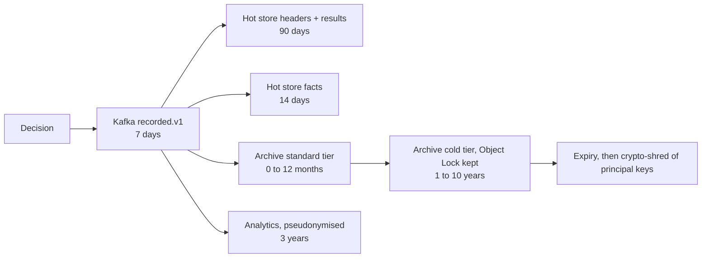

At the end of the retention period, archived objects expire. The **per-data-principal keys** (§9.3) for principals with no remaining retained records are also deleted, so any surviving copies, such as backups or exports, become unreadable.

### 7.3 Schema registry and evolution

| Contract | Format | Registry | Compatibility rule |
|---|---|---|---|
| Fact Schema (`lending-facts@x.y.z`) | JSON Schema 2020-12, plus generated Java records in `bre-fact-model` | Stored as a versioned Shared Asset in `bre_control` and mirrored to the schema registry | SemVer. **Minor** = additive optional fields only. **Major** = breaking. A PolicyVersion pins an exact version, and requests are validated against the pinned version. A request may declare `factSchemaVersion`; a newer minor version is accepted against an older pin, with unknown fields ignored and recorded. |
| `bre.decision.recorded.v1` payload | Protobuf (binary CloudEvents), shared with the gRPC contract | Apicurio Registry (Apache-2.0) | Field tags are never reused. Additive only within `v1`. A breaking change means `v2` on a new topic, with dual-write during migration. |
| Other topics (`requested`, `completed`, `deviation.raised`, `deployment.activated`, `policy.approved`, `studio.audit`) | JSON (structured CloudEvents), JSON Schema | Apicurio Registry | Backward-compatible within `v1`; consumers must ignore unknown fields. |
| REST | OpenAPI 3.1 | Repository plus a published portal | `/v1` additive only |
| gRPC | Protobuf `bre.decision.v1` | Buf Schema Registry or the repository with `buf breaking` in CI | `buf breaking` gate |
| Bundle format | Versioned IR (`irVersion`) | — | The engine reads every `irVersion` it has ever produced, within the retained engine majors. |

### 7.4 Data lineage

Every decision can be traced end to end by joining on IDs. No inference is needed.

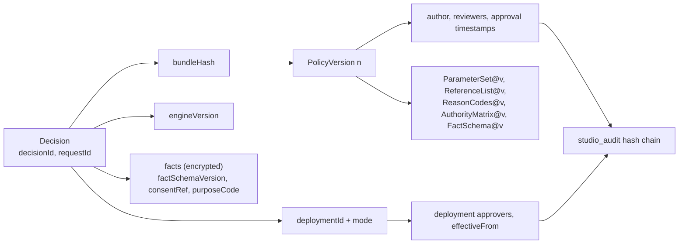

---

## 8. Multi-tenancy and isolation

### 8.1 Tenant context propagation

1. The **gateway** validates the JWT and extracts the `tenant_id` claim. A system client is bound to exactly one tenant; a platform admin acting for a tenant needs an audited impersonation grant. The gateway sets `x-bre-tenant` and **strips any inbound `x-bre-*` header**.
2. The **service** binds `TenantContext` in a Java 25 `ScopedValue` (JEP 506) for the request. It is never a `ThreadLocal`, so it cannot leak across virtual threads.
3. **Kafka** records carry `tenantid` as a CloudEvents extension attribute and in the key (`tenantId:applicationRef`). Consumers re-bind the context from the record and never from configuration.
4. **PostgreSQL**: every transaction begins with `SET LOCAL app.tenant_id = ...`. RLS policies enforce `tenant_id = current_setting('app.tenant_id')`. Application roles have no `BYPASSRLS`.

### 8.2 Isolation at every layer

| Layer | Mechanism | Verified by |
|---|---|---|
| Gateway | Per-tenant quotas; routing table; the token's tenant claim is authoritative | Contract tests with forged tenant headers |
| Pods | Pointer table and bundle LRU keyed by tenant; per-tenant memory quota; weighted-fair admission | Unit and property tests; a load test with a noisy neighbour |
| Engine | A bundle can only reference its own tenant's pinned assets. The verifier checks that the bundle's `tenantId` equals the request tenant. | Compile-time and load-time checks |
| Kafka | Per-cell clusters or namespaces. ACLs per service principal. Shared-cell SaaS tenants have no Kafka principal at all: their async requests enter through `POST /v1/decisions:async`. In dedicated cells, a tenant principal may only produce events whose `tenantid` equals its own; `decision-worker` checks this, and mismatches go to the DLQ with a security alert. | ACL tests; chaos test with a cross-tenant event |
| PostgreSQL | RLS on every tenant table. Sub-partitioning by tenant hash. Dedicated shards for dedicated cells. | An automated RLS test suite that attempts cross-tenant reads |
| Object store | Prefix per tenant (`archive/<tenant>/`, `bundles/<tenant>/`). Bucket policies; per-tenant encryption context. | Policy simulation tests |
| Keys | Per-tenant KEK. Encryption context = `{tenant, purpose}`, so a ciphertext cannot be decrypted under another tenant's context. | KMS policy tests |
| Metrics and logs | A `tenant` label on business metrics. Tenant-scoped dashboards. Log access filtered by tenant for tenant users. | Dashboard RBAC tests |

### 8.3 Deployment options

| Option | What is shared | Fit |
|---|---|---|
| Shared cell (SaaS) | Data-plane infrastructure inside the cell; control plane | NBFCs and NBFC-MFIs, small banks |
| Dedicated cell (SaaS) | Control plane only | Large banks; contractual isolation |
| Single-tenant install (customer VPC or DC) | Nothing; `tenantCount = 1`, same images | Banks requiring on-prem, or a regulator-driven deployment |
| Compact single-tenant install | Nothing; reduced footprint (§12.4) | Small lenders; non-production environments |

---

## 9. Security architecture

### 9.1 Authentication and authorisation

| Principal | AuthN | AuthZ |
|---|---|---|
| Studio users | OIDC (Keycloak by default, or the tenant's IdP federated per tenant). MFA required for `POLICY_REVIEWER`, `DEPLOYMENT_APPROVER`, `AUDITOR`, `TENANT_ADMIN` and `PLATFORM_ADMIN`. | RBAC roles from 00 §3.12, mapped from IdP groups per tenant. Segregation of duties is enforced server-side (author ≠ reviewer ≠ deployment approver for the same change). |
| System clients (LOS) | OAuth2 client credentials (private_key_jwt) **plus** mTLS on the client certificate, with certificate-bound tokens (RFC 8705) | Scopes `decisions:evaluate`, `decisions:read`, `decision-jobs:submit`, `bundles:read` (00 §3.12) |
| Internal services | mTLS from the service mesh or SPIFFE identities, plus per-service Kafka and PostgreSQL credentials from the secrets manager | Least privilege per service: the data plane cannot reach `bre_control`; sinks cannot read Valkey; and so on |
| Unmasking | — | `AUDITOR` only, with a mandatory reason. Every unmask emits an audit event. |

### 9.2 Bundle signing chain

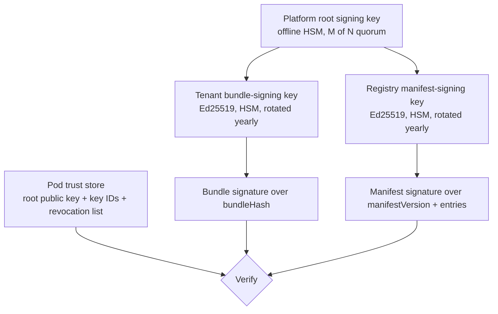

Verification rules in each pod:
- The bundle signature must chain to the root and must not be on the revocation list.
- `sha256(bytes)` must equal `bundleHash`.
- `bundle.tenantId` must match the deployment entry.
- `manifestVersion` must be greater than or equal to the last seen version.

Key rotation adds a new key ID **before** the old one retires, so bundles signed under the old key remain verifiable for replay. Revoking a compromised key re-signs every affected live bundle under a new key, then issues a manifest that names the new signatures.

### 9.3 Encryption and key hierarchy

| Key | Where | Scope | Use |
|---|---|---|---|
| Root / master | HSM (FIPS 140-2/3 Level 3) or cloud KMS backed by an HSM | Environment | Wraps tenant KEKs |
| **Tenant KEK** | KMS | Tenant, rotated yearly | Wraps Tenant Data Keys and the Principal Key Wrapping Key |
| **Tenant Data Key (TDK)** | Generated by KMS `GenerateDataKey`; the plaintext is cached in pod memory for its period only | Tenant × hour | AES-256-GCM over the **non-identifying** part of the fact blob and the results |
| **Principal Key Wrapping Key (PKWK)** | Unwrapped by the tenant KEK, cached in memory | Tenant | Wraps Data Principal Keys |
| **Data Principal Key (DPK)** | Random, stored **wrapped** in `principal_keys(tenant_id, principal_ref, key_id, wrapped_key)` | One per data principal (`principalRef`, Appendix B) | AES-256-GCM over the **identifying field group** of that principal's facts (DOB, tokens, free-text names if any, contact references) |

Why this is needed: a WORM archive cannot be edited, yet DPDP erasure (once legal retention obligations end) must still be honoured. **Crypto-shredding** reconciles the two. Deleting a principal's DPK makes every archived copy of that principal's identifying fields unreadable, without touching the WORM objects. Non-identifying decision data (outcomes, amounts, rule results) stays usable for aggregate analytics and model governance.

The KMS is not on the per-decision path:
- TDKs for the next period are pre-generated 15 minutes ahead, so a KMS outage is tolerated for up to about one hour (§10).
- DPK unwrap is a local AES operation using the cached PKWK.
- Back-tests over 1 M decisions therefore need **no** per-record KMS calls.

### 9.4 PII handling

| Data | Rule |
|---|---|
| Aadhaar number | **Rejected** at validation (pattern plus Verhoeff checksum detection, in any string field) with `422`. Only vault reference keys or tokens are accepted (00 §3.9). |
| PAN | Token, or an encrypted value inside the identifying field group. The masked view shows `XXXXX1234X`-style output only for `AUDITOR` after unmask. |
| Names and contact details | Not needed by the engine, because name-match scores arrive as facts. If present, they go in the identifying field group, are encrypted under the DPK, and are never logged. |
| Protected attributes (`gender`, `religion`, `caste`, …) | Tagged `protected` in the Fact Schema. Use in rule logic is blocked at compile time unless a governance override is approved (00 §3.9). |
| Masked views | `OPS_VIEWER` and `RISK_ANALYST` see outcomes, reason codes and amounts. DOB is reduced to age band; tokens are truncated; identifying fields are hidden. |
| Telemetry | No fact values in logs, traces or metric labels (§11.2). |

### 9.5 Secrets and supply chain

| Area | Control |
|---|---|
| Secrets | OpenBao (MPL-2.0 Vault fork) or cloud secrets manager. Dynamic PostgreSQL credentials. Short-lived Kafka credentials (SASL/OAUTHBEARER or mTLS). No secrets in images or Git. |
| Dependencies | Maven Central and npm only (D11). Gradle dependency locking, verification metadata (`verification-metadata.xml` with checksums and PGP keys), Renovate for updates, and an OSV/OWASP dependency-check gate in CI. |
| SBOM | CycloneDX SBOM per artifact, attached to the image and stored with the release |
| Images | Distroless or UBI-micro base. Images signed with cosign (Sigstore) and verified at admission (Kyverno or Gatekeeper policy). Runs as non-root with a read-only root filesystem. |
| Build provenance | SLSA level 3 provenance from CI; reproducible Gradle builds |
| Engine release gate | Conformance replay (§15.2) must pass before a new engine version can serve |

### 9.6 Threat model (STRIDE)

| # | Threat | STRIDE | Scenario | Mitigations | Residual |
|---|---|---|---|---|---|
| T1 | **Malicious or careless rule author** | E, T | An author writes logic to exfiltrate data or approve a specific applicant | BEL has no host calls, I/O or reflection (D3, fixing review B1). Maker-checker with SoD, plus 2 approvers in PROD. Test Cases and impact analysis show flipped decisions. A static check flags rules keyed on identifiers (for example `applicationRef = "…"`). Hash-chained audit. | Collusion between author and reviewer; mitigated by impact-report review and post-implementation review |
| T2 | **Tampered bundle or manifest** | T | An attacker modifies a bundle in the object store, or replays an older manifest | Ed25519 signatures chained to an HSM root; content hash; monotonic manifest version; data plane has no write path | Root-key compromise needs an HSM quorum breach |
| T3 | **Cross-tenant leakage** | I | A bug or attacker reads another tenant's decisions | Token-bound tenant; `ScopedValue` context; RLS; per-tenant KEKs and encryption context; prefix policies; tenant check on bundle load; automated cross-tenant tests | Low |
| T4 | **Poison payload** | D | Deeply nested JSON, huge lists, malformed decimals | Gateway body and depth limits; streaming decoder limits; schema validation; list-size cap; numeric range checks; DLQ for async | Low |
| T5 | **ReDoS / fuel exhaustion** | D | A crafted regex or a pathological list makes evaluation explode | RE2J (linear-time) regex; compile-time cost estimate; runtime fuel limit and list cap produce `ERROR` → `REFER` for that request only; CPU bulkhead | Low |
| T6 | **Spoofed caller** | S | A stolen client secret is used to request decisions | private_key_jwt + mTLS-bound tokens; IP allow-list per tenant (optional); anomaly alerts on volume per client | Medium if the client certificate is also stolen |
| T7 | **Decision repudiation** | R | A lender disputes that the BRE said X | Kafka-first durable record before the response; WORM archive; replay verification; signed bundles; studio audit chain anchored daily | Low |
| T8 | **Insider reads PII in logs** | I | An operator greps logs for applicant data | No fact values in telemetry; masked views; unmask audited; log access by role | Low |
| T9 | **Supply-chain compromise** | T, E | A malicious dependency is injected | Pinned, verified dependencies; SBOM; signed images; admission control; minimal base images | Medium (industry-wide) |
| T10 | **Pointer flip without approval** | E | A registry operator activates an unapproved bundle | The registry requires recorded approvals before signing a manifest; the HSM signing policy requires a deployment-approval token; audit | Low |
| T11 | **Raw Aadhaar ingestion** | I | A caller sends a raw Aadhaar number in a free-text field | Pattern + Verhoeff detection across all string fields → `422`; the payload is never persisted | Low |

---

## 10. Resilience and disaster recovery

### 10.1 Failure-mode analysis

| Failure | Detection | Behaviour | Decision RTO / RPO |
|---|---|---|---|
| **Kafka unavailable** (cannot reach `min.insync.replicas`) | Produce timeouts; broker health; `NotEnoughReplicas` errors | **Fail closed**: `503 Retry-After`, and no decision without a durable record. The circuit breaker opens to fail fast. P1, P2 and P3 pause. Kafka runs across 3 AZs, so this requires losing 2 of 3 AZs or a cluster-wide fault. | RTO = Kafka recovery. RPO 0. |
| **Hot store down** | Sink write errors; `GET` latency and errors | Decisions **continue**, because Kafka-first does not depend on PostgreSQL. Sinks pause and catch up from Kafka (7-day buffer). `GET /v1/decisions/{id}` serves from the 15-minute response cache, otherwise `503`. | Decisions unaffected. Reads degraded. |
| **Policy registry down** | Long-poll failures; manifest age metric | Pods keep serving the last verified manifest and bundles. New pods boot from the **signed manifest mirror** in the object store. Activations and rollbacks are unavailable until recovery (control-plane RTO ≤ 30 min). A break-glass rollback signs a manifest with the HSM quorum. | Decisions unaffected |
| **Bad bundle** (passes CI but misbehaves) | Load-time self-test; post-activation **outcome guardrails** (decline rate, REFER/ERROR rate, deviation rate vs the 7-day baseline for the same hour) | A self-test failure means the pod refuses the bundle and keeps the previous one, and the registry halts the rollout. A guardrail breach pages the tenant's on-call and offers one-click rollback, or rolls back automatically if the tenant enabled it. | Rollback converges in ≤ 30 s |
| **Poison request** | Validation errors; fuel or cap exceeded | Sync: `422` (invalid) or `REFER` with `ERROR` (fuel). Async: DLQ, no retry loop. Other requests are unaffected. | n/a |
| **Slow consumer** (sink, shadow) | Consumer lag (KEDA, alerts) | KEDA scales up to the partition count; Kafka retention absorbs the backlog; P3 is paused under CPU pressure. Alert if hot-store lag > 5 s at p99, page if > 10 min. | No data loss |
| **Valkey down** | Client errors | Idempotency degrades: the request proceeds, and duplicates are **benign** because the engine is deterministic. The sink de-duplicates on `(tenant_id, request_id)` and keeps the first. Rate limiting falls back to local buckets. | Decisions unaffected |
| **AZ loss** | Node and zone health | Pods in the other 2 AZs absorb load (sized in §6.1.6). Kafka keeps ISR ≥ 2. PostgreSQL fails over to the synchronous standby. | RTO < 1 min. RPO 0. |
| **Region loss** | GSLB health checks | Active-active: GSLB stops routing to the region within 30–60 s. The survivor scales to 100% (HPA max sized). Decisions already acknowledged in the lost region are in its Kafka and hot store, and replicated cross-region by MirrorMaker 2 with ≤ 5 s lag (see the RPO note). | RTO ≤ 1 min (NFR-DR-01) |
| **KMS unavailable** | KMS client errors | Cached TDKs, pre-generated 15 minutes ahead, keep encrypting for up to about 1 h. After that, **fail closed** (`503`), because an unencrypted record is not allowed. Explanations and back-tests needing a decrypt pause. | Decisions unaffected for ≤ 1 h |
| **Clock skew** | Chrony offset metric; alert at > 250 ms | Evaluation never reads the clock (D8). The clock only affects `receivedAt`, UUIDv7 ordering, the instant of a scheduled switch in pre-staged mode, and the **default `asOf`** (= `receivedAt` in the tenant time zone) when the caller omits it. Skew within 250 ms can change the outcome only for requests within 250 ms of midnight in the tenant time zone. Registry-driven activation (the default) does not depend on pod clocks. | Negligible; callers needing exactness send `asOf` |
| **Engine defect discovered** | Conformance replay; integrity alert from replay verification | Roll the engine image back; the bundles do not change. Decisions made by the faulty engine are identified exactly by `engineVersion` for remediation. | Engine rollback by GitOps in about 10 min |

**RPO note for total region loss.** In-region durability is `acks=all` across 3 AZs, so RPO is 0 for any AZ failure or any region *outage* in which storage survives. Under **permanent destruction of an entire region**, decisions acknowledged in the last ≤ 5 s before cross-region replication are at risk, unless the tenant enables **Sync-DR mode**. In that mode the decision is produced to a stretched cluster that spans both regions, with `min.insync.replicas` including the remote region, costing about +20–30 ms at p99. Because evaluation is deterministic, a caller holding the response can always re-record it. This qualification of NFR-DR-01 is recorded as ambiguity 1 in Appendix B.

### 10.2 Region topology

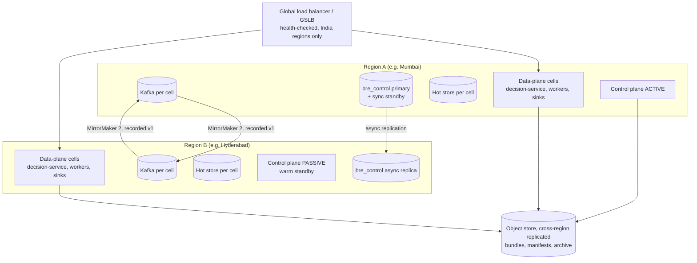

| Plane | Mode | RTO | RPO |
|---|---|---|---|
| Data plane | Active-active. Each region can carry 100% of traffic. Both read the same signed manifests. | ≤ 1 min | 0 in-region; ≤ 5 s on permanent region loss (Sync-DR: 0) |
| Control plane | Active-passive, with a warm standby in region B | ≤ 30 min | ≤ 1 min (async replica). The bundles themselves are replicated in the object store. |
| Archive | Cross-region replicated object store, Object Lock in both regions | n/a | ≤ 15 min replication lag; Kafka plus the sink re-run cover the gap |

The archive is append-only from both regions under region-specific prefixes (`archive/<tenant>/…/region=<r>/`), so there is no write conflict. A sink de-duplicates mirrored records by `decisionId`.

---

## 11. Observability

### 11.1 Metrics

**Cardinality rule:** Prometheus labels are limited to `tenant`, `cell`, `policy`, `decision`, `mode` and `status_class`. **Per-rule** statistics (hit rates, status distribution per rule) are computed in the **analytics pipeline** from decision records, never as Prometheus labels. 50 tenants × 20 policies × 200 rules × 7 statuses would already be 1.4 M series.

| Family | Metric (examples) | Type |
|---|---|---|
| RED: Decision API | `bre_decision_requests_total{tenant,policy,decision,mode}`, `bre_decision_errors_total{tenant,problem_type}`, `bre_decision_duration_seconds{phase=decode\|validate\|evaluate\|record\|total}` | Counter, histogram (native histograms) |
| Durability | `bre_decisionlog_produce_duration_seconds`, `bre_decisionlog_produce_failures_total`, `bre_decisionlog_circuit_state` | Histogram, counter, gauge |
| Engine | `bre_engine_fuel_used` (histogram), `bre_engine_fuel_exhausted_total`, `bre_engine_rule_errors_total{tenant,policy}` | |
| Bundles | `bre_bundle_load_duration_seconds`, `bre_bundle_load_failures_total{reason=signature\|hash\|selftest}`, `bre_bundle_cache_bytes`, `bre_manifest_version` (gauge per pod), `bre_manifest_age_seconds` | |
| Convergence | `bre_deployment_convergence_seconds` (computed by the registry from serving reports) | Histogram |
| USE: resources | CPU, CPU-bulkhead saturation (`bre_bulkhead_queue_depth`), heap, ZGC pause and allocation rate, virtual-thread count, Kafka producer buffer | Gauges |
| Async and sinks | Consumer lag per group, `bre_sink_end_to_end_lag_seconds`, DLQ depth per topic | Gauge, histogram |
| Idempotency | `bre_idempotency_hits_total{result=replay\|in_progress\|key_reused}`, `bre_idempotency_degraded` | |
| Quotas | `bre_quota_rejections_total{tenant}`, `bre_load_shed_total{priority}` | |

### 11.2 Tracing

OpenTelemetry SDK with W3C `traceparent` (`correlationId`, 00 §3.7). Spans: `gateway`, `decision.decode`, `decision.validate`, `decision.select`, `decision.evaluate`, `decision.record`, `kafka.produce`, then the sink and shadow spans linked from the record.

| Allowed span attributes | **Forbidden** span attributes |
|---|---|
| `bre.tenant`, `bre.cell`, `bre.policy`, `bre.bundle` (first 12 hex characters), `bre.deployment`, `bre.mode`, `bre.decision`, `bre.rules.evaluated`, `bre.entities`, `bre.fuel`, `bre.decision_id`, `bre.request_id` | **Any fact value**, `applicationRef` (pseudonymous, but linkable; it is recorded only in the decision record), party references, amounts, scores, DOB, tokens, reason **text** (codes are allowed), BEL expressions with bound values |

Sampling: tail-based. Keep 100% of errors and of requests above 250 ms, and 1% of the rest.

### 11.3 Logging

Structured JSON with the fields `ts`, `level`, `service`, `cell`, `tenant`, `traceId`, `spanId`, `decisionId`, `event` and `problemType`. A **log scrubber** at the appender rejects any field outside an allow-list, so a developer cannot log facts by accident. Logs are shipped to OpenSearch or Loki inside India and retained ≥ 180 days (NFR-COMP-01, CERT-In). Security events (authentication failures, unmask, signature failures, cross-tenant attempts) go to the SIEM.

### 11.4 Business monitors

These are computed by the analytics pipeline per `(tenant, policy, bundleHash)`.

| Monitor | Definition | Alert |
|---|---|---|
| Decision mix | Shares of APPROVE, APPROVE_WITH_DEVIATION, REFER and DECLINE per hour | Change of more than 3σ against the same hour over the last 7 days, or more than X percentage points (tenant-set) within 60 min of a deployment. This is also the **post-activation guardrail** (§10.1). |
| ERROR rate | Rule `ERROR` results ÷ rule evaluations | > 0.05% for 10 min → page |
| DATA_MISSING rate per variable | Missing-data results by input variable | Doubling over the 7-day baseline indicates an upstream fact-preparation defect; notify the tenant |
| Population stability (PSI) | Daily PSI of scorecard scores and the top 20 input variables against the deployment baseline week | PSI > 0.10 warn, PSI > 0.25 alert to model risk |
| Deviation load | Required approvals per authority level per day | Above the tenant-set capacity of that level |
| Champion/challenger | Outcome rates per arm, with the sample size and a confidence interval | Report only; never auto-promote |
| Shadow divergence | Champion × shadow decision matrix | Report; alert if the shadow ERROR rate exceeds 0.1% |

### 11.5 SLOs and error budgets

| SLO | Objective | Window | Error budget | Burn-rate alerts (multi-window) |
|---|---|---|---|---|
| Decision API availability | 99.95% (single region) / 99.99% (two regions) of valid requests not answered with 5xx | 30 days | 21.9 min / 4.4 min | Page at 14.4× burn over 1 h and 5 min; ticket at 6× over 6 h and 30 min |
| Decision API latency | 99% of requests ≤ 100 ms server-side (NFR-PERF-01) | 30 days | 1% slow | Page at 14.4× burn over 1 h |
| Durable record | 100% of 200 responses have a committed record | Continuous | 0 | Any violation is a SEV-1 integrity incident |
| Convergence | 99% of deployments converge ≤ 30 s (NFR-OPS-01) | 30 days | 1% | Ticket on each breach; page if > 5 min |
| Sink freshness | 99% of decisions visible in the hot store ≤ 5 s | 7 days | 1% | Ticket at 6×; page at lag > 10 min |
| Studio availability | 99.5% | 30 days | 3.6 h | Ticket |

---

## 12. Deployment topology

### 12.1 Kubernetes layout (per region)

| Namespace | Contents | Node pool |
|---|---|---|
| `bre-edge` | API gateway | `edge` |
| `bre-control` | `studio-service`, `policy-registry`, `tenant-admin-service`, `studio-web` | `general` |
| `bre-sim` | `simulation-service` coordinator and workers, replay pool | `batch` (separate; may be spot or pre-emptible in non-PROD only) |
| `bre-cell-<id>` (one per cell) | `decision-service`, `decision-worker` (async + bulk deployments), `decision-sink`, `shadow-evaluator` | `decision` (dedicated, no co-tenancy with batch) |
| `bre-data-<id>` | Kafka (Strimzi operator), Valkey, hot-store PostgreSQL (CloudNativePG operator), or managed equivalents | `stateful` (local NVMe) |
| `bre-obs` | OTel collector, Prometheus, Grafana, log shipper | `general` |

### 12.2 Workload settings

| Workload | Requests | Limits | Replicas (per region) | PDB | Spread |
|---|---|---|---|---|---|
| `decision-service` | 2 vCPU, 6 GiB | memory 6 GiB, **no CPU limit** | HPA, min 6, max 24 | `minAvailable: 80%` | `topologySpreadConstraints` zone `maxSkew: 1`, hostname `maxSkew: 1` |
| `decision-worker` (async) | 2 vCPU, 4 GiB | memory 4 GiB | KEDA, 2–24 | `maxUnavailable: 1` | zone |
| `decision-worker` (bulk) | 2 vCPU, 4 GiB | memory 4 GiB | KEDA, 0–N (quota) | none | zone |
| `decision-sink` | 1 vCPU, 2 GiB | memory 2 GiB | KEDA, 3–48 | `maxUnavailable: 1` | zone |
| `shadow-evaluator` | 2 vCPU, 4 GiB | memory 4 GiB | KEDA, 0–24 | none | zone |
| `policy-registry` | 1 vCPU, 2 GiB | memory 2 GiB | 3 | `minAvailable: 2` | zone |
| `studio-service` | 1 vCPU, 2 GiB | memory 2 GiB | 2–4 | `minAvailable: 1` | zone |
| `simulation-service` workers | 4 vCPU, 8 GiB | memory 8 GiB | KEDA, 0–32 | none | — |
| `tenant-admin-service` | 0.5 vCPU, 1 GiB | memory 1 GiB | 2 | `minAvailable: 1` | zone |

JVM flags for `decision-service`: `-XX:+UseZGC -XX:+UseCompactObjectHeaders -XX:MaxRAMPercentage=66 -XX:AOTCache=app.aot -Xss512k`, plus `-XX:+ExitOnOutOfMemoryError`. Readiness is the bundle load and self-test; liveness is the event loop plus the bulkhead watchdog. Graceful shutdown: the pod is removed from endpoints, drains in-flight requests (≤ 10 s), then flushes the producer.

### 12.3 Environments and promotion

| Aspect | Design |
|---|---|
| Environments | `DEV`, `UAT` and `PROD` per tenant (configurable; 00 §3.1). In SaaS, non-PROD environments run in **non-production cells** on separate clusters. PROD runs only in production cells. |
| Policy promotion | A bundle is exported from UAT (`GET /v1/bundles/{bundleHash}`) and imported to PROD (`POST /v1/bundles:import`). On import, the registry verifies the signature and hash, and checks that every pinned asset version exists or is imported with it. The PROD deployment then needs `minDeploymentApprovers[PROD]` (default 2) approvers who are neither its author nor its reviewer. The same `bundleHash` is used in every environment, so what was tested is exactly what runs. |
| Engine and platform releases | A separate GitOps pipeline: build → conformance replay (§15.2) → non-PROD cells → canary **one production cell** (smallest blast radius) for 24 h → remaining cells, wave by wave. Rollback is GitOps revert. |
| Configuration | Helm values per cell, held in Git. No manual changes to clusters. |

### 12.4 Compact mode (single-tenant, on-prem)

| Component | Compact choice | Minimum footprint |
|---|---|---|
| Kubernetes | Any CNCF-conformant distribution (RKE2, k3s, OpenShift) | 3 nodes × 8 vCPU / 32 GiB |
| Data plane | `decision-service` (3 replicas); `decision-sink` only if Kafka is present | on the 3 nodes |
| Control plane | `studio-service`, `policy-registry`, `tenant-admin-service`, `simulation-service` (1 worker), `studio-web` | on the 3 nodes |
| Decision log | **PostgreSQL-first with a transactional outbox** (D6); Kafka is **optional** | PostgreSQL primary + synchronous standby, 2 × 8 vCPU / 32 GiB / 2 TB NVMe |
| Hot store | The same PostgreSQL cluster (separate database) | included |
| Archive | The bank's S3-compatible store with Object Lock, or SeaweedFS / Ceph RGW | 3 nodes or existing |
| Valkey | Optional. Without it, idempotency uses the PostgreSQL unique constraint, and rate limits are local. | 1 primary + 1 replica |
| Keys | The bank's HSM via PKCS#11, or OpenBao with an HSM seal | existing |
| IdP | Keycloak, or the bank's IdP over OIDC | existing |
| Capacity | **≈ 500 decisions/s and ≤ 2 M/day.** Above this, move to Kafka-first. | — |

---

## 13. Technology choices

Every library is from Maven Central or npm (D11). Infrastructure components are open source with the licence noted, or a customer-managed equivalent.

| Concern | Choice | Version line | Licence | Rationale |
|---|---|---|---|---|
| Language and runtime | Java (Eclipse Temurin) | 25 LTS | GPLv2+CE | Virtual threads, `ScopedValue`, generational ZGC, compact object headers, AOT cache |
| Application framework | Spring Boot (Spring Framework 7) | 4.x | Apache-2.0 | Ecosystem, virtual-thread support, observability. The data-plane hot path stays framework-light (`bre-engine-core` has no Spring). |
| Build | Gradle (Kotlin DSL), dependency locking + verification | 9.x | Apache-2.0 | Reproducible, verifiable builds |
| JSON | Jackson (streaming API) | 3.x | Apache-2.0 | The Spring Boot 4 default; the streaming parser avoids tree allocation |
| RPC | gRPC-Java + Protobuf | current 1.x / 4.x | Apache-2.0 / BSD-3 | High-volume callers; schema-first |
| Messaging | Apache Kafka (KRaft) + Spring for Apache Kafka | 4.x | Apache-2.0 | Durable decision log, consumer groups, transactions |
| Kafka on Kubernetes | Strimzi | current | Apache-2.0 | Operator-managed brokers, Cruise Control |
| Relational store | PostgreSQL | 17+ (18 supported) | PostgreSQL licence | Partitioning, RLS, JSONB for diagnostics |
| PostgreSQL on Kubernetes | CloudNativePG | current | Apache-2.0 | Synchronous standby, PITR, failover |
| Migrations | Flyway (community) | 11.x | Apache-2.0 | Versioned DDL including partition maintenance |
| Cache and counters | Valkey (preferred) or Redis | 8.x / 7.x | BSD-3 / tri-licence | Idempotency and rate limits; Valkey avoids Redis 7.4+ licence ambiguity |
| Object storage | Cloud S3, or SeaweedFS / Ceph RGW / MinIO on-prem | — | Apache-2.0 / LGPL / AGPL-3.0 | Object Lock (WORM). Flag MinIO's AGPL to bank legal teams. |
| Columnar archive | Apache Parquet (parquet-java) + zstd-jni | 1.15+ / 1.5.x | Apache-2.0 / BSD | Partition-prunable back-tests |
| Schema registry | Apicurio Registry | 3.x | Apache-2.0 | JSON Schema + Protobuf; avoids the Confluent Community Licence |
| Regex | RE2J | 1.8 | Go/BSD | Linear time; ReDoS-safe |
| Crypto | JDK (AES-GCM, Ed25519, SHA-256); PKCS#11 for the HSM | JDK 25 | — | No extra crypto provider needed |
| Resilience | Resilience4j; Netflix `concurrency-limits` | 2.x / current | Apache-2.0 | Circuit breakers; adaptive concurrency |
| Secrets | OpenBao or cloud secrets manager | current | MPL-2.0 | Vault-compatible without the BSL |
| Identity | Keycloak (default), or any OIDC IdP | 26.x | Apache-2.0 | Per-tenant realms or federation |
| Gateway | Envoy Gateway | current | Apache-2.0 | JWT, mTLS, global rate limiting |
| Autoscaling | KEDA | 2.x | Apache-2.0 | Lag- and queue-based scaling |
| Observability | OpenTelemetry, Micrometer, Prometheus, Grafana, Loki or OpenSearch | current | Apache-2.0 / AGPL (Grafana, Loki) | Standard stack; customer may substitute |
| Analytics | ClickHouse (or the tenant's lakehouse) | 24.x+ | Apache-2.0 | Per-rule statistics, PSI, dashboards |
| GitOps / packaging | Argo CD, Helm | current | Apache-2.0 | Declarative, auditable deploys |
| Policy and admission | Kyverno + cosign | current | Apache-2.0 | Signed-image enforcement |
| Studio front end | React + TypeScript + Vite + Monaco | 19 / 5.x / current | MIT | BEL editor with diagnostics |
| Testing | JUnit 5, jqwik (property tests), JMH, Testcontainers, Gatling (Java DSL), k6 | current | EPL / Apache / MIT / AGPL (k6 is a tool, not shipped) | §15 |

---

## 14. Architecture Decision Records

Every ADR below is **Accepted for Draft 2**.

### ADR-001: Facts in, decision out
- **Context.** Draft 1 contradicts itself on whether the BRE fetches bureau, KYC and VRM data (review B4). A fetching engine cannot meet a 500 ms p99 if a bureau call takes 3 s. It cannot replay decisions exactly, and it would hold regulated bureau data in caches.
- **Decision.** The Decision API is a pure function of `(facts, bundle, asOf)` (D2). Data acquisition belongs to the caller, or to the Phase 3 Fact Connectors, which run as a separate component.
- **Consequences.**
  - Single-digit-ms evaluation; exact replay, simulation and back-test.
  - A smaller regulatory surface.
  - Callers must assemble complete fact snapshots. Fact-schema quality becomes a product concern, which the PRD and the DATA_MISSING monitor address.
- **Alternatives rejected.** The BRE calls data sources inline: latency, coupling, non-determinism. A hybrid with a cache: stale-data ambiguity and PII in the cache.

### ADR-002: Own decision model and BEL; not SpEL, CEL, DRL or the KIE DMN runtime
- **Context.** Rule authors are business users. Money needs exact decimals. Draft 1's SpEL with `StandardEvaluationContext` allows arbitrary code execution (review B1). Draft 1's DSL cannot express decision tables (B3) or collection and time-window logic (B5).
- **Decision.** Own IR for rules, decision tables (with hit policies), scorecards, variables and flows. Own typed, decimal-native, sandboxed **BEL**, compiled at approval into closures run by `bre-engine-core` (D3).
- **Consequences.**
  - Full control of safety (no host calls, fuel), performance and studio UX (precise diagnostics).
  - We own a language: the grammar, type checker and conformance suite are long-lived assets that need investment.
  - DMN import/export is deferred to Phase 3.
- **Alternatives rejected.**
  - SpEL: unsafe by default and has no decimal discipline.
  - CEL: sandboxed but has **no decimal type**.
  - Drools DRL: not usable by business analysts; a heavy runtime.
  - KIE DMN/FEEL runtime: a standard and the closest fit, but heavy, with less control over diagnostics and sandboxing (external function definitions must be fenced off). It is kept as the reference semantics for hit policies and unary tests.

### ADR-003: Kafka-first decision log, with a PostgreSQL-first compact mode
- **Context.** Draft 1 demands RPO 0 but writes the audit log asynchronously (review B6). One row per rule at 1,000 req/s × 100 rules is 8.6 billion rows a day.
- **Decision.** One record per decision, produced to `bre.decision.recorded.v1` with `acks=all` **before** responding. Sinks fan out to the hot store, archive and analytics. Compact mode uses a PostgreSQL transaction plus an outbox. Both sit behind the `DecisionLog` port (D6).
- **Consequences.**
  - The write path scales horizontally by partitions.
  - The response latency includes a cross-AZ replication round trip (§6.2, about 4 ms at p50).
  - Kafka becomes Phase 1 infrastructure (00 §3.7a).
  - Read-after-write through `GET` is eventually consistent (≤ 5 s), mitigated by the 15-minute response cache.
- **Alternatives rejected.**
  - Synchronous PostgreSQL insert at 10,000/s with large blobs: one primary becomes the bottleneck, with write amplification.
  - Asynchronous logging: violates RPO 0.
  - Writing directly to the object store: no low-latency durable append.

### ADR-004: Signed, content-addressed bundles and a signed active-pointer manifest
- **Context.** Rule-by-rule activation leaves policies inconsistent mid-change, and decisions are not reproducible (review B7). Kafka-driven cache invalidation can leave a deactivated rule live for 30 minutes (H3).
- **Decision.** Approval produces an immutable bundle `sha256` signed with Ed25519. Activation and rollback are monotonically versioned, signed manifest flips. Pods verify both before use (D5).
- **Consequences.**
  - Atomic switches; rollback in seconds; tamper evidence.
  - The same artifact runs in UAT and PROD.
  - Requires HSM-backed key management and a trust store in pods.
- **Alternatives rejected.** Rows in a shared database read by the data plane: coupling and no tamper evidence. Git-based rules: a business-user mismatch and no runtime atomicity guarantee.

### ADR-005: In-process compiled snapshot instead of a Redis rule cache
- **Context.** Draft 1 reads rules from Redis on every request, with a 30-minute TTL and Kafka-driven invalidation (H3).
- **Decision.** Compiled bundles live in each pod's memory (an LRU by hash). The pointer table is swapped atomically. Redis/Valkey is not on the policy path at all.
- **Consequences.**
  - Lookup in about 10 µs with no network.
  - Convergence is governed by the manifest long-poll (≤ 30 s at p99, typically about 2 s).
  - Memory per pod must be budgeted (§6.3), with pod groups as the overflow strategy.
- **Alternatives rejected.** A Redis cache: extra hop, serialisation cost, invalidation races. Database reads with a short TTL: load and staleness.

### ADR-006: Regenerate explanations by deterministic replay
- **Context.** Storing a full trace per decision would multiply record size by about 10, against a 25 M/day design point.
- **Decision.** Store outcomes, reason codes and key values. Regenerate the trace on demand from the stored facts, bundle hash and engine major, and verify that the replayed outcome equals the recorded one (D7).
- **Consequences.**
  - About 10× less storage.
  - An explanation costs one evaluation (milliseconds).
  - Engine majors must be retained as replay images for the archive retention period.
- **Alternatives rejected.** Storing every trace (cost). Storing no trace and no replay capability (fails audit).

### ADR-007: Cell-based data plane
- **Context.** A multi-tenant SaaS needs bounded blast radius, noisy-neighbour isolation and linear scale.
- **Decision.** Tenants are mapped to cells; each cell has its own pods, Kafka and hot store. Dedicated cells serve large tenants (D14).
- **Consequences.** Linear scale-out and fault isolation. The control plane, routing table and tenant moves need tooling (§6.5).
- **Alternatives rejected.** One global cluster: blast radius and noisy neighbours. A cluster per tenant: cost and operational load for small tenants.

### ADR-008: UUIDv7 decision IDs with locator bits
- **Context.** IDs must be index-friendly (time-ordered), globally unique without coordination, and routable to the right cell and shard.
- **Decision.** UUIDv7 (RFC 9562). 16 bits of `rand_b` carry `cellId` and `shardId` (§6.5.4).
- **Consequences.** B-tree locality; direct routing for `GET`. The locator bits are internal and not a contract for callers.
- **Alternatives rejected.** UUIDv4: index fragmentation. Snowflake-style IDs: need worker-id coordination. Database sequences: a single point of contention.

### ADR-009: REST and gRPC for the Decision API
- **Context.** Callers range from modern microservices to legacy LOS platforms.
- **Decision.** OpenAPI 3.1 REST/JSON for reach. gRPC/protobuf for high-volume callers. Both use the same handler and the same engine (D12).
- **Consequences.** Two contracts to version, both generated from one domain model, with `buf breaking` and OpenAPI diff gates.
- **Alternatives rejected.** REST only: about 3–5× higher decode cost at volume. gRPC only: excludes many LOS platforms.

### ADR-010: PostgreSQL hot store with time-bounded application sharding
- **Context.** Up to about 9.5 TB of 90-day serving data per design-max cell, with simple access patterns (by ID, by application).
- **Decision.** PostgreSQL 17+, partitioned by day and sub-partitioned by tenant hash. Application-level sharding is used beyond about 2.5 TB per shard. Resharding is time-bounded (new epoch; old data ages out), so there is no migration.
- **Consequences.** A familiar operational model and RLS for tenant isolation. Cross-shard queries are limited to lists by `applicationRef`.
- **Alternatives rejected.**
  - Cassandra/Scylla: no RLS, weaker ad-hoc investigation.
  - Distributed SQL (YugabyteDB): kept as the fallback if online history beyond 90 days becomes a requirement.
  - Elasticsearch: not a system of record.

### ADR-011: Parquet archive on WORM object storage
- **Context.** 10-year retention, regulator-grade immutability, and back-tests over millions of decisions.
- **Decision.** Hourly Parquet files per tenant with manifests, on object storage with Object Lock (compliance mode), crypto-shredding for erasure (§9.3), and cross-region replication.
- **Consequences.** Cheap storage at petabyte scale; partition-pruned back-tests; erasure without rewriting WORM objects.
- **Alternatives rejected.** Keeping everything in PostgreSQL: cost, and vacuum at scale. Kafka infinite retention: not query-friendly, and no WORM guarantee.

### ADR-012: Java 25 and Spring Boot 4 with virtual threads and a CPU bulkhead
- **Context.** Draft 1 targets Java 17 and Spring Boot 3.x (review H8). The hot path mixes I/O waits (the Kafka ack) with CPU-bound evaluation.
- **Decision.** Java 25 LTS and Spring Boot 4.x. Virtual threads for request handling. An explicit CPU bulkhead around evaluation. Generational ZGC; AOT cache.
- **Consequences.** Simple blocking code at high concurrency; flat p99. The team must follow virtual-thread hygiene: no `ThreadLocal` caches; use `ScopedValue`.
- **Alternatives rejected.** Reactive (WebFlux): complexity with no throughput gain once virtual threads are available. Java 17: misses `ScopedValue`, generational ZGC by default, compact headers and the AOT cache.

### ADR-013: Deviation approval stays outside the BRE
- **Context.** Draft 1 is ambiguous about who owns deviation approval and expiry (review R7).
- **Decision.** The BRE computes the required approvals from a versioned **Authority Matrix**. The caller's workflow runs the approval. Approvals return as `deviationApprovals[]` facts, bound to an approved value and an expiry (D10).
- **Consequences.** The BRE stays stateless and deterministic. Re-evaluation re-raises a deviation only if the measured value worsens beyond the approved bound. Callers must persist approvals and send them back.
- **Alternatives rejected.** A BRE-owned approval workflow: stateful, which breaks replay purity, and duplicates every LOS's workflow engine.

### ADR-014: Multi-tenant by default
- **Context.** The product must serve SaaS tenants and single-tenant installs from one codebase (D1).
- **Decision.** `tenant_id` is everywhere (rows, keys, events, metrics, logs, encryption context). A single-tenant install is simply `tenantCount = 1`.
- **Consequences.** One artifact set. Isolation tests are part of CI. A slight overhead in key design.
- **Alternatives rejected.** Single-tenant code with retrofitted tenancy: historically the most expensive migration a SaaS can face.

### ADR-015: Crypto-shredding to reconcile WORM retention with erasure
- **Context.** DPDP erasure obligations versus immutable archives and backups.
- **Decision.** Identifying fact fields are encrypted under a per-data-principal key (DPK), which is wrapped by a tenant key. Erasure, once permitted after legal retention ends, deletes the DPK.
- **Consequences.**
  - WORM integrity is preserved.
  - Aggregates and non-identifying analytics survive erasure.
  - Requires a stable `principalRef` from callers (Appendix B) and a key table with its own backup-expiry policy.
- **Alternatives rejected.** Rewriting archives (breaks WORM). Tenant-level keys only (cannot erase one person).

---

## 15. Verification strategy

### 15.1 Engine micro-benchmarks (JMH)

| Benchmark | Input | Pass criterion |
|---|---|---|
| `evaluate_retail_100` | Profile R, 100-rule bundle | ≤ 0.4 ms average, ≤ 50 KB allocated per operation |
| `evaluate_jlg_g10` | Profile G10, 300 rules (200 member-scoped) | ≤ 1.5 ms average |
| `evaluate_jlg_g40_1000` | Profile G40, 1,000 rules | ≤ 50 ms average (NFR-PERF-02 headroom) |
| `decode_json_52k` / `decode_proto_52k` | Blended facts | ≤ 0.25 ms / ≤ 0.08 ms |
| `bundle_load_1000` | 1,000-rule bundle, 100k-entry list | ≤ 500 ms including verify and self-test |
| `fuel_exhaustion` | Adversarial nested filters | Terminates at the fuel limit, ≤ 50 ms, produces `ERROR` |

These run on every merge. A regression above 10% fails the build.

### 15.2 Determinism and conformance

- **Property tests (jqwik):** for any facts and bundle, `evaluate` is pure (same output on repeated runs and across threads), and no result containing `ERROR` or `DATA_MISSING` yields `APPROVE` (D9).
- **Golden conformance suite:** BEL and IR test vectors (from `03_LLD.md`) with exact expected values, including decimal rounding, null logic and hit policies.
- **Conformance replay gate for engine releases:** replay a stratified sample of at least 100,000 decisions per tenant from the last 30 days (synthetic decisions in non-PROD). Any outcome difference blocks a minor or patch release. Only a major release may change outcomes, and then the replay pool keeps the previous major.

### 15.3 Load profiles (Gatling, Java DSL; k6 for external smoke tests)

| Profile | Shape | Validates |
|---|---|---|
| L1 Sustained | 5,000/s blended mix for 2 h on one cell | NFR-SCALE-01, NFR-PERF-01 |
| L2 Burst | Ramp from 2,000 to 10,000/s in 60 s, hold 15 min | Burst capacity, HPA reaction, p99 under scale-out |
| L3 Large groups | 200/s of G40 with 1,000-rule bundles | NFR-PERF-02 |
| L4 Bulk + online | 1 M bulk job concurrent with 3,000/s online | NFR-SCALE-02; priority isolation (P0 p99 unaffected within 10%) |
| L5 Noisy neighbour | Tenant A at 3× its quota, tenant B at normal load | Quotas and fair share; B's p99 unaffected within 10% |
| L6 Back-test | 1 M archived decisions | NFR-SCALE-03 (≤ 30 min) |
| L7 Soak | 1,500/s for 72 h | Memory and GC stability, no leaks, partition maintenance, retention drops |

### 15.4 Chaos and failure experiments

| Experiment | Expected |
|---|---|
| Kill 1 of 3 AZs (pods + 1/3 of brokers) | No failed requests beyond in-flight. p99 within SLO after ≤ 60 s. RPO 0. |
| Kafka `min.insync.replicas` unattainable | Fail closed with `503`; zero 200s without a record (verified by reconciling responses against the archive) |
| Hot store primary killed | Decisions unaffected. Sink catch-up ≤ 10 min. |
| Registry down for 30 min, plus a pod restart | New pods boot from the manifest mirror; no decision errors |
| Corrupted bundle in the object store | Signature or hash failure, pods refuse it, alert raised, no impact on serving |
| Valkey flush mid-load | Duplicates on client retry are identical; the sink de-duplicates |
| KMS blackout for 45 min | No impact. At 65 min, fail closed. |
| Region failover drill (quarterly) | RTO ≤ 1 min; the survivor carries 100% |

### 15.5 Proving the 30-second convergence

- **Continuous synthetic deployments.** Every 15 minutes in every cell, a canary tenant deploys a new bundle that alternates between two versions and differs only in one sentinel output. A synthetic client issues decisions and records the first instant at which every pod returns the new sentinel. Pods identify themselves in a debug header available to the canary tenant only.
- **Registry measurement.** `bre_deployment_convergence_seconds` is computed from pod serving reports.
- **Pass criterion.** The p99 of both measures is ≤ 30 s over a rolling 30 days (NFR-OPS-01), and both measures agree within 2 s.

---

## Appendix A: Traceability from review findings

| Review finding | Summary | Addressed in |
|---|---|---|
| B1 | SpEL allows arbitrary code execution | §4.1 (closed function registry, no host calls), §9.6 T1/T5, ADR-002 |
| B2 | Errors let the loan through | §4.1.2 (fail-closed classify, property test), §15.2, 00 §3.5 |
| B3 | Worked example wrong for every input | §4.1.1 (decision tables, hit policies, overlap/gap static checks, mandatory Test Cases) |
| B4 | Who fetches data | ADR-001, §2.1, §3 |
| B5 | Rule model too thin | §4.1 (variables, collections, scopes, aggregation), `03_LLD.md` |
| B6 | Audit contradictions, volume, invalid DDL, immutability | §5.1, §6.1.3–6.1.5, §7, ADR-003, ADR-010, ADR-011, §4.6 (hash chain) |
| B7 | No policy-level versioning; no rollback | §3.2, §5.5, §5.6, §5.8, ADR-004 |
| H1 | Leader-only Kafka consumers | §4.3 (consumer groups), §6.4 |
| H2 | Kubernetes vs Eureka | §12.1 (Kubernetes DNS and service mesh; no Eureka) |
| H3 | Cache invalidation depends on Kafka | ADR-005, §5.5, §5.6 |
| H4 | PII-keyed bureau caches | ADR-001 (no bureau data held), §9.4 |
| H5 | Masked vs encrypted inputs | §9.3 (encrypted full facts + masked views), §9.4 |
| H6 | DR covers pods only | §10, §6.1.6 (AZ/region sizing) |
| H7 | Engine choice unjustified | ADR-002 |
| H8 | Java 17 / Boot 3.x | ADR-012, §13 |
| S1 | Async persist vs RPO 0 | §5.1 (durability point before the 200) |
| S2 | Lifecycle gaps | 00 §3.3–3.4; §5.5, §5.6 |
| S3 | Mixed product journeys; re-run semantics | §5.8 (resolution per product line and stage, pinning), §5.11 |
| S4 | Text-table diagrams | Mermaid diagrams throughout |
| L6 | BIGINT application IDs | `applicationRef` string (00 §3.7); §6.1.4 indexes |
| L7 | No tenant, no optimistic locking | §8, §4.6 (`row_version`) |
| L8 | Effective dating gaps | §4.7 (scheduled deployments, pre-staged switch), §10.1 (clock skew), 00 §3.7a |
| L9 | Floating-point money | §4.1.2 (`BigDecimal`), 00 §3.10 |
| L10 | Silent nulls | §4.1.2 (`onMissing`, three-valued logic) |
| L11 | Kafka message loss | §4.3 (`DefaultErrorHandler`, DLQ, transactional offsets) |
| L12 | API gaps | §3.13 of 00; §5; `03_LLD.md` |

## Appendix B: Additions to canonical terms and open points

### B.1 Additions

| Term | Definition | Section |
|---|---|---|
| **Active Pointer Manifest** | A signed (registry key), monotonically versioned list of deployments per cell, with resolution keys and the servable set. Pods accept only versions ≥ the last seen. | §3.2, §4.7 |
| **Servable set** | Bundles that were ACTIVE as CHAMPION in an environment within `grandfatherWindowDays`, which pinned requests may use | §3.2, §5.8 |
| **Manifest mirror** | A copy of each signed manifest in the object store, used for booting when the registry is down | §4.7, §10.1 |
| **Serving report** | A pod's report of `(manifestVersion, bundle hashes, status)`, used to compute convergence | §5.5 |
| **Load-time self-test** | Running a bundle's own Test Cases in the pod before serving it | §4.2, §5.5 |
| **Outcome guardrails** | Post-activation monitors on the decision mix and the ERROR/REFER rate that trigger alerting or rollback | §10.1, §11.4 |
| **Engine major / replay pool** | Retained engine images, one per major version, used to replay decisions recorded under older engines | §4.1.2, §5.9 |
| **Decision locator bits** | 8 bits of cellId + 8 bits of shardId inside UUIDv7 `rand_b` | §6.5.4, ADR-008 |
| **Pod group** | A subset of a cell's decision-service pods that serves a subset of tenants, used to bound bundle memory | §6.5.5 |
| **Priority classes P0–P3** | P0 sync, P1 async, P2 bulk, P3 shadow, back-tests and analytics; shed in reverse order | §6.4 |
| **Physical topic prefix** | `<cellId>.<logical topic>` when several cells share a Kafka cluster. Logical names stay canonical. | §6.5.1 |
| **Sync-DR mode** | Optional per-tenant mode that produces to a stretched two-region cluster, for RPO 0 even under permanent region loss | §10.1 |
| **TDK / PKWK / DPK** | Tenant Data Key (per hour), Principal Key Wrapping Key, Data Principal Key | §9.3 |
| **`principalRef`** | A stable data-principal reference on `parties[]`, used for crypto-shredding. Defaults to `partyRef` if absent. **Needs adding to the Fact Schema (00 §3.9).** | §9.3, ADR-015 |
| **`shadowSampleBasisPoints`** | Per-SHADOW-deployment sampling rate | §4.5 |
| **`memberParallelism`** | Optional intra-request parallelism over member scopes (default 1) | §6.2 |
| **Result webhooks** | Compact-mode delivery of async results and events when Kafka is absent | §5.2 |
| Problem `policy-not-resolved` | Returned when no policy matches `(productLine, stage, segment)` and no `policyCode` was given | §5.8 |

### B.2 Ambiguities found in 00, and the resolution taken here

1. **NFR-DR-01, RPO 0.** RPO 0 holds for AZ failure and region outage. Under **permanent destruction** of a region, RPO is the cross-region replication lag (≤ 5 s) unless Sync-DR mode is enabled. *Adopted in 00 §4 NFR-DR-01.*
2. **Event payload encoding.** 00 fixes CloudEvents but not the payload format. Taken here: protobuf for `bre.decision.recorded.v1` (shared with gRPC; compact), and JSON Schema for every other topic. *Adopted in 00 §3.13; the LLD matches (§7.1).*
3. **Hot-store retention of facts.** D6 says the hot store keeps 90 days. Taken here: **headers and results** for 90 days, **encrypted facts for 14 days**; older facts are read from the archive for explanations. That cuts the hot-store size by about 60%. *Adopted in 00 D6.*
4. **SaaS async ingress.** *Resolved in 00 §3.13:* shared-cell SaaS tenants use `POST /v1/decisions:async` (202), with no Kafka access. Dedicated cells and single-tenant installs may produce directly under per-tenant ACLs (§5.3, §8.2).
