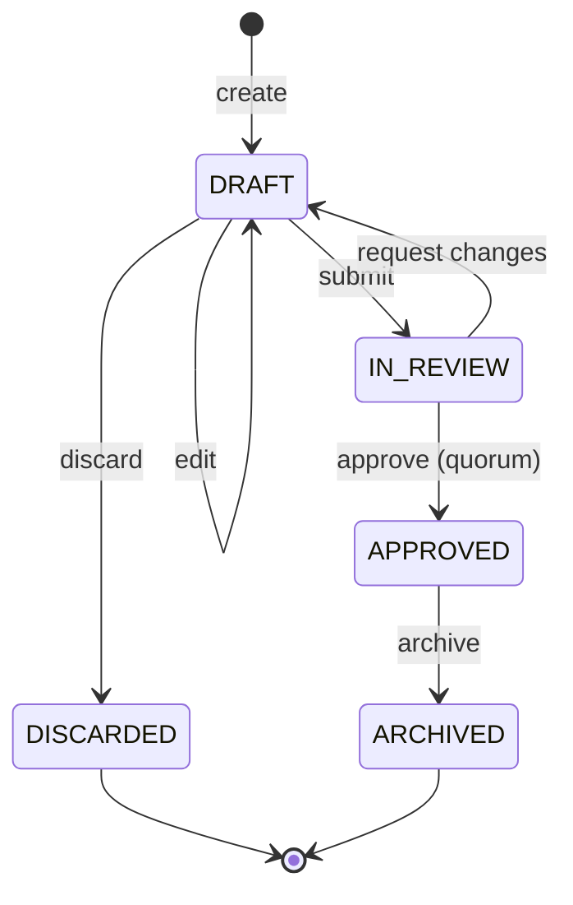
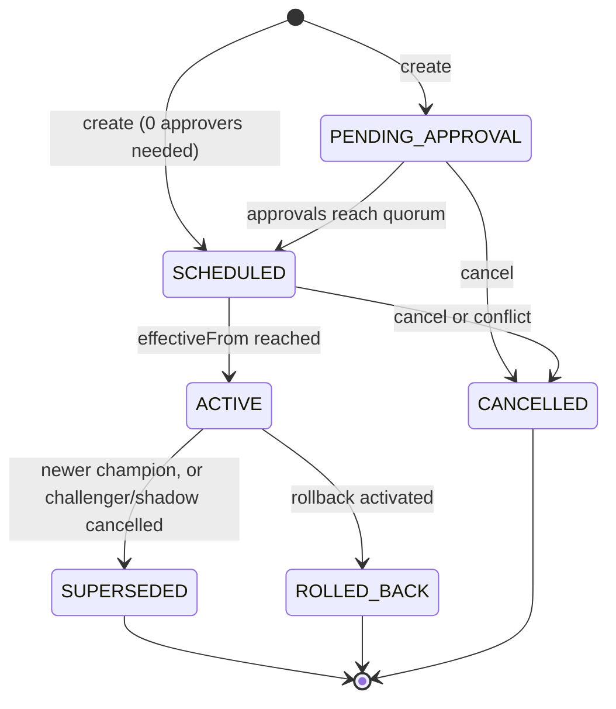
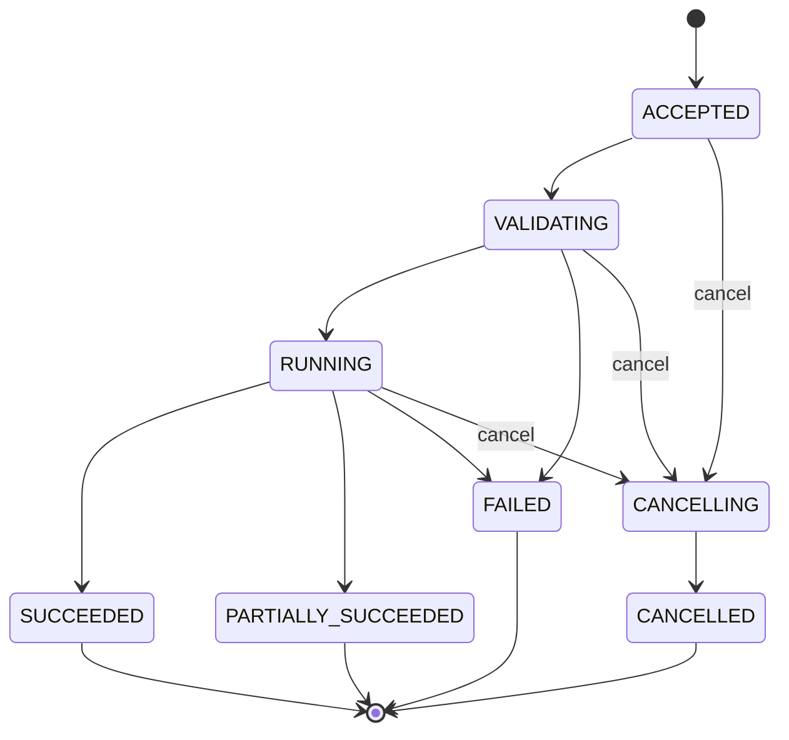

# BRE Platform — Low-Level Design (Draft 2)

## 0. Document control

| Item | Value |
|---|---|
| Document | 03_LLD.md — Low-Level Design |
| Version | Draft 2.0 |
| Date | 2026-10-01 |
| Status | Draft for engineering review |
| Normative inputs | `00_Decisions_and_Canonical_Terms.md` (D1–D15, §3 vocabulary, §3.14 PSF v1, §4 NFRs) |
| Companion documents | `01_PRD.md`, `02_Architecture.md`, `04_Rule_Authoring_Guide.md` |
| Replaces | Draft 1 `BRE_LLD.pdf` v1.0 (June 2026) in full |
| Audience | Engineers building `bre-engine-core`, the data-plane and control-plane services, and SDK users |

**Conventions**
- The words MUST, MUST NOT, SHOULD and MAY follow RFC 2119.
- JSON examples are valid JSON. Comments appear only in YAML and SQL.
- Decimal values in JSON responses and in bundles are serialised as **strings** (§2.5, §6.1).
- All SQL is PostgreSQL 17 dialect.
- Any term this document adds beyond the canonical vocabulary is listed in Appendix B.

---

## 1. Code structure

### 1.1 Repository layout

There is one Gradle (Kotlin DSL) multi-project build. Versions are managed in `gradle/libs.versions.toml`. Every dependency resolves from Maven Central; the web studio's dependencies resolve from npm.

```
bre-platform/
├── settings.gradle.kts
├── gradle/libs.versions.toml
├── build-logic/                      # convention plugins
│   ├── bre.java-library.gradle.kts   # Java 25 toolchain, -Werror, errorprone, jacoco
│   ├── bre.spring-service.gradle.kts # Spring Boot 4.x, virtual threads, OCI image, SBOM (CycloneDX)
│   └── bre.contracts.gradle.kts      # protobuf + OpenAPI generation, buf-breaking check
├── libs/
│   ├── bre-engine-core/              # IR model, BEL, compiler, evaluator, explainer, static checks
│   ├── bre-ir-json/                  # IR <-> JSON, PSF (YAML 1.2) <-> IR, BRE-JCS canonical JSON
│   ├── bre-bundle/                   # bundle format, hashing, Ed25519 sign/verify
│   ├── bre-fact-model/               # canonical fact JSON Schema, typed fact reader, classification
│   ├── bre-crypto/                   # envelope encryption, key hierarchy, masking
│   ├── bre-contracts/                # OpenAPI 3.1, .proto, AsyncAPI 3.0, event JSON Schemas
│   ├── bre-platform-common/          # tenancy context, UUIDv7, problem+json, OTel helpers, PII log guard
│   └── bre-sdk-java/                 # REST + gRPC client; optional embedded engine
├── services/
│   ├── decision-service/
│   ├── decision-worker/
│   ├── decision-sink/
│   ├── shadow-evaluator/
│   ├── studio-service/
│   ├── policy-registry/
│   ├── simulation-service/
│   └── tenant-admin-service/
├── apps/studio-web/                  # React + TypeScript (npm), Monaco BEL language support
├── tools/bre-cli/                    # psf lint | compile | test | bundle | verify (local, offline)
└── tests/
    ├── engine-conformance/           # language-neutral test vectors (JSON) + JUnit runner
    └── perf/                         # JMH (engine), k6 (API), chaos scripts
```

### 1.2 Dependency rules (enforced by Gradle and ArchUnit)

| Module | MAY depend on | MUST NOT depend on |
|---|---|---|
| `bre-engine-core` | JDK 25, `com.google.re2j:re2j` | Spring, Jackson, any logging backend (it uses `System.Logger` with no fact values), any I/O |
| `bre-ir-json` | engine-core, `jackson-core`/`jackson-databind`, `snakeyaml-engine` (YAML 1.2) | Spring |
| `bre-bundle` | engine-core, ir-json, JDK `java.security` (Ed25519, SHA-256) | Spring |
| `bre-fact-model` | engine-core (value types), `jackson-core`, a JSON Schema validator | Spring |
| `bre-crypto` | JDK `javax.crypto`, `zstd-jni`, a KMS client port (interface only) | engine-core |
| `services/*` | any lib, Spring Boot 4.x | another service's internal packages |
| `bre-sdk-java` | contracts, optionally engine-core + ir-json + bundle | Spring (core SDK); a separate `bre-sdk-spring` adapter MAY exist |

ArchUnit enforces three more rules:
1. No class in `dev.bre.engine..` imports `java.time.Clock`, `System.currentTimeMillis`, `Instant.now`, `LocalDate.now`, `Random` or `ThreadLocalRandom` (determinism, D8).
2. No logging call anywhere receives a `FactsDocument`, `RecordV` or `JsonNode` argument (PII guard, §9.6).
3. Engine exceptions carry fact *paths* and *types*, never values.

### 1.3 Package root and main types

The package root is `dev.bre`.

| Module | Package | Main types |
|---|---|---|
| engine-core | `dev.bre.engine.ir` | `PolicyIr`, `VariableDef`, `RuleDef`, `DecisionTableDef`, `ScorecardDef`, `FlowDef`, `StageDef`, `StepDef`, `AggregateSpec`, `HitPolicy`, `TestCaseDef` |
| | `dev.bre.engine.bel.lex` / `.parse` / `.ast` | `Lexer`, `Token`, `Parser` (hand-written recursive descent), `UnaryTestParser`, `Expr` sealed hierarchy |
| | `dev.bre.engine.bel.types` | `BelType` sealed hierarchy, `TypeChecker`, `Scope`, `SymbolTable` |
| | `dev.bre.engine.bel.fn` | `FunctionRegistry` (closed), `FunctionSpec`, built-in implementations |
| | `dev.bre.engine.compile` | `PolicyCompiler`, `VariableGraph`, `CompiledPolicy`, `Node` (closure tree), `CostEstimator` |
| | `dev.bre.engine.eval` | `Evaluator`, `Frame`, `FuelMeter`, `Value` sealed hierarchy (`DecimalV`, `IntV`, `BoolV`, `TextV`, `DateV`, `DateTimeV`, `PeriodV`, `ListV`, `RecordV`, `Missing`), `RuleResult`, `EntityResult`, `StepResult`, `DecisionOutcome` |
| | `dev.bre.engine.decide` | `Aggregator`, `PrecedenceResolver`, `DeviationMatcher`, `AuthorityResolver`, `ReasonSelector`, `TrafficSplitter` |
| | `dev.bre.engine.explain` | `TraceRecorder`, `TraceNode`, `Explanation` |
| | `dev.bre.engine.check` | `StaticChecker`, `TableAnalyzer`, `IntervalDomain`, `Box`, `CheckFinding` |
| bundle | `dev.bre.bundle` | `Bundle`, `BundleManifest`, `BundleHasher`, `BundleSigner`, `BundleVerifier`, `TrustStore` |
| ir-json | `dev.bre.irjson` | `IrCodec`, `PsfCodec`, `BreJcs` |
| fact-model | `dev.bre.facts` | `FactSchema`, `FactReader` (JSON → `RecordV` in one pass), `Classification`, `ProhibitedDataDetector` |
| crypto | `dev.bre.crypto` | `FactsEnvelope`, `TenantDataKeyProvider` (TDK), `PrincipalKeyService` (PKWK/DPK), `KmsPort`, `Masker`, `FieldGroupSplitter` |
| decision-service | `dev.bre.decision.api` / `.app` / `.log` / `.bundles` | `DecisionController`, `DecisionGrpcService`, `DecideUseCase`, `DecisionLog` (port), `KafkaDecisionLog`, `OutboxDecisionLog`, `BundleCache`, `PointerWatcher`, `IdempotencyStore` |

---

## 2. Policy IR, PSF and bundles

### 2.1 Design rules for the IR

1. The IR is the **compiled-from** form of a PolicyVersion. A bundle carries the IR and the pinned assets. Every data-plane pod recompiles the IR into a closure tree on load (§4.4). This is cheap and deterministic for a given `engineVersion`.
2. Expressions are stored as **BEL source text**, not as serialised ASTs. The text is short and auditable, and the parser is part of the same engine. The type checker re-validates every expression against the pinned fact schema on load.
3. Every default is **explicit** in the IR; PSF may omit defaults. Examples: `onMissing.policy = "REFER"`, `aggregate.kind = "WORST"`, `knockout = false`.
4. **Decimals are JSON strings** wherever they appear as data (parameter values, list items of Decimal type, literal outputs in decision-table rows, expected test values). JSON numbers are allowed only for integers in the range ±(2^53 − 1). This keeps canonicalisation lossless (§2.5).
5. Array order is significant: decision-table rows, scorecard bins, flow stages and steps. Every other array (variables, rules, tables, scorecards, tests) MUST be emitted sorted by `name`/`code` before hashing.

### 2.2 JSON Schema for the PolicyVersion IR (draft 2020-12)

```json
{
  "$schema": "https://json-schema.org/draft/2020-12/schema",
  "$id": "https://bre.dev/schemas/ir/policy-version-1.json",
  "title": "BRE PolicyVersion IR v1",
  "type": "object",
  "additionalProperties": false,
  "required": ["irVersion", "policy", "factSchema", "assets", "settings", "variables", "rules", "decisionTables", "scorecards", "flow", "tests"],
  "properties": {
    "irVersion": { "const": 1 },
    "policy": {
      "type": "object",
      "additionalProperties": false,
      "required": ["tenantId", "code", "version", "productLines", "stage"],
      "properties": {
        "tenantId": { "$ref": "#/$defs/tenantId" },
        "code": { "$ref": "#/$defs/code" },
        "version": { "type": "integer", "minimum": 1 },
        "productLines": { "type": "array", "minItems": 1, "uniqueItems": true, "items": { "$ref": "#/$defs/code" } },
        "stage": { "$ref": "#/$defs/code" },
        "segment": { "oneOf": [ { "$ref": "#/$defs/code" }, { "type": "null" } ] },
        "description": { "type": "string", "maxLength": 4000 }
      }
    },
    "factSchema": {
      "type": "object",
      "additionalProperties": false,
      "required": ["code", "version"],
      "properties": {
        "code": { "type": "string", "pattern": "^[a-z][a-z0-9-]{1,63}$" },
        "version": { "type": "string", "pattern": "^(0|[1-9][0-9]*)\\.(0|[1-9][0-9]*)\\.(0|[1-9][0-9]*)$" }
      }
    },
    "assets": {
      "type": "object",
      "additionalProperties": false,
      "required": ["parameterSet", "referenceLists", "reasonCodes", "authorityMatrix"],
      "properties": {
        "parameterSet": { "oneOf": [ { "$ref": "#/$defs/assetRef" }, { "type": "null" } ] },
        "referenceLists": { "type": "array", "items": { "$ref": "#/$defs/assetRef" } },
        "reasonCodes": { "$ref": "#/$defs/assetRef" },
        "authorityMatrix": { "oneOf": [ { "$ref": "#/$defs/assetRef" }, { "type": "null" } ] }
      }
    },
    "settings": {
      "type": "object",
      "additionalProperties": false,
      "required": ["authorityAmount", "customerReasonLimit"],
      "properties": {
        "authorityAmount": { "$ref": "#/$defs/expr" },
        "customerReasonLimit": { "type": "integer", "minimum": 0, "maximum": 10 },
        "fuelLimit": { "type": "integer", "minimum": 1000, "maximum": 10000000 }
      }
    },
    "variables": { "type": "array", "items": { "$ref": "#/$defs/variable" } },
    "rules": { "type": "array", "items": { "$ref": "#/$defs/rule" } },
    "decisionTables": { "type": "array", "items": { "$ref": "#/$defs/decisionTable" } },
    "scorecards": { "type": "array", "items": { "$ref": "#/$defs/scorecard" } },
    "flow": { "$ref": "#/$defs/flow" },
    "tests": { "type": "array", "items": { "$ref": "#/$defs/testCase" } }
  },
  "$defs": {
    "tenantId": { "type": "string", "pattern": "^[a-z][a-z0-9_]{2,31}$" },
    "code": { "type": "string", "pattern": "^[A-Z][A-Z0-9_]{1,63}$" },
    "name": { "type": "string", "pattern": "^[a-z][A-Za-z0-9_]{0,63}$" },
    "expr": { "type": "string", "minLength": 1, "maxLength": 8000 },
    "decimalString": { "type": "string", "pattern": "^-?(0|[1-9][0-9]*)(\\.[0-9]+)?$" },
    "assetRef": {
      "type": "object",
      "additionalProperties": false,
      "required": ["code", "version"],
      "properties": { "code": { "$ref": "#/$defs/code" }, "version": { "type": "integer", "minimum": 1 } }
    },
    "belType": { "enum": ["Decimal", "Integer", "Boolean", "Text", "Date", "DateTime", "Period", "Record", "List<Decimal>", "List<Integer>", "List<Text>", "List<Date>", "List<Record>"] },
    "scope": { "enum": ["APPLICATION", "PARTY", "GROUP", "MEMBER", "HOUSEHOLD", "COLLATERAL"] },
    "status": { "enum": ["PASS", "DEVIATION", "REFER", "FAIL"] },
    "anyStatus": { "enum": ["PASS", "DEVIATION", "REFER", "FAIL", "NOT_APPLICABLE", "DATA_MISSING", "ERROR"] },
    "governance": {
      "type": "object",
      "additionalProperties": false,
      "required": ["overrideRef"],
      "properties": { "overrideRef": { "type": "string", "pattern": "^GOV-[A-Z0-9-]{3,40}$" } }
    },
    "variable": {
      "type": "object",
      "additionalProperties": false,
      "required": ["name", "type", "scope", "expr"],
      "properties": {
        "governance": { "$ref": "#/$defs/governance" },
        "name": { "$ref": "#/$defs/name" },
        "type": { "$ref": "#/$defs/belType" },
        "scope": { "$ref": "#/$defs/scope" },
        "expr": { "$ref": "#/$defs/expr" },
        "description": { "type": "string", "maxLength": 2000 }
      }
    },
    "onMissing": {
      "type": "object",
      "additionalProperties": false,
      "required": ["policy"],
      "properties": {
        "policy": { "enum": ["REFER", "FAIL", "NOT_APPLICABLE", "USE_DEFAULT"] },
        "value": { "type": "boolean" },
        "reasonCode": { "$ref": "#/$defs/code" }
      },
      "if": { "properties": { "policy": { "const": "USE_DEFAULT" } } },
      "then": { "required": ["value"] },
      "else": { "not": { "required": ["value"] } }
    },
    "outcome": {
      "type": "object",
      "additionalProperties": false,
      "required": ["status"],
      "properties": {
        "status": { "$ref": "#/$defs/status" },
        "reasonCode": { "$ref": "#/$defs/code" },
        "deviationType": { "$ref": "#/$defs/code" },
        "measure": { "$ref": "#/$defs/expr" },
        "worseWhen": { "enum": ["HIGHER", "LOWER"] }
      },
      "allOf": [
        { "if": { "properties": { "status": { "const": "DEVIATION" } } }, "then": { "required": ["deviationType", "reasonCode"] } },
        { "if": { "properties": { "status": { "enum": ["FAIL", "REFER"] } } }, "then": { "required": ["reasonCode"] } },
        { "if": { "properties": { "status": { "const": "FAIL" } } }, "then": { "not": { "required": ["measure"] } } }
      ]
    },
    "rule": {
      "type": "object",
      "additionalProperties": false,
      "required": ["code", "name", "scope", "check", "onFail", "onMissing", "outputs"],
      "properties": {
        "code": { "$ref": "#/$defs/code" },
        "name": { "type": "string", "minLength": 1, "maxLength": 200 },
        "scope": { "$ref": "#/$defs/scope" },
        "when": { "$ref": "#/$defs/expr" },
        "check": { "$ref": "#/$defs/expr" },
        "onFail": { "allOf": [ { "$ref": "#/$defs/outcome" }, { "properties": { "status": { "enum": ["FAIL", "DEVIATION", "REFER"] } } } ] },
        "onMissing": { "$ref": "#/$defs/onMissing" },
        "outputs": { "type": "object", "propertyNames": { "$ref": "#/$defs/name" }, "additionalProperties": { "$ref": "#/$defs/expr" } },
        "priority": { "type": "integer", "minimum": 0 },
        "governance": { "$ref": "#/$defs/governance" },
        "description": { "type": "string", "maxLength": 4000 }
      }
    },
    "hitPolicy": {
      "oneOf": [
        { "type": "object", "additionalProperties": false, "required": ["kind"], "properties": { "kind": { "enum": ["FIRST", "UNIQUE", "PRIORITY"] } } },
        {
          "type": "object", "additionalProperties": false, "required": ["kind", "op", "collectOutput"],
          "properties": {
            "kind": { "const": "COLLECT" },
            "op": { "enum": ["SUM", "MIN", "MAX", "COUNT", "LIST"] },
            "collectOutput": { "$ref": "#/$defs/name" }
          }
        }
      ]
    },
    "tableRow": {
      "type": "object",
      "additionalProperties": false,
      "required": ["when", "then"],
      "properties": {
        "when": { "type": "array", "minItems": 1, "items": { "type": "string", "minLength": 1, "maxLength": 2000 } },
        "then": {
          "type": "object",
          "additionalProperties": false,
          "properties": {
            "status": { "$ref": "#/$defs/status" },
            "reasonCode": { "$ref": "#/$defs/code" },
            "deviationType": { "$ref": "#/$defs/code" },
            "measure": { "$ref": "#/$defs/expr" },
            "worseWhen": { "enum": ["HIGHER", "LOWER"] },
            "outputs": { "type": "object", "propertyNames": { "$ref": "#/$defs/name" }, "additionalProperties": { "$ref": "#/$defs/expr" } }
          }
        },
        "label": { "type": "string", "maxLength": 200 }
      }
    },
    "decisionTable": {
      "type": "object",
      "additionalProperties": false,
      "required": ["code", "name", "scope", "hitPolicy", "inputs", "outputs", "rows", "onMissing"],
      "properties": {
        "code": { "$ref": "#/$defs/code" },
        "name": { "type": "string", "minLength": 1, "maxLength": 200 },
        "scope": { "$ref": "#/$defs/scope" },
        "when": { "$ref": "#/$defs/expr" },
        "hitPolicy": { "$ref": "#/$defs/hitPolicy" },
        "inputs": {
          "type": "array", "minItems": 1, "maxItems": 16,
          "items": {
            "type": "object", "additionalProperties": false, "required": ["name", "expr"],
            "properties": { "name": { "$ref": "#/$defs/name" }, "expr": { "$ref": "#/$defs/expr" } }
          }
        },
        "outputs": {
          "type": "array",
          "items": {
            "type": "object", "additionalProperties": false, "required": ["name", "type"],
            "properties": { "name": { "$ref": "#/$defs/name" }, "type": { "$ref": "#/$defs/belType" } }
          }
        },
        "rows": { "type": "array", "minItems": 1, "maxItems": 2000, "items": { "$ref": "#/$defs/tableRow" } },
        "onMissing": { "$ref": "#/$defs/onMissing" },
        "priority": { "type": "integer", "minimum": 0 },
        "governance": { "$ref": "#/$defs/governance" },
        "description": { "type": "string", "maxLength": 4000 }
      }
    },
    "bin": {
      "type": "object",
      "additionalProperties": false,
      "required": ["when", "points"],
      "properties": {
        "when": { "type": "string", "minLength": 1, "maxLength": 2000 },
        "points": { "type": "integer", "minimum": -100000, "maximum": 100000 },
        "reasonCode": { "$ref": "#/$defs/code" }
      }
    },
    "scorecard": {
      "type": "object",
      "additionalProperties": false,
      "required": ["code", "name", "scope", "baseScore", "characteristics", "adverseReasons", "scaling", "onMissing"],
      "properties": {
        "code": { "$ref": "#/$defs/code" },
        "name": { "type": "string", "minLength": 1, "maxLength": 200 },
        "scope": { "$ref": "#/$defs/scope" },
        "baseScore": { "type": "integer" },
        "characteristics": {
          "type": "array", "minItems": 1, "maxItems": 64,
          "items": {
            "type": "object", "additionalProperties": false, "required": ["name", "expr", "bins"],
            "properties": {
              "name": { "$ref": "#/$defs/name" },
              "expr": { "$ref": "#/$defs/expr" },
              "reasonCode": { "$ref": "#/$defs/code" },
              "bins": { "type": "array", "minItems": 1, "maxItems": 64, "items": { "$ref": "#/$defs/bin" } }
            }
          }
        },
        "adverseReasons": { "type": "integer", "minimum": 0, "maximum": 10 },
        "scaling": {
          "type": "object", "additionalProperties": false, "required": ["multiplier", "offset", "scale", "roundingMode"],
          "properties": {
            "multiplier": { "$ref": "#/$defs/decimalString" },
            "offset": { "$ref": "#/$defs/decimalString" },
            "scale": { "type": "integer", "minimum": 0, "maximum": 6 },
            "roundingMode": { "enum": ["HALF_UP", "HALF_EVEN", "DOWN", "UP", "FLOOR", "CEILING"] }
          }
        },
        "onMissing": { "$ref": "#/$defs/onMissing" },
        "priority": { "type": "integer", "minimum": 0 },
        "governance": { "$ref": "#/$defs/governance" }
      }
    },
    "aggregate": {
      "oneOf": [
        { "type": "object", "additionalProperties": false, "required": ["kind"], "properties": { "kind": { "enum": ["WORST", "ALL_MUST_PASS", "NONE"] } } },
        {
          "type": "object", "additionalProperties": false,
          "required": ["kind", "metric", "op", "value", "statuses", "result"],
          "properties": {
            "kind": { "const": "THRESHOLD" },
            "metric": { "enum": ["COUNT", "PERCENT"] },
            "op": { "enum": [">=", ">", "<=", "<", "="] },
            "value": { "oneOf": [ { "$ref": "#/$defs/decimalString" }, { "type": "string", "pattern": "^param\\.[A-Z][A-Z0-9_]{1,63}$" } ] },
            "statuses": { "type": "array", "minItems": 1, "uniqueItems": true, "items": { "$ref": "#/$defs/anyStatus" } },
            "result": { "$ref": "#/$defs/status" }
          }
        }
      ]
    },
    "flow": {
      "type": "object",
      "additionalProperties": false,
      "required": ["stages"],
      "properties": {
        "stages": {
          "type": "array", "minItems": 1, "maxItems": 32,
          "items": {
            "type": "object", "additionalProperties": false, "required": ["name", "knockout", "steps"],
            "properties": {
              "name": { "$ref": "#/$defs/code" },
              "knockout": { "type": "boolean" },
              "steps": {
                "type": "array", "minItems": 1, "maxItems": 512,
                "items": {
                  "type": "object", "additionalProperties": false, "required": ["ref", "aggregate"],
                  "properties": {
                    "ref": { "$ref": "#/$defs/code" },
                    "roles": { "type": "array", "uniqueItems": true, "items": { "enum": ["APPLICANT", "CO_APPLICANT", "GUARANTOR", "PROMOTER", "DIRECTOR", "MEMBER"] } },
                    "aggregate": { "$ref": "#/$defs/aggregate" }
                  }
                }
              }
            }
          }
        }
      }
    },
    "testCase": {
      "type": "object",
      "additionalProperties": false,
      "required": ["name", "asOf", "facts", "expect", "smoke"],
      "properties": {
        "name": { "type": "string", "minLength": 1, "maxLength": 200 },
        "asOf": { "type": "string", "format": "date" },
        "facts": { "type": "object" },
        "smoke": { "type": "boolean" },
        "expect": {
          "type": "object", "additionalProperties": false,
          "properties": {
            "decision": { "enum": ["DECLINE", "REFER", "APPROVE_WITH_DEVIATION", "APPROVE"] },
            "stpEligible": { "type": "boolean" },
            "rules": { "type": "object", "propertyNames": { "$ref": "#/$defs/code" }, "additionalProperties": { "$ref": "#/$defs/anyStatus" } },
            "entities": {
              "type": "array",
              "items": {
                "type": "object", "additionalProperties": false, "required": ["ref", "entityRef", "status"],
                "properties": { "ref": { "$ref": "#/$defs/code" }, "entityRef": { "type": "string" }, "status": { "$ref": "#/$defs/anyStatus" } }
              }
            },
            "outputs": { "type": "object" },
            "customerReasons": { "type": "array", "items": { "$ref": "#/$defs/code" } }
          }
        }
      }
    }
  }
}
```

**Constraints the schema cannot express.** The compiler enforces these and reports violations as compile errors (§3.12):
- Every `ref` in a flow step names exactly one rule, decision table or scorecard.
- Each component is referenced at most once in the flow. A component that is not in the flow is dead code: CHK-005 warns, and result references to it are BEL-016.
- When an outcome has a `measure`: a `Num` or `Date` measure requires `worseWhen`; a `Text`, `Enum` or `Boolean` (categorical) measure must not have `worseWhen` and is matched by equality (S8).
- A component or variable whose transitive dependencies read a field tagged `protected` must carry `governance.overrideRef`, and that override must be APPROVED in the control plane (§5.2 `governance_overrides`). Otherwise the compiler raises BEL-017.
- `roles` is allowed only when the referenced component's scope is `PARTY`.
- Every decision-table row's `when` has exactly as many cells as the table has `inputs`.
- `COLLECT` tables declare `collectOutput` among their `outputs`.
- Every row of a table with no `status` in any row is an *output-only* table, whose step status is `PASS` on a match.

### 2.3 Example IR document

This is the IR form of the PSF example in `00 §3.14`, with all defaults expanded. The `SCREENING_HIT` rule is filled in so the document is self-contained. Test facts are abbreviated with a `$fixture` marker here; in a real IR the full facts object is inlined.

```json
{
  "irVersion": 1,
  "policy": {
    "tenantId": "t_acme",
    "code": "MFI_JLG_CREDIT_UW",
    "version": 3,
    "productLines": ["MFI_JLG"],
    "stage": "CREDIT_UW",
    "segment": null,
    "description": "JLG credit underwriting policy"
  },
  "factSchema": { "code": "lending-facts", "version": "1.0.0" },
  "assets": {
    "parameterSet": { "code": "MFI_PARAMS", "version": 7 },
    "referenceLists": [
      { "code": "OPEN_TRADELINE_STATUSES", "version": 1 },
      { "code": "UNSECURED_ACCOUNT_TYPES", "version": 2 }
    ],
    "reasonCodes": { "code": "CORE_REASONS", "version": 5 },
    "authorityMatrix": { "code": "MFI_DOP", "version": 3 }
  },
  "settings": {
    "authorityAmount": "coalesce(application.approvedAmount, application.recommendedAmount, application.requestedAmount)",
    "customerReasonLimit": 4,
    "fuelLimit": 1000000
  },
  "variables": [
    {
      "name": "memberUnsecuredOutstanding",
      "type": "Decimal",
      "scope": "MEMBER",
      "expr": "sum(member.bureauReports.tradelines[it.accountType in list.UNSECURED_ACCOUNT_TYPES and it.status in list.OPEN_TRADELINE_STATUSES].currentBalance)",
      "description": "Outstanding on open unsecured tradelines across all bureau reports of the member"
    },
    {
      "name": "proposedAmount",
      "type": "Decimal",
      "scope": "APPLICATION",
      "expr": "coalesce(application.approvedAmount, application.recommendedAmount, application.requestedAmount)"
    }
  ],
  "rules": [
    {
      "code": "MFI_INDEBTEDNESS_CAP",
      "name": "Member indebtedness within cap",
      "scope": "MEMBER",
      "when": "true",
      "check": "memberUnsecuredOutstanding + proposedAmount / count(group.memberPartyRefs) <= param.INDEBTEDNESS_CAP",
      "onFail": {
        "status": "DEVIATION",
        "reasonCode": "AFF_INDEBTEDNESS_CAP",
        "deviationType": "INDEBTEDNESS_CAP",
        "measure": "memberUnsecuredOutstanding + proposedAmount / count(group.memberPartyRefs)",
        "worseWhen": "HIGHER"
      },
      "onMissing": { "policy": "REFER" },
      "outputs": {
        "totalIndebtedness": "memberUnsecuredOutstanding + proposedAmount / count(group.memberPartyRefs)"
      }
    },
    {
      "code": "SCREENING_HIT",
      "name": "No sanctions, PEP or negative-list hit",
      "scope": "PARTY",
      "check": "not (party.screening.sanctionsHit or party.screening.pepHit or party.screening.negativeListHit)",
      "onFail": { "status": "FAIL", "reasonCode": "KO_SCREENING_HIT" },
      "onMissing": { "policy": "REFER" },
      "outputs": {}
    }
  ],
  "decisionTables": [
    {
      "code": "GRP_VRM_CATEGORY",
      "name": "Village risk category",
      "scope": "GROUP",
      "hitPolicy": { "kind": "FIRST" },
      "inputs": [ { "name": "vrm", "expr": "group.villageRiskCategory" } ],
      "outputs": [],
      "rows": [
        { "when": ["in [\"A\",\"B\"]"], "then": { "status": "PASS" } },
        { "when": ["= \"C\""], "then": { "status": "DEVIATION", "deviationType": "VRM_CATEGORY_C", "reasonCode": "POL_VRM_C" } },
        { "when": ["in [\"D\",\"E\"]"], "then": { "status": "FAIL", "reasonCode": "POL_VRM_DE" } },
        { "when": ["missing"], "then": { "status": "REFER", "reasonCode": "DATA_VRM_MISSING" } },
        { "when": ["-"], "then": { "status": "REFER", "reasonCode": "POL_VRM_UNKNOWN" } }
      ],
      "onMissing": { "policy": "REFER" }
    }
  ],
  "scorecards": [
    {
      "code": "MFI_APP_SCORE_V1",
      "name": "MFI application score v1",
      "scope": "MEMBER",
      "baseScore": 300,
      "characteristics": [
        {
          "name": "groupCycle",
          "expr": "group.cycleNumber",
          "reasonCode": "SC_CYCLE_LOW",
          "bins": [
            { "when": "= 1", "points": 20 },
            { "when": "[2..3]", "points": 45 },
            { "when": ">= 4", "points": 70 },
            { "when": "missing", "points": 0, "reasonCode": "SC_CYCLE_MISSING" }
          ]
        }
      ],
      "adverseReasons": 3,
      "scaling": { "multiplier": "1", "offset": "0", "scale": 0, "roundingMode": "HALF_UP" },
      "onMissing": { "policy": "REFER" }
    }
  ],
  "flow": {
    "stages": [
      {
        "name": "KNOCKOUT",
        "knockout": true,
        "steps": [ { "ref": "SCREENING_HIT", "roles": ["MEMBER"], "aggregate": { "kind": "WORST" } } ]
      },
      {
        "name": "ELIGIBILITY",
        "knockout": false,
        "steps": [
          { "ref": "GRP_VRM_CATEGORY", "aggregate": { "kind": "WORST" } },
          {
            "ref": "MFI_INDEBTEDNESS_CAP",
            "aggregate": { "kind": "THRESHOLD", "metric": "PERCENT", "op": ">=", "value": "param.GROUP_DEVIATION_SHARE_REFER_PCT", "statuses": ["DEVIATION"], "result": "REFER" }
          }
        ]
      },
      {
        "name": "SCORING",
        "knockout": false,
        "steps": [ { "ref": "MFI_APP_SCORE_V1", "aggregate": { "kind": "NONE" } } ]
      }
    ]
  },
  "tests": [
    {
      "name": "VRM C raises a deviation",
      "asOf": "2026-10-01",
      "facts": { "$fixture": "fixtures/jlg_vrm_c.json" },
      "smoke": true,
      "expect": {
        "decision": "APPROVE_WITH_DEVIATION",
        "rules": { "GRP_VRM_CATEGORY": "DEVIATION" }
      }
    }
  ]
}
```

In the 00 §3.14 example, "REFER the group when ≥ 20% of members deviate" is a separate step, `MEMBER_DEVIATION_SHARE`, and that rule is never defined. The IR expresses the same intent the way Authoring Guide E7 does: the `MFI_INDEBTEDNESS_CAP` step itself carries a `THRESHOLD` aggregate (§4.7). This needs no extra rule, and per-member results stay visible.

### 2.4 PSF ↔ IR mapping rules

| # | Rule |
|---|---|
| M1 | PSF is parsed with a **YAML 1.2 core-schema** parser (`snakeyaml-engine`). YAML 1.1 implicit typing is never used: `NO`, `yes` and `on` stay strings, which avoids the "Norway problem" for codes. |
| M2 | Every BEL expression field (`expr`, `when`, `check`, `measure`, `outputs.*`, table cells, bins) MUST be a YAML string. A YAML number or boolean in an expression position becomes its canonical text (`true` → `"true"`). |
| M3 | An **unquoted non-integer YAML number** anywhere in PSF is error `PSF-002` ("quote decimal literals"). YAML floats are binary doubles and would corrupt decimals. Integers are accepted where the IR has integer fields (`baseScore`, `points`, `version`, `adverseReasons`). |
| M4 | `factSchema: code@x.y.z` → `{"code","version"}`. `CODE@n` asset references → `{"code","version": n}`. |
| M5 | `onMissing: REFER` → `{"policy":"REFER"}`. `USE_DEFAULT(true)` → `{"policy":"USE_DEFAULT","value":true}`. When omitted, the default is `{"policy":"REFER"}`. |
| M6 | `hitPolicy: FIRST` → `{"kind":"FIRST"}`. `COLLECT(SUM)` → `{"kind":"COLLECT","op":"SUM","collectOutput":<required sibling key collectOutput>}`. |
| M7 | Step `aggregate` grammar: `WORST \| ALL_MUST_PASS \| NONE \| THRESHOLD( (count\|percent) <op> (<number>\|param.NAME) , <STATUS>{\|<STATUS>} ) -> <STATUS>`. The 00 example `"THRESHOLD(percent >= 20, DEVIATION) -> REFER"` maps to the object form in §2.3. When omitted, the default is `{"kind":"WORST"}`. |
| M8 | Missing scorecard `onMissing` → `{"policy":"REFER"}`. Missing variable `scope` → `APPLICATION`. Missing `when` → key absent (meaning always applicable). Missing `outputs` → `{}`. Missing `knockout` → `false`. Missing `scaling` → `{"multiplier":"1","offset":"0","scale":0,"roundingMode":"HALF_UP"}`. Missing `settings.authorityAmount` → `"coalesce(application.approvedAmount, application.recommendedAmount, application.requestedAmount)"`. Missing `settings.customerReasonLimit` → `4`. |
| M9 | `tests[].facts: { $ref: path }` is resolved at import against the studio's fixture store. The facts are inlined into the IR, and each fixture's SHA-256 is recorded in the version's `test_case` rows. Fixtures MUST be synthetic (§9.7). |
| M10 | YAML comments are not preserved. Each element's `description` is preserved. |
| M11 | **IR → PSF** is a deterministic pretty-printer. Key order follows `00 §3.14`. Defaults equal to M5–M8 are omitted. Sequences of scalars use flow style. Expressions longer than 100 characters use a folded block scalar (`>`). This makes PSF → IR → PSF idempotent after the first normalisation, which `bre-cli psf fmt --check` enforces in CI. |

### 2.5 Canonical JSON (BRE-JCS) and hashing

RFC 8785 (JCS) serialises JSON numbers using ECMAScript double formatting. That would silently alter decimals such as `123456789012345.67`. BRE therefore uses **BRE-JCS**: RFC 8785 with three changes.

1. **Numbers:** only integers are permitted, and they are emitted in base-10 with no exponent, sign, leading zeros or fraction. A non-integer JSON number in canonicalised input is rejected (`CANON-001`). Decimals are always strings (§2.1, rule 4).
2. **Strings and object keys** follow RFC 8785 exactly: UTF-16 code-unit ordering of keys, minimal escaping, UTF-8 output.
3. **Facts canonicalisation** (used only for the facts integrity HMAC, §9.2) first converts every schema-typed Decimal field to its canonical decimal string: `stripTrailingZeros().toPlainString()`, so `212500.00` → `"212500"`. It then applies rules 1 and 2.

`bundleHash = "sha256:" + lowercase-hex( SHA-256( BRE-JCS( {"manifest": M, "ir": I, "assets": A} ) ) )`

### 2.6 Bundle format `bre-bundle/1`

A bundle is one JSON document. Its media type is `application/vnd.bre.bundle+json`. It is compressed in transit with zstd (`Content-Encoding: zstd`) and stored compressed in the object store.

```json
{
  "format": "bre-bundle/1",
  "bundleHash": "sha256:3f6c0d9a1b2e4f5a6b7c8d9e0f1a2b3c4d5e6f708192a3b4c5d6e7f8091a2b3c",
  "manifest": {
    "tenantId": "t_acme",
    "policyCode": "MFI_JLG_CREDIT_UW",
    "policyVersion": 3,
    "createdAt": "2026-10-01T09:12:44Z",
    "engine": { "irVersion": 1, "minVersion": "1.4.0" },
    "factSchema": { "code": "lending-facts", "version": "1.0.0", "hash": "sha256:9a0b1c2d3e4f5061728394a5b6c7d8e9f00112233445566778899aabbccddeeff" },
    "assets": [
      { "kind": "PARAMETER_SET", "code": "MFI_PARAMS", "version": 7, "hash": "sha256:1111111111111111111111111111111111111111111111111111111111111111" },
      { "kind": "REFERENCE_LIST", "code": "OPEN_TRADELINE_STATUSES", "version": 1, "hash": "sha256:2222222222222222222222222222222222222222222222222222222222222222" },
      { "kind": "REFERENCE_LIST", "code": "UNSECURED_ACCOUNT_TYPES", "version": 2, "hash": "sha256:3333333333333333333333333333333333333333333333333333333333333333" },
      { "kind": "REASON_CODE_CATALOGUE", "code": "CORE_REASONS", "version": 5, "hash": "sha256:4444444444444444444444444444444444444444444444444444444444444444" },
      { "kind": "AUTHORITY_MATRIX", "code": "MFI_DOP", "version": 3, "hash": "sha256:5555555555555555555555555555555555555555555555555555555555555555" }
    ],
    "authors": ["u_author_03"],
    "approvals": [
      { "subject": "POLICY_VERSION", "by": "u_reviewer_17", "at": "2026-10-01T09:10:02Z" }
    ],
    "staticCheck": { "errors": 0, "warnings": 2 },
    "tests": { "total": 42, "passed": 42, "smoke": 6 }
  },
  "ir": { "irVersion": 1 },
  "assets": {
    "factSchema": {},
    "parameterSet": {
      "code": "MFI_PARAMS",
      "version": 7,
      "parameters": [
        { "name": "GROUP_DEVIATION_SHARE_REFER_PCT", "type": "Integer", "regulatory": false, "values": [ { "effectiveFrom": "2026-01-01", "effectiveTo": null, "value": "20" } ] },
        { "name": "INDEBTEDNESS_CAP", "type": "Decimal", "regulatory": true, "sourceRef": "SRO-GUARDRAIL-2025-03", "nextReviewOn": "2027-03-31", "values": [ { "effectiveFrom": "2025-04-01", "effectiveTo": null, "value": "200000.00" } ] }
      ]
    },
    "referenceLists": [
      { "code": "OPEN_TRADELINE_STATUSES", "version": 1, "itemType": "Text", "items": ["ACTIVE", "OVERDUE", "RESTRUCTURED", "SUIT_FILED"] },
      { "code": "UNSECURED_ACCOUNT_TYPES", "version": 2, "itemType": "Text", "items": ["CONSUMER_LOAN", "CREDIT_CARD", "MFI_JLG", "MFI_SHG", "PERSONAL_LOAN"] }
    ],
    "reasonCodes": { "code": "CORE_REASONS", "version": 5, "codes": [] },
    "authorityMatrix": { "code": "MFI_DOP", "version": 3, "levels": [], "entries": [] }
  },
  "signatures": [
    { "kid": "reg-acme-prod-2026-01", "alg": "Ed25519", "role": "ORIGIN", "sig": "q1o3Yg0Qx3m6kz4oQd8m2wq6Tq0c9QwX1Qv7x3l0m6s2n8w1d4g7h0k3r5t8y1u4i7o0p3a6s9d2f5g8h1j4k7l0zQ" }
  ]
}
```

(`ir`, `factSchema` and the catalogue arrays are elided here; §2.3 shows a full IR.) A parameter's `effectiveTo` is **exclusive**, and `null` means open-ended. Parameter values are always strings and are parsed by `type`. The values shown are illustrative; regulatory figures must be confirmed with compliance.

**Signing and verification:**
- **Signed message:** `UTF-8("bre-bundle/1:") || UTF-8(bundleHash)`. Domain separation prevents a signature being reused across formats.
- **Signature roles:** `ORIGIN` is added by the registry that approved the PolicyVersion. `IMPORT` is a countersignature added by a registry that imported the bundle from another installation after verifying the `ORIGIN` signature against its trusted-exporter list (§8.6).
- **A data-plane pod accepts a bundle only if all of these hold:**
  - the recomputed hash equals `bundleHash`;
  - the bundle carries a valid signature from a `kid` in the pod's trust store for **its own** installation, with role `ORIGIN` or `IMPORT`;
  - `manifest.tenantId` matches the pointer's tenant;
  - `manifest.engine.minVersion` ≤ the pod's engine version, and `irVersion` is supported;
  - every asset hash recomputes.
- **Private keys** live in the KMS or HSM (one signing key per installation, rotated yearly). The public keys are distributed as a signed ConfigMap; the trust store holds the current and previous `kid`s.

---

## 3. BEL — BRE Expression Language specification

BEL is a small, typed, pure expression language. It has no statements, assignments, loops, recursion, user-defined functions or host access. Every BEL text in the IR is one of:
- an **expression**: variables, `when`, `check`, `measure`, outputs, table inputs, characteristic expressions, `settings.authorityAmount`;
- a **unary test**: decision-table cells and scorecard bins.

### 3.1 Lexical structure

| Token class | Definition |
|---|---|
| Whitespace | U+0020, U+0009, U+000A, U+000D. Whitespace separates tokens and is otherwise ignored. BEL has no comments; PSF/YAML comments sit outside expressions. |
| Identifier | `[A-Za-z_][A-Za-z0-9_]*`, case-sensitive, at most 64 characters |
| Integer literal | `DIGITS` where `DIGITS = [0-9]+ ( "_" [0-9]+ )*`. Underscores are visual separators only (`200_000`). A value above 2^63 − 1 is a compile error (BEL-012). |
| Decimal literal | `DIGITS "." DIGITS`. A `.` belongs to a number **only if a digit follows it**, so `2..3` lexes as `2`, `..`, `3`. There are no exponents and no leading `+`. Leading zeros are allowed only as the single digit before the point (`0.5`). |
| String literal | `"` … `"`. Escapes: `\"`, `\\`, `\n`, `\r`, `\t` and `\uXXXX`. At most 4,000 characters. Strings are NFC-normalised at compile time. Single quotes are not BEL string delimiters, because PSF uses them as YAML quoting. |
| Punctuation | `( ) [ ] , . ..` |
| Operators | `+ - * / = != < <= > >=` |
| Reserved words | `and or not in between if then else true false it asOf param list rule table scorecard missing` |
| Contextual words | `HALF_UP HALF_EVEN HALF_DOWN UP DOWN CEILING FLOOR`. Rounding-mode constants, valid only as the third argument of `round`. |

### 3.2 Grammar (EBNF, ISO/IEC 14977 style)

The grammar is LL(1) except at one point: inside `inTarget` and `range`, after `[` or `(` and the first `additive`, the parser looks at the next token. `..` means a range; `,` or `]` means a list literal; `)` means a parenthesised expression.

```ebnf
expression      = conditional ;
conditional     = "if" , expression , "then" , expression , "else" , expression
                | disjunction ;
disjunction     = conjunction , { "or" , conjunction } ;                 (* left-assoc *)
conjunction     = negation , { "and" , negation } ;                      (* left-assoc *)
negation        = "not" , negation | comparison ;                        (* right-assoc prefix *)
comparison      = additive , [ compTail ] ;                              (* non-associative *)
compTail        = compOp , additive
                | [ "not" ] , "in" , inTarget
                | [ "not" ] , "between" , additive , "and" , additive ;
compOp          = "=" | "!=" | "<" | "<=" | ">" | ">=" ;
inTarget        = listLiteral | range | postfix ;
additive        = multiplicative , { ( "+" | "-" ) , multiplicative } ;  (* left-assoc *)
multiplicative  = unary , { ( "*" | "/" ) , unary } ;                    (* left-assoc *)
unary           = "-" , unary | postfix ;
postfix         = primary , { "." , IDENT | "[" , expression , "]" } ;
primary         = literal | listLiteral | call | IDENT | "(" , expression , ")" ;
call            = IDENT , "(" , [ expression , { "," , expression } ] , ")" ;
listLiteral     = "[" , [ expression , { "," , expression } ] , "]" ;
range           = ( "[" | "(" ) , additive , ".." , additive , ( "]" | ")" ) ;
literal         = INTEGER | DECIMAL | STRING | "true" | "false" ;
```

**Precedence**, from lowest to highest:
1. `if-then-else`
2. `or`
3. `and`
4. `not`
5. comparison, `in` and `between`
6. `+` and `-`
7. `*` and `/`
8. unary `-`
9. postfix `.`, `[ ]` and calls

`a < b < c` is a syntax error, because comparison is non-associative. `x between 1 and 5 and y` parses as `(x between 1 and 5) and y`, because both bounds of `between` are `additive`.

Namespaced references such as `param.X`, `list.X`, `rule.CODE.out`, `table.CODE.out`, `scorecard.CODE.score` and `scorecard.CODE.reasons` are ordinary `postfix` chains rooted at a reserved word. The binder gives them meaning (§3.8).

### 3.3 Unary-test grammar (decision-table cells, scorecard bins)

```ebnf
unaryTests      = "-" | unaryTest , { "," , unaryTest } ;      (* "," = OR *)
unaryTest       = "missing"
                | compOp , additive
                | range
                | [ "not" ] , "in" , inTarget
                | additive ;                                    (* bare value means "= value" *)
```

| Test | Matches input `v` when | Missing input `v` |
|---|---|---|
| `-` | `v` is present | **no match** (S5; deliberately unlike FEEL) |
| `missing` | never | matches |
| `-, missing` | always | matches |
| `< e`, `<= e`, `> e`, `>= e`, `= e`, `!= e` | the comparison is TRUE | no match |
| `[a..b]`, `(a..b)`, `[a..b)`, `(a..b]` | `v` lies within the range, using the stated inclusivity | no match |
| `in [..]`, `in list.X`, `in <List expr>` | membership is TRUE | no match |
| `not in …` | membership is FALSE | no match |
| bare `e` | `v = e` is TRUE | no match |
| `t1, t2, …` | any `ti` matches | matches only if some `ti` is `missing` |

The right-hand sides (`e`, `a`, `b`) may be literals, `param.X`, `list.X` or APPLICATION-scope variables. Referencing the cell's own input inside its test is a compile error (BEL-027). A row matches when **every** cell matches; rows are AND across columns.

**No matching row (S5).** If any input value was missing, the component's `onMissing` applies (default `DATA_MISSING`). If every input was present, the result is `ERROR` (`EVAL_TABLE_NO_MATCH`): a gap that CHK-002 should already have rejected. The same rule applies to scorecard bins: no bin with a missing value goes to `onMissing`; no bin with a present value is `ERROR` (`EVAL_SCORECARD_NO_BIN`, S11).

### 3.4 Type system

| Type | Java carrier | Notes |
|---|---|---|
| `Integer` | `long` | Overflow in `+ - *` → `ERROR` (`EVAL_OVERFLOW`) |
| `Decimal` | `BigDecimal` | Never `double`. See §3.6. |
| `Boolean` | `boolean` | Three-valued at runtime: TRUE, FALSE or unknown (= missing) |
| `Text` | `String` (NFC) | Equality only; ordering is a compile error (BEL-010) |
| `Date` | `LocalDate` | Calendar date; `asOf` has this type |
| `DateTime` | `OffsetDateTime` | Compared on the instant. Not comparable with `Date` (BEL-021); use `toDate()`. |
| `Period` | `java.time.Period` | Built only by `period("P…")` |
| `Enum<E>` | `String` | Declared in the fact schema (e.g. `GroupType = JLG \| SHG`). Text literals compared with an enum are checked for membership at compile time (BEL-011). |
| `List<T>` | immutable list | Elements may be missing |
| `Record<R>` | immutable map | Structural type taken from the fact schema (`Party`, `Tradeline`, `Household`, …). An IR declaration `Record` / `List<Record>` is coarse; the checker infers `R`. |

**Missing** is not a type. Any value of any type may be missing at runtime: the fact was absent, an operand was missing, or a function returned missing.

**Implicit conversions.** The only implicit conversion is `Integer → Decimal` widening:
- in mixed arithmetic,
- in comparisons,
- when unifying list-literal elements, `coalesce` arguments, or `if` branches.

Everything else is explicit: `floor`/`ceil` (Decimal → Integer), `toDate` (DateTime → Date) and `round`.

**Typing rules** (`Num` means Integer or Decimal; widening applies):

| Construct | Rule | Result |
|---|---|---|
| `a + b`, `a - b`, `a * b` | both `Num` | `Integer` if both are `Integer`, else `Decimal` |
| `a / b` | both `Num` | always `Decimal` |
| `-a` | `Num` | type of `a` |
| `a = b`, `a != b` | same type after widening; not `List` or `Record` | `Boolean` |
| `a < b` (etc.) | both `Num`, both `Date`, or both `DateTime` | `Boolean` |
| `a and b`, `a or b`, `not a` | `Boolean` | `Boolean` |
| `x in L` | `L: List<T>`, list literal, range or `list.X` whose element type equals `x`'s type after widening | `Boolean` |
| `x between a and b` | as `>=` and `<=` | `Boolean` |
| `if c then a else b` | `c: Boolean`; `a`, `b` unify | unified type |
| `r.f` | `r: Record<R>`, `f ∈ R` | type of `f` |
| `l.f` | `l: List<Record<R>>`, and `f` is a field of `R` or a **virtual field** (a per-entity variable whose scope's record type is `R`, §3.8) | `List<type of f>`, **flattened** one level if `f` is itself a list |
| `l[p]` | `l: List<T>`; `p: Boolean`, with `it: T` | `List<T>` |
| `l[i]` with `i: Integer` | — | compile error BEL-009 (use `first`) |

### 3.5 Three-valued logic and missing values

`U` means unknown, which is a missing Boolean.

| `and` | T | F | U |
|---|---|---|---|
| **T** | T | F | U |
| **F** | F | F | F |
| **U** | U | F | U |

| `or` | T | F | U |
|---|---|---|---|
| **T** | T | T | T |
| **F** | T | F | U |
| **U** | T | U | U |

| `not` | T → F | F → T | U → U |
|---|---|---|---|

**Evaluation order** is left to right, with short-circuiting:
- `a and b` does not evaluate `b` when `a` is FALSE.
- `a or b` does not evaluate `b` when `a` is TRUE.

Errors and fuel use in an unevaluated operand do not occur. This makes guards such as `income > 0 and emi / income <= param.FOIR_CAP` safe. The tables above remain exact, because a skipped operand cannot change the result.

**Other operators over missing values:**
- Every arithmetic operator, comparison, `between` and `in` returns **missing** if any operand is missing.
- One exception for `in`: if `x` is present and **equals** some present element, the result is TRUE even if other elements are missing.
- `if c then a else b`:
  - `c` TRUE → `a`
  - `c` FALSE → `b`
  - `c` unknown → **missing**. It never falls through to `else`; that is the fail-closed choice.
- Functions follow their own row in §3.9.
- `isMissing(x)` is never unknown.

### 3.6 Decimal semantics

| Operation | Definition |
|---|---|
| `+ - *` | Exact `BigDecimal` arithmetic, then `round(MathContext.DECIMAL128)` (34 significant digits, HALF_EVEN). With INR amounts this rounding never triggers in practice; it bounds memory. |
| `/` | `a.divide(b, 10, RoundingMode.HALF_EVEN)`, then DECIMAL128. **`b = 0` → `ERROR` (`EVAL_DIV_ZERO`)**, not missing. |
| `=` / `<` etc. | `compareTo`, so scale is ignored: `1.0 = 1.00`. |
| `round(x, s, MODE)` | `x.setScale(s, MODE)`. `s ∈ [−12, 12]` and must be an Integer literal. A negative `s` rounds to tens, hundreds, …: `round(4444444.44, -3, DOWN) = 4444000`. The result is normalised so it never uses exponent form. |
| Parsing facts | JSON numbers in Decimal fields are read exactly (`BigDecimal(String)`). JSON strings matching `^-?(0\|[1-9][0-9]*)(\.[0-9]+)?$` are accepted for Decimal fields. Exponent notation is rejected (`facts-schema-violation`). |
| Serialising results | `stripTrailingZeros().toPlainString()`, as a JSON **string**. `212500.0000000000` → `"212500"`. An output can declare its presentation by rounding explicitly. |

Example: FOIR `0.500004` against a cap of `0.5`. `0.500004 <= 0.5` is FALSE. `round(0.500004, 2, HALF_UP) <= 0.5` is TRUE. Comparisons always use the unrounded value unless the author rounds (00 §3.10).

### 3.7 Dates and `asOf`

- **`asOf`** has type `Date`. It is the calendar date of the request's resolved `asOf` instant in the tenant time zone (default `Asia/Kolkata`; 00 §3.7a).
  - If the request omits `asOf`, it is `receivedAt`.
  - The resolved instant, the time zone and the derived date are all stored in the decision record (§5.3).
  - Evaluation **never** reads a clock.
- **`monthsBetween(a, b)`** = `Period.between(a, b).toTotalMonths()`, counting completed months. It is negative when `b < a`. Example: `monthsBetween(2026-01-31, 2026-02-28) = 0`.
- **`ageInYears(dob, d)`** = `Period.between(dob, d).getYears()` (S10). Examples:
  - dob 2008-10-02 on 2026-10-01 → `17`;
  - dob 2004-02-29 on 2026-02-28 → `21`, and on 2026-03-01 → `22`.
- **`dpdHistory[].month`** is the first day of its month. **`financials[].fiscalYear`** is the Integer FY end year (S10).
- **`addMonths(d, n)`** = `d.plusMonths(n)`, clamped to the end of the month. Example: `addMonths(2026-01-31, 1) = 2026-02-28`.
- **`daysBetween(a, b)`** = `ChronoUnit.DAYS.between(a, b)`.
- **`toDate(dt)`** converts a `DateTime` to a `Date` using the tenant time zone.
- **Date literals** exist only through `date("YYYY-MM-DD")`, `dateTime("…ISO-8601 with offset…")` and `period("PnYnMnD")`. The argument must be a string literal, folded at compile time; an invalid value is BEL-012.

### 3.8 References, scopes and collections

**Name resolution order.** An identifier `x` in expression position resolves as follows:
1. **`it`**. Valid only inside a filter `l[...]` or the second argument of `any`/`all`. `it` is the **innermost** element; there is no access to outer `it`, so use a per-entity variable instead.
2. **Current-scope entity names.**

   | Scope | Bound names |
   |---|---|
   | PARTY | `party`, and `household` (the party's household via `householdRef`, or missing) |
   | MEMBER | `member`, `party` (the same record), `household`, `group` |
   | GROUP | `group` |
   | HOUSEHOLD | `household` |
   | COLLATERAL | `collateral` |

3. **Fact roots and scope collections.**
   - Fact roots: `application`, `group`, `business`, `portfolio`, `deviationApprovals`, `consent`.
   - Scope collections: `parties`, `members`, `households`, `collaterals`. `members` is the parties with role MEMBER, in `group.memberPartyRefs` order.
4. **Variables**, by name (see visibility below).
5. **Reserved namespaces:** `asOf`, `param.NAME`, `list.NAME`, `rule.CODE.<output>`, `table.CODE.<output>`, `scorecard.CODE.score`, `scorecard.CODE.reasons`.

A variable whose name equals a root, a reserved word, or a real field of its scope's record type is BEL-025.

**Scope order.** APPLICATION is wider than every scope. GROUP is wider than MEMBER. HOUSEHOLD is wider than PARTY and MEMBER, through `householdRef`. PARTY and MEMBER are mutually readable for the same person: a member is a party.

**Variable visibility (S13).**
- A per-entity variable (scope PARTY, MEMBER, HOUSEHOLD or COLLATERAL) is readable as a **scalar** in its own scope and in narrower scopes. For example, a HOUSEHOLD variable is readable in a MEMBER rule as the value for that member's household.
- Wider scopes read it as a **virtual field** of the entity record, usually through a scope collection: `sum(members.memberUnsecuredOutstanding)` in a GROUP rule, or `max(households.hhObligationRatio)` at APPLICATION scope.
- A virtual field is evaluated lazily for that entity and memoised per `(variable, entityRef)` within one decision.
- Using a variable bare in a wider scope is BEL-014.

**Result references (adopted additions, 00 §3.10).**

| Form | Type | Reads |
|---|---|---|
| `rule.CODE.<output>` | the output's type | a rule's named output |
| `table.CODE.<output>` | the output's type | a decision table's named output |
| `scorecard.CODE.score` | `Decimal` | the scaled score |
| `scorecard.CODE.reasons` | `List<Text>` | adverse reason codes, ranked |

- **Same entity.** In the current scope, or in a narrower scope, a reference reads the value for the same entity: the member's own result, the member's group's result, or the application's result. Reading a narrower component from a wider scope is done by wrapping the reference in a per-entity variable and aggregating that variable through a scope collection.
- **Stage order.** The referenced component MUST be a flow step in an **earlier stage**, or an earlier step of the same stage. A forward reference, or a reference to a component that is not in the flow, is BEL-016.
- **Edges in the DAG.** References are edges in the dependency DAG (BEL-015 on cycles).
- **Missing results.** A reference returns missing if:
  - the referenced step was skipped by a knockout (S12);
  - the component was NOT_APPLICABLE or DATA_MISSING for that entity;
  - the output itself is missing.
- **Error propagation.** If the referenced component's result for that entity is `ERROR`, the referencing evaluation yields `ERROR` (`EVAL_REFERENCE_ERROR`).

**Path projection (S4).**
- `l.f` maps `f` over every element of `l`, keeping order.
- If `f` is list-valued, the results are concatenated (flattened by one level), so `member.bureauReports.tradelines` is a single `List<Tradeline>`.
- An element whose scalar `f` is missing contributes a **missing element**. The strict aggregates then return missing (S2).
- An element whose **list-valued** `f` is missing makes the **whole projection missing**: absence is not emptiness.
- A missing `l` gives a missing projection.

**Filter `l[p]` (S3, fail-closed).**
- `p` is evaluated for every element, in order, with `it` bound.
- If `p` is **unknown for any element**, the result is **missing**.
- Otherwise the result is the elements for which `p` is TRUE, in order.
- A missing `l` gives a missing result, and `[]` gives `[]`.
- Authors who want elements with missing values handled explicitly write a **total** predicate, such as `isMissing(it.dpd) or it.dpd >= 30`. CHK-019 flags filter predicates that read optional fields without such a guard.
- *This departs from FEEL on purpose: dropping unknown elements would under-count debt and delinquency.*

### 3.9 Function registry (closed)

Notation:
- `λ` marks a **lambda argument**: an expression evaluated once per element with `it` bound. Only `any` and `all` take one.
- `n` is the list size, and `c(λ)` is the fuel cost of one lambda evaluation.
- A missing list argument makes every collection function return missing.

| Function | Signature | Semantics | Missing behaviour (S2) | Fuel |
|---|---|---|---|---|
| `isMissing` | `(T) → Boolean` | TRUE iff the argument is missing | never unknown | 1 |
| `coalesce` | `(T, T, …) → T` | first present argument; lazy, left to right | all missing → missing | 1 per argument evaluated |
| `round` | `(Num, IntLiteral, MODE) → Decimal` | §3.6; MODE ∈ {HALF_UP, HALF_EVEN, DOWN, UP, CEILING, FLOOR} | missing → missing | 1 |
| `abs` | `(Num) → Num` | absolute value | missing → missing | 1 |
| `floor`, `ceil` | `(Num) → Integer` | toward −∞ / +∞; out of `long` range → ERROR | missing → missing | 1 |
| `count` | `(List<T>) → Integer` | number of elements, including missing ones | `[]` → 0 | 1 |
| `sum` | `(List<Num>) → Num` | total; `Integer` for `List<Integer>` | `[]` → 0; any missing element → missing | 1 + n |
| `min`, `max` | `(List<T>) → T`, with T ∈ {Num, Date, DateTime} | smallest / largest. A list literal is allowed: `min([a, b, c])`. | `[]` → missing; any missing → missing | 1 + n |
| `avg` | `(List<Num>) → Decimal` | `sum / count`, using §3.6 division | `[]` → missing; any missing → missing | 1 + n |
| `distinctCount` | `(List<T>) → Integer`, with T a scalar | number of distinct values (Decimal by `compareTo`) | `[]` → 0; any missing → missing | 1 + 2n |
| `any` | `(List<T>, λBoolean) → Boolean` | Kleene: TRUE if any λ is TRUE; else U if any is U; else FALSE | `[]` → FALSE | 1 + n·c(λ), stopping at the first TRUE |
| `all` | `(List<T>, λBoolean) → Boolean` | Kleene: FALSE if any λ is FALSE; else U if any is U; else TRUE | `[]` → TRUE (CHK-010 lint) | 1 + n·c(λ), stopping at the first FALSE |
| `first` | `(List<T>) → T` | first element in input order | `[]` → missing | 1 |
| `date`, `dateTime`, `period` | `(StringLiteral) → Date / DateTime / Period` | compile-time constant | — | 0 |
| `toDate` | `(DateTime) → Date` | in the tenant time zone | missing → missing | 1 |
| `year`, `month` | `(Date) → Integer` | calendar fields | missing → missing | 1 |
| `monthsBetween`, `daysBetween` | `(Date, Date) → Integer` | §3.7 | missing → missing | 1 |
| `ageInYears` | `(Date, Date) → Integer` | §3.7 | missing → missing | 1 |
| `addMonths`, `addDays` | `(Date, Integer) → Date` | §3.7 | missing → missing | 1 |
| `startsWith`, `endsWith`, `contains` | `(Text, Text) → Boolean` | case-sensitive | missing → missing | 1 + ⌈len/64⌉ |
| `matches` | `(Text, StringLiteral) → Boolean` | RE2J **full** match. The pattern is compiled once at compile time; an invalid pattern is BEL-013. An input over 10,000 characters → ERROR. | missing → missing | 1 + ⌈len/64⌉ |
| `upper`, `lower`, `trim` | `(Text) → Text` | `Locale.ROOT`; `trim` uses Unicode whitespace | missing → missing | 1 + ⌈len/64⌉ |
| `length` | `(Text) → Integer` | Unicode code points | missing → missing | 1 |

`abs`, `floor`, `ceil`, `date`, `dateTime`, `period`, `toDate`, `year`, `month` and `trim` are additions beyond 00 §3.10 (Appendix B).

### 3.10 Cost model and fuel

- **Unit costs.** Every AST node evaluation costs 1 fuel unit. Function costs are given in §3.9.
- **Collection operations:**
  - a projection `l.f` costs `1 + n`, plus the cost of each virtual-field evaluation the first time it is computed;
  - a filter costs `1 + n + n·c(p)`;
  - `x in [k literals]` costs `1 + k`;
  - `x in list.NAME` costs 1, because a reference list compiles to a hash set;
  - `x in <List expr>` costs `1 + n`.
- **Fuel limit.** Each decision has one `FuelMeter`, with limit `settings.fuelLimit` (default 1,000,000; 00 §3.10).
- **When fuel runs out:**
  1. The component being evaluated gets `ERROR`, reason `SYS_ERROR`, `errorCode = EVAL_FUEL_EXHAUSTED`.
  2. **Every component not yet evaluated** is reported `ERROR` with the same code. It is never reported `NOT_APPLICABLE`, which keeps the outcome fail-closed.
  3. The Decision is computed normally: DECLINE if an earlier FAIL exists, otherwise REFER.
- **List cap.** A list larger than `bre.engine.max-list-size` (default 10,000) is an error, whether it arrives as a fact or is produced at runtime.
  - At the API, it is rejected before evaluation with `facts-too-large`.
  - At runtime, it gives `ERROR` with `EVAL_LIST_TOO_LARGE`.
- **Compile-time estimate.** `CostEstimator` computes a worst-case cost per component using the fact schema's `maxItems` (or the list cap when it is absent).
  - If any single expression exceeds `fuelLimit`, that is error BEL-018.
  - If the policy total exceeds `fuelLimit`, that is warning CHK-020.

### 3.11 Evaluation error codes (runtime, reported on results, not HTTP)

| Code | Cause |
|---|---|
| `EVAL_DIV_ZERO` | Division by zero |
| `EVAL_OVERFLOW` | Integer overflow, or `floor`/`ceil` out of range |
| `EVAL_FUEL_EXHAUSTED` | Fuel limit reached (§3.10) |
| `EVAL_LIST_TOO_LARGE` | A list over the cap |
| `EVAL_TEXT_TOO_LONG` | Input to `matches`, or another text function, over 10,000 characters |
| `EVAL_TABLE_NO_MATCH` | Inputs present but no row matched (a gap) |
| `EVAL_TABLE_UNIQUE_VIOLATION` | More than one row matched under `UNIQUE` |
| `EVAL_SCORECARD_NO_BIN` | A characteristic value is present but no bin matched |
| `EVAL_PARAM_NOT_EFFECTIVE` | No value of a referenced parameter is effective at `asOf` |
| `EVAL_REFERENCE_ERROR` | A referenced component (`rule.`/`table.`/`scorecard.` reference) errored for that entity |
| `EVAL_INTERNAL` | An engine defect. Raises a P1 alert. |

Every runtime error produces `status = ERROR` and `reasonCode = SYS_ERROR` (PRD system reason code), and raises a system alert (00 §3.5). The message carries the expression span and fact **path**, never a value.

### 3.12 Compile-time diagnostics

| Code | Severity | Message template |
|---|---|---|
| BEL-001 | error | Syntax error at {line}:{col}: expected {expected}, found {found} |
| BEL-002 | error | Unknown identifier '{name}' |
| BEL-003 | error | Type mismatch: '{op}' expects {expected}, got {actual} |
| BEL-004 | error | Unknown function '{name}' |
| BEL-005 | error | Function '{name}' expects {n} arguments, got {m} |
| BEL-006 | error | 'it' used outside a filter or lambda argument |
| BEL-007 | error | Filter applied to non-list type {type} |
| BEL-008 | error | Filter predicate must be Boolean, got {type} |
| BEL-009 | error | Indexing is not supported; use first() |
| BEL-010 | error | Ordering comparison on {type} is not allowed |
| BEL-011 | error | '{literal}' is not a value of enum {enum} |
| BEL-012 | error | Invalid literal: {detail} |
| BEL-013 | error | Invalid or non-literal regular expression |
| BEL-014 | error | Variable '{name}' has scope {S} and cannot be read bare in wider scope {T}; read it as a virtual field through a scope collection |
| BEL-015 | error | Dependency cycle: {cycle path} |
| BEL-016 | error | Reference to '{code}' is not allowed: it is in a later stage or step, it is not in the flow, or its scope {S} is narrower than {T} |
| BEL-017 | error | '{component}' reads protected field '{path}' without an approved governance.overrideRef |
| BEL-018 | error | Worst-case cost {cost} exceeds the fuel limit {limit} |
| BEL-019 | error | Unknown fact path '{path}' for schema {schema} |
| BEL-020 | error | Invalid rounding mode or scale |
| BEL-021 | error | Date and DateTime are not comparable; use toDate() |
| BEL-022 | error | Unknown parameter 'param.{name}' in parameter set {set}@{v} |
| BEL-023 | error | Unknown reference list 'list.{name}' |
| BEL-024 | error | List element type {a} does not match {b} |
| BEL-025 | error | Name '{name}' is reserved or already defined |
| BEL-026 | error | Field '{path}' is tagged aadhaar and may not be read by rule logic |
| BEL-027 | error | A unary test cannot reference its own input column |
| PSF-001 | error | YAML parse error |
| PSF-002 | error | Unquoted non-integer number at {path}; quote decimal literals |
| PSF-003 | error | Unknown key '{key}' at {path} |
| CANON-001 | error | Non-integer JSON number in canonical document at {path} |

---

## 4. Compiler and evaluator design

### 4.1 Pipeline

| # | Stage | Input → Output | Errors |
|---|---|---|---|
| 1 | Decode | PSF YAML or IR JSON → `PolicyIr` (validated against §2.2) | PSF-001..003, schema violations |
| 2 | Resolve assets | pinned refs → `AssetSnapshot` (parameter tables by effective window, list hash sets, reason catalogue, authority matrix, fact schema) | unknown or unapproved asset version |
| 3 | Parse | every BEL text → AST (`Expr`, `UnaryTests`) | BEL-001, BEL-012, BEL-013 |
| 4 | Bind | identifiers → symbols; scope check; namespace references | BEL-002, 006, 014, 016, 019, 022, 023, 025, 026 |
| 5 | Type-check | typed AST | BEL-003..011, 020, 021, 024, 027 |
| 6 | Dependency graph | variables + result references → DAG; topological order | BEL-015 |
| 7 | Static checks | `CheckFinding[]` (§4.13) | CHK-xxx errors block approval |
| 8 | Cost estimate | worst-case fuel per expression and component | BEL-018, CHK-020 |
| 9 | Lower | typed AST → closure tree (`Node`) → `CompiledPolicy` | — |
| 10 | Test (control plane) | runs every Test Case through steps 1–9 and the evaluator | CHK-021 |
| 11 | Bundle (approval only) | BRE-JCS → `bundleHash` → Ed25519 signature (§2.6) | — |

- **Data-plane load** runs steps 1–6, 8 and 9, then the **load-time self-test**. By default the self-test runs every Test Case; `bre.bundle.self-test=SMOKE` restricts it to `smoke: true` cases. A failure sets `LOAD_FAILED` (§8).
- **The studio** runs steps 1–8 on every edit, debounced, to give live diagnostics in Monaco.

### 4.2 Dependency graph and cycle detection

The graph has these nodes:
- variables;
- the components (rules, tables and scorecards) that appear in result references;
- the synthetic node `settings.authorityAmount`.

There is an edge `u → v` when `v`'s expressions reference `u`. A virtual-field read through a scope collection is still an edge to the variable.

Cycle detection uses Tarjan's SCC algorithm in O(V + E). Every SCC of size > 1, and every self-loop, is reported as BEL-015 with the cycle path in declaration order. The resulting topological order is used only for deterministic cost estimation and trace ordering. At runtime, evaluation is **lazy with memoisation**, which is equivalent for pure expressions.

The **stage-order check** (BEL-016) runs in the same pass. Every reference `rule|table|scorecard.CODE…` must satisfy

`position(CODE) < position(referrer's step)`

where `position = (stageIndex, stepIndex)`. A variable inherits the minimum position of all the steps that read it, transitively.

### 4.3 Scope resolution

Each expression is checked under a **static scope**:
- the component's `scope`, or the variable's `scope`;
- inside a filter or `any`/`all` lambda, a nested **element scope** whose `it` has the list's element type.

Entity names, collections, variable visibility and namespace references resolve as in §3.8. Fact paths are typed against the pinned fact schema, so `member.bureauReports.tradelines.dpdHistory` is `List<DpdRow>`.

### 4.4 Lowering to a closure tree

```java
sealed interface Node permits Literal, FieldGet, VarRef, ParamRef, ListRef, ResultRef, Unary, Binary,
                              AndNode, OrNode, NotNode, IfNode, InNode, Between, Filter, Project, Call {
    Value eval(Frame f);                     // charges fuel, may return Missing.INSTANCE
}
```

- **`FieldGet` uses slot indexes.** `RecordV` stores fields in an array laid out by the fact schema, so field access is an array read with no hashing.
- **Constant folding** applies to literals, `date()`, `dateTime()` and `period()`, list literals of constants, and unary tests with constant bounds.
  - `param.X` is **not** folded. A parameter's effective value depends on `asOf`, so `ParamRef` resolves it once per decision through `ParamView.valueAt(asOf)` and caches the result in the `Frame`.
- **Specialised nodes** are chosen by static type, e.g. `DecimalAdd`, `IntAddExact`, `DecimalCompare`, `TextEquals`, and `InHashSet` for `list.X` and constant list literals.
- **Optional bytecode stage.** `bre.engine.codegen=CLASSFILE` emits hidden classes with the JDK ClassFile API (`java.lang.classfile`, final in JDK 24). It is disabled by default. Before enabling it, a differential test MUST show byte-identical decision records against the closure interpreter over the conformance suite and a replay corpus.

### 4.5 Evaluation context and per-entity iteration

```text
Frame {
  facts: RecordV                 // typed, immutable, read in one pass by FactReader
  asOf: LocalDate; zone: ZoneId
  params: ParamView              // pinned set, value-at-asOf memo
  assets: AssetSnapshot
  binding: EntityBinding         // current entity names (§3.8), immutable chain
  varMemo:  Map<(VarId, EntityKey), Value>
  compMemo: Map<(CompId, EntityKey), EntityResult>
  fuel: FuelMeter
  trace: TraceRecorder | null    // non-null only for explanation/simulation
}
```

**Entity enumeration per scope.** Order is always input order.

| Scope | Entities | EntityKey (`entityType`, `entityRef`) | If the source is absent |
|---|---|---|---|
| APPLICATION | one | (`APPLICATION`, `applicationRef`) | — |
| PARTY | `parties`, filtered by the step's `roles` if given | (`PARTY`, `partyRef`) | `parties` missing → step result via `onMissing` |
| GROUP | `group` | (`GROUP`, `groupRef`) | `group` missing → `onMissing` |
| MEMBER | `members` | (`MEMBER`, `partyRef`) | `group` or `parties` missing → `onMissing` |
| HOUSEHOLD | `households` | (`HOUSEHOLD`, `householdRef`) | missing → `onMissing` |
| COLLATERAL | `collaterals` | (`COLLATERAL`, `collateralRef`) | missing → `onMissing` |

If the source list is **present but empty**, the step has no entities and its aggregated status is `NOT_APPLICABLE`. CHK-017 warns when this can happen silently.

**Member parallelism.** `memberParallelism` (Architecture §6.2, default 1) is an optional intra-request fan-out over the entities of one step, on virtual threads.
- Results are re-assembled in input order.
- Each subtask gets a deterministic fuel slice: `remaining / entities`.
- If any slice is exhausted, the **whole decision is re-run serially**, and the serial result is the canonical one. This preserves determinism (D8).

### 4.6 Component evaluation (one entity)

**Rule:**

```text
evalRule(r, e):
  if r.when present:
      w = eval(r.when)
      if w == FALSE: return NA
      if w == UNKNOWN: return applyMissing(r, e)              # S1: never NA by itself
  c = eval(r.check)
  if c == TRUE:   res = PASS
  elif c == FALSE:
      res = r.onFail.status, reason = r.onFail.reasonCode, devType = r.onFail.deviationType
      if r.onFail.measure present: res.measure = eval(measure)  # only on fail (S9); error → ERROR
  else:           return applyMissing(r, e) + outputs(r)        # outputs still reported
  res.outputs = { k: eval(expr) for k, expr in r.outputs }      # always (S9); unknown → missing
  return res
  on EvalError(code) anywhere: return ERROR(reason=SYS_ERROR, errorCode=code)

applyMissing(c, e):
  switch c.onMissing.policy:
    REFER          -> DATA_MISSING, reason = c.onMissing.reasonCode ?: "DATA_MISSING_" + SNAKE(firstMissingSymbol)
    FAIL           -> FAIL,         reason = c.onMissing.reasonCode     # required by CHK-007 when policy=FAIL
    NOT_APPLICABLE -> NA                                                 # explicit author choice; CHK-009 warns
    USE_DEFAULT(b) -> re-run the decision point with the unknown Boolean replaced by b
```

- **`firstMissingSymbol`** is the first missing fact path or variable encountered in evaluation order. For example, `group.villageRiskCategory` gives `DATA_MISSING_GROUP_VILLAGE_RISK_CATEGORY`, a PRD system reason code.
- **`USE_DEFAULT(b)`** applies to whichever of `when` or `check` was unknown. The literal is a Boolean; it is not a substitute input value. Inputs are defaulted with `coalesce` in a variable instead.

**Decision table** (after `when`, as for rules):

```text
vals = [eval(in.expr) for in in t.inputs]                      # may contain Missing
M = [i for i, row in enumerate(t.rows) if all(match(row.when[k], vals[k]) for k)]
FIRST:    chosen = M[0]
UNIQUE:   if |M| > 1: ERROR(EVAL_TABLE_UNIQUE_VIOLATION); chosen = M[0]
PRIORITY: chosen = argmax over M of severity(row.then.status ?: PASS); ties → lowest index
COLLECT(op, out):
          values = [eval(rows[i].then.outputs[out]) for i in M]
          SUM → Σ (0 if M empty) | COUNT → |M| | MIN/MAX → extreme (missing if M empty) | LIST → values
          status = WORST over rows[i].then.status (PASS if none); return
if M is empty (non-COLLECT):
          if any(isMissing(v) for v in vals): return applyMissing(t, e)  # S5
          else: return ERROR(EVAL_TABLE_NO_MATCH)
res = chosen.then.status ?: PASS; reason/deviationType from chosen.then
res.measure = eval(chosen.then.measure) if res ∈ {DEVIATION, REFER, FAIL} and measure present
res.outputs = { k: eval(v) for k, v in chosen.then.outputs }
```

**Scorecard:**

```text
for ch in sc.characteristics (declaration order):
    v = eval(ch.expr)
    bin = first bin whose unary test matches v                  # bins are disjoint (CHK-012)
    if none: return applyMissing(sc, e) if isMissing(v) else ERROR(EVAL_SCORECARD_NO_BIN)   # S11
    pts[ch] = bin.points; rc[ch] = bin.reasonCode ?: ch.reasonCode
raw   = sc.baseScore + Σ pts
score = round(raw × scaling.multiplier + scaling.offset, scaling.scale, scaling.roundingMode)
gap[ch] = max(bin.points for bin in ch.bins) − pts[ch]
reasons = [rc[ch] for ch sorted by (gap desc, declaration order) if gap[ch] > 0 and rc[ch] present][: sc.adverseReasons]
return PASS with outputs { score, rawScore: raw, reasons, points.<ch>... }
```

### 4.7 Aggregation (per step)

**Severity (S6):** FAIL 6 > ERROR 5 > DATA_MISSING 4 > REFER 3 > DEVIATION 2 > PASS 1 > NOT_APPLICABLE 0.

**Effective status.** A DEVIATION covered by an approval (§4.9) counts as PASS for aggregation and precedence. It carries the annotation `DEVIATION_APPROVED`.

```text
E  = [effective(r) for r in entityResults]; E' = [x for x in E if x != NA]
WORST:          NA if E' empty else maxSeverity(E')
ALL_MUST_PASS:  NA if E' empty
                else PASS if all(x == PASS for x in E')
                else FAIL if any(x in {FAIL, REFER, DEVIATION} for x in E')   # strict: nobody may approve around it
                else WORST(E')     # only DATA_MISSING / ERROR remain: keep them (→ REFER), never convert to DECLINE
THRESHOLD(metric, op, value, S, result):                      # S7
                if E' empty: NA
                k = count(x in E' with x ∈ S)                  # covered deviations are PASS, so excluded
                m = k if metric == COUNT else 100 × k / |E'|  (Decimal, §3.6; value is a whole-number percent)
                v = value or valueAt(param, asOf)
                if compare(m, op, v): return maxSeverity(result, WORST(E'))   # never weaker than WORST
                else:                 return WORST(E')
NONE:           contributes nothing to the Decision, EXCEPT that any ERROR entity contributes ERROR
```

- **THRESHOLD reason codes.** When the threshold is met, the step's reason code is that of the first entity whose status is in S.
- **Never weaker than WORST.** When the threshold is met, the step result is the more severe of `result` and WORST. For example, if one member FAILs while 30% deviate, the step is FAIL, not REFER. This refines S7, which defines only the not-met case.

### 4.8 Decision precedence

```text
decide(cp, facts, asOf):
  steps = []
  for (si, stage) in enumerate(cp.flow.stages):
     for step in stage.steps: steps.append(evalStep(step))      # per-entity eval + §4.9 coverage/authority + §4.7
     if stage.knockout and any(s.aggregated == FAIL for s in steps of stage si):
         for every remaining step: append NA with reason SYS_SKIPPED_KNOCKOUT     # S12
         break
  S = [s.aggregated for s in steps if s.aggregate != NONE]
      + [ERROR for s in steps if s.aggregate == NONE and any(e.status == ERROR for e in s.entities)]
  decision = DECLINE                if FAIL in S
        else REFER                  if S ∩ {REFER, DATA_MISSING, ERROR} ≠ ∅
        else APPROVE_WITH_DEVIATION if DEVIATION in S
        else APPROVE
  stpEligible = decision == APPROVE and no DEVIATION_APPROVED annotation in any step with aggregate != NONE
  return Decision(decision, stpEligible, steps, deviations(steps), requiredApprovals(steps), outputs(steps),
                  customerReasons(decision, steps))
```

### 4.9 Deviation coverage and authority resolution

Coverage and authority are resolved **per entity, before aggregation**, for every entity result whose raw status is `DEVIATION`:

```text
level = resolveAuthority(r.deviationType, application.productLine, application.segment, authorityAmount)
if authorityAmount is missing:  → DATA_MISSING, reason DATA_MISSING_AUTHORITY_AMOUNT
if level == none:               → REFER, reason DEV_NO_AUTHORITY, alert                       (PRD FR-DEV-004)
a = covered(r, e, facts.deviationApprovals, asOf, level)
if a: effective = PASS, annotation DEVIATION_APPROVED(approvalRef = a.approvalRef)
else: effective = DEVIATION, requiredLevel = level

covered(r, (entityType, entityRef), A, asOf, level):                        # S8; first match in input order wins
  for a in A:
    require a.ruleCode == r.ruleCode and a.deviationType == r.deviationType
    require a.entityType == entityType and a.entityRef == entityRef
    require a.expiresOn present and asOf <= a.expiresOn
    require r.measure present and a.approvedValue present
    if measure is Num or Date:  require (worseWhen == HIGHER and r.measure <= a.approvedValue)
                                     or (worseWhen == LOWER  and r.measure >= a.approvedValue)
    else (categorical):         require r.measure == a.approvedValue
    require rank(a.approvedLevel) >= rank(level)      # unknown level code → no match
    return a
  return none
```

Further rules:
- **Approvals never cover FAIL (S8).** A FAIL outcome has no `measure` (§2.2 constraint).
- **Approved values arrive as JSON strings or numbers.** They are parsed with the measure's static type.

**`resolveAuthority(devType, productLine, segment, amount)`**

The matrix entries are `(deviationType, productLine | '*', segment | '*', amountAbove, amountUpTo, level)`. A band is `amountAbove < amount ≤ amountUpTo`; a null bound means unbounded. This expresses Authoring Guide §1.7's "≤ ₹10,00,000 / ₹10,00,000.01 – ₹25,00,000 / > ₹25,00,000" style exactly.

1. **Candidates:** entries with an equal `deviationType`, `productLine ∈ {productLine, '*'}`, `segment ∈ {segment, '*'}` (a null segment matches only `'*'`), and a band containing `amount`.
2. **Specificity:** `2·[productLine exact] + [segment exact]`. The highest wins. Bands of one key cannot overlap (DDL exclusion constraint), so the result is unique.
3. **Coverage check at compile time.** CHK-011 verifies that, for every `deviationType` the policy can emit and every product line the policy serves, the matrix covers the whole amount range `[0, ∞)`.

**Required approvals.**
- The routing mode is **pinned in the Authority Matrix version**, copied from the tenant setting when the version is created (Appendix B). Replay is therefore exact.
- `HIGHEST_ONLY` produces one item `{level = argmax rank over uncovered deviations, deviations: all}`.
- `EACH` produces one item per uncovered deviation `{level, deviation}`.
- Order is flow order, then entity order.

### 4.10 Customer-facing reason selection

Customer reasons are produced **only when the Decision is DECLINE**:
1. Walk the steps in order of `(rule.priority ?: ∞, stageIndex, stepIndex)`, and within each step the entities in input order.
2. Collect the `reasonCode` of every entity whose effective status is FAIL.
3. Drop codes whose catalogue entry has `adverse = false`, and system codes (`SYS_*`, `DEV_NO_AUTHORITY`, `DATA_MISSING_*`).
4. De-duplicate, keeping the first occurrence, and keep the first `settings.customerReasonLimit` (default 4).
5. Render `customerText[locale]`, falling back to `en`. `locale` is the request field, default `en`.

Internal reasons, meaning every non-PASS reason code, are always returned.

### 4.11 Champion/challenger assignment

**Bucket function (D8).** This fixes the byte encoding that Architecture §5.8 leaves open:

```text
bytes  = UTF8(tenantId) ‖ 0x00 ‖ UTF8(applicationRef) ‖ 0x00 ‖ UTF8(experimentId)
bucket = Long.remainderUnsigned( bigEndianLong( SHA-256(bytes)[0..8) ), 10000 )
```

**Ranges.** All CHALLENGER deployments that are concurrently active for one `(tenant, env, policyCode)` share one `experimentId`. At approval, each challenger is given a contiguous range `[bucketFrom, bucketTo)` in creation order. The ranges never sum to more than 10,000. A request goes to challenger *k* iff `bucketFrom_k ≤ bucket < bucketTo_k`; otherwise it goes to the CHAMPION.

Pinned requests and `dryRun` requests ignore challengers.

**Test vectors**, computed with the function above:

| tenantId | applicationRef | experimentId | SHA-256 first 8 bytes | bucket |
|---|---|---|---|---|
| `t_acme` | `APP-2026-000123` | `MFI_JLG_CREDIT_UW:EXP-1` | `9b3f7a3b92430c81` | 8193 |
| `t_acme` | `APP-2026-000124` | `MFI_JLG_CREDIT_UW:EXP-1` | `f212be344116ef45` | 1237 |
| `t_acme` | `APP-2026-000123` | `MFI_JLG_CREDIT_UW:EXP-2` | `80a4421df2b219ca` | 6474 |

### 4.12 Explanation trace

```text
Explanation { decisionId, bundleHash, engineVersion, asOf, zone,
              replay: { matched: bool, mismatches: [ {path, recorded, replayed} ] },
              stages: [ StageTrace ] }
StageTrace  { name, knockout, skippedFromHere: bool, steps: [ StepTrace ] }
StepTrace   { ref, kind (RULE|TABLE|SCORECARD), aggregate, aggregated, reasonCode,
              entities: [ EntityTrace ] }
EntityTrace { entityType, entityRef, status, effectiveStatus, annotation?, reasonCode?, errorCode?,
              when?: ExprTrace, check?: ExprTrace, measure?: ExprTrace, outputs: {name: ExprTrace},
              matchedRows?: [int], bins?: [{characteristic, binIndex, points}], fuelUsed }
ExprTrace   { src: string, span: [start, end], type, value: Value | "<masked>" | "<missing>",
              note?: string, children: [ExprTrace] }
```

**How a trace is produced:**
1. An explanation is **never stored**. It is regenerated by re-running the engine with a non-null `TraceRecorder` against:
   - the stored facts: the hot store for 14 days, then the WORM archive;
   - the stored `bundleHash`;
   - the stored `asOf` and time zone.
2. If the recorded `engineVersion` major differs from the serving engine, the request is routed to the **replay pool** in `simulation-service`, which runs retained engine majors (Architecture §5.9).
3. The replayed Decision, statuses and outputs are compared with the recorded ones. Any difference sets `replay.matched = false` and raises a P1 alert, because it means determinism was broken.

**Size and masking limits:**
- List values in a trace are truncated to 20 elements, with a `note` giving the full size.
- Expression depth is limited to 64.
- Values from fields tagged `pii`, `protected` or `regulated` are `<masked>` unless the caller holds unmask rights with a recorded reason (§9.4).

### 4.13 Static checks

#### 4.13.1 Decision-table and scorecard analysis (CHK-001/002/003/012)

**Column domains.** For each input column:

| Column kind | Elementary pieces |
|---|---|
| **NUMERIC** (Integer, Decimal, Date as epoch-day) | Collect every constant bound appearing in the column's cells, sorted as `b1 < … < bk`. The pieces are `(−∞,b1), [b1], (b1,b2), …, [bk], (bk,+∞)`, which is 2k+1 pieces. For Integer and Date columns, open pieces that contain no integer are dropped. |
| **CATEGORICAL** (Enum, Boolean, or Text tested only by equality or membership) | Every enum member, or every literal and list value mentioned, plus the symbol `OTHER` for unlisted Text values |

- Every column also has the symbol **MISSING**.
- A cell maps to a bitset over the pieces:
  - `-` = all present pieces;
  - `missing` = MISSING only (S5);
  - comparisons and ranges = the covered numeric pieces;
  - `!=` and `not in` = the complement of the present pieces.
- **Parameters.** Cells using `param.X` are analysed **once per parameter epoch**: every distinct combination of effective values over the next 365 days, taking `asOf` from today.
- **Opaque columns.** A cell that references a variable makes its column opaque (CHK-014 info). That column is treated as "any" for overlap and skipped for gaps.

**Algorithms.** A row is a **box**, `B(r) = (bitset_1, …, bitset_C)`.

- **Overlap:** `B(r) ∩ B(s) ≠ ∅ ⇔ ∀c: r_c ∩ s_c ≠ ∅`. This is checked over all row pairs, O(R²·C).
- **Box difference** `u ∖ r`: if `u ∩ r = ∅`, the result is `{u}`. Otherwise, for `i = 1..C`, emit `(u_1∩r_1, …, u_{i−1}∩r_{i−1}, u_i∖r_i, u_{i+1}, …, u_C)` whenever `u_i∖r_i ≠ ∅`. The emitted boxes are disjoint, at most C of them.
- **Gap:**
  1. Start with `U = {PresentBox}`, the full box excluding MISSING.
  2. For each row `r`, set `U = ⋃_{u∈U} (u ∖ B(r))`.
  3. Any box left in `U` is a gap over present values. CHK-002 is an **error**, because at runtime a gap is `ERROR` (S5). Each gap is reported with up to 10 concrete witness tuples, one representative value per piece.
  - Gaps that involve only MISSING are not errors: they go to `onMissing`.
  - If `|U|` exceeds 50,000 boxes, the analysis stops with CHK-014.
- **Unreachable row (FIRST):** row `r` is unreachable iff `B(r) ∖ ⋃_{s<r} B(s) = ∅`, computed by successive box difference.
- **UNIQUE:** any overlap is CHK-001 (error).
- **PRIORITY and COLLECT:** overlaps are allowed.
- **Scorecard characteristics** are analysed as one-column tables. Bins must be pairwise disjoint (CHK-012) and must cover every present value (CHK-012).

#### 4.13.2 Check catalogue

| Code | Severity | Check |
|---|---|---|
| CHK-001 | error | UNIQUE table: rows overlap (witness given) |
| CHK-002 | error | Table gap over present values (witness given) |
| CHK-003 | warning | Unreachable row under FIRST |
| CHK-004 | warning | Variable is not used by any component in the flow |
| CHK-005 | warning | Component is not in the flow |
| CHK-006 | error | Transitive read of a `protected` field without an approved `governance.overrideRef` (equivalent to BEL-017, reported per component) |
| CHK-007 | error | Reason code missing from the pinned catalogue, or `onMissing: FAIL` without `reasonCode` |
| CHK-008 | error | FAIL outcome uses a reason code with `adverse = false` |
| CHK-009 | warning | `onMissing: NOT_APPLICABLE` on a component that reads optional facts (possible fail-open) |
| CHK-010 | warning | `all(l, …)` where `l` may be empty |
| CHK-011 | error | Authority matrix does not cover `[0, ∞)` for an emitted `deviationType` × served product line |
| CHK-012 | error | Scorecard bins overlap, or leave a gap over present values |
| CHK-013 | warning | A referenced parameter has no effective value for some date in [today, today + 365 d] |
| CHK-014 | info | Table or scorecard analysis skipped or incomplete (opaque column, or budget exceeded) |
| CHK-015 | warning | DEVIATION outcome without `measure`, so approvals can never cover it |
| CHK-016 | error | A policy asset uses a reserved system reason code (`SYS_*`, `DEV_NO_AUTHORITY`, `DATA_MISSING_*`) |
| CHK-017 | warning | Per-entity step over a collection that may be present but empty (step → NOT_APPLICABLE) |
| CHK-018 | warning | Policy variable or output named like a fact field of the same record (shadowing risk) |
| CHK-019 | warning | Filter predicate reads an optional field without an `isMissing`/`coalesce` guard, so the list becomes missing whenever that field is absent (S3) |
| CHK-020 | warning | Total worst-case fuel of the policy exceeds `fuelLimit` |
| CHK-021 | error | One or more Test Cases fail |

---

## 5. Database design (PostgreSQL 17)

### 5.1 Conventions

| Topic | Rule |
|---|---|
| Databases | Two databases. `bre_control`, with schema `bre_ctl`, is the control plane: one per region pair, active-passive. The **cell hot store**, with schema `bre_dec`, is the data plane: one PostgreSQL cluster per cell shard (Architecture §6.5). |
| Tenancy | Every tenant-owned table has `tenant_id` as the **leading** column of its PK and has RLS enabled and **forced**. Application sessions run `SELECT set_config('bre.tenant_id', $1, true)` at the start of every transaction. If the setting is missing, `current_setting(..., true)` returns NULL and the session sees no rows (fail-closed). |
| Roles | `*_owner` owns the objects and is used only by migrations. `*_app` is the services, with RLS enforced. `*_platform` and `bre_dec_sink` are cross-tenant batch roles with `BYPASSRLS`, restricted to specific services. `*_auditor` is read-only. Nobody except the owner holds `DELETE`, apart from explicitly listed DRAFT-editable child tables. Nobody holds `TRUNCATE`. |
| Optimistic locking | Mutable rows carry `row_version bigint`. Writers run `UPDATE … WHERE row_version = $expected`, and the `tg_touch` trigger increments it. REST exposes it as a weak `ETag` and requires `If-Match` on every mutation (§6.1). |
| Immutability | Rows of non-DRAFT versions are frozen by triggers. Approved content is identified by `content_hash` / `bundle_hash`. |
| Time | `timestamptz` everywhere. Business dates use `date`. Partition keys use the **UTC** date. |
| Money | `numeric(18,2)` in SQL. The engine uses `BigDecimal`. |
| Migrations | Flyway, forward-only, one repository per database. Expand/contract for every change to a hot-store column. |

### 5.2 Control plane — schema `bre_ctl`

```sql
CREATE EXTENSION IF NOT EXISTS btree_gist;               -- equality on text/int inside GiST exclusion constraints

CREATE ROLE bre_ctl_owner    NOLOGIN;
CREATE ROLE bre_ctl_app      NOLOGIN;                    -- studio-service, policy-registry, simulation-service
CREATE ROLE bre_ctl_platform NOLOGIN BYPASSRLS;          -- tenant-admin-service (operator actions only)
CREATE ROLE bre_ctl_auditor  NOLOGIN;

CREATE SCHEMA bre_ctl AUTHORIZATION bre_ctl_owner;

-- ---------------------------------------------------------------- generic triggers
CREATE FUNCTION bre_ctl.tg_touch() RETURNS trigger LANGUAGE plpgsql AS $$
BEGIN
  NEW.row_version := OLD.row_version + 1;
  NEW.updated_at  := now();
  RETURN NEW;
END $$;

CREATE FUNCTION bre_ctl.tg_forbid() RETURNS trigger LANGUAGE plpgsql AS $$
BEGIN
  RAISE EXCEPTION '% on %.% is not permitted (append-only)', TG_OP, TG_TABLE_SCHEMA, TG_TABLE_NAME
        USING ERRCODE = 'insufficient_privilege';
END $$;

-- ---------------------------------------------------------------- platform
CREATE TABLE bre_ctl.cells (
  cell_id           smallint    PRIMARY KEY CHECK (cell_id BETWEEN 0 AND 255),
  region_pair       text        NOT NULL,
  status            text        NOT NULL CHECK (status IN ('ACTIVE','DRAINING','RETIRED')),
  hot_store_shards  smallint    NOT NULL CHECK (hot_store_shards BETWEEN 1 AND 256),
  dedicated_tenant  text,
  created_at        timestamptz NOT NULL DEFAULT now()
);

CREATE TABLE bre_ctl.tenants (
  tenant_id                text        PRIMARY KEY CHECK (tenant_id ~ '^[a-z][a-z0-9_]{2,31}$'),
  display_name             text        NOT NULL,
  status                   text        NOT NULL DEFAULT 'ONBOARDING'
                                       CHECK (status IN ('ONBOARDING','ACTIVE','SUSPENDED','OFFBOARDING','CLOSED')),
  cell_id                  smallint    NOT NULL REFERENCES bre_ctl.cells (cell_id),
  time_zone                text        NOT NULL DEFAULT 'Asia/Kolkata',
  min_policy_reviewers     smallint    NOT NULL DEFAULT 1  CHECK (min_policy_reviewers BETWEEN 1 AND 5),
  routing_mode             text        NOT NULL DEFAULT 'HIGHEST_ONLY' CHECK (routing_mode IN ('HIGHEST_ONLY','EACH')),
  grandfather_window_days  smallint    NOT NULL DEFAULT 90 CHECK (grandfather_window_days BETWEEN 0 AND 730),
  languages                text[]      NOT NULL DEFAULT ARRAY['en'],
  hot_retention_days       smallint    NOT NULL DEFAULT 90 CHECK (hot_retention_days BETWEEN 7 AND 180),
  facts_retention_days     smallint    NOT NULL DEFAULT 14 CHECK (facts_retention_days BETWEEN 0 AND 180),
  archive_retention_years  smallint    NOT NULL DEFAULT 10 CHECK (archive_retention_years BETWEEN 1 AND 30),
  row_version              bigint      NOT NULL DEFAULT 1,
  created_at               timestamptz NOT NULL DEFAULT now(),
  updated_at               timestamptz NOT NULL DEFAULT now(),
  CHECK ('en' = ANY (languages)),
  CHECK (facts_retention_days <= hot_retention_days)
);

CREATE TABLE bre_ctl.role_assignments (
  tenant_id   text        NOT NULL REFERENCES bre_ctl.tenants (tenant_id),
  subject     text        NOT NULL,                                -- OIDC 'sub'
  role        text        NOT NULL CHECK (role IN ('POLICY_AUTHOR','POLICY_REVIEWER','DEPLOYMENT_APPROVER',
                                                   'RISK_ANALYST','AUDITOR','OPS_VIEWER','TENANT_ADMIN')),
  granted_by  text        NOT NULL,
  granted_at  timestamptz NOT NULL DEFAULT now(),
  PRIMARY KEY (tenant_id, subject, role)
);

CREATE TABLE bre_ctl.environments (
  tenant_id                text     NOT NULL REFERENCES bre_ctl.tenants (tenant_id),
  env_code                 text     NOT NULL CHECK (env_code ~ '^[A-Z][A-Z0-9_]{1,15}$'),
  is_production            boolean  NOT NULL DEFAULT false,
  promotion_order          smallint NOT NULL,
  min_deployment_approvers smallint NOT NULL CHECK (min_deployment_approvers BETWEEN 0 AND 5), -- DEV 0, UAT 1, PROD 2
  dry_run_allowed          boolean  NOT NULL DEFAULT true,
  PRIMARY KEY (tenant_id, env_code),
  UNIQUE (tenant_id, promotion_order),
  CHECK (NOT (is_production AND dry_run_allowed)),
  CHECK (NOT is_production OR min_deployment_approvers >= 1)
);

-- ---------------------------------------------------------------- policies
CREATE TABLE bre_ctl.policies (
  tenant_id       text        NOT NULL REFERENCES bre_ctl.tenants (tenant_id),
  policy_code     text        NOT NULL CHECK (policy_code ~ '^[A-Z][A-Z0-9_]{1,63}$'),
  name            text        NOT NULL,
  stage           text        NOT NULL CHECK (stage ~ '^[A-Z][A-Z0-9_]{1,63}$'),
  segment         text        CHECK (segment ~ '^[A-Z][A-Z0-9_]{1,63}$'),
  pinning_allowed boolean     NOT NULL DEFAULT true,
  status          text        NOT NULL DEFAULT 'ACTIVE' CHECK (status IN ('ACTIVE','RETIRED')),
  created_by      text        NOT NULL,
  row_version     bigint      NOT NULL DEFAULT 1,
  created_at      timestamptz NOT NULL DEFAULT now(),
  updated_at      timestamptz NOT NULL DEFAULT now(),
  PRIMARY KEY (tenant_id, policy_code)
);

CREATE TABLE bre_ctl.policy_resolution_keys (            -- one row per product line served (00 §3.7a)
  tenant_id    text NOT NULL,
  policy_code  text NOT NULL,
  product_line text NOT NULL CHECK (product_line ~ '^[A-Z][A-Z0-9_]{1,63}$'),
  PRIMARY KEY (tenant_id, policy_code, product_line),
  FOREIGN KEY (tenant_id, policy_code) REFERENCES bre_ctl.policies (tenant_id, policy_code)
);

-- ---------------------------------------------------------------- shared assets (versioned)
CREATE TABLE bre_ctl.asset_versions (
  tenant_id        text        NOT NULL REFERENCES bre_ctl.tenants (tenant_id),
  asset_kind       text        NOT NULL CHECK (asset_kind IN ('PARAMETER_SET','REFERENCE_LIST',
                                                              'REASON_CODE_CATALOGUE','AUTHORITY_MATRIX')),
  asset_code       text        NOT NULL CHECK (asset_code ~ '^[A-Z][A-Z0-9_]{1,63}$'),
  version          integer     NOT NULL CHECK (version >= 1),
  status           text        NOT NULL DEFAULT 'DRAFT'
                               CHECK (status IN ('DRAFT','IN_REVIEW','APPROVED','ARCHIVED','DISCARDED')),
  content_hash     text        CHECK (content_hash ~ '^sha256:[0-9a-f]{64}$'),
  author           text        NOT NULL,
  submission_round smallint    NOT NULL DEFAULT 0,
  approved_at      timestamptz,
  row_version      bigint      NOT NULL DEFAULT 1,
  created_at       timestamptz NOT NULL DEFAULT now(),
  updated_at       timestamptz NOT NULL DEFAULT now(),
  PRIMARY KEY (tenant_id, asset_kind, asset_code, version),
  CHECK ((status IN ('APPROVED','ARCHIVED')) = (content_hash IS NOT NULL AND approved_at IS NOT NULL))
);

CREATE TABLE bre_ctl.asset_version_reviews (
  tenant_id        text        NOT NULL,
  asset_kind       text        NOT NULL,
  asset_code       text        NOT NULL,
  asset_version    integer     NOT NULL,
  submission_round smallint    NOT NULL,
  reviewer         text        NOT NULL,
  decision         text        NOT NULL CHECK (decision IN ('APPROVE','REQUEST_CHANGES')),
  comment          text,
  created_at       timestamptz NOT NULL DEFAULT now(),
  PRIMARY KEY (tenant_id, asset_kind, asset_code, asset_version, submission_round, reviewer),
  FOREIGN KEY (tenant_id, asset_kind, asset_code, asset_version)
    REFERENCES bre_ctl.asset_versions (tenant_id, asset_kind, asset_code, version)
);

CREATE TABLE bre_ctl.parameters (
  tenant_id      text    NOT NULL,
  asset_kind     text    NOT NULL DEFAULT 'PARAMETER_SET' CHECK (asset_kind = 'PARAMETER_SET'),
  asset_code     text    NOT NULL,
  asset_version  integer NOT NULL,
  name           text    NOT NULL CHECK (name ~ '^[A-Z][A-Z0-9_]{1,63}$'),
  value_type     text    NOT NULL CHECK (value_type IN ('Decimal','Integer','Boolean','Text','Date')),
  regulatory     boolean NOT NULL DEFAULT false,                       -- PRD FR-GOV-005
  source_ref     text,
  next_review_on date,
  description    text,
  PRIMARY KEY (tenant_id, asset_code, asset_version, name),
  FOREIGN KEY (tenant_id, asset_kind, asset_code, asset_version)
    REFERENCES bre_ctl.asset_versions (tenant_id, asset_kind, asset_code, version),
  CHECK (NOT regulatory OR (source_ref IS NOT NULL AND next_review_on IS NOT NULL))
);

CREATE TABLE bre_ctl.parameter_values (
  tenant_id      text    NOT NULL,
  asset_kind     text    NOT NULL DEFAULT 'PARAMETER_SET' CHECK (asset_kind = 'PARAMETER_SET'),
  asset_code     text    NOT NULL,
  asset_version  integer NOT NULL,
  name           text    NOT NULL,
  effective_from date    NOT NULL,
  effective_to   date,                                                 -- exclusive; NULL = open-ended
  value          text    NOT NULL,                                     -- parsed by parameters.value_type
  PRIMARY KEY (tenant_id, asset_code, asset_version, name, effective_from),
  FOREIGN KEY (tenant_id, asset_code, asset_version, name)
    REFERENCES bre_ctl.parameters (tenant_id, asset_code, asset_version, name),
  CHECK (effective_to IS NULL OR effective_to > effective_from),
  EXCLUDE USING gist (tenant_id WITH =, asset_code WITH =, asset_version WITH =, name WITH =,
                      (daterange(effective_from, effective_to, '[)')) WITH &&)
);

CREATE TABLE bre_ctl.reference_list_meta (
  tenant_id     text    NOT NULL,
  asset_kind    text    NOT NULL DEFAULT 'REFERENCE_LIST' CHECK (asset_kind = 'REFERENCE_LIST'),
  asset_code    text    NOT NULL,
  asset_version integer NOT NULL,
  item_type     text    NOT NULL CHECK (item_type IN ('Text','Integer','Decimal','Date')),
  description   text,
  PRIMARY KEY (tenant_id, asset_code, asset_version),
  FOREIGN KEY (tenant_id, asset_kind, asset_code, asset_version)
    REFERENCES bre_ctl.asset_versions (tenant_id, asset_kind, asset_code, version)
);

CREATE TABLE bre_ctl.reference_list_items (
  tenant_id     text    NOT NULL,
  asset_kind    text    NOT NULL DEFAULT 'REFERENCE_LIST' CHECK (asset_kind = 'REFERENCE_LIST'),
  asset_code    text    NOT NULL,
  asset_version integer NOT NULL,
  item          text    NOT NULL,                                      -- normalised by item_type on insert
  PRIMARY KEY (tenant_id, asset_code, asset_version, item),
  FOREIGN KEY (tenant_id, asset_code, asset_version)
    REFERENCES bre_ctl.reference_list_meta (tenant_id, asset_code, asset_version)
);

CREATE TABLE bre_ctl.reason_codes (
  tenant_id     text    NOT NULL,
  asset_kind    text    NOT NULL DEFAULT 'REASON_CODE_CATALOGUE' CHECK (asset_kind = 'REASON_CODE_CATALOGUE'),
  asset_code    text    NOT NULL,
  asset_version integer NOT NULL,
  code          text    NOT NULL CHECK (code ~ '^[A-Z][A-Z0-9_]{1,63}$'
                                    AND code !~ '^(SYS_|DATA_MISSING(_|$)|DEV_NO_AUTHORITY$)'), -- reserved (CHK-016)
  category      text    NOT NULL CHECK (category IN ('KNOCKOUT','CREDIT','KYC','FRAUD','AFFORDABILITY',
                                                     'COLLATERAL','POLICY')),
  adverse       boolean NOT NULL,
  internal_text text    NOT NULL,
  customer_text jsonb   NOT NULL CHECK (jsonb_typeof(customer_text) = 'object' AND customer_text ? 'en'),
  PRIMARY KEY (tenant_id, asset_code, asset_version, code),
  FOREIGN KEY (tenant_id, asset_kind, asset_code, asset_version)
    REFERENCES bre_ctl.asset_versions (tenant_id, asset_kind, asset_code, version)
);

CREATE TABLE bre_ctl.authority_matrix_meta (
  tenant_id     text    NOT NULL,
  asset_kind    text    NOT NULL DEFAULT 'AUTHORITY_MATRIX' CHECK (asset_kind = 'AUTHORITY_MATRIX'),
  asset_code    text    NOT NULL,
  asset_version integer NOT NULL,
  routing_mode  text    NOT NULL CHECK (routing_mode IN ('HIGHEST_ONLY','EACH')),  -- copied from tenant at creation
  PRIMARY KEY (tenant_id, asset_code, asset_version),
  FOREIGN KEY (tenant_id, asset_kind, asset_code, asset_version)
    REFERENCES bre_ctl.asset_versions (tenant_id, asset_kind, asset_code, version)
);

CREATE TABLE bre_ctl.authority_levels (
  tenant_id     text     NOT NULL,
  asset_kind    text     NOT NULL DEFAULT 'AUTHORITY_MATRIX' CHECK (asset_kind = 'AUTHORITY_MATRIX'),
  asset_code    text     NOT NULL,
  asset_version integer  NOT NULL,
  level_code    text     NOT NULL CHECK (level_code ~ '^[A-Z][A-Z0-9_]{0,31}$'),
  rank          smallint NOT NULL CHECK (rank >= 1),                   -- higher = more senior
  PRIMARY KEY (tenant_id, asset_code, asset_version, level_code),
  UNIQUE (tenant_id, asset_code, asset_version, rank),
  FOREIGN KEY (tenant_id, asset_code, asset_version)
    REFERENCES bre_ctl.authority_matrix_meta (tenant_id, asset_code, asset_version)
);

CREATE TABLE bre_ctl.authority_entries (
  tenant_id      text          NOT NULL,
  asset_kind     text          NOT NULL DEFAULT 'AUTHORITY_MATRIX' CHECK (asset_kind = 'AUTHORITY_MATRIX'),
  asset_code     text          NOT NULL,
  asset_version  integer       NOT NULL,
  entry_no       integer       NOT NULL,
  deviation_type text          NOT NULL CHECK (deviation_type ~ '^[A-Z][A-Z0-9_]{1,63}$'),
  product_line   text          NOT NULL DEFAULT '*',
  segment        text          NOT NULL DEFAULT '*',
  amount_above   numeric(18,2),                                       -- exclusive lower bound; NULL = unbounded
  amount_up_to   numeric(18,2),                                       -- inclusive upper bound; NULL = unbounded
  level_code     text          NOT NULL,
  PRIMARY KEY (tenant_id, asset_code, asset_version, entry_no),
  FOREIGN KEY (tenant_id, asset_code, asset_version, level_code)
    REFERENCES bre_ctl.authority_levels (tenant_id, asset_code, asset_version, level_code),
  CHECK (amount_above IS NULL OR amount_above >= 0),
  CHECK (amount_above IS NULL OR amount_up_to IS NULL OR amount_up_to > amount_above),
  EXCLUDE USING gist (tenant_id WITH =, asset_code WITH =, asset_version WITH =, deviation_type WITH =,
                      product_line WITH =, segment WITH =,
                      (numrange(amount_above, amount_up_to, '(]')) WITH &&)
);

CREATE TABLE bre_ctl.fact_schemas (
  tenant_id    text        NOT NULL REFERENCES bre_ctl.tenants (tenant_id),
  schema_code  text        NOT NULL CHECK (schema_code ~ '^[a-z][a-z0-9-]{1,63}$'),
  version      text        NOT NULL CHECK (version ~ '^(0|[1-9][0-9]*)\.(0|[1-9][0-9]*)\.(0|[1-9][0-9]*)$'),
  status       text        NOT NULL DEFAULT 'DRAFT'
                           CHECK (status IN ('DRAFT','IN_REVIEW','APPROVED','ARCHIVED','DISCARDED')),
  json_schema  jsonb       NOT NULL,
  content_hash text        CHECK (content_hash ~ '^sha256:[0-9a-f]{64}$'),
  base_version text,
  author       text        NOT NULL,
  approved_at  timestamptz,
  row_version  bigint      NOT NULL DEFAULT 1,
  created_at   timestamptz NOT NULL DEFAULT now(),
  updated_at   timestamptz NOT NULL DEFAULT now(),
  PRIMARY KEY (tenant_id, schema_code, version),
  CHECK ((status IN ('APPROVED','ARCHIVED')) = (content_hash IS NOT NULL))
);

CREATE TABLE bre_ctl.governance_overrides (                          -- protected-attribute use (00 §3.9, BEL-017)
  tenant_id     text        NOT NULL REFERENCES bre_ctl.tenants (tenant_id),
  override_ref  text        NOT NULL CHECK (override_ref ~ '^GOV-[A-Z0-9-]{3,40}$'),
  fields        text[]      NOT NULL CHECK (cardinality(fields) >= 1),
  justification text        NOT NULL,
  status        text        NOT NULL DEFAULT 'REQUESTED'
                            CHECK (status IN ('REQUESTED','APPROVED','REJECTED','EXPIRED','REVOKED')),
  requested_by  text        NOT NULL,
  expires_on    date        NOT NULL,
  row_version   bigint      NOT NULL DEFAULT 1,
  created_at    timestamptz NOT NULL DEFAULT now(),
  updated_at    timestamptz NOT NULL DEFAULT now(),
  PRIMARY KEY (tenant_id, override_ref)
);

CREATE TABLE bre_ctl.governance_override_approvals (
  tenant_id     text        NOT NULL,
  override_ref  text        NOT NULL,
  approver      text        NOT NULL,
  approver_role text        NOT NULL,
  created_at    timestamptz NOT NULL DEFAULT now(),
  PRIMARY KEY (tenant_id, override_ref, approver),
  FOREIGN KEY (tenant_id, override_ref) REFERENCES bre_ctl.governance_overrides (tenant_id, override_ref)
);

-- ---------------------------------------------------------------- policy versions
CREATE TABLE bre_ctl.policy_versions (
  tenant_id           text        NOT NULL,
  policy_code         text        NOT NULL,
  version             integer     NOT NULL CHECK (version >= 1),
  status              text        NOT NULL DEFAULT 'DRAFT'
                                  CHECK (status IN ('DRAFT','IN_REVIEW','APPROVED','ARCHIVED','DISCARDED')),
  ir                  jsonb       NOT NULL,                            -- §2.2; canonicalised at submit (DRAFT→IN_REVIEW)
  fact_schema_code    text        NOT NULL,
  fact_schema_version text        NOT NULL,
  based_on_version    integer,
  submission_round    smallint    NOT NULL DEFAULT 0,
  bundle_hash         text        CHECK (bundle_hash ~ '^sha256:[0-9a-f]{64}$'),
  imported            boolean     NOT NULL DEFAULT false,
  submitted_at        timestamptz,
  approved_at         timestamptz,
  row_version         bigint      NOT NULL DEFAULT 1,
  created_by          text        NOT NULL,
  created_at          timestamptz NOT NULL DEFAULT now(),
  updated_at          timestamptz NOT NULL DEFAULT now(),
  PRIMARY KEY (tenant_id, policy_code, version),
  FOREIGN KEY (tenant_id, policy_code) REFERENCES bre_ctl.policies (tenant_id, policy_code),
  FOREIGN KEY (tenant_id, fact_schema_code, fact_schema_version)
    REFERENCES bre_ctl.fact_schemas (tenant_id, schema_code, version),
  CHECK ((status IN ('APPROVED','ARCHIVED')) = (bundle_hash IS NOT NULL AND approved_at IS NOT NULL)),
  CHECK (status <> 'IN_REVIEW' OR submitted_at IS NOT NULL)
);

CREATE FUNCTION bre_ctl.tg_policy_version_guard() RETURNS trigger LANGUAGE plpgsql AS $$
BEGIN
  IF OLD.status <> 'DRAFT' AND (NEW.ir IS DISTINCT FROM OLD.ir
                                OR NEW.fact_schema_version IS DISTINCT FROM OLD.fact_schema_version) THEN
    RAISE EXCEPTION 'policy version %/% is % and immutable', OLD.policy_code, OLD.version, OLD.status
          USING ERRCODE = 'P0001';
  END IF;
  IF NEW.status <> OLD.status AND NOT ((OLD.status, NEW.status) IN
       (('DRAFT','IN_REVIEW'), ('IN_REVIEW','DRAFT'), ('IN_REVIEW','APPROVED'),
        ('DRAFT','DISCARDED'), ('APPROVED','ARCHIVED'))) THEN
    RAISE EXCEPTION 'illegal policy version transition % -> %', OLD.status, NEW.status USING ERRCODE = 'P0001';
  END IF;
  NEW.row_version := OLD.row_version + 1;
  NEW.updated_at  := now();
  RETURN NEW;
END $$;
CREATE TRIGGER policy_versions_guard BEFORE UPDATE ON bre_ctl.policy_versions
  FOR EACH ROW EXECUTE FUNCTION bre_ctl.tg_policy_version_guard();

CREATE TABLE bre_ctl.policy_version_editors (                        -- everyone who saved the DRAFT (SoD)
  tenant_id      text        NOT NULL,
  policy_code    text        NOT NULL,
  policy_version integer     NOT NULL,
  editor         text        NOT NULL,
  first_edit_at  timestamptz NOT NULL DEFAULT now(),
  PRIMARY KEY (tenant_id, policy_code, policy_version, editor),
  FOREIGN KEY (tenant_id, policy_code, policy_version)
    REFERENCES bre_ctl.policy_versions (tenant_id, policy_code, version)
);

CREATE TABLE bre_ctl.policy_version_pins (
  tenant_id      text    NOT NULL,
  policy_code    text    NOT NULL,
  policy_version integer NOT NULL,
  asset_kind     text    NOT NULL,
  asset_code     text    NOT NULL,
  asset_version  integer NOT NULL,
  PRIMARY KEY (tenant_id, policy_code, policy_version, asset_kind, asset_code),
  FOREIGN KEY (tenant_id, policy_code, policy_version)
    REFERENCES bre_ctl.policy_versions (tenant_id, policy_code, version),
  FOREIGN KEY (tenant_id, asset_kind, asset_code, asset_version)
    REFERENCES bre_ctl.asset_versions (tenant_id, asset_kind, asset_code, version)
);
CREATE UNIQUE INDEX policy_version_pins_one_per_kind
  ON bre_ctl.policy_version_pins (tenant_id, policy_code, policy_version, asset_kind)
  WHERE asset_kind <> 'REFERENCE_LIST';

CREATE TABLE bre_ctl.test_cases (
  tenant_id      text        NOT NULL,
  policy_code    text        NOT NULL,
  policy_version integer     NOT NULL,
  test_name      text        NOT NULL CHECK (length(test_name) BETWEEN 1 AND 200),
  as_of          date        NOT NULL,
  facts          jsonb       NOT NULL,                                 -- synthetic only (§9.7)
  expect         jsonb       NOT NULL,
  smoke          boolean     NOT NULL DEFAULT false,
  fixture_sha256 text        CHECK (fixture_sha256 ~ '^[0-9a-f]{64}$'),
  created_at     timestamptz NOT NULL DEFAULT now(),
  PRIMARY KEY (tenant_id, policy_code, policy_version, test_name),
  FOREIGN KEY (tenant_id, policy_code, policy_version)
    REFERENCES bre_ctl.policy_versions (tenant_id, policy_code, version)
);

CREATE TABLE bre_ctl.compile_reports (                               -- latest static-check + test result per save
  tenant_id      text        NOT NULL,
  policy_code    text        NOT NULL,
  policy_version integer     NOT NULL,
  report_no      integer     NOT NULL,
  engine_version text        NOT NULL,
  ok             boolean     NOT NULL,
  findings       jsonb       NOT NULL,                                 -- [{code, severity, path, message, witness?}]
  tests          jsonb       NOT NULL,                                 -- {total, passed, failures:[...]}
  created_at     timestamptz NOT NULL DEFAULT now(),
  PRIMARY KEY (tenant_id, policy_code, policy_version, report_no),
  FOREIGN KEY (tenant_id, policy_code, policy_version)
    REFERENCES bre_ctl.policy_versions (tenant_id, policy_code, version)
);

CREATE TABLE bre_ctl.policy_version_reviews (
  tenant_id        text        NOT NULL,
  policy_code      text        NOT NULL,
  policy_version   integer     NOT NULL,
  submission_round smallint    NOT NULL,
  reviewer         text        NOT NULL,
  decision         text        NOT NULL CHECK (decision IN ('APPROVE','REQUEST_CHANGES')),
  comment          text,
  created_at       timestamptz NOT NULL DEFAULT now(),
  PRIMARY KEY (tenant_id, policy_code, policy_version, submission_round, reviewer),
  FOREIGN KEY (tenant_id, policy_code, policy_version)
    REFERENCES bre_ctl.policy_versions (tenant_id, policy_code, version)
);

-- children of a version are editable only while it is DRAFT
CREATE FUNCTION bre_ctl.tg_policy_child_guard() RETURNS trigger LANGUAGE plpgsql AS $$
DECLARE r record; s text;
BEGIN
  IF TG_OP = 'DELETE' THEN r := OLD; ELSE r := NEW; END IF;
  SELECT status INTO s FROM bre_ctl.policy_versions
   WHERE tenant_id = r.tenant_id AND policy_code = r.policy_code AND version = r.policy_version;
  IF s IS DISTINCT FROM 'DRAFT' THEN
    RAISE EXCEPTION 'policy version %/% is % and immutable', r.policy_code, r.policy_version, s
          USING ERRCODE = 'P0001';
  END IF;
  IF TG_OP = 'DELETE' THEN RETURN OLD; END IF;
  RETURN NEW;
END $$;
CREATE TRIGGER test_cases_guard   BEFORE INSERT OR UPDATE OR DELETE ON bre_ctl.test_cases
  FOR EACH ROW EXECUTE FUNCTION bre_ctl.tg_policy_child_guard();
CREATE TRIGGER pins_guard         BEFORE INSERT OR UPDATE OR DELETE ON bre_ctl.policy_version_pins
  FOR EACH ROW EXECUTE FUNCTION bre_ctl.tg_policy_child_guard();
CREATE TRIGGER editors_guard      BEFORE INSERT OR UPDATE OR DELETE ON bre_ctl.policy_version_editors
  FOR EACH ROW EXECUTE FUNCTION bre_ctl.tg_policy_child_guard();

CREATE FUNCTION bre_ctl.tg_asset_child_guard() RETURNS trigger LANGUAGE plpgsql AS $$
DECLARE r record; s text;
BEGIN
  IF TG_OP = 'DELETE' THEN r := OLD; ELSE r := NEW; END IF;
  SELECT status INTO s FROM bre_ctl.asset_versions
   WHERE tenant_id = r.tenant_id AND asset_kind = r.asset_kind
     AND asset_code = r.asset_code AND version = r.asset_version;
  IF s IS DISTINCT FROM 'DRAFT' THEN
    RAISE EXCEPTION 'asset %/%@% is % and immutable', r.asset_kind, r.asset_code, r.asset_version, s
          USING ERRCODE = 'P0001';
  END IF;
  IF TG_OP = 'DELETE' THEN RETURN OLD; END IF;
  RETURN NEW;
END $$;
CREATE TRIGGER parameters_guard       BEFORE INSERT OR UPDATE OR DELETE ON bre_ctl.parameters
  FOR EACH ROW EXECUTE FUNCTION bre_ctl.tg_asset_child_guard();
CREATE TRIGGER parameter_values_guard BEFORE INSERT OR UPDATE OR DELETE ON bre_ctl.parameter_values
  FOR EACH ROW EXECUTE FUNCTION bre_ctl.tg_asset_child_guard();
CREATE TRIGGER list_meta_guard        BEFORE INSERT OR UPDATE OR DELETE ON bre_ctl.reference_list_meta
  FOR EACH ROW EXECUTE FUNCTION bre_ctl.tg_asset_child_guard();
CREATE TRIGGER list_items_guard       BEFORE INSERT OR UPDATE OR DELETE ON bre_ctl.reference_list_items
  FOR EACH ROW EXECUTE FUNCTION bre_ctl.tg_asset_child_guard();
CREATE TRIGGER reason_codes_guard     BEFORE INSERT OR UPDATE OR DELETE ON bre_ctl.reason_codes
  FOR EACH ROW EXECUTE FUNCTION bre_ctl.tg_asset_child_guard();
CREATE TRIGGER matrix_meta_guard      BEFORE INSERT OR UPDATE OR DELETE ON bre_ctl.authority_matrix_meta
  FOR EACH ROW EXECUTE FUNCTION bre_ctl.tg_asset_child_guard();
CREATE TRIGGER levels_guard           BEFORE INSERT OR UPDATE OR DELETE ON bre_ctl.authority_levels
  FOR EACH ROW EXECUTE FUNCTION bre_ctl.tg_asset_child_guard();
CREATE TRIGGER entries_guard          BEFORE INSERT OR UPDATE OR DELETE ON bre_ctl.authority_entries
  FOR EACH ROW EXECUTE FUNCTION bre_ctl.tg_asset_child_guard();

-- segregation of duties (defence in depth; the services check first)
CREATE FUNCTION bre_ctl.tg_policy_review_sod() RETURNS trigger LANGUAGE plpgsql AS $$
BEGIN
  IF EXISTS (SELECT 1 FROM bre_ctl.policy_version_editors e
              WHERE e.tenant_id = NEW.tenant_id AND e.policy_code = NEW.policy_code
                AND e.policy_version = NEW.policy_version AND e.editor = NEW.reviewer) THEN
    RAISE EXCEPTION 'segregation of duties: % edited %/% and cannot review it',
          NEW.reviewer, NEW.policy_code, NEW.policy_version USING ERRCODE = 'P0001';
  END IF;
  RETURN NEW;
END $$;
CREATE TRIGGER policy_reviews_sod BEFORE INSERT ON bre_ctl.policy_version_reviews
  FOR EACH ROW EXECUTE FUNCTION bre_ctl.tg_policy_review_sod();

CREATE FUNCTION bre_ctl.tg_asset_review_sod() RETURNS trigger LANGUAGE plpgsql AS $$
BEGIN
  IF EXISTS (SELECT 1 FROM bre_ctl.asset_versions a
              WHERE a.tenant_id = NEW.tenant_id AND a.asset_kind = NEW.asset_kind
                AND a.asset_code = NEW.asset_code AND a.version = NEW.asset_version
                AND a.author = NEW.reviewer) THEN
    RAISE EXCEPTION 'segregation of duties: % authored the asset and cannot review it', NEW.reviewer
          USING ERRCODE = 'P0001';
  END IF;
  RETURN NEW;
END $$;
CREATE TRIGGER asset_reviews_sod BEFORE INSERT ON bre_ctl.asset_version_reviews
  FOR EACH ROW EXECUTE FUNCTION bre_ctl.tg_asset_review_sod();

-- ---------------------------------------------------------------- bundles and deployments
CREATE TABLE bre_ctl.bundles (
  tenant_id          text        NOT NULL,
  bundle_hash        text        NOT NULL CHECK (bundle_hash ~ '^sha256:[0-9a-f]{64}$'),
  policy_code        text        NOT NULL,
  policy_version     integer     NOT NULL,
  origin             text        NOT NULL CHECK (origin IN ('BUILT','IMPORTED')),
  object_key         text        NOT NULL,                             -- bundles/<tenant>/<sha256>
  size_bytes         bigint      NOT NULL CHECK (size_bytes > 0),
  ir_version         smallint    NOT NULL,
  engine_min_version text        NOT NULL,
  signatures         jsonb       NOT NULL,
  created_at         timestamptz NOT NULL DEFAULT now(),
  PRIMARY KEY (tenant_id, bundle_hash),
  FOREIGN KEY (tenant_id, policy_code, policy_version)
    REFERENCES bre_ctl.policy_versions (tenant_id, policy_code, version)
);

CREATE TABLE bre_ctl.deployments (
  tenant_id                  text        NOT NULL,
  deployment_id              uuid        NOT NULL,
  env_code                   text        NOT NULL,
  policy_code                text        NOT NULL,
  bundle_hash                text        NOT NULL,
  mode                       text        NOT NULL CHECK (mode IN ('CHAMPION','CHALLENGER','SHADOW')),
  traffic_basis_points       integer,
  bucket_from                integer,
  bucket_to                  integer,
  experiment_id              text,
  shadow_sample_basis_points integer,
  effective_from             timestamptz NOT NULL,
  status                     text        NOT NULL DEFAULT 'PENDING_APPROVAL'
                                         CHECK (status IN ('PENDING_APPROVAL','SCHEDULED','ACTIVE',
                                                           'SUPERSEDED','ROLLED_BACK','CANCELLED')),
  expedited                  boolean     NOT NULL DEFAULT false,
  rollback_of                uuid,
  reason                     text        NOT NULL,
  requested_by               text        NOT NULL,
  activated_at               timestamptz,
  ended_at                   timestamptz,
  pir_task_ref               text,                                     -- post-implementation review (EXPEDITED)
  row_version                bigint      NOT NULL DEFAULT 1,
  created_at                 timestamptz NOT NULL DEFAULT now(),
  updated_at                 timestamptz NOT NULL DEFAULT now(),
  PRIMARY KEY (tenant_id, deployment_id),
  FOREIGN KEY (tenant_id, env_code)    REFERENCES bre_ctl.environments (tenant_id, env_code),
  FOREIGN KEY (tenant_id, policy_code) REFERENCES bre_ctl.policies (tenant_id, policy_code),
  FOREIGN KEY (tenant_id, bundle_hash) REFERENCES bre_ctl.bundles (tenant_id, bundle_hash),
  CHECK ((mode = 'CHALLENGER') = (traffic_basis_points IS NOT NULL)),
  CHECK (mode <> 'CHALLENGER' OR (traffic_basis_points BETWEEN 1 AND 5000
                                  AND bucket_from BETWEEN 0 AND 9999
                                  AND bucket_to = bucket_from + traffic_basis_points
                                  AND bucket_to <= 10000
                                  AND experiment_id IS NOT NULL)),
  CHECK ((mode = 'SHADOW') = (shadow_sample_basis_points IS NOT NULL)),
  CHECK (shadow_sample_basis_points IS NULL OR shadow_sample_basis_points BETWEEN 1 AND 10000),
  CHECK (status <> 'ACTIVE' OR activated_at IS NOT NULL),
  CHECK (NOT expedited OR mode = 'CHAMPION'),
  -- at most one ACTIVE champion per (tenant, env, policy); checked at COMMIT so supersede+activate can run in any order
  CONSTRAINT one_active_champion EXCLUDE USING btree (tenant_id WITH =, env_code WITH =, policy_code WITH =)
    WHERE (status = 'ACTIVE' AND mode = 'CHAMPION') DEFERRABLE INITIALLY DEFERRED,
  -- concurrently active challengers of one policy never overlap in bucket space
  CONSTRAINT challenger_buckets_disjoint EXCLUDE USING gist (tenant_id WITH =, env_code WITH =,
    policy_code WITH =, (int4range(bucket_from, bucket_to)) WITH &&)
    WHERE (status = 'ACTIVE' AND mode = 'CHALLENGER') DEFERRABLE INITIALLY DEFERRED
);
CREATE INDEX deployments_by_policy ON bre_ctl.deployments (tenant_id, env_code, policy_code, activated_at DESC);
CREATE TRIGGER deployments_touch BEFORE UPDATE ON bre_ctl.deployments
  FOR EACH ROW EXECUTE FUNCTION bre_ctl.tg_touch();

CREATE TABLE bre_ctl.deployment_approvals (
  tenant_id     text        NOT NULL,
  deployment_id uuid        NOT NULL,
  approver      text        NOT NULL,
  comment       text,
  created_at    timestamptz NOT NULL DEFAULT now(),
  PRIMARY KEY (tenant_id, deployment_id, approver),
  FOREIGN KEY (tenant_id, deployment_id) REFERENCES bre_ctl.deployments (tenant_id, deployment_id)
);

CREATE FUNCTION bre_ctl.tg_deployment_approval_sod() RETURNS trigger LANGUAGE plpgsql AS $$
BEGIN
  IF EXISTS (
       SELECT 1
         FROM bre_ctl.deployments d
         JOIN bre_ctl.bundles b ON b.tenant_id = d.tenant_id AND b.bundle_hash = d.bundle_hash
        WHERE d.tenant_id = NEW.tenant_id AND d.deployment_id = NEW.deployment_id
          AND (EXISTS (SELECT 1 FROM bre_ctl.policy_version_editors e
                        WHERE e.tenant_id = b.tenant_id AND e.policy_code = b.policy_code
                          AND e.policy_version = b.policy_version AND e.editor = NEW.approver)
               OR EXISTS (SELECT 1 FROM bre_ctl.policy_version_reviews r
                           WHERE r.tenant_id = b.tenant_id AND r.policy_code = b.policy_code
                             AND r.policy_version = b.policy_version AND r.reviewer = NEW.approver
                             AND r.decision = 'APPROVE'))) THEN
    RAISE EXCEPTION 'segregation of duties: % authored or reviewed the bundle and cannot approve its deployment',
          NEW.approver USING ERRCODE = 'P0001';
  END IF;
  RETURN NEW;
END $$;
CREATE TRIGGER deployment_approvals_sod BEFORE INSERT ON bre_ctl.deployment_approvals
  FOR EACH ROW EXECUTE FUNCTION bre_ctl.tg_deployment_approval_sod();

-- resolution uniqueness (00 §3.7a): one ACTIVE CHAMPION per (tenant, env, productLine, stage, segment)
CREATE TABLE bre_ctl.resolution_index (
  tenant_id     text NOT NULL,
  env_code      text NOT NULL,
  product_line  text NOT NULL,
  stage         text NOT NULL,
  segment_key   text NOT NULL,                                         -- segment or '*'
  policy_code   text NOT NULL,
  deployment_id uuid NOT NULL,
  PRIMARY KEY (tenant_id, env_code, product_line, stage, segment_key),
  FOREIGN KEY (tenant_id, deployment_id) REFERENCES bre_ctl.deployments (tenant_id, deployment_id)
);

-- signed Active Pointer Manifests, one monotonically increasing sequence per cell (§8)
CREATE TABLE bre_ctl.pointer_manifests (
  cell_id          smallint    NOT NULL REFERENCES bre_ctl.cells (cell_id),
  manifest_version bigint      NOT NULL CHECK (manifest_version >= 1),
  body             jsonb       NOT NULL,
  body_sha256      text        NOT NULL CHECK (body_sha256 ~ '^sha256:[0-9a-f]{64}$'),
  signature        jsonb       NOT NULL,                               -- {kid, alg:"Ed25519", sig}
  created_at       timestamptz NOT NULL DEFAULT now(),
  PRIMARY KEY (cell_id, manifest_version)
);

CREATE TABLE bre_ctl.serving_reports (                               -- last report per pod (§8.5)
  cell_id          smallint    NOT NULL,
  pod_id           text        NOT NULL,
  manifest_version bigint      NOT NULL,
  status           text        NOT NULL CHECK (status IN ('SERVING','LOADING','LOAD_FAILED','STALE')),
  bundle_hashes    text[]      NOT NULL,
  failures         jsonb       NOT NULL DEFAULT '[]'::jsonb,
  reported_at      timestamptz NOT NULL,
  PRIMARY KEY (cell_id, pod_id)
);

CREATE VIEW bre_ctl.active_pointers WITH (security_invoker = true) AS
  SELECT tenant_id, env_code, policy_code, deployment_id, bundle_hash, mode,
         traffic_basis_points, bucket_from, bucket_to, experiment_id, shadow_sample_basis_points,
         effective_from, activated_at
    FROM bre_ctl.deployments
   WHERE status = 'ACTIVE';

-- ---------------------------------------------------------------- simulations / back-tests / impact analyses
CREATE TABLE bre_ctl.simulation_runs (
  tenant_id               text        NOT NULL REFERENCES bre_ctl.tenants (tenant_id),
  run_id                  uuid        NOT NULL,
  kind                    text        NOT NULL CHECK (kind IN ('SIMULATION','BACKTEST','IMPACT_ANALYSIS')),
  policy_code             text        NOT NULL,
  candidate_version       integer     NOT NULL,
  candidate_build_hash    text        NOT NULL CHECK (candidate_build_hash ~ '^sha256:[0-9a-f]{64}$'),
  baseline_bundle_hash    text        CHECK (baseline_bundle_hash ~ '^sha256:[0-9a-f]{64}$'),
  source                  jsonb       NOT NULL,                        -- §6.5
  status                  text        NOT NULL DEFAULT 'QUEUED'
                                      CHECK (status IN ('QUEUED','RUNNING','SUCCEEDED','FAILED','CANCELLED')),
  total                   bigint,
  processed               bigint      NOT NULL DEFAULT 0,
  summary                 jsonb,
  result_object_key       text,
  requested_by            text        NOT NULL,
  requested_at            timestamptz NOT NULL DEFAULT now(),
  started_at              timestamptz,
  finished_at             timestamptz,
  row_version             bigint      NOT NULL DEFAULT 1,
  updated_at              timestamptz NOT NULL DEFAULT now(),
  PRIMARY KEY (tenant_id, run_id),
  FOREIGN KEY (tenant_id, policy_code, candidate_version)
    REFERENCES bre_ctl.policy_versions (tenant_id, policy_code, version),
  CHECK (kind = 'SIMULATION' OR baseline_bundle_hash IS NOT NULL)
);

-- ---------------------------------------------------------------- hash-chained audit log
CREATE TABLE bre_ctl.audit_chain_heads (
  tenant_id text   PRIMARY KEY REFERENCES bre_ctl.tenants (tenant_id),
  last_seq  bigint NOT NULL DEFAULT 0,
  last_hash bytea  NOT NULL DEFAULT decode(repeat('00', 32), 'hex')
);

CREATE TABLE bre_ctl.audit_log (
  tenant_id    text        NOT NULL REFERENCES bre_ctl.tenants (tenant_id),
  seq          bigint      NOT NULL,
  occurred_at  timestamptz NOT NULL,
  actor        text        NOT NULL,
  actor_type   text        NOT NULL CHECK (actor_type IN ('USER','SERVICE','SYSTEM')),
  action       text        NOT NULL,                                   -- e.g. POLICY_VERSION.APPROVED
  subject_kind text        NOT NULL,
  subject_key  text        NOT NULL,
  detail       jsonb       NOT NULL,                                   -- never contains fact values
  prev_hash    bytea       NOT NULL,
  entry_hash   bytea       NOT NULL,
  PRIMARY KEY (tenant_id, seq)
);

CREATE FUNCTION bre_ctl.tg_audit_chain() RETURNS trigger
LANGUAGE plpgsql SECURITY DEFINER SET search_path = pg_catalog, bre_ctl AS $$
DECLARE h bre_ctl.audit_chain_heads%ROWTYPE;
BEGIN
  INSERT INTO bre_ctl.audit_chain_heads (tenant_id) VALUES (NEW.tenant_id) ON CONFLICT (tenant_id) DO NOTHING;
  SELECT * INTO h FROM bre_ctl.audit_chain_heads WHERE tenant_id = NEW.tenant_id FOR UPDATE;
  NEW.seq         := h.last_seq + 1;
  NEW.occurred_at := clock_timestamp();
  NEW.prev_hash   := h.last_hash;
  NEW.entry_hash  := sha256(h.last_hash || convert_to(concat_ws(E'\x1f',
                        NEW.tenant_id, NEW.seq::text,
                        to_char(NEW.occurred_at AT TIME ZONE 'UTC', 'YYYY-MM-DD"T"HH24:MI:SS.US"Z"'),
                        NEW.actor, NEW.actor_type, NEW.action, NEW.subject_kind, NEW.subject_key,
                        NEW.detail::text), 'UTF8'));
  UPDATE bre_ctl.audit_chain_heads SET last_seq = NEW.seq, last_hash = NEW.entry_hash
   WHERE tenant_id = NEW.tenant_id;
  RETURN NEW;
END $$;
ALTER FUNCTION bre_ctl.tg_audit_chain() OWNER TO bre_ctl_owner;
CREATE TRIGGER audit_log_chain       BEFORE INSERT ON bre_ctl.audit_log
  FOR EACH ROW EXECUTE FUNCTION bre_ctl.tg_audit_chain();
CREATE TRIGGER audit_log_no_mutation BEFORE UPDATE OR DELETE ON bre_ctl.audit_log
  FOR EACH ROW EXECUTE FUNCTION bre_ctl.tg_forbid();
CREATE TRIGGER audit_log_no_truncate BEFORE TRUNCATE ON bre_ctl.audit_log
  FOR EACH STATEMENT EXECUTE FUNCTION bre_ctl.tg_forbid();

-- ---------------------------------------------------------------- optimistic-locking triggers
CREATE TRIGGER tenants_touch        BEFORE UPDATE ON bre_ctl.tenants        FOR EACH ROW EXECUTE FUNCTION bre_ctl.tg_touch();
CREATE TRIGGER policies_touch       BEFORE UPDATE ON bre_ctl.policies       FOR EACH ROW EXECUTE FUNCTION bre_ctl.tg_touch();
CREATE TRIGGER asset_versions_touch BEFORE UPDATE ON bre_ctl.asset_versions FOR EACH ROW EXECUTE FUNCTION bre_ctl.tg_touch();
CREATE TRIGGER fact_schemas_touch   BEFORE UPDATE ON bre_ctl.fact_schemas   FOR EACH ROW EXECUTE FUNCTION bre_ctl.tg_touch();
CREATE TRIGGER overrides_touch      BEFORE UPDATE ON bre_ctl.governance_overrides FOR EACH ROW EXECUTE FUNCTION bre_ctl.tg_touch();
CREATE TRIGGER sim_runs_touch       BEFORE UPDATE ON bre_ctl.simulation_runs FOR EACH ROW EXECUTE FUNCTION bre_ctl.tg_touch();

-- ---------------------------------------------------------------- row-level security
DO $$
DECLARE t text;
BEGIN
  FOREACH t IN ARRAY ARRAY[
    'tenants','role_assignments','environments','policies','policy_resolution_keys','asset_versions',
    'asset_version_reviews','parameters','parameter_values','reference_list_meta','reference_list_items',
    'reason_codes','authority_matrix_meta','authority_levels','authority_entries','fact_schemas',
    'governance_overrides','governance_override_approvals','policy_versions','policy_version_editors',
    'policy_version_pins','test_cases','compile_reports','policy_version_reviews','bundles','deployments',
    'deployment_approvals','resolution_index','simulation_runs','audit_log']
  LOOP
    EXECUTE format('ALTER TABLE bre_ctl.%I ENABLE ROW LEVEL SECURITY', t);
    EXECUTE format('ALTER TABLE bre_ctl.%I FORCE ROW LEVEL SECURITY', t);
    EXECUTE format($f$CREATE POLICY tenant_isolation ON bre_ctl.%I
                        USING (tenant_id = current_setting('bre.tenant_id', true))
                        WITH CHECK (tenant_id = current_setting('bre.tenant_id', true))$f$, t);
  END LOOP;
END $$;

-- ---------------------------------------------------------------- grants
GRANT USAGE ON SCHEMA bre_ctl TO bre_ctl_app, bre_ctl_platform, bre_ctl_auditor;
GRANT SELECT, INSERT, UPDATE ON ALL TABLES IN SCHEMA bre_ctl TO bre_ctl_app, bre_ctl_platform;
REVOKE UPDATE ON bre_ctl.audit_log, bre_ctl.policy_version_reviews, bre_ctl.asset_version_reviews,
                 bre_ctl.deployment_approvals, bre_ctl.governance_override_approvals, bre_ctl.audit_chain_heads,
                 bre_ctl.cells, bre_ctl.pointer_manifests
  FROM bre_ctl_app;
REVOKE INSERT ON bre_ctl.audit_chain_heads, bre_ctl.cells FROM bre_ctl_app;
GRANT DELETE ON bre_ctl.test_cases, bre_ctl.policy_version_pins, bre_ctl.parameters, bre_ctl.parameter_values,
                bre_ctl.reference_list_items, bre_ctl.reason_codes, bre_ctl.authority_levels,
                bre_ctl.authority_entries, bre_ctl.resolution_index
  TO bre_ctl_app;                                                     -- DRAFT-only, guarded by triggers
GRANT SELECT ON ALL TABLES IN SCHEMA bre_ctl TO bre_ctl_auditor;
```

**Notes on the control-plane DDL**

1. **Bypassing FORCE RLS.** `FORCE ROW LEVEL SECURITY` means the owner is also filtered, so seed DML runs as `bre_ctl_platform`. The audit trigger is `SECURITY DEFINER` and writes `audit_chain_heads`, which has no RLS.
2. **Audit chain hash.** The hash covers the row exactly as stored, including `detail::text`; the output of jsonb text is deterministic for a given value. `bre-cli audit verify --tenant t_acme --from 1` recomputes the chain. The same rows are produced to `bre.studio.audit.v1` and archived as WORM (Architecture §7).
3. **Deployment activation transaction** (policy-registry):
   - `SELECT … FROM policies … FOR UPDATE`
   - `UPDATE deployments SET status='SUPERSEDED' …` (or `ROLLED_BACK` for a rollback)
   - `UPDATE deployments SET status='ACTIVE' …`
   - one upsert into `resolution_index` per product line, using `ON CONFLICT (pk) DO UPDATE SET policy_code = EXCLUDED.policy_code, deployment_id = EXCLUDED.deployment_id WHERE resolution_index.policy_code = EXCLUDED.policy_code`. If that upsert affects zero rows, another policy holds the key. The registry rolls back with `champion-conflict` (§10).
   - insert the next `pointer_manifests` row
   - `COMMIT`. The deferred exclusion constraints are checked here.
4. **Imported bundles** are recorded in one transaction:
   1. Create the `policies` row if it is absent, and a `policy_versions` row in `DRAFT` with `imported = true`.
   2. Insert `policy_version_editors` from the manifest's `authors`.
   3. Transition the version `DRAFT → IN_REVIEW`.
   4. Insert `policy_version_reviews` from the manifest's `approvals`, insert the `bundles` row, then transition `IN_REVIEW → APPROVED`.

   The guard and SoD triggers therefore behave exactly as they do for a locally built bundle. Imported versions are read-only in the studio.

### 5.3 Data plane — schema `bre_dec` (cell hot store)

**Partitioning scheme.**
- Each decision table is partitioned `RANGE (decision_date)`, one partition per **UTC day**.
- Each day is sub-partitioned `HASH (tenant_id)` with modulus 8. The modulus is set per day, so it can change over time without migrating data.
- The PK always includes `decision_date` and `tenant_id`, as PostgreSQL requires for partitioned tables.
- `decision_date` is the UTC date of the `decisionId` UUIDv7 timestamp. A lookup by ID therefore prunes to a single day partition and a single hash sub-partition.
- Retention is applied by **dropping whole day partitions**, never by DELETE. The exception is a tenant with a shorter-than-cell retention, which is purged by a batched DELETE job.

```sql
CREATE ROLE bre_dec_owner  NOLOGIN;
CREATE ROLE bre_dec_app    NOLOGIN;                -- decision-service (read path), compact-mode writer
CREATE ROLE bre_dec_sink   NOLOGIN BYPASSRLS;      -- decision-sink, shadow-evaluator (multi-tenant batch writers)
CREATE ROLE bre_dec_erasure NOLOGIN BYPASSRLS;     -- erasure service (principal key deletion)

CREATE SCHEMA bre_dec AUTHORIZATION bre_dec_owner;

CREATE TABLE bre_dec.decisions (
  tenant_id             text        NOT NULL,
  decision_date         date        NOT NULL,              -- UTC date of decision_id's UUIDv7 timestamp
  decision_id           uuid        NOT NULL,
  request_id            text        NOT NULL CHECK (length(request_id) BETWEEN 1 AND 128),
  application_ref       text        NOT NULL CHECK (length(application_ref) BETWEEN 1 AND 128),
  env_code              text        NOT NULL,
  policy_code           text        NOT NULL,
  policy_version        integer     NOT NULL,
  bundle_hash           text        NOT NULL,
  deployment_id         uuid        NOT NULL,
  mode                  text        NOT NULL CHECK (mode IN ('CHAMPION','CHALLENGER')),
  pinned                boolean     NOT NULL,
  engine_version        text        NOT NULL,
  as_of                 timestamptz NOT NULL,
  as_of_date            date        NOT NULL,
  time_zone             text        NOT NULL,
  received_at           timestamptz NOT NULL,
  completed_at          timestamptz NOT NULL,
  latency_us            integer     NOT NULL CHECK (latency_us >= 0),
  decision              text        NOT NULL CHECK (decision IN ('DECLINE','REFER','APPROVE_WITH_DEVIATION','APPROVE')),
  stp_eligible          boolean     NOT NULL,
  reason_codes          text[]      NOT NULL DEFAULT '{}',   -- internal, non-PII
  customer_reason_codes text[]      NOT NULL DEFAULT '{}',
  deviation_types       text[]      NOT NULL DEFAULT '{}',
  required_levels       text[]      NOT NULL DEFAULT '{}',
  error_count           smallint    NOT NULL DEFAULT 0,
  fuel_used             integer     NOT NULL,
  results_envelope      bytea       NOT NULL,                -- §9.2: zstd(protobuf DecisionResults) under TDK
  source_partition      integer,                             -- Kafka lineage (Kafka-first mode)
  source_offset         bigint,
  record_schema         smallint    NOT NULL DEFAULT 1,
  PRIMARY KEY (tenant_id, decision_date, decision_id),
  CHECK (NOT stp_eligible OR decision = 'APPROVE')
) PARTITION BY RANGE (decision_date);

CREATE INDEX decisions_by_application ON bre_dec.decisions (tenant_id, application_ref, received_at DESC);
CREATE INDEX decisions_by_request     ON bre_dec.decisions (tenant_id, request_id);

CREATE TABLE bre_dec.decision_facts (                       -- 14-day default retention (D6 split)
  tenant_id          text    NOT NULL,
  decision_date      date    NOT NULL,
  decision_id        uuid    NOT NULL,
  facts_envelope     bytea   NOT NULL,                      -- non-identifying facts, TDK (§9.2)
  principal_envelope bytea   NOT NULL,                      -- identifying field groups, one DPK per principal
  facts_hmac         bytea   NOT NULL,                      -- HMAC-SHA256 over BRE-JCS facts (integrity)
  fact_schema        text    NOT NULL,                      -- e.g. lending-facts@1.0.0
  PRIMARY KEY (tenant_id, decision_date, decision_id)
) PARTITION BY RANGE (decision_date);

CREATE TABLE bre_dec.shadow_results (
  tenant_id          text        NOT NULL,
  decision_date      date        NOT NULL,
  decision_id        uuid        NOT NULL,
  shadow_bundle_hash text        NOT NULL,
  deployment_id      uuid        NOT NULL,
  decision           text        NOT NULL CHECK (decision IN ('DECLINE','REFER','APPROVE_WITH_DEVIATION','APPROVE')),
  champion_decision  text        NOT NULL CHECK (champion_decision IN ('DECLINE','REFER','APPROVE_WITH_DEVIATION','APPROVE')),
  changed_rules      text[]      NOT NULL DEFAULT '{}',
  error_count        smallint    NOT NULL DEFAULT 0,
  evaluated_at       timestamptz NOT NULL,
  PRIMARY KEY (tenant_id, decision_date, decision_id, shadow_bundle_hash)
) PARTITION BY RANGE (decision_date);
CREATE INDEX shadow_results_by_deployment ON bre_dec.shadow_results (tenant_id, deployment_id, decision_date);

-- compact mode, and Kafka-first mode without Valkey: authoritative idempotency (7-day window)
CREATE TABLE bre_dec.idempotency_keys (
  tenant_id           text        NOT NULL,
  request_id          text        NOT NULL,
  decision_id         uuid        NOT NULL,
  decision_date       date        NOT NULL,
  request_fingerprint bytea       NOT NULL,                 -- SHA-256 of BRE-JCS(request minus volatile headers)
  created_at          timestamptz NOT NULL DEFAULT now(),
  PRIMARY KEY (tenant_id, request_id)
) PARTITION BY HASH (tenant_id, request_id);
CREATE TABLE bre_dec.idempotency_keys_p0 PARTITION OF bre_dec.idempotency_keys FOR VALUES WITH (MODULUS 4, REMAINDER 0);
CREATE TABLE bre_dec.idempotency_keys_p1 PARTITION OF bre_dec.idempotency_keys FOR VALUES WITH (MODULUS 4, REMAINDER 1);
CREATE TABLE bre_dec.idempotency_keys_p2 PARTITION OF bre_dec.idempotency_keys FOR VALUES WITH (MODULUS 4, REMAINDER 2);
CREATE TABLE bre_dec.idempotency_keys_p3 PARTITION OF bre_dec.idempotency_keys FOR VALUES WITH (MODULUS 4, REMAINDER 3);
CREATE INDEX idempotency_keys_expiry ON bre_dec.idempotency_keys (created_at);

-- bulk decision jobs: items live as NDJSON in the object store; the DB tracks chunks and failures only
CREATE TABLE bre_dec.decision_jobs (
  tenant_id         text        NOT NULL,
  job_id            uuid        NOT NULL,
  env_code          text        NOT NULL,
  status            text        NOT NULL DEFAULT 'ACCEPTED'
                                CHECK (status IN ('ACCEPTED','VALIDATING','RUNNING','SUCCEEDED',
                                                  'PARTIALLY_SUCCEEDED','FAILED','CANCELLING','CANCELLED')),
  selection         jsonb       NOT NULL,                   -- {policyCode | productLine/stage/segment, pinning}
  record_decisions  boolean     NOT NULL DEFAULT true,
  input_object_key  text        NOT NULL,
  output_object_key text,
  total_items       integer,
  succeeded_items   integer     NOT NULL DEFAULT 0,
  failed_items      integer     NOT NULL DEFAULT 0,
  submitted_by      text        NOT NULL,
  submitted_at      timestamptz NOT NULL DEFAULT now(),
  started_at        timestamptz,
  finished_at       timestamptz,
  expires_at        timestamptz NOT NULL,                   -- results retained 30 days by default
  row_version       bigint      NOT NULL DEFAULT 1,
  PRIMARY KEY (tenant_id, job_id)
);

CREATE TABLE bre_dec.decision_job_chunks (
  tenant_id    text        NOT NULL,
  job_id       uuid        NOT NULL,
  chunk_no     integer     NOT NULL,
  first_item   integer     NOT NULL,
  item_count   integer     NOT NULL CHECK (item_count BETWEEN 1 AND 1000),
  status       text        NOT NULL DEFAULT 'PENDING' CHECK (status IN ('PENDING','LEASED','DONE','FAILED')),
  lease_owner  text,
  lease_until  timestamptz,
  attempts     smallint    NOT NULL DEFAULT 0,
  succeeded    integer     NOT NULL DEFAULT 0,
  failed       integer     NOT NULL DEFAULT 0,
  PRIMARY KEY (tenant_id, job_id, chunk_no),
  FOREIGN KEY (tenant_id, job_id) REFERENCES bre_dec.decision_jobs (tenant_id, job_id)
);
CREATE INDEX decision_job_chunks_pending ON bre_dec.decision_job_chunks (status, lease_until)
  WHERE status IN ('PENDING','LEASED');

CREATE TABLE bre_dec.decision_job_items (                    -- failed items only (sparse)
  tenant_id   text NOT NULL,
  job_id      uuid NOT NULL,
  item_no     integer NOT NULL,
  request_id  text,
  problem     jsonb NOT NULL,                               -- RFC 9457 body
  PRIMARY KEY (tenant_id, job_id, item_no),
  FOREIGN KEY (tenant_id, job_id) REFERENCES bre_dec.decision_jobs (tenant_id, job_id)
);

-- async requests that failed permanently (§6.2); small, 7-day retention
CREATE TABLE bre_dec.async_failures (
  tenant_id     text        NOT NULL,
  decision_id   uuid        NOT NULL,
  request_id    text        NOT NULL,
  problem       jsonb       NOT NULL,                       -- RFC 9457 body
  failed_at     timestamptz NOT NULL DEFAULT now(),
  PRIMARY KEY (tenant_id, decision_id)
);
CREATE INDEX async_failures_expiry ON bre_dec.async_failures (failed_at);

-- compact mode transactional outbox (§7.6)
CREATE TABLE bre_dec.outbox (
  outbox_id    bigint      GENERATED ALWAYS AS IDENTITY PRIMARY KEY,
  tenant_id    text        NOT NULL,
  topic        text        NOT NULL,
  record_key   text        NOT NULL,
  headers      jsonb       NOT NULL,                        -- CloudEvents ce_* attributes
  payload      bytea       NOT NULL,
  created_at   timestamptz NOT NULL DEFAULT now(),
  published_at timestamptz
);
CREATE INDEX outbox_unpublished ON bre_dec.outbox (outbox_id) WHERE published_at IS NULL;

-- exactly-once Kafka → PostgreSQL sink offsets, committed in the same transaction as the rows
CREATE TABLE bre_dec.sink_offsets (
  consumer_group text   NOT NULL,
  topic          text   NOT NULL,
  partition_no   integer NOT NULL,
  next_offset    bigint NOT NULL,
  PRIMARY KEY (consumer_group, topic, partition_no)
);

-- per-data-principal keys (crypto-shredding). Lives on the cell's key shard (shard 0) only.
CREATE TABLE bre_dec.principal_keys (
  tenant_id     text        NOT NULL,
  principal_ref text        NOT NULL CHECK (length(principal_ref) BETWEEN 8 AND 128),
  key_id        smallint    NOT NULL DEFAULT 1,
  wrapped_key   bytea       NOT NULL,                       -- AES-256 DPK wrapped by the tenant PKWK (AES-KW)
  pkwk_kid      text        NOT NULL,
  created_at    timestamptz NOT NULL DEFAULT now(),
  PRIMARY KEY (tenant_id, principal_ref, key_id)
);

CREATE TABLE bre_dec.erasure_log (                           -- evidence of shredding (no key material)
  tenant_id     text        NOT NULL,
  principal_ref text        NOT NULL,
  requested_ref text        NOT NULL,                       -- caller's DPDP request reference
  shredded_at   timestamptz NOT NULL DEFAULT now(),
  key_ids       smallint[]  NOT NULL,
  PRIMARY KEY (tenant_id, principal_ref, shredded_at)
);

-- RLS for tenant-scoped reads by the decision-service
DO $$
DECLARE t text;
BEGIN
  FOREACH t IN ARRAY ARRAY['decisions','decision_facts','shadow_results','idempotency_keys','async_failures','decision_jobs',
                           'decision_job_chunks','decision_job_items','principal_keys','erasure_log']
  LOOP
    EXECUTE format('ALTER TABLE bre_dec.%I ENABLE ROW LEVEL SECURITY', t);
    EXECUTE format('ALTER TABLE bre_dec.%I FORCE ROW LEVEL SECURITY', t);
    EXECUTE format($f$CREATE POLICY tenant_isolation ON bre_dec.%I
                        USING (tenant_id = current_setting('bre.tenant_id', true))
                        WITH CHECK (tenant_id = current_setting('bre.tenant_id', true))$f$, t);
  END LOOP;
END $$;

GRANT USAGE ON SCHEMA bre_dec TO bre_dec_app, bre_dec_sink, bre_dec_erasure;
GRANT SELECT ON bre_dec.decisions, bre_dec.decision_facts, bre_dec.shadow_results, bre_dec.async_failures TO bre_dec_app;
GRANT SELECT, INSERT, UPDATE ON bre_dec.decision_jobs, bre_dec.decision_job_chunks TO bre_dec_app;
GRANT SELECT, INSERT ON bre_dec.decision_job_items, bre_dec.idempotency_keys TO bre_dec_app;
GRANT INSERT ON bre_dec.decisions, bre_dec.decision_facts, bre_dec.outbox TO bre_dec_app;   -- compact mode only
GRANT SELECT, INSERT ON bre_dec.principal_keys TO bre_dec_sink;
GRANT SELECT, INSERT ON bre_dec.decisions, bre_dec.decision_facts, bre_dec.shadow_results,
                        bre_dec.idempotency_keys, bre_dec.async_failures TO bre_dec_sink;
GRANT SELECT, INSERT, UPDATE ON bre_dec.sink_offsets TO bre_dec_sink;
GRANT SELECT, UPDATE ON bre_dec.outbox TO bre_dec_sink;                                    -- relay
GRANT SELECT, DELETE ON bre_dec.principal_keys TO bre_dec_erasure;
GRANT INSERT ON bre_dec.erasure_log TO bre_dec_erasure;
```

Grants exist **only on the partitioned parents**. Partitions inherit no privileges, so a direct `SELECT` on a partition fails, and RLS cannot be bypassed through one.

### 5.4 Partition maintenance

```sql
CREATE FUNCTION bre_dec.ensure_daily_partitions(p_parent regclass, p_from date, p_days integer,
                                                p_modulus integer DEFAULT 8)
RETURNS integer LANGUAGE plpgsql AS $$
DECLARE
  v_schema text; v_name text; v_part text; d date; created integer := 0;
BEGIN
  SELECT n.nspname, c.relname INTO v_schema, v_name
    FROM pg_class c JOIN pg_namespace n ON n.oid = c.relnamespace WHERE c.oid = p_parent;
  FOR i IN 0 .. p_days - 1 LOOP
    d := p_from + i;
    v_part := v_name || '_' || to_char(d, 'YYYYMMDD');
    IF to_regclass(format('%I.%I', v_schema, v_part)) IS NULL THEN
      EXECUTE format('CREATE TABLE %I.%I PARTITION OF %s FOR VALUES FROM (%L) TO (%L) PARTITION BY HASH (tenant_id)',
                     v_schema, v_part, p_parent, d, d + 1);
      FOR r IN 0 .. p_modulus - 1 LOOP
        EXECUTE format('CREATE TABLE %I.%I PARTITION OF %I.%I FOR VALUES WITH (MODULUS %s, REMAINDER %s)',
                       v_schema, v_part || '_h' || r, v_schema, v_part, p_modulus, r);
      END LOOP;
      created := created + 1;
    END IF;
  END LOOP;
  RETURN created;
END $$;
```

| Job | Schedule | Action |
|---|---|---|
| `partitions-ahead` | hourly | `ensure_daily_partitions(t, current_date - 1, 9)` for `decisions`, `decision_facts` and `shadow_results`. This keeps 7 days ahead. An alert fires if fewer than 3 days ahead exist. |
| `partitions-expire` | daily 02:30 UTC | For each partition older than its retention, run `ALTER TABLE … DETACH PARTITION … CONCURRENTLY` and then `DROP TABLE`. This runs **outside** a transaction block, which `CONCURRENTLY` requires. Retention: `decisions` = max(tenant `hot_retention_days`) in the cell (default 90); `decision_facts` = max(`facts_retention_days`) (default 14); `shadow_results` = 90. |
| `tenant-short-retention` | daily | For tenants whose retention is below the cell maximum: batched `DELETE … WHERE tenant_id=$1 AND decision_date < $2`, 10,000 rows per batch, with `pg_sleep` throttling. |
| `async-failures-expire` | hourly | `DELETE FROM bre_dec.async_failures WHERE failed_at < now() - interval '7 days'` |
| `idempotency-expire` | every 15 min | `DELETE FROM bre_dec.idempotency_keys WHERE created_at < now() - interval '7 days'`, in batches through `ctid` |
| `outbox-cleanup` | hourly | Delete published rows older than 24 h |
| `jobs-expire` | daily | Delete jobs past `expires_at` along with their chunks, items and objects |

`pg_partman` 5.x MAY replace the first two jobs. It supports range-then-hash sub-partitioning through templates, but the native function above is the reference behaviour.

### 5.5 Why per-rule results are stored as one envelope, not as rows

- **Volume.** At NFR-SCALE-01, per-rule rows would mean 5,000 decisions/s × about 100 rules × entities, which is more than 500,000 rows/s per cell. That is the defect found in review finding B6.
- **The hot store serves two read patterns only:** fetch a decision by ID or by application, and regenerate its explanation. Both read **one decision at a time**, so one zstd-compressed protobuf envelope per decision (typically 2–8 KB) is optimal.
- **Cross-decision analysis** (rule hit rates, PSI, deviation mix) runs on the pseudonymised per-rule rows that `decision-sink` writes to the **analytics store** (Architecture §7.1). It never runs on the OLTP hot store.
- **Non-PII arrays** (`reason_codes`, `deviation_types`, `required_levels`) are kept in clear in `decisions` for operational filtering, and a GIN index MAY be added per cell when ops needs it.

---

## 6. APIs

The full contracts are generated from `libs/bre-contracts`: OpenAPI 3.1 (`decision-api.yaml`, `studio-api.yaml`, `registry-api.yaml`), protobuf and AsyncAPI 3.0. This section is normative for behaviour.

### 6.1 Common conventions

| Item | Rule |
|---|---|
| Authentication | OAuth 2.0 bearer JWT from the tenant's OIDC IdP (users) or client credentials (systems). Service-to-service traffic additionally uses mTLS. The tenant comes **from the token** (`tenant` claim), never from the body or path. |
| Scopes | `decisions:evaluate`, `decisions:read`, `decision-jobs:submit`, `bundles:read` (00 §3.12), plus `decisions:dry-run` (Appendix B). Studio and registry endpoints use RBAC roles. |
| `Idempotency-Key` | **Required** on every POST that creates something. 1–128 characters `[A-Za-z0-9._:-]`. On `/v1/decisions` it *is* the `requestId` (00 §3.7). For 7 days, a repeat with the same key and the same request fingerprint returns the original response with `Idempotent-Replay: true`. A repeat with a different fingerprint returns `409 idempotency-key-reused`. |
| Tracing | W3C `traceparent` and `tracestate` are accepted and propagated. Every response carries `traceparent` and `X-Request-Id`. |
| Content | `application/json; charset=utf-8`. Request bodies up to 1 MiB by default. Over that, the response is `413 facts-too-large`; the limit is per tenant and at most 4 MiB. `Content-Encoding: gzip` or `zstd` is accepted. |
| Numbers | Request facts may give decimals as JSON numbers (parsed exactly) or as strings. **Responses always serialise Decimal values as strings** and Integers as numbers. |
| Optimistic locking | Studio and registry mutations require `If-Match: W/"<row_version>"`. A mismatch returns `412 precondition-failed`. |
| Pagination | `?limit=` (default 50, max 200) and `?cursor=`. The response has `{"items": [...], "next": "<opaque cursor>"}`. Cursors are base64url of `(sort key, id)`, signed with an HMAC to prevent tampering, and valid for 24 h. |
| Versioning | URI major version `/v1`. Changes within v1 are additive only. Unknown request fields are rejected in `facts` unless they are under `ext` (an undeclared `ext` field is ignored and listed in `warnings`). Unknown top-level request fields are rejected (`400 request-invalid`). |
| Errors | RFC 9457 `application/problem+json` (§10) |

### 6.2 Decision API

#### `POST /v1/decisions` — synchronous decision

**Request headers:** `Authorization`, `Idempotency-Key`, `traceparent`. Optional: `Accept-Language`, which is a fallback for `locale`.

**Request body:**

| Field | Type | Required | Meaning |
|---|---|---|---|
| `policyCode` | string | no | Explicit policy. If absent, the policy is resolved from `facts.application.productLine`, `.stage` and `.segment` (00 §3.7a). |
| `pinning` | `"LATEST"` or `{ "bundleHash": "sha256:…" }` | no (default `"LATEST"`) | Grandfathering (00 §3.7a) |
| `asOf` | RFC 3339 date-time with offset | no (default `receivedAt`) | Decision instant. `asOf` (Date) is its date in the tenant time zone. |
| `locale` | BCP 47 language tag | no (default `en`) | Language for customer reason text |
| `dryRun` | boolean | no (default false) | Evaluate without recording. Allowed only where `environments.dry_run_allowed`, with scope `decisions:dry-run`. |
| `factSchemaVersion` | semver | no | The caller's schema version. A newer minor version than the pinned one is accepted, and its unknown fields are ignored and reported. |
| `facts` | object | yes | Canonical lending facts (00 §3.9) |

Example: an MFI JLG group of six members at credit underwriting. One member is over the indebtedness cap.

```json
{
  "pinning": "LATEST",
  "asOf": "2026-10-01T10:15:00+05:30",
  "locale": "hi",
  "factSchemaVersion": "1.0.0",
  "facts": {
    "application": {
      "applicationRef": "APP-2026-000123",
      "productLine": "MFI_JLG",
      "productCode": "JLG_IGL_24M",
      "stage": "CREDIT_UW",
      "segment": null,
      "channel": "FIELD_APP",
      "branchCode": "BR-0412",
      "requestedAmount": "300000.00",
      "tenureMonths": 24,
      "repaymentFrequency": "FORTNIGHTLY",
      "proposedMonthlyInstalment": "15600.00",
      "purpose": "INCOME_GENERATION"
    },
    "group": {
      "groupRef": "G-88412",
      "type": "JLG",
      "formedOn": "2025-11-04",
      "cycleNumber": 2,
      "memberPartyRefs": ["P-0001", "P-0002", "P-0003", "P-0004", "P-0005", "P-0006"],
      "meetingFrequency": "FORTNIGHTLY",
      "centreRef": "C-1207",
      "villageRiskCategory": "B"
    },
    "parties": [
      {
        "partyRef": "P-0001", "principalRef": "pr_7Hk2q9LmA1", "role": "MEMBER", "type": "INDIVIDUAL",
        "dateOfBirth": "1988-03-14", "householdRef": "H-01",
        "proposedAmount": "50000.00", "proposedMonthlyInstalment": "2600.00",
        "kyc": { "status": "VERIFIED", "verifiedAt": "2026-09-20T11:02:00+05:30", "method": "OKYC" },
        "income": { "monthlyNet": "14000.00", "verified": false, "source": "DECLARED" },
        "declaredObligations": [],
        "bureauReports": [
          {
            "bureau": "BUREAU_A", "scoreType": "MFI_SCORE", "score": 742, "noHit": false,
            "pulledAt": "2026-09-28T09:40:00+05:30",
            "tradelines": [
              { "lenderRef": "L-17", "accountType": "MFI_JLG", "lenderType": "NBFC_MFI", "ownership": "INDIVIDUAL",
                "sanctionedAmount": "60000.00", "currentBalance": "40000.00", "instalmentAmount": "2900.00",
                "overdueAmount": "0.00", "status": "ACTIVE", "openedOn": "2025-06-10", "reportedOn": "2026-08-31",
                "dpdHistory": [ { "month": "2026-08-01", "dpd": 0 }, { "month": "2026-07-01", "dpd": 0 } ] }
            ],
            "enquiries": [ { "date": "2026-09-28", "purpose": "MFI", "amount": "50000.00" } ]
          }
        ],
        "screening": { "sanctionsHit": false, "pepHit": false, "negativeListHit": false }
      },
      {
        "partyRef": "P-0002", "principalRef": "pr_Qz81mWv3Xc", "role": "MEMBER", "type": "INDIVIDUAL",
        "dateOfBirth": "1993-07-02", "householdRef": "H-02",
        "proposedAmount": "50000.00", "proposedMonthlyInstalment": "2600.00",
        "kyc": { "status": "VERIFIED", "verifiedAt": "2026-09-20T11:15:00+05:30", "method": "OKYC" },
        "income": { "monthlyNet": "11000.00", "verified": false, "source": "DECLARED" },
        "declaredObligations": [],
        "bureauReports": [
          { "bureau": "BUREAU_A", "scoreType": "MFI_SCORE", "noHit": true, "pulledAt": "2026-09-28T09:41:00+05:30",
            "tradelines": [], "enquiries": [] }
        ],
        "screening": { "sanctionsHit": false, "pepHit": false, "negativeListHit": false }
      },
      {
        "partyRef": "P-0003", "principalRef": "pr_Lm40pEr7Tb", "role": "MEMBER", "type": "INDIVIDUAL",
        "dateOfBirth": "1985-12-21", "householdRef": "H-03",
        "proposedAmount": "50000.00", "proposedMonthlyInstalment": "2600.00",
        "kyc": { "status": "VERIFIED", "verifiedAt": "2026-09-20T11:31:00+05:30", "method": "OKYC" },
        "income": { "monthlyNet": "18000.00", "verified": false, "source": "DECLARED" },
        "declaredObligations": [],
        "bureauReports": [
          {
            "bureau": "BUREAU_A", "scoreType": "MFI_SCORE", "score": 701, "noHit": false,
            "pulledAt": "2026-09-28T09:42:00+05:30",
            "tradelines": [
              { "lenderRef": "L-03", "accountType": "MFI_JLG", "lenderType": "NBFC_MFI", "ownership": "INDIVIDUAL",
                "sanctionedAmount": "120000.00", "currentBalance": "95000.00", "instalmentAmount": "6100.00",
                "overdueAmount": "0.00", "status": "ACTIVE", "openedOn": "2025-12-01", "reportedOn": "2026-08-31",
                "dpdHistory": [ { "month": "2026-08-01", "dpd": 0 } ] },
              { "lenderRef": "L-22", "accountType": "PERSONAL_LOAN", "lenderType": "BANK", "ownership": "INDIVIDUAL",
                "sanctionedAmount": "100000.00", "currentBalance": "70000.00", "instalmentAmount": "4700.00",
                "overdueAmount": "0.00", "status": "ACTIVE", "openedOn": "2025-03-15", "reportedOn": "2026-08-31",
                "dpdHistory": [ { "month": "2026-08-01", "dpd": 0 } ] }
            ],
            "enquiries": []
          }
        ],
        "screening": { "sanctionsHit": false, "pepHit": false, "negativeListHit": false }
      },
      {
        "partyRef": "P-0004", "principalRef": "pr_Vn55cRt2Ha", "role": "MEMBER", "type": "INDIVIDUAL",
        "dateOfBirth": "1990-01-30", "householdRef": "H-04",
        "proposedAmount": "50000.00", "proposedMonthlyInstalment": "2600.00",
        "kyc": { "status": "VERIFIED", "verifiedAt": "2026-09-20T11:44:00+05:30", "method": "OKYC" },
        "income": { "monthlyNet": "12500.00", "verified": false, "source": "DECLARED" },
        "declaredObligations": [],
        "bureauReports": [
          {
            "bureau": "BUREAU_A", "scoreType": "MFI_SCORE", "score": 755, "noHit": false,
            "pulledAt": "2026-09-28T09:43:00+05:30",
            "tradelines": [
              { "lenderRef": "L-17", "accountType": "MFI_JLG", "lenderType": "NBFC_MFI", "ownership": "INDIVIDUAL",
                "sanctionedAmount": "40000.00", "currentBalance": "20000.00", "instalmentAmount": "1950.00",
                "overdueAmount": "0.00", "status": "ACTIVE", "openedOn": "2025-08-20", "reportedOn": "2026-08-31",
                "dpdHistory": [ { "month": "2026-08-01", "dpd": 0 } ] }
            ],
            "enquiries": []
          }
        ],
        "screening": { "sanctionsHit": false, "pepHit": false, "negativeListHit": false }
      },
      {
        "partyRef": "P-0005", "principalRef": "pr_Bc19yUo6Ke", "role": "MEMBER", "type": "INDIVIDUAL",
        "dateOfBirth": "1996-05-09", "householdRef": "H-05",
        "proposedAmount": "50000.00", "proposedMonthlyInstalment": "2600.00",
        "kyc": { "status": "VERIFIED", "verifiedAt": "2026-09-20T12:01:00+05:30", "method": "OKYC" },
        "income": { "monthlyNet": "10500.00", "verified": false, "source": "DECLARED" },
        "declaredObligations": [],
        "bureauReports": [
          { "bureau": "BUREAU_A", "scoreType": "MFI_SCORE", "noHit": true, "pulledAt": "2026-09-28T09:44:00+05:30",
            "tradelines": [], "enquiries": [] }
        ],
        "screening": { "sanctionsHit": false, "pepHit": false, "negativeListHit": false }
      },
      {
        "partyRef": "P-0006", "principalRef": "pr_Hy62tIa8Nd", "role": "MEMBER", "type": "INDIVIDUAL",
        "dateOfBirth": "1982-09-17", "householdRef": "H-06",
        "proposedAmount": "50000.00", "proposedMonthlyInstalment": "2600.00",
        "kyc": { "status": "VERIFIED", "verifiedAt": "2026-09-20T12:14:00+05:30", "method": "OKYC" },
        "income": { "monthlyNet": "16000.00", "verified": false, "source": "DECLARED" },
        "declaredObligations": [],
        "bureauReports": [
          {
            "bureau": "BUREAU_A", "scoreType": "MFI_SCORE", "score": 768, "noHit": false,
            "pulledAt": "2026-09-28T09:45:00+05:30",
            "tradelines": [
              { "lenderRef": "L-09", "accountType": "CONSUMER_LOAN", "lenderType": "NBFC", "ownership": "INDIVIDUAL",
                "sanctionedAmount": "30000.00", "currentBalance": "12000.00", "instalmentAmount": "2100.00",
                "overdueAmount": "0.00", "status": "ACTIVE", "openedOn": "2026-01-05", "reportedOn": "2026-08-31",
                "dpdHistory": [ { "month": "2026-08-01", "dpd": 0 } ] }
            ],
            "enquiries": []
          }
        ],
        "screening": { "sanctionsHit": false, "pepHit": false, "negativeListHit": false }
      }
    ],
    "households": [
      { "householdRef": "H-01", "memberPartyRefs": ["P-0001"], "annualIncome": "210000.00", "monthlyRepaymentObligations": "2900.00" },
      { "householdRef": "H-02", "memberPartyRefs": ["P-0002"], "annualIncome": "160000.00", "monthlyRepaymentObligations": "0.00" },
      { "householdRef": "H-03", "memberPartyRefs": ["P-0003"], "annualIncome": "276000.00", "monthlyRepaymentObligations": "10800.00" },
      { "householdRef": "H-04", "memberPartyRefs": ["P-0004"], "annualIncome": "180000.00", "monthlyRepaymentObligations": "1950.00" },
      { "householdRef": "H-05", "memberPartyRefs": ["P-0005"], "annualIncome": "150000.00", "monthlyRepaymentObligations": "0.00" },
      { "householdRef": "H-06", "memberPartyRefs": ["P-0006"], "annualIncome": "240000.00", "monthlyRepaymentObligations": "2100.00" }
    ],
    "deviationApprovals": [],
    "consent": { "consentRef": "CNS-2026-55120", "purposeCode": "CREDIT_ASSESSMENT" }
  }
}
```

How the example policy (§2.3) evaluates this request. INDEBTEDNESS_CAP is 2,00,000, and the per-member share is 3,00,000 / 6 = 50,000.

| Member | Unsecured open outstanding | + share | ≤ cap? | Status |
|---|---|---|---|---|
| P-0001 | 40,000 | 90,000 | yes | PASS |
| P-0002 | 0 (no-hit) | 50,000 | yes | PASS |
| P-0003 | 95,000 + 70,000 = 1,65,000 | 2,15,000 | **no** | **DEVIATION** (measure 215000) |
| P-0004 | 20,000 | 70,000 | yes | PASS |
| P-0005 | 0 (no-hit) | 50,000 | yes | PASS |
| P-0006 | 12,000 | 62,000 | yes | PASS |

1 of 6 members deviates, which is 16.67%. That is below the 20% threshold, so the step falls back to WORST, which is DEVIATION. VRM category `B` gives PASS. The authority amount of 3,00,000 falls in the ≤ ₹10,00,000 band, so level `L2` is required. The decision is **APPROVE_WITH_DEVIATION**.

**Response `200 OK`.** Headers: `Location: /v1/decisions/0192f3a1-7c4e-7a10-8b2c-3d4e5f607182`, `traceparent`.

```json
{
  "decisionId": "0192f3a1-7c4e-7a10-8b2c-3d4e5f607182",
  "state": "COMPLETED",
  "requestId": "LOS-7f3c9e2a-0001",
  "applicationRef": "APP-2026-000123",
  "decision": "APPROVE_WITH_DEVIATION",
  "stpEligible": false,
  "policy": {
    "policyCode": "MFI_JLG_CREDIT_UW",
    "version": 3,
    "bundleHash": "sha256:3f6c0d9a1b2e4f5a6b7c8d9e0f1a2b3c4d5e6f708192a3b4c5d6e7f8091a2b3c",
    "deploymentId": "0192e8d0-11aa-7c3e-9f00-5a5b5c5d5e5f",
    "mode": "CHAMPION",
    "pinned": false
  },
  "engineVersion": "1.4.2",
  "asOf": "2026-10-01T10:15:00+05:30",
  "asOfDate": "2026-10-01",
  "timeZone": "Asia/Kolkata",
  "receivedAt": "2026-10-01T04:45:00.412Z",
  "completedAt": "2026-10-01T04:45:00.424Z",
  "latencyMicros": 11840,
  "steps": [
    {
      "stage": "KNOCKOUT", "ref": "SCREENING_HIT", "kind": "RULE", "aggregate": "WORST", "status": "PASS",
      "entities": [
        { "entityType": "PARTY", "entityRef": "P-0001", "status": "PASS" },
        { "entityType": "PARTY", "entityRef": "P-0002", "status": "PASS" },
        { "entityType": "PARTY", "entityRef": "P-0003", "status": "PASS" },
        { "entityType": "PARTY", "entityRef": "P-0004", "status": "PASS" },
        { "entityType": "PARTY", "entityRef": "P-0005", "status": "PASS" },
        { "entityType": "PARTY", "entityRef": "P-0006", "status": "PASS" }
      ]
    },
    {
      "stage": "ELIGIBILITY", "ref": "GRP_VRM_CATEGORY", "kind": "TABLE", "aggregate": "WORST", "status": "PASS",
      "entities": [ { "entityType": "GROUP", "entityRef": "G-88412", "status": "PASS", "matchedRow": 0 } ]
    },
    {
      "stage": "ELIGIBILITY", "ref": "MFI_INDEBTEDNESS_CAP", "kind": "RULE",
      "aggregate": "THRESHOLD(percent >= param.GROUP_DEVIATION_SHARE_REFER_PCT, DEVIATION) -> REFER",
      "status": "DEVIATION", "reasonCode": "AFF_INDEBTEDNESS_CAP",
      "aggregation": { "thresholdMet": false, "metric": "16.6666666667", "threshold": "20" },
      "entities": [
        { "entityType": "MEMBER", "entityRef": "P-0001", "status": "PASS", "outputs": { "totalIndebtedness": "90000" } },
        { "entityType": "MEMBER", "entityRef": "P-0002", "status": "PASS", "outputs": { "totalIndebtedness": "50000" } },
        { "entityType": "MEMBER", "entityRef": "P-0003", "status": "DEVIATION", "reasonCode": "AFF_INDEBTEDNESS_CAP",
          "deviationType": "INDEBTEDNESS_CAP", "measure": "215000", "worseWhen": "HIGHER", "requiredLevel": "L2",
          "outputs": { "totalIndebtedness": "215000" } },
        { "entityType": "MEMBER", "entityRef": "P-0004", "status": "PASS", "outputs": { "totalIndebtedness": "70000" } },
        { "entityType": "MEMBER", "entityRef": "P-0005", "status": "PASS", "outputs": { "totalIndebtedness": "50000" } },
        { "entityType": "MEMBER", "entityRef": "P-0006", "status": "PASS", "outputs": { "totalIndebtedness": "62000" } }
      ]
    },
    {
      "stage": "SCORING", "ref": "MFI_APP_SCORE_V1", "kind": "SCORECARD", "aggregate": "NONE", "status": "PASS",
      "entities": [
        { "entityType": "MEMBER", "entityRef": "P-0001", "status": "PASS", "outputs": { "score": "345", "reasons": ["SC_CYCLE_LOW"] } },
        { "entityType": "MEMBER", "entityRef": "P-0002", "status": "PASS", "outputs": { "score": "345", "reasons": ["SC_CYCLE_LOW"] } },
        { "entityType": "MEMBER", "entityRef": "P-0003", "status": "PASS", "outputs": { "score": "345", "reasons": ["SC_CYCLE_LOW"] } },
        { "entityType": "MEMBER", "entityRef": "P-0004", "status": "PASS", "outputs": { "score": "345", "reasons": ["SC_CYCLE_LOW"] } },
        { "entityType": "MEMBER", "entityRef": "P-0005", "status": "PASS", "outputs": { "score": "345", "reasons": ["SC_CYCLE_LOW"] } },
        { "entityType": "MEMBER", "entityRef": "P-0006", "status": "PASS", "outputs": { "score": "345", "reasons": ["SC_CYCLE_LOW"] } }
      ]
    }
  ],
  "deviations": [
    {
      "ruleCode": "MFI_INDEBTEDNESS_CAP", "deviationType": "INDEBTEDNESS_CAP",
      "entityType": "MEMBER", "entityRef": "P-0003",
      "measure": "215000", "worseWhen": "HIGHER", "requiredLevel": "L2", "reasonCode": "AFF_INDEBTEDNESS_CAP"
    }
  ],
  "requiredApprovals": [ { "level": "L2", "routingMode": "HIGHEST_ONLY", "deviationIndexes": [0] } ],
  "outputs": {},
  "reasons": { "internal": ["AFF_INDEBTEDNESS_CAP"], "customer": [] },
  "warnings": [],
  "fuelUsed": 2214,
  "dryRun": false
}
```

Notes on the example:
- The scorecard reason `SC_CYCLE_LOW` comes from the `groupCycle` characteristic's `reasonCode` (§2.3). Cycle 2 scores 45 against a maximum of 70, a shortfall of 25 (S11).
- `customer` reasons are empty because the decision is not DECLINE (§4.10).
- To clear the deviation, the LOS obtains an L2 approval and re-evaluates with `deviationApprovals`:

```json
[ { "deviationType": "INDEBTEDNESS_CAP", "ruleCode": "MFI_INDEBTEDNESS_CAP", "entityType": "MEMBER", "entityRef": "P-0003",
    "approvedValue": "215000", "approvedBy": "u_bm_221", "approvedLevel": "L2", "approvalRef": "APR-99120",
    "approvedAt": "2026-10-01T12:05:00+05:30", "expiresOn": "2026-10-31" } ]
```

The re-evaluation returns `APPROVE`, with `stpEligible: false` and the annotation `DEVIATION_APPROVED` on P-0003.

**Status codes** (§10 has the full catalogue):

| Code | Meaning |
|---|---|
| 200 | A decision, of any outcome |
| 400 | Request invalid, or `dryRun` not allowed |
| 401 / 403 | Authentication or authorisation failed |
| 404 | `policy-not-found` |
| 409 | `idempotency-key-reused`, `idempotency-in-progress` |
| 413 | Facts too large |
| 422 | `facts-schema-violation`, `prohibited-data`, `policy-not-resolved`, `no-active-deployment`, `pinned-bundle-not-allowed` |
| 429 | Quota |
| 503 | `bundle-unavailable`, `decision-log-unavailable` (the durable write failed, so **no decision is returned**) |

A business DECLINE is a 200, not an error.

#### `POST /v1/decisions:async` — asynchronous decision (Phase 2)

- The body is the same as `POST /v1/decisions`.
- The service validates the request, assigns the `decisionId`, produces the request to `bre.decision.requested.v1` with `acks=all`, and returns **`202 Accepted`** with `{"decisionId", "state": "ACCEPTED"}` and `Location`.
- Validation errors return synchronously, exactly as for the sync endpoint.
- Shared-cell SaaS tenants use only this endpoint. Dedicated cells and single-tenant installs MAY also produce directly to the topic under per-tenant ACLs (§7.4).

#### `GET /v1/decisions/{decisionId}` (scope `decisions:read`)

| Situation | Response |
|---|---|
| Decision recorded | `200` with the same body as the POST response. `state: "COMPLETED"`. |
| Async request still in flight. The `decisionId` timestamp is < 15 min old and there is no record yet. | `200` with `{"decisionId", "state": "PENDING"}` and `Retry-After: 1` |
| Async request failed permanently (`bre_dec.async_failures`) | `200` with `{"decisionId", "state": "FAILED", "problem": {…}}` |
| Older than the hot-store retention | `404 decision-not-found`, with `"archived": true` when the ID is within archive retention. Archive retrieval is an audited `AUDITOR` workflow. |

`?include=facts` adds the **masked** facts view (§9.4). It needs `AUDITOR`, or a tenant-granted view permission.

#### `GET /v1/decisions?applicationRef=APP-2026-000123&from=&to=&limit=&cursor=`

Returns decision summaries, newest first: `decisionId`, `requestId`, `receivedAt`, `policy`, `decision`, `stpEligible`, `mode`, `pinned`. The window is at most the hot-store retention.

#### `GET /v1/decisions/{decisionId}/explanation`

Regenerated by replay (§4.12).
- Query parameters: `entityRef=` (filter), `unmask=true` (needs unmask rights plus an `X-Unmask-Reason` header; the request is audited).
- Response: `200` with the `Explanation` (§4.12). `replay.matched` must be true.
- When facts have aged out of the hot store, the replay pool reads the archive. That path is asynchronous: `202` with `Location` to poll, then `303 See Other` to the result.

```json
{
  "decisionId": "0192f3a1-7c4e-7a10-8b2c-3d4e5f607182",
  "bundleHash": "sha256:3f6c0d9a1b2e4f5a6b7c8d9e0f1a2b3c4d5e6f708192a3b4c5d6e7f8091a2b3c",
  "engineVersion": "1.4.2",
  "asOf": "2026-10-01", "zone": "Asia/Kolkata",
  "replay": { "matched": true, "mismatches": [] },
  "stages": [
    {
      "name": "ELIGIBILITY", "knockout": false, "skippedFromHere": false,
      "steps": [
        {
          "ref": "MFI_INDEBTEDNESS_CAP", "kind": "RULE", "aggregated": "DEVIATION",
          "entities": [
            {
              "entityType": "MEMBER", "entityRef": "P-0003", "status": "DEVIATION", "effectiveStatus": "DEVIATION",
              "reasonCode": "AFF_INDEBTEDNESS_CAP", "fuelUsed": 61,
              "check": {
                "src": "memberUnsecuredOutstanding + proposedAmount / count(group.memberPartyRefs) <= param.INDEBTEDNESS_CAP",
                "span": [0, 100], "type": "Boolean", "value": "false",
                "children": [
                  { "src": "memberUnsecuredOutstanding + proposedAmount / count(group.memberPartyRefs)", "span": [0, 75],
                    "type": "Decimal", "value": "215000",
                    "children": [
                      { "src": "memberUnsecuredOutstanding", "span": [0, 26], "type": "Decimal", "value": "165000",
                        "note": "sum over 2 of 2 tradelines", "children": [] },
                      { "src": "proposedAmount / count(group.memberPartyRefs)", "span": [29, 75], "type": "Decimal",
                        "value": "50000", "children": [] }
                    ] },
                  { "src": "param.INDEBTEDNESS_CAP", "span": [79, 100], "type": "Decimal", "value": "200000",
                    "note": "MFI_PARAMS@7, effective from 2025-04-01", "children": [] }
                ]
              }
            }
          ]
        }
      ]
    }
  ]
}
```

#### `POST /v1/decision-jobs` — bulk decisions (scope `decision-jobs:submit`)

- **Request:** `Content-Type: application/x-ndjson`. Each line is one decision request body with an added required `"requestId"`.
- **Query parameters:** `policyCode` (optional; each line otherwise resolves its own) and `record=true|false`. `false` is allowed only where dry-run is allowed.
- **Limits:** at most 1,000,000 lines and 2 GiB per job. `Idempotency-Key` identifies the job.
- **Response:** `202` with `{"jobId", "status": "ACCEPTED"}` and `Location: /v1/decision-jobs/{jobId}`.
- The body is streamed to the object store and split into chunks of 1,000 lines (`decision_job_chunks`). `decision-worker` processes chunks at priority class P2 (Architecture §6.4).
- Every line is a full decision, recorded through `DecisionLog` with its own `requestId`, so a re-submitted job does not duplicate decisions.

#### `GET /v1/decision-jobs/{jobId}`

```json
{
  "jobId": "0192f3b0-0c1d-7e2f-8a3b-4c5d6e7f8091",
  "status": "PARTIALLY_SUCCEEDED",
  "totalItems": 120000, "succeededItems": 119988, "failedItems": 12,
  "submittedAt": "2026-10-01T05:00:00Z", "startedAt": "2026-10-01T05:00:04Z", "finishedAt": "2026-10-01T05:07:31Z",
  "results": { "url": "https://objects.example/bre/jobs/…/results.ndjson.zst?X-Sig=…", "expiresAt": "2026-10-01T06:07:31Z" },
  "failures": { "url": "https://objects.example/bre/jobs/…/failures.ndjson?X-Sig=…", "expiresAt": "2026-10-01T06:07:31Z" }
}
```

`DELETE /v1/decision-jobs/{jobId}` requests cancellation, which takes the job through `CANCELLING` to `CANCELLED`. Chunks already completed stay recorded.

### 6.3 gRPC — `bre.decision.v1`

**Facts travel as JSON bytes.** `google.protobuf.Struct` would coerce numbers to IEEE-754 doubles and corrupt decimals.

```proto
syntax = "proto3";

package bre.decision.v1;

option java_multiple_files = true;
option java_package = "dev.bre.contracts.decision.v1";

import "google/protobuf/timestamp.proto";

service DecisionService {
  rpc Evaluate(EvaluateRequest) returns (Decision);
  rpc Get(GetDecisionRequest) returns (Decision);
}

message EvaluateRequest {
  string request_id = 1;                         // idempotency key, 1..128 chars
  string policy_code = 2;                        // empty: resolve from facts.application
  optional string pinned_bundle_hash = 3;        // absent: LATEST
  google.protobuf.Timestamp as_of = 4;           // absent: receivedAt
  string locale = 5;
  bool dry_run = 6;
  string fact_schema_version = 7;
  bytes facts_json = 8;                          // UTF-8 JSON, lending-facts schema
}

message GetDecisionRequest {
  string decision_id = 1;
}

enum DecisionState {
  DECISION_STATE_UNSPECIFIED = 0;
  DECISION_STATE_COMPLETED = 1;
  DECISION_STATE_ACCEPTED = 2;
  DECISION_STATE_PENDING = 3;
  DECISION_STATE_FAILED = 4;
}

enum Outcome {
  OUTCOME_UNSPECIFIED = 0;
  OUTCOME_DECLINE = 1;
  OUTCOME_REFER = 2;
  OUTCOME_APPROVE_WITH_DEVIATION = 3;
  OUTCOME_APPROVE = 4;
}

enum RuleStatus {
  RULE_STATUS_UNSPECIFIED = 0;
  RULE_STATUS_PASS = 1;
  RULE_STATUS_DEVIATION = 2;
  RULE_STATUS_REFER = 3;
  RULE_STATUS_FAIL = 4;
  RULE_STATUS_NOT_APPLICABLE = 5;
  RULE_STATUS_DATA_MISSING = 6;
  RULE_STATUS_ERROR = 7;
}

enum DeploymentMode {
  DEPLOYMENT_MODE_UNSPECIFIED = 0;
  DEPLOYMENT_MODE_CHAMPION = 1;
  DEPLOYMENT_MODE_CHALLENGER = 2;
  DEPLOYMENT_MODE_SHADOW = 3;
}

enum ComponentKind {
  COMPONENT_KIND_UNSPECIFIED = 0;
  COMPONENT_KIND_RULE = 1;
  COMPONENT_KIND_TABLE = 2;
  COMPONENT_KIND_SCORECARD = 3;
}

message Value {
  oneof kind {
    string decimal = 1;                          // canonical plain decimal string
    int64 integer = 2;
    bool boolean = 3;
    string text = 4;
    string date = 5;                             // ISO-8601 date
    ValueList list = 6;
    bool missing = 7;                            // always true when set
  }
}

message ValueList {
  repeated Value items = 1;
}

message PolicyRef {
  string policy_code = 1;
  int32 version = 2;
  string bundle_hash = 3;
  string deployment_id = 4;
  DeploymentMode mode = 5;
  bool pinned = 6;
}

message EntityResult {
  string entity_type = 1;
  string entity_ref = 2;
  RuleStatus status = 3;
  RuleStatus effective_status = 4;
  string annotation = 5;                         // "" or "DEVIATION_APPROVED"
  string reason_code = 6;
  string error_code = 7;
  string deviation_type = 8;
  Value measure = 9;
  string worse_when = 10;
  string required_level = 11;
  map<string, Value> outputs = 12;
  int32 matched_row = 13;                        // -1 when not a table
}

message StepResult {
  string stage = 1;
  string ref = 2;
  ComponentKind kind = 3;
  string aggregate = 4;
  RuleStatus status = 5;
  string reason_code = 6;
  repeated EntityResult entities = 7;
}

message Deviation {
  string rule_code = 1;
  string deviation_type = 2;
  string entity_type = 3;
  string entity_ref = 4;
  Value measure = 5;
  string worse_when = 6;
  string required_level = 7;
  string reason_code = 8;
}

message RequiredApproval {
  string level = 1;
  string routing_mode = 2;
  repeated int32 deviation_indexes = 3;
}

message CustomerReason {
  string code = 1;
  string text = 2;
  string locale = 3;
}

message Reasons {
  repeated string internal = 1;
  repeated CustomerReason customer = 2;
}

message Decision {
  string decision_id = 1;
  DecisionState state = 2;
  string request_id = 3;
  string application_ref = 4;
  Outcome decision = 5;
  bool stp_eligible = 6;
  PolicyRef policy = 7;
  string engine_version = 8;
  google.protobuf.Timestamp as_of = 9;
  string as_of_date = 10;
  string time_zone = 11;
  google.protobuf.Timestamp received_at = 12;
  google.protobuf.Timestamp completed_at = 13;
  int64 latency_micros = 14;
  repeated StepResult steps = 15;
  repeated Deviation deviations = 16;
  repeated RequiredApproval required_approvals = 17;
  map<string, Value> outputs = 18;
  Reasons reasons = 19;
  repeated string warnings = 20;
  int64 fuel_used = 21;
  bool dry_run = 22;
  string problem_json = 23;                      // set only when state = FAILED (RFC 9457 body)
}
```

**gRPC conventions:**
- Metadata carries `authorization` and `traceparent`.
- Errors map to `google.rpc.Status`. The `ErrorInfo.reason` is the problem slug from §10. Code mapping: `INVALID_ARGUMENT` for 400/413/422, `NOT_FOUND` for 404, `ALREADY_EXISTS`/`ABORTED` for 409, `FAILED_PRECONDITION` for 412, `RESOURCE_EXHAUSTED` for 429, `UNAVAILABLE` for 503.
- `buf lint` and `buf breaking` gate the build in CI.

### 6.4 Studio API (`/v1/studio`) — key endpoints

| Method | Path | Role | Behaviour |
|---|---|---|---|
| POST | `/policies` | POLICY_AUTHOR | Create a policy with `{policyCode, name, productLines[], stage, segment?}` |
| POST | `/policies/{policyCode}/versions` | POLICY_AUTHOR | Create a DRAFT. Body: `{"basedOn": n}` copies an existing version, or `{"psf": "<yaml>"}` imports PSF. Returns `201` with an `ETag`. |
| GET | `/policies/{policyCode}/versions/{n}` | any studio role | The IR, plus `?format=psf` for YAML. Includes the latest `compile_report`. |
| PUT | `/policies/{policyCode}/versions/{n}/{rules\|decision-tables\|scorecards\|variables\|flow\|tests}/{code?}` | POLICY_AUTHOR | Upsert one element. Requires `If-Match`. Responds with diagnostics (BEL/CHK) inline. DRAFT only, otherwise `409 version-not-editable`. |
| POST | `/policies/{policyCode}/versions/{n}:validate` | POLICY_AUTHOR | Full compile, static checks and tests. Returns a `compile_report`. |
| POST | `/policies/{policyCode}/versions/{n}:submit` | POLICY_AUTHOR | Guards: no CHK/BEL errors; all tests pass; every pinned asset APPROVED. Canonicalises the IR and moves DRAFT → IN_REVIEW. |
| POST | `/policies/{policyCode}/versions/{n}:approve` | POLICY_REVIEWER | SoD: the reviewer is not an editor. When `minPolicyReviewers` approvals exist in the current round, the bundle is built and signed and the version becomes APPROVED. Emits `bre.policy.approved.v1`. |
| POST | `/policies/{policyCode}/versions/{n}:request-changes` | POLICY_REVIEWER | `{comment}` required. IN_REVIEW → DRAFT; `submission_round` +1 at the next submit. |
| POST | `/policies/{policyCode}/versions/{n}:simulate` | POLICY_AUTHOR, RISK_ANALYST | Body `{"cases": [{asOf, facts, deviationApprovals?}], "explain": true}`. At most 100 cases inline, which returns `200` with decisions and traces. Never recorded. Larger input: `{"source": {...}}` creates a `simulation_runs` row and returns `202`. |
| POST | `/backtests` | RISK_ANALYST | `{policyCode, candidateVersion, baselineBundleHash?, window: {from, to}, sampleBasisPoints, filters}` → `202` with a run ID. Replays recorded decisions' facts against the candidate (§4.12). |
| POST | `/impact-analyses` | RISK_ANALYST | A back-test that also produces a decision migration matrix, rule hit-rate deltas, a deviation-level mix and up to 1,000 flipped decision IDs |
| GET | `/backtests/{runId}`, `/impact-analyses/{runId}` | RISK_ANALYST | Status, summary, result download |
| CRUD | `/parameter-sets`, `/reference-lists`, `/reason-codes`, `/authority-matrices`, `/fact-schemas` (+ `/{code}/versions/{v}:submit\|:approve`) | AUTHOR / REVIEWER | Same maker-checker lifecycle as policy versions |

### 6.5 Registry API

| Method | Path | Role / scope | Behaviour |
|---|---|---|---|
| POST | `/v1/deployments` | POLICY_AUTHOR, DEPLOYMENT_APPROVER | Body `{env, policyCode, bundleHash, mode, trafficBasisPoints?, shadowSampleBasisPoints?, effectiveFrom, expedited, reason}`. Guards: the bundle exists for the tenant; the resolution keys do not conflict (preliminary check); challenger traffic fits the remaining bucket space. Creates `PENDING_APPROVAL`, or `SCHEDULED` if `minDeploymentApprovers[env] = 0`. |
| POST | `/v1/deployments/{id}:approve` | DEPLOYMENT_APPROVER | SoD trigger. When approvals reach `minDeploymentApprovers[env]` (or 2 if expedited), the deployment becomes SCHEDULED, and ACTIVE once `effectiveFrom` passes (§11.2). |
| POST | `/v1/deployments/{id}:cancel` | requester or DEPLOYMENT_APPROVER | From PENDING_APPROVAL or SCHEDULED |
| POST | `/v1/deployments/{id}:rollback` | DEPLOYMENT_APPROVER | `{targetBundleHash?, reason}`. Defaults to the previous ACTIVE champion's bundle. Creates a new CHAMPION deployment with `rollback_of = id` and `effectiveFrom = now()`. It needs `minDeploymentApprovers[env]` approvals, except where the tenant enables the **one-approver emergency rollback** setting, which raises an EXPEDITED post-implementation review. |
| GET | `/v1/active-pointers?cell=7` | service identity (pods) | Long-poll distribution (§8.2) |
| GET | `/v1/bundles/{bundleHash}` | `bundles:read`, or pods | The bundle (`application/vnd.bre.bundle+json`, zstd). `ETag` = the bundle hash. Immutable, cacheable for 1 year. |
| POST | `/v1/bundles:import` | DEPLOYMENT_APPROVER | Body: a bundle exported from another installation. Verifies the `ORIGIN` signature against the trusted-exporter list, verifies the hash and the target tenant mapping, countersigns `IMPORT`, then records it (§5.2 note 4). |

### 6.6 Problem examples (RFC 9457)

```json
{
  "type": "https://bre.dev/problems/facts-schema-violation",
  "title": "Facts do not conform to the pinned fact schema",
  "status": 422,
  "detail": "2 violations against lending-facts@1.0.0",
  "instance": "/v1/decisions",
  "requestId": "LOS-7f3c9e2a-0001",
  "traceId": "4bf92f3577b34da6a3ce929d0e0e4736",
  "violations": [
    { "path": "/facts/parties/2/dateOfBirth", "code": "format", "message": "must be an ISO-8601 date" },
    { "path": "/facts/application/requestedAmount", "code": "decimal", "message": "exponent notation is not allowed" }
  ]
}
```

```json
{
  "type": "https://bre.dev/problems/pinned-bundle-not-allowed",
  "title": "Pinned bundle is outside the grandfather window",
  "status": 422,
  "detail": "Bundle sha256:9d2e…41 was last ACTIVE as CHAMPION in PROD on 2026-05-30; the window is 90 days",
  "instance": "/v1/decisions",
  "requestId": "LOS-7f3c9e2a-0002",
  "retryable": false
}
```

```json
{
  "type": "https://bre.dev/problems/prohibited-data",
  "title": "Facts contain prohibited data",
  "status": 422,
  "detail": "A value matching the Aadhaar number pattern with a valid Verhoeff check digit was found",
  "instance": "/v1/decisions",
  "violations": [ { "path": "/facts/parties/0/ext/idNumber", "code": "aadhaar" } ]
}
```

The `prohibited-data` problem never echoes the offending value.

---

## 7. Events

### 7.1 Envelope and encoding

Every event is a **CloudEvents 1.0** event in the Kafka protocol binding.

| Attribute | Value |
|---|---|
| `specversion` | `1.0` |
| `id` | UUIDv7. For `recorded`, `completed` and `requested` it equals the `decisionId`. |
| `source` | `/bre/cell/<cellId>/<service>`, e.g. `/bre/cell/7/decision-service` |
| `type` | `dev.bre.<topic-without-version>.v1`, e.g. `dev.bre.decision.recorded.v1` |
| `subject` | the decision ID, deployment ID, or `policyCode/version` |
| `time` | RFC 3339 UTC |
| `datacontenttype` | `application/protobuf` (`recorded`) or `application/json` (all others) |
| `dataschema` | Schema-registry URI, e.g. `apicurio://bre/dev.bre.decision.recorded.v1/versions/1` |
| Extensions | `tenantid`, `environment`, `traceparent` (CloudEvents distributed-tracing extension), `partitionkey` |

- **Encoding.** `bre.decision.recorded.v1` uses **binary mode**: the attributes travel as `ce_*` Kafka headers, and the value is a protobuf `DecisionRecord` (§7.3). Every other topic uses **structured mode**: `content-type: application/cloudevents+json`, and the value is the whole JSON CloudEvent.
- **Schemas** are registered in the schema registry (Apicurio) and evolve backward-compatibly within `v1`. Consumers ignore unknown fields. A breaking change means a `v2` topic with dual-write.
- **Physical topic names.** When cells share a Kafka cluster, the physical name is `<cellId>.<logical name>` (Architecture Appendix B). The logical names below are canonical.

### 7.2 Topics

| Topic | Key | Partitions per cell | Retention / cleanup | Producer → consumers |
|---|---|---|---|---|
| `bre.decision.requested.v1` | `tenantId:applicationRef` | 48 | 3 days, delete | decision-service (`:async`) and dedicated-cell callers → decision-worker |
| `bre.decision.completed.v1` | `tenantId:applicationRef` | 48 | 7 days, delete | decision-worker → callers (dedicated cells), decision-sink (`FAILED` → `async_failures`) |
| `bre.decision.recorded.v1` | `tenantId:applicationRef` | 96 | 7 days, delete; `min.insync.replicas=2`; `max.message.bytes=4194304` | decision-service, decision-worker → decision-sink, shadow-evaluator |
| `bre.deviation.raised.v1` | `tenantId:applicationRef` | 24 | 7 days, delete | decision-sink (after the recorded write) → caller workflow, notifications |
| `bre.deployment.activated.v1` | `tenantId:environment:policyCode` | 6 | 90 days, delete | policy-registry → studio (notifications), audit, analytics |
| `bre.policy.approved.v1` | `tenantId:policyCode` | 6 | 90 days, delete | studio-service → registry, notifications |
| `bre.studio.audit.v1` | `tenantId` | 12 | 30 days, delete (archived to WORM by decision-sink) | studio-service, policy-registry, tenant-admin → archive sink |
| `<topic>.dlq` | original key | same as source | 14 days, delete | consumers' recoverers → ops tooling (replay) |

All topics use RF 3 and `unclean.leader.election.enable=false`. Partition counts are sized for NFR-SCALE-01, with a burst of 10,000/s per cell at roughly 100–200/s per partition.

`bre.deviation.raised.v1` is produced by the **sink**, not by the decision-service, for two reasons: it keeps the hot path to a single produce, and it guarantees that a deviation event never exists for a decision that was not durably recorded.

### 7.3 Payload schemas

#### `bre.decision.recorded.v1` (protobuf, binary mode)

```proto
syntax = "proto3";

package bre.decision.v1;

option java_multiple_files = true;
option java_package = "dev.bre.contracts.decision.v1";

import "google/protobuf/timestamp.proto";
import "bre/decision/v1/decision_service.proto";

message SealedPayload {
  string kid = 1;                       // tdk/<tenantId>/<yyyyMMddHH>/<n>
  bytes nonce = 2;                      // 12 random bytes
  bytes ciphertext = 3;                 // AES-256-GCM(zstd(plaintext)); 16-byte tag appended
  bytes wrapped_dek = 4;                // the TDK wrapped by the tenant KEK (KMS ciphertext blob)
  string aad = 5;                       // "bre/1;tenant=<id>;purpose=<p>;decision=<uuid>"
}

message DecisionRecord {
  uint32 record_schema = 1;             // 1
  string tenant_id = 2;
  string environment = 3;
  string decision_id = 4;
  string request_id = 5;
  string application_ref = 6;
  PolicyRef policy = 7;
  string engine_version = 8;
  Outcome decision = 9;
  bool stp_eligible = 10;
  google.protobuf.Timestamp as_of = 11;
  string as_of_date = 12;
  string time_zone = 13;
  google.protobuf.Timestamp received_at = 14;
  google.protobuf.Timestamp completed_at = 15;
  int64 latency_micros = 16;
  repeated string reason_codes = 17;
  repeated string customer_reason_codes = 18;
  repeated string deviation_types = 19;
  repeated string required_levels = 20;
  uint32 error_count = 21;
  int64 fuel_used = 22;
  SealedPayload sealed_decision = 23;   // full Decision message (purpose "results")
  SealedPayload sealed_facts = 24;      // facts JSON as received (purpose "facts")
  bytes facts_hmac = 25;                // HMAC-SHA256(tenant integrity key, BRE-JCS(facts))
  string fact_schema = 26;              // "lending-facts@1.0.0"
  bytes request_fingerprint = 27;       // SHA-256 of BRE-JCS(request body)
  bool async = 28;
  repeated DeviationSummary deviations = 29;
}

message DeviationSummary {              // clear, non-PII: lets the sink emit deviation.raised without decrypting
  string rule_code = 1;
  string deviation_type = 2;
  string entity_type = 3;
  string entity_ref = 4;
  string required_level = 5;
  string reason_code = 6;
}
```

The clear header fields duplicate what the hot store indexes, so sinks can route and index without decrypting. The `ce_*` headers carry `tenantid`, `environment`, `subject = decisionId` and `traceparent`.

#### JSON topics (structured mode)

`bre.decision.requested.v1`. Here `data` is the REST request body plus routing fields:

```json
{
  "specversion": "1.0",
  "id": "0192f3a1-7c4e-7a10-8b2c-3d4e5f607182",
  "source": "/bre/cell/7/decision-service",
  "type": "dev.bre.decision.requested.v1",
  "subject": "0192f3a1-7c4e-7a10-8b2c-3d4e5f607182",
  "time": "2026-10-01T04:45:00.412Z",
  "datacontenttype": "application/json",
  "dataschema": "apicurio://bre/dev.bre.decision.requested.v1/versions/1",
  "tenantid": "t_acme",
  "environment": "PROD",
  "partitionkey": "t_acme:APP-2026-000123",
  "traceparent": "00-4bf92f3577b34da6a3ce929d0e0e4736-00f067aa0ba902b7-01",
  "data": {
    "requestId": "LOS-7f3c9e2a-0001",
    "decisionId": "0192f3a1-7c4e-7a10-8b2c-3d4e5f607182",
    "request": { "pinning": "LATEST", "asOf": "2026-10-01T10:15:00+05:30", "facts": { "application": { "applicationRef": "APP-2026-000123" } } }
  }
}
```

The facts in this example are abbreviated. Requests produced directly by dedicated-cell callers omit `decisionId`; the worker assigns it, deterministically, as UUIDv7 from the Kafka record timestamp plus a hash of `(tenantId, requestId)`.

The remaining topics use the same envelope. Only their `data` objects are shown:

```json
{ "type": "dev.bre.decision.completed.v1",
  "data": { "decisionId": "0192f3a1-7c4e-7a10-8b2c-3d4e5f607182", "requestId": "LOS-7f3c9e2a-0001",
            "state": "COMPLETED", "decision": { "decision": "APPROVE_WITH_DEVIATION", "stpEligible": false } } }
```

```json
{ "type": "dev.bre.deviation.raised.v1",
  "data": { "decisionId": "0192f3a1-7c4e-7a10-8b2c-3d4e5f607182", "applicationRef": "APP-2026-000123",
            "policyCode": "MFI_JLG_CREDIT_UW", "routingMode": "HIGHEST_ONLY",
            "deviations": [ { "ruleCode": "MFI_INDEBTEDNESS_CAP", "deviationType": "INDEBTEDNESS_CAP",
                              "entityType": "MEMBER", "entityRef": "P-0003", "requiredLevel": "L2",
                              "reasonCode": "AFF_INDEBTEDNESS_CAP" } ],
            "requiredApprovals": [ { "level": "L2", "deviationIndexes": [0] } ] } }
```

```json
{ "type": "dev.bre.deployment.activated.v1",
  "data": { "deploymentId": "0192e8d0-11aa-7c3e-9f00-5a5b5c5d5e5f", "environment": "PROD",
            "policyCode": "MFI_JLG_CREDIT_UW", "policyVersion": 3, "mode": "CHAMPION",
            "bundleHash": "sha256:3f6c0d9a1b2e4f5a6b7c8d9e0f1a2b3c4d5e6f708192a3b4c5d6e7f8091a2b3c",
            "previousDeploymentId": "0192d000-0000-7000-8000-000000000001", "rollbackOf": null,
            "activatedAt": "2026-10-01T03:30:00Z", "manifestVersion": 48213, "approvers": ["u_cro_02", "u_ch_07"] } }
```

```json
{ "type": "dev.bre.policy.approved.v1",
  "data": { "policyCode": "MFI_JLG_CREDIT_UW", "version": 3,
            "bundleHash": "sha256:3f6c0d9a1b2e4f5a6b7c8d9e0f1a2b3c4d5e6f708192a3b4c5d6e7f8091a2b3c",
            "authors": ["u_author_03"], "reviewers": ["u_reviewer_17"],
            "staticCheck": { "errors": 0, "warnings": 2 }, "tests": { "total": 42, "passed": 42 } } }
```

```json
{ "type": "dev.bre.studio.audit.v1",
  "data": { "seq": 88213, "occurredAt": "2026-10-01T03:12:44.120Z", "actor": "u_reviewer_17", "actorType": "USER",
            "action": "POLICY_VERSION.APPROVED", "subjectKind": "POLICY_VERSION", "subjectKey": "MFI_JLG_CREDIT_UW/3",
            "detail": { "submissionRound": 1 },
            "prevHash": "9f2c0e0d7a6b5c4d3e2f1a0b9c8d7e6f5a4b3c2d1e0f9a8b7c6d5e4f3a2b1c0d",
            "entryHash": "1a2b3c4d5e6f708192a3b4c5d6e7f8091a2b3c4d5e6f708192a3b4c5d6e7f809" } }
```

### 7.4 Async ingress and ACLs

| Deployment | How async requests enter |
|---|---|
| Shared cell (SaaS) | **Only** `POST /v1/decisions:async`. Tenants never produce to Kafka. |
| Dedicated cell / single-tenant install | `POST /v1/decisions:async`, **or** direct produce to `bre.decision.requested.v1` |

For direct producers, each tenant gets a Kafka principal with an ACL `WRITE` on that topic and `READ` on `bre.decision.completed.v1` with a consumer-group prefix `t_<tenant>.`. The worker **re-validates** that the CloudEvent `tenantid` equals the producing principal's tenant (mTLS SAN mapping). A mismatch goes to the DLQ with `tenant-mismatch`.

### 7.5 Consumer configuration (Spring Kafka 4.x)

```java
@Bean
DefaultErrorHandler breErrorHandler(KafkaOperations<Object, Object> dlqTemplate) {
    var recoverer = new DeadLetterPublishingRecoverer(dlqTemplate,
        (rec, ex) -> new TopicPartition(rec.topic() + ".dlq", rec.partition()));   // same partition count as source
    var backOff = new ExponentialBackOffWithMaxRetries(5);
    backOff.setInitialInterval(200);
    backOff.setMultiplier(2.0);
    backOff.setMaxInterval(5_000);
    var handler = new DefaultErrorHandler(recoverer, backOff);
    handler.addNotRetryableExceptions(                // poison input: straight to DLQ
        DeserializationException.class, FactsSchemaViolation.class, TenantMismatchException.class,
        BundleVerificationException.class);
    handler.setCommitRecovered(true);                  // commit the offset only after the DLQ write succeeds
    return handler;
}

@Bean
ConcurrentKafkaListenerContainerFactory<String, byte[]> breListenerFactory(
        ConsumerFactory<String, byte[]> cf, DefaultErrorHandler breErrorHandler) {
    var f = new ConcurrentKafkaListenerContainerFactory<String, byte[]>();
    f.setConsumerFactory(cf);
    f.setCommonErrorHandler(breErrorHandler);
    f.getContainerProperties().setAckMode(ContainerProperties.AckMode.RECORD);
    f.getContainerProperties().setObservationEnabled(true);      // OTel spans per record
    return f;
}
```

Consumer properties:

| Setting | Value |
|---|---|
| `isolation.level` | `read_committed` |
| `enable.auto.commit` | `false` |
| `max.poll.records` | 500 (sink), 50 (worker) |
| `partition.assignment.strategy` | `CooperativeStickyAssignor` |
| `group.instance.id` | pod name (static membership) |

Listener code **never** catches an exception and then returns normally. That was the failure mode in Draft 1, where messages were silently lost. Exceptions must propagate to the error handler.

**Idempotent consumers:**

| Consumer | Idempotency key | Mechanism |
|---|---|---|
| decision-worker | `(tenantId, requestId)` | The same idempotency path as the sync API (§6.1). A redelivered request re-emits the original decision. |
| decision-sink → hot store | `decisionId` | `INSERT … ON CONFLICT (tenant_id, decision_date, decision_id) DO NOTHING`, plus the first-wins check on `(tenant_id, request_id)` over the 7-day window (§5.3). Offsets are written to `bre_dec.sink_offsets` **in the same transaction**. On partition assignment, the listener seeks to `next_offset` (`ConsumerSeekAware`). This gives exactly-once semantics without Kafka transactions on the read side. |
| decision-sink → archive | `decisionId` | Parquet files are named `tenant=<t>/date=<d>/hour=<h>/<partition>-<firstOffset>-<lastOffset>.parquet`, so a rewrite produces an identical object name. The S3 Object Lock retention is set on the first write, and duplicate-name PUTs are skipped after a HEAD check. |
| shadow-evaluator | `(decisionId, shadowBundleHash)` | PK upsert |

### 7.6 Producers: Kafka-first and compact mode

**Kafka-first (`bre.decision-log.mode=KAFKA`).** `KafkaDecisionLog.append(record)` does the following:

```text
future = producer.send(ProducerRecord(topic="bre.decision.recorded.v1", key=tenantId+":"+applicationRef,
                                      value=DecisionRecord.toByteArray(), headers=ce_*))
future.get(timeout = bre.decision-log.ack-timeout (default 2 s))
  → success: return decision to caller
  → timeout/exception: respond 503 decision-log-unavailable; no decision returned (fail-closed: unacknowledged
    decisions do not exist)
```

The producer settings match Architecture §6:

| Setting | Value |
|---|---|
| `acks` | `all` |
| `enable.idempotence` | `true` |
| `max.in.flight.requests.per.connection` | 5 |
| `linger.ms` | 1 |
| `batch.size` | 262144 |
| `compression.type` | `none` (the payload is already zstd-compressed and encrypted) |
| `delivery.timeout.ms` | 2000 |

**What a 503 means for the caller.** A 503 can occur after the broker had in fact persisted the record, for example when the ack was lost. If the caller then retries with the same `Idempotency-Key`, the idempotency store returns the persisted decision. If the store had not yet marked it, a duplicate decision with the same `requestId` may be evaluated. That duplicate is identical because evaluation is deterministic, and the sink keeps the first.

**Compact mode (`bre.decision-log.mode=POSTGRES`).** `OutboxDecisionLog.append` runs one transaction:

```sql
BEGIN;
SELECT set_config('bre.tenant_id', $1, true);
INSERT INTO bre_dec.idempotency_keys (tenant_id, request_id, decision_id, decision_date, request_fingerprint)
     VALUES ($1, $2, $3, $4, $5);          -- PK conflict → replay the original (fingerprint must match)
INSERT INTO bre_dec.decisions (tenant_id, decision_date, decision_id, request_id, application_ref, env_code,
            policy_code, policy_version, bundle_hash, deployment_id, mode, pinned, engine_version, as_of,
            as_of_date, time_zone, received_at, completed_at, latency_us, decision, stp_eligible, reason_codes,
            customer_reason_codes, deviation_types, required_levels, error_count, fuel_used, results_envelope)
     VALUES ($1, $4, $3, $2, $6, $7, $8, $9, $10, $11, $12, $13, $14, $15, $16, $17, $18, $19, $20, $21, $22,
             $23, $24, $25, $26, $27, $28, $29);
INSERT INTO bre_dec.decision_facts (tenant_id, decision_date, decision_id, facts_envelope, principal_envelope,
            facts_hmac, fact_schema)
     VALUES ($1, $4, $3, $30, $31, $32, $33);
INSERT INTO bre_dec.outbox (tenant_id, topic, record_key, headers, payload)
     VALUES ($1, 'bre.decision.recorded.v1', $34, $35, $36);   -- plus deviation.raised when deviations exist
COMMIT;
```

In compact mode there is no sink between the API and PostgreSQL, so the decision-service performs the §9.2 identifying-field split itself. It reads or creates DPKs in `bre_dec.principal_keys` on the same database.

The **relay** runs in decision-sink (compact profile) as a single leader per cell, elected by a PostgreSQL advisory lock (`pg_try_advisory_lock`). It:
1. selects `… FROM bre_dec.outbox WHERE published_at IS NULL ORDER BY outbox_id LIMIT 500 FOR UPDATE SKIP LOCKED`;
2. produces each row in order, using an idempotent producer;
3. sets `published_at = now()`;
4. commits.

When Kafka is absent from a compact install, the relay instead POSTs **result webhooks** (Architecture Appendix B), signed with HMAC-SHA256 in the `X-BRE-Signature: t=<unix>,v1=<hex>` header. Retries back off exponentially for up to 24 h, after which the event goes to a dead letter.

---

## 8. Bundle distribution protocol

### 8.1 Active Pointer Manifest

The **Active Pointer Manifest** is a signed, monotonically versioned document per cell. It lists everything the pods of that cell may serve: champion, challengers, shadows, the pinnable set, and the resolution index.

```json
{
  "format": "bre-manifest/1",
  "cellId": 7,
  "manifestVersion": 48213,
  "issuedAt": "2026-10-01T03:30:00.215Z",
  "entries": [
    {
      "tenantId": "t_acme",
      "environment": "PROD",
      "policyCode": "MFI_JLG_CREDIT_UW",
      "timeZone": "Asia/Kolkata",
      "pinningAllowed": true,
      "resolutionKeys": [ { "productLine": "MFI_JLG", "stage": "CREDIT_UW", "segment": "*" } ],
      "champion": { "deploymentId": "0192e8d0-11aa-7c3e-9f00-5a5b5c5d5e5f",
                    "bundleHash": "sha256:3f6c0d9a1b2e4f5a6b7c8d9e0f1a2b3c4d5e6f708192a3b4c5d6e7f8091a2b3c" },
      "challengers": [ { "deploymentId": "0192e9aa-2b3c-7d4e-8f50-617283940a1b",
                         "bundleHash": "sha256:7a1b2c3d4e5f60718293a4b5c6d7e8f90a1b2c3d4e5f60718293a4b5c6d7e8f9",
                         "experimentId": "MFI_JLG_CREDIT_UW:EXP-1", "bucketFrom": 0, "bucketTo": 1000 } ],
      "shadows": [],
      "servable": [
        { "bundleHash": "sha256:3f6c0d9a1b2e4f5a6b7c8d9e0f1a2b3c4d5e6f708192a3b4c5d6e7f8091a2b3c",
          "deploymentId": "0192e8d0-11aa-7c3e-9f00-5a5b5c5d5e5f", "championUntil": null },
        { "bundleHash": "sha256:9d2e3f405162738495a6b7c8d9e0f1021324354657687980a1b2c3d4e5f60708",
          "deploymentId": "0192c111-3c4d-7e5f-9a60-718293a4b5c6", "championUntil": "2026-08-14T05:00:00Z" }
      ]
    }
  ],
  "signature": { "kid": "manifest-cell7-2026-01", "alg": "Ed25519", "sig": "0mX4r1t9Kf2b8Hq6Zp3Lw7Yc5Nd1Ve9Ua4Ts2Ro8Qi6Pg0Mh3Jk5Ll7Bn9Cv1Xz4Aa" }
}
```

- **Signature.** The signed message is `UTF8("bre-manifest/1:") ‖ SHA-256(BRE-JCS(manifest without "signature"))`.
- **`servable`** holds every bundle that was ACTIVE as CHAMPION in that environment, either now (`championUntil: null`) or within `grandfatherWindowDays`. A pinned request is honoured iff its hash is in `servable` and either `championUntil` is null or `receivedAt − championUntil ≤ grandfatherWindowDays` (00 §3.7a).
- **Clock.** The comparison uses the request's `receivedAt`, not the client's `asOf`, so that a caller cannot back-date its way into the window.

### 8.2 Long-poll

```http
GET /v1/active-pointers?cell=7 HTTP/1.1
If-None-Match: "48212"
Prefer: wait=30
```

| Outcome | Response |
|---|---|
| No new manifest within the wait | `304 Not Modified` after at most 30 s |
| New manifest | `200`, `ETag: "48213"`, body = manifest |

Pods poll continuously with jitter. **Every** signed manifest is also written to `manifests/<cellId>/<manifestVersion>.json` in the object store, and to `manifests/<cellId>/latest.json` (the **manifest mirror**).

### 8.3 Pod algorithm

```text
state: AtomicReference<ServingState>  // immutable: manifestVersion, Map<(tenant,env,policy), PolicyRoute>,
                                      //            ResolutionIndex, Map<bundleHash, CompiledPolicy>
onManifest(m):
  verify signature (trust store: current + previous manifest kid)             else reject, alert
  if m.manifestVersion <= state.manifestVersion: ignore                        // monotonic; anti-replay
  needed = champions ∪ challengers ∪ shadows of m      (servable-but-not-current bundles load lazily on first pin)
  for h in needed \ cache (parallel, max 4):
      bytes = GET /v1/bundles/{h}  (fallback: object store bundles/<tenant>/<sha256>)
      verifyBundle(bytes, h, entry.tenantId)                                    // §2.6 checks
      cp = compile(ir, assets, engine)                                          // §4.1 steps 1–6, 8–9
      selfTest(cp)                                                              // §4.1; SMOKE or FULL
  if any needed bundle failed: report(LOAD_FAILED, m.manifestVersion, failures); keep current state; return
  next = ServingState(m, cache ∩ (needed ∪ pinnedRecentlyUsed))
  state.set(next)                                                               // atomic swap; in-flight requests
                                                                                 // finish on the old state they hold
  report(SERVING, m.manifestVersion, needed)
```

- **Atomicity.** A request reads `state.get()` exactly once at its start. Policy resolution, deployment selection and evaluation then all use that snapshot, so a swap can never yield a mixed policy.
- **No pod clocks.** `effectiveFrom` is applied by the **registry**: its scheduler issues the manifest at the effective instant. Pods never compare clocks.
- **Bundle cache.** An LRU keyed by `bundleHash` (default 256 compiled bundles, or 2 GiB). Every bundle referenced by the current manifest is pinned. Pinned-request bundles are evicted after 24 h without use.

### 8.4 Serving heartbeat and rollout status

- Each pod POSTs a **serving report** `{podId, cellId, manifestVersion, status, bundleHashes, failures}` to the registry. It reports on every state change and at least every 10 s, and the registry upserts it into `bre_ctl.serving_reports`.
- **Live pods** are those whose report is younger than 30 s.
- For a manifest *N*:

| Rollout status | Condition |
|---|---|
| `CONVERGED` | Every live pod reports `manifestVersion ≥ N` and `SERVING` |
| `IN_PROGRESS` | Otherwise, while age(N) ≤ 30 s (NFR-OPS-01) |
| `STALLED` | Age(N) > 30 s without convergence. Alert. |
| `FAILED` | Any live pod reports `LOAD_FAILED` for *N* |

On `FAILED`, the registry **automatically rolls back**:
1. It creates rollback deployments that restore the previous champion of each affected policy (`rollback_of = <failed deployment>`, `reason = "AUTO: LOAD_FAILED"`). These are pre-approved by the system under the tenant's emergency-rollback setting, and a post-implementation review is raised.
2. It issues manifest N+1.
3. Pods that had already swapped to N swap to N+1. Pods that rejected N never left N−1, and accept N+1.

The convergence latency is published as `bre_deployment_convergence_seconds`.

### 8.5 When the registry is unreachable

| Situation | Behaviour |
|---|---|
| A running pod cannot reach the registry | It keeps serving its last verified manifest indefinitely and exports a `bre_manifest_age_seconds` metric (alert at > 120 s). Pinned requests whose bundle is not yet cached can still fetch it from the object store; if that also fails, they get `503 bundle-unavailable`. |
| A tenant or policy is not in the current manifest | `422 no-active-deployment` if the manifest is fresh. While the manifest is older than 5 minutes, the pod returns `503 bundle-unavailable` instead, because a stale manifest means it may be missing **new** tenants. |
| A new pod boots without the registry | It loads `manifests/<cell>/latest.json` from the object store, then verifies the signature and checks that the version is ≥ the highest version in its local persisted hint, if one exists. With neither the registry nor the mirror available, readiness stays false and the pod never takes traffic. |

### 8.6 Trust

| Key | Purpose |
|---|---|
| **Bundle signing key** (one per installation) | Signs bundles |
| **Manifest signing key** (one per cell) | Signs manifests |
| **Trusted exporters** (`bre.registry.trusted-exporters`) | The public keys of other installations whose `ORIGIN` signatures may be imported, for example UAT → PROD on a separate on-prem install |

All three are distinct, and each lives in the KMS/HSM. Pods trust only the bundle key of **their own** installation; imported bundles are therefore always countersigned `IMPORT` before any pod sees them. Rotation is overlap-based, so a pod trusts both the current and the previous `kid`.

---

## 9. Security implementation

### 9.1 Field classification in the fact schema

The fact schema (JSON Schema 2020-12) carries BRE vendor keywords on every leaf:

```json
{
  "dateOfBirth": {
    "type": "string", "format": "date",
    "x-bre-tags": ["pii"],
    "x-bre-group": "identifying",
    "x-bre-mask": "AGE_BAND"
  },
  "gender": {
    "type": "string", "enum": ["F", "M", "X"],
    "x-bre-tags": ["pii", "protected"],
    "x-bre-group": "identifying",
    "x-bre-mask": "HIDE"
  },
  "panToken": {
    "type": "string", "pattern": "^tok_[A-Za-z0-9]{16,64}$",
    "x-bre-tags": ["pii", "regulated"],
    "x-bre-group": "identifying",
    "x-bre-mask": "TOKEN_TAIL4"
  }
}
```

| Keyword | Values | Effect |
|---|---|---|
| `x-bre-tags` | `pii`, `protected`, `regulated`, `aadhaar` | `pii` is masked in every view and log (FR-AUD-008). `protected` cannot be read by rules without an override (BEL-017). `regulated` covers bureau or KYC-derived data: masked, and subject to purpose checks against `consent.purposeCode`. `aadhaar` cannot be read by rules at all (BEL-026), and a value that looks like a raw Aadhaar number fails validation. |
| `x-bre-group` | `identifying`, `non-identifying` (default) | Selects which encryption envelope the field goes into (§9.2) |
| `x-bre-mask` | `HIDE`, `AGE_BAND`, `TOKEN_TAIL4`, `ROUND_1000`, `MONTH_ONLY`, `NONE` | Masking rule (§9.4) |

**Prohibited-data detection** runs on **every** string in the facts, including `ext`: any 12-digit sequence, with optional single spaces or hyphens every 4 digits, whose Verhoeff check digit is valid. The scan is a linear-time single pass. A hit returns `422 prohibited-data`, and the value is never logged or echoed.

### 9.2 Envelope encryption

| Artifact | Key | AAD |
|---|---|---|
| Kafka `sealed_facts` and `sealed_decision` (§7.3) | TDK (tenant × hour), AES-256-GCM | `bre/1;tenant=<t>;purpose=facts\|results;decision=<id>` |
| Hot store `results_envelope` | TDK of the decision hour | `…purpose=results…` |
| Hot store `facts_envelope` (non-identifying part) | TDK of the decision hour | `…purpose=facts-ni…` |
| Hot store / archive `principal_envelope` | DPK per data principal | `bre/1;tenant=<t>;purpose=facts-id;principal=<principalRef>;decision=<id>` |

- **Splitting.** The decision-service seals the entire facts JSON under the TDK, so the hot path does no per-principal key work. **decision-sink** decrypts it and splits it by `x-bre-group`:
  - **identifying** fields are grouped per party, by `principalRef`, falling back to `partyRef`;
  - each group is sealed under that principal's DPK. The DPK is created on first use with `INSERT … ON CONFLICT DO NOTHING` in `principal_keys` on the key shard, then cached;
  - non-identifying fields are re-sealed under the TDK.

  Both envelopes are written to `decision_facts` and to the archive.
- **Envelope byte format:** `0x01 ‖ kidLen(1) ‖ kid ‖ nonce(12) ‖ ciphertext‖tag`. The plaintext is zstd-compressed before encryption.
- **Integrity.** `facts_hmac = HMAC-SHA256(K_int[tenant], BRE-JCS(facts))`, where `K_int` is derived as `HKDF-SHA256(tenant KEK-wrapped secret, info="bre/facts-hmac/1")`. Replay verifies the HMAC before evaluating, and a mismatch makes the explanation `replay.matched = false` with reason `INTEGRITY`.

### 9.3 Key identifiers

| Key | `kid` format | Rotation |
|---|---|---|
| Tenant KEK | `kek/<tenantId>/<n>` | yearly, plus on demand |
| TDK | `tdk/<tenantId>/<yyyyMMddHH>/<n>` | hourly (pre-generated 15 min ahead) |
| PKWK | `pkwk/<tenantId>/<n>` | yearly. Re-wrap of DPKs is a background job. |
| DPK | row `(tenant_id, principal_ref, key_id)` | never rotated; deleted to shred |
| Bundle signing | `reg-<installation>-<yyyy>-<nn>` | yearly, with overlap |
| Manifest signing | `manifest-cell<id>-<yyyy>-<nn>` | yearly, with overlap |

### 9.4 Masking rules

| Rule | Input → masked view |
|---|---|
| `HIDE` | `"<masked>"` |
| `AGE_BAND` | Date of birth → age band at `asOf`: `18-25`, `26-35`, `36-45`, `46-55`, `56-65`, `66+` |
| `TOKEN_TAIL4` | `tok_9f8e7d6c5b4a3210` → `tok_…3210` |
| `ROUND_1000` | Decimal rounded to the nearest 1,000 (for amounts in shared screenshots) |
| `MONTH_ONLY` | Date → `YYYY-MM` |
| `NONE` | unchanged, for non-PII fields only |

- **Who sees what.** `OPS_VIEWER` and `RISK_ANALYST` always get the masked view. `AUDITOR` may unmask with `X-Unmask-Reason`. Each unmask is an audit event (`DECISION.UNMASKED`) carrying the field paths, not the values.
- **Traces.** Explanation traces apply the same rules to every `ExprTrace.value` whose source path is tagged.

### 9.5 Crypto-shredding

1. An erasure request (`POST /v1/admin/erasures`, `TENANT_ADMIN`) names a `principalRef` and a `requestedRef`. **Erasure is refused while legal retention applies**: the service checks that the tenant's retention rules allow erasure, a tenant attestation flag recorded by the request.
2. The erasure service (role `bre_dec_erasure`) deletes every `principal_keys` row for `(tenant, principalRef)` on the key shard, writes `erasure_log`, and emits an audit event.
3. **Effect:**
   - every `principal_envelope` segment for that principal, in the hot store and in the WORM archive, becomes undecryptable, while the archive objects themselves are unchanged;
   - explanations for affected decisions show `"<shredded>"` for identifying values;
   - replays that depend on identifying fields report `replay.matched = false` with reason `SHREDDED`. This is expected, so it raises no alert.
4. **Backups** of the key shard expire after 35 days. After that, a shredded key cannot be restored.
5. **The Kafka copy** (7 days, TDK-sealed) expires naturally, so the erasure SLA is "≤ 7 days for all copies". The PRD states this.

### 9.6 PII-free logging guard

- **Values never reach logs.** Domain objects that hold facts (`RecordV`, `FactsDocument`, raw request bodies) override `toString()` to return `"<facts:redacted>"`. ArchUnit forbids passing them to loggers (§1.2).
- **Log4j2/Logback filter.** A `PiiScrubbingFilter` drops any log event whose rendered message matches the Aadhaar (Verhoeff), PAN (`[A-Z]{5}[0-9]{4}[A-Z]`), mobile (`[6-9][0-9]{9}`) or email patterns. It increments `bre_log_pii_blocked_total`, which alerts at > 0.
- **Tracing.** Span attributes come from an allow-list only (`bre.tenant`, `bre.policy`, `bre.bundle`, `bre.decision`, `bre.outcome`, …). Metric labels never include `applicationRef`, `partyRef` or `decisionId`.
- **Exceptions** carry fact paths and types (§1.2, rule 3). HTTP error bodies follow §6.6.
- **CI check.** A log-scanning step runs the full conformance suite with DEBUG enabled and fails the build if any fixture value appears in the logs.

### 9.7 Synthetic test fixtures

Fixtures stored in the studio are validated on import.
- **Rejected** if they contain an Aadhaar-valid number, a well-formed PAN outside a token field, a mobile number, or an email address.
- **Rejected** if a `principalRef` or token matches a value seen in the tenant's production decisions. The check uses a keyed Bloom filter of recent `principalRef` HMACs, so no raw values are compared.

Test cases are never copied from production decisions. A "promote decision to test" feature is deliberately not provided; an analyst can rebuild a case synthetically from the masked view.

---

## 10. Error catalogue

Problem `type` URIs are `https://bre.dev/problems/<slug>`. Every problem body carries `type`, `title`, `status`, `detail`, `instance`, `traceId`, and `requestId` when one is known. A retryable problem also carries `retryable: true` and a `Retry-After` header.

| Slug | HTTP | Retryable | Meaning |
|---|---|---|---|
| `request-invalid` | 400 | no | Malformed JSON, unknown top-level field, bad header, invalid `asOf` / `pinning` / `locale` |
| `dry-run-not-allowed` | 400 | no | `dryRun` in an environment where it is disallowed, or without the `decisions:dry-run` scope |
| `unauthenticated` | 401 | no | Missing, expired or invalid token |
| `forbidden` | 403 | no | Missing scope or role |
| `segregation-of-duties` | 403 | no | The actor authored, edited or reviewed the subject (§5.2 SoD triggers) |
| `tenant-suspended` | 403 | no | Tenant status SUSPENDED, OFFBOARDING or CLOSED |
| `decision-not-found` | 404 | no | Unknown, or beyond hot-store retention (`archived: true` if within archive retention) |
| `policy-not-found` | 404 | no | An explicit `policyCode` is not known to the tenant |
| `job-not-found` | 404 | no | Unknown bulk job |
| `idempotency-key-reused` | 409 | no | Same `Idempotency-Key` with a different request fingerprint |
| `idempotency-in-progress` | 409 | yes | The first request with this key is still being processed |
| `version-not-editable` | 409 | no | Mutation of a non-DRAFT policy version or asset version |
| `invalid-state-transition` | 409 | no | The lifecycle transition is not allowed from the current state (§11) |
| `champion-conflict` | 409 | no | Activation would create a second ACTIVE CHAMPION for a resolution key (00 §3.7a) |
| `challenger-capacity-exceeded` | 409 | no | Challenger traffic exceeds the free bucket space (max 5,000 bp in total) |
| `precondition-failed` | 412 | no | `If-Match` does not match the current `row_version` |
| `facts-too-large` | 413 | no | Body over the tenant limit, or a list over `max-list-size` |
| `unsupported-media-type` | 415 | no | — |
| `facts-schema-violation` | 422 | no | Facts fail validation against the pinned schema (with `violations[]`) |
| `prohibited-data` | 422 | no | Raw Aadhaar detected (§9.1). The value is never echoed. |
| `policy-not-resolved` | 422 | no | No policy matches `(productLine, stage, segment)` |
| `no-active-deployment` | 422 | no | Policy resolved, but there is no ACTIVE CHAMPION in this environment |
| `pinned-bundle-not-allowed` | 422 | no | Pinned bundle not in the servable set, or pinning disabled for the policy |
| `validation-failed` | 422 | no | Submit or approve blocked by BEL/CHK errors (with `findings[]`) |
| `tests-failed` | 422 | no | Submit blocked by failing Test Cases |
| `asset-not-approved` | 422 | no | A pinned asset version is not APPROVED |
| `bundle-verification-failed` | 422 | no | Import or load: hash, signature, tenant or engine-version check failed |
| `quota-exceeded` | 429 | yes | Tenant quota (decisions per second, or per day) exceeded |
| `rate-limited` | 429 | yes | Per-client rate limit |
| `bundle-unavailable` | 503 | yes | The needed bundle cannot be loaded, or the manifest is stale for an unknown tenant or policy (§8.5) |
| `decision-log-unavailable` | 503 | yes | The durable decision write was not acknowledged; no decision was returned (§7.6) |
| `dependency-unavailable` | 503 | yes | KMS / TDK unavailable beyond the pre-generated window |
| `internal` | 500 | yes | Unexpected server error (P1 alert) |

Evaluation problems such as `EVAL_FUEL_EXHAUSTED`, `EVAL_DIV_ZERO` and `EVAL_TABLE_NO_MATCH` (§3.11) are **not** HTTP errors. They appear on rule results as `status = ERROR`, `errorCode = …`, and make the decision REFER, or DECLINE if a FAIL is present. This keeps one decision record per request, whatever happens inside the policy.

---

## 11. State machines

### 11.1 PolicyVersion (also used for asset versions and fact schemas)

| From | To | Trigger | Actor role | Guards | Side effects |
|---|---|---|---|---|---|
| — | DRAFT | create | POLICY_AUTHOR | policy ACTIVE | creator added to `policy_version_editors` |
| DRAFT | DRAFT | edit | POLICY_AUTHOR | `If-Match` | editor recorded; compile report |
| DRAFT | IN_REVIEW | `:submit` | POLICY_AUTHOR | no BEL/CHK errors; all tests pass; pinned assets APPROVED; fact schema APPROVED | IR canonicalised; `submission_round` +1; reviewers notified; audit event |
| IN_REVIEW | DRAFT | `:request-changes` | POLICY_REVIEWER | reviewer ∉ editors; comment present | audit event |
| IN_REVIEW | APPROVED | `:approve` (the Nth approval) | POLICY_REVIEWER | reviewer ∉ editors; approvals in the round ≥ `minPolicyReviewers` | bundle built, signed and stored; `bundle_hash` set; `bre.policy.approved.v1` emitted |
| DRAFT | DISCARDED | `:discard` | POLICY_AUTHOR | — | audit event |
| APPROVED | ARCHIVED | `:archive` | TENANT_ADMIN | the bundle is not ACTIVE or in the servable set of any environment | audit event. The bundle object is retained for replay (Architecture §7.1). |



### 11.2 Deployment

| From | To | Trigger | Actor | Guards | Side effects |
|---|---|---|---|---|---|
| — | PENDING_APPROVAL | `POST /v1/deployments` | POLICY_AUTHOR, DEPLOYMENT_APPROVER | bundle APPROVED for this tenant; preliminary resolution-key check; challenger capacity | audit event |
| — | SCHEDULED | create, when `minDeploymentApprovers[env] = 0` | as above | as above | — |
| PENDING_APPROVAL | SCHEDULED | `:approve` reaching the quorum (2 if `expedited`) | DEPLOYMENT_APPROVER | SoD trigger | — |
| SCHEDULED | ACTIVE | scheduler at `effectiveFrom`, or immediately if it is in the past | system (registry) | the activation transaction of §5.2 note 3 succeeds | previous champion → SUPERSEDED, or ROLLED_BACK if this is a rollback; `resolution_index` updated; manifest N+1; `bre.deployment.activated.v1`; PIR task if `expedited` |
| ACTIVE (champion) | SUPERSEDED | another champion activated for the same policy and environment | system | — | `ended_at` set; the bundle stays in the servable set for `grandfatherWindowDays` |
| ACTIVE (champion) | ROLLED_BACK | a rollback deployment of it activated | system | — | as SUPERSEDED, flagged |
| ACTIVE (challenger or shadow) | SUPERSEDED | `:cancel` | DEPLOYMENT_APPROVER | — | bucket range released |
| PENDING_APPROVAL, SCHEDULED | CANCELLED | `:cancel` | requester, DEPLOYMENT_APPROVER | — | — |
| SCHEDULED | CANCELLED | activation conflict (`champion-conflict`) | system | — | alert |



### 11.3 DecisionJob

| From | To | Trigger | Notes |
|---|---|---|---|
| — | ACCEPTED | `POST /v1/decision-jobs` | Body streamed to the object store |
| ACCEPTED | VALIDATING | worker picks the job up | Line count, line syntax, policy resolution of the first line |
| VALIDATING | RUNNING | validation OK | Chunks created (1,000 lines each) |
| VALIDATING | FAILED | the file is unreadable or empty | — |
| RUNNING | SUCCEEDED | every chunk DONE with 0 failed items | Results file written |
| RUNNING | PARTIALLY_SUCCEEDED | every chunk DONE or FAILED, with at least one item succeeded and one failed | Failures file written |
| RUNNING | FAILED | every item failed, or a chunk exhausted `max-attempts` (default 5) with a system error | — |
| ACCEPTED, VALIDATING, RUNNING | CANCELLING | `DELETE /v1/decision-jobs/{id}` | Leased chunks finish; no new leases |
| CANCELLING | CANCELLED | no chunk leased | Results so far remain recorded |

Chunk leases are 60 s, renewed every 20 s. A lease that expires makes the chunk `PENDING` again, and per-item idempotency (`requestId`) makes the re-run safe.



---

## 12. Configuration properties

Spring Boot properties are bound with `@ConfigurationProperties` and validated at startup.

| Property | Default | Component | Notes |
|---|---|---|---|
| `bre.cell-id` | — (required) | data plane | Must match the manifest |
| `bre.decision-log.mode` | `KAFKA` | decision-service, worker | `KAFKA` or `POSTGRES` (compact) |
| `bre.decision-log.ack-timeout` | `2s` | decision-service | Over → `503 decision-log-unavailable` |
| `bre.decision-log.topic` | `bre.decision.recorded.v1` | decision-service, worker | Physical prefix applied by `bre.kafka.topic-prefix` |
| `bre.kafka.topic-prefix` | `""` | all Kafka users | `<cellId>.` when cells share a cluster |
| `bre.engine.fuel-limit` | `1000000` | engine | `settings.fuelLimit` in the IR overrides it per policy (≤ 10,000,000) |
| `bre.engine.max-list-size` | `10000` | engine, API | — |
| `bre.engine.max-text-length` | `10000` | engine | — |
| `bre.engine.codegen` | `CLOSURE` | engine | `CLOSURE` or `CLASSFILE` (§4.4) |
| `bre.engine.member-parallelism` | `1` | engine | §4.5 |
| `bre.api.max-body-bytes` | `1048576` | decision-service | Per-tenant override up to 4 MiB |
| `bre.api.idempotency.ttl` | `7d` | decision-service | 00 §3.7 |
| `bre.api.idempotency.store` | `VALKEY` | decision-service | `VALKEY` or `POSTGRES` (compact) |
| `bre.api.response-cache.ttl` | `15m` | decision-service | Replay responses |
| `bre.bundle.cache.max-entries` | `256` | decision-service | Compiled bundles |
| `bre.bundle.cache.max-bytes` | `2GiB` | decision-service | — |
| `bre.bundle.self-test` | `FULL` | data plane | `FULL` or `SMOKE` |
| `bre.manifest.poll-wait` | `30s` | data plane | Long-poll wait |
| `bre.manifest.stale-after` | `5m` | data plane | §8.5 |
| `bre.manifest.report-interval` | `10s` | data plane | Serving heartbeat |
| `bre.crypto.tdk.period` | `PT1H` | data plane | TDK rotation |
| `bre.crypto.tdk.prefetch` | `PT15M` | data plane | — |
| `bre.registry.convergence-timeout` | `30s` | policy-registry | NFR-OPS-01 |
| `bre.registry.trusted-exporters` | `[]` | policy-registry | Public keys of other installations |
| `bre.registry.challenger.max-total-bp` | `5000` | policy-registry | — |
| `bre.sink.batch-size` | `500` | decision-sink | Records per DB transaction |
| `bre.sink.archive.roll` | `5m / 256MB` | decision-sink | Parquet roll policy |
| `bre.jobs.chunk-size` | `1000` | decision-worker | — |
| `bre.jobs.lease` | `60s` | decision-worker | — |
| `bre.jobs.max-attempts` | `5` | decision-worker | Per chunk |
| `bre.async.pending-window` | `15m` | decision-service | §6.2 GET semantics |

---

## 13. Engine conformance test vectors

The vectors live in `tests/engine-conformance/vectors/*.json` and are language-neutral. Every engine build MUST pass all of them, and so must the studio's TypeScript **preview** evaluator if one is ever added. One vector looks like this:

```json
{
  "id": "S3-01",
  "description": "Filter predicate unknown for one element makes the filtered list missing",
  "asOf": "2026-10-01",
  "params": {},
  "lists": {},
  "scope": "MEMBER",
  "facts": { "member": { "tradelines": [ { "status": "ACTIVE", "currentBalance": "10" }, { "currentBalance": "20" } ] } },
  "expr": "sum(member.tradelines[it.status = \"ACTIVE\"].currentBalance)",
  "expect": { "value": { "missing": true } }
}
```

Rule-level and policy-level vectors use `"policy": { …IR fragment… }` and expect `{ "status" | "decision" | "steps" }`.

All decimals below are written in plain notation, `∅` means missing and `U` means unknown.

| ID | Area | Input | Expected |
|---|---|---|---|
| L-01 | 3VL | `false and x`, x = ∅ | FALSE |
| L-02 | 3VL | `true or x`, x = ∅ | TRUE |
| L-03 | 3VL | `not x`, x = ∅; as a rule `check` with default `onMissing` | U → status DATA_MISSING, reason `DATA_MISSING_X` |
| L-04 | 3VL / guard | `x > 0 and y / x <= 1` with x = 0, y = 5 | FALSE, no error (short-circuit) |
| L-05 | `in` | `"A" in ["A", ∅]` ; `"B" in ["A", ∅]` | TRUE ; U |
| L-06 | `if` | `if c then 1 else 2`, c = ∅ | ∅ (never falls through to `else`) |
| D-01 | Decimal | `0.1 + 0.2 = 0.3` | TRUE |
| D-02 | Decimal | `0.500004 <= 0.5` ; `round(0.500004, 2, HALF_UP) <= 0.5` | FALSE ; TRUE |
| D-03 | Decimal | `2 / 3` ; `1 / 3 * 3 = 1` | `0.6666666667` ; FALSE (`0.9999999999`) |
| D-04 | Decimal | `4200.03 / 8400` | `0.5000035714` |
| D-05 | Decimal | `1.0 = 1.00` | TRUE |
| D-06 | Rounding | `round(4444444.44, -3, DOWN)` ; `round(2.5, 0, HALF_EVEN)` ; `round(2.5, 0, HALF_UP)` ; `round(-2.5, 0, FLOOR)` | `4444000` ; `2` ; `3` ; `-3` |
| D-07 | Div by zero | rule `check: emi / income <= 0.5`, income = 0 | ERROR, `EVAL_DIV_ZERO`, decision REFER (S9) |
| S2-01 | Empty lists | `sum([])`, `count([])`, `distinctCount([])`, `any([], it > 0)`, `all([], it > 0)` | `0`, `0`, `0`, FALSE, TRUE |
| S2-02 | Empty lists | `max([])`, `min([])`, `avg([])`, `first([])` | ∅ each |
| S2-03 | Strict propagation | `sum([100, ∅, 50])` ; `count([100, ∅, 50])` | ∅ ; `3` |
| S2-04 | Projection | tradelines `[{bal 10}, {bal ∅}]`: `sum(t.bal)` | ∅ |
| S3-01 | Fail-closed filter | tradelines `[{status ACTIVE, bal 10}, {status ∅, bal 20}]`: `sum(t[it.status = "ACTIVE"].bal)` | ∅ (the list is missing; nothing is excluded) |
| S3-02 | Total predicate | same facts: `sum(t[isMissing(it.status) or it.status = "ACTIVE"].bal)` | `30` |
| S3-03 | Filter over `[]` | `count([][it > 0])` | `0` |
| S4-01 | Flatten | 2 reports with 1 and 2 tradelines: `count(member.bureauReports.tradelines)` | `3` |
| S4-02 | Missing sub-list | report 2 has `tradelines` absent: `count(member.bureauReports.tradelines)` | ∅ |
| S1-01 | Unknown `when` | rule `when: x > 0`, x = ∅, `onMissing` default | DATA_MISSING (never NOT_APPLICABLE) |
| S1-02 | False `when` | same rule, x = −1 | NOT_APPLICABLE |
| M-01 | onMissing | `check` unknown with `FAIL` (reasonCode `KYC_MISSING`) ; `NOT_APPLICABLE` ; `USE_DEFAULT(true)` | FAIL / KYC_MISSING ; NOT_APPLICABLE ; PASS |
| S5-01 | `-` vs missing | table FIRST rows `[in ["A","B"] → PASS]`, `[- → REFER]`, input ∅ | no row matches → `onMissing` → DATA_MISSING |
| S5-02 | `missing` row | add row `[missing → REFER(DATA_VRM_MISSING)]` above `-`, input ∅ | REFER, reason `DATA_VRM_MISSING` |
| S5-03 | `-, missing` | single row `[-, missing → PASS]`, input ∅ ; input "Z" | PASS ; PASS |
| S5-04 | Gap, present | rows `[in ["A","B"]]`, `[= "C"]`; input "F" | ERROR `EVAL_TABLE_NO_MATCH` (and CHK-002 at compile time) |
| T-01 | UNIQUE | two rows match | ERROR `EVAL_TABLE_UNIQUE_VIOLATION` (and CHK-001) |
| T-02 | PRIORITY | rows matched: PASS, DEVIATION, REFER | REFER (highest severity) |
| T-03 | COLLECT(SUM) | `points` outputs 10 and 20 match ; nothing matches | `30`, PASS ; `0`, PASS |
| S6-01 | WORST | `[PASS, DATA_MISSING, DEVIATION]` ; `[ERROR, FAIL]` ; `[NA, NA]` | DATA_MISSING ; FAIL ; NOT_APPLICABLE |
| A-01 | ALL_MUST_PASS | `[PASS, NA, PASS]` ; `[PASS, DEVIATION]` ; `[PASS, DATA_MISSING]` | PASS ; FAIL ; DATA_MISSING |
| S7-01 | THRESHOLD | `percent >= 20, DEVIATION → REFER`; 10 members: 2 DEV, 8 PASS | REFER |
| S7-02 | THRESHOLD | 10 members: 1 DEV, 9 PASS | DEVIATION (WORST) |
| S7-03 | THRESHOLD, approvals | 10 members: 2 DEV, one covered by a valid approval | 1/10 = 10% → DEVIATION |
| S7-04 | THRESHOLD, denominator | 10 members: 2 DEV, 2 NA, 6 PASS | 2/8 = 25% → REFER |
| S7-05 | THRESHOLD, FAIL | 10 members: 1 FAIL, 3 DEV | FAIL (never weaker than WORST) |
| S7-06 | THRESHOLD, param | `param.GROUP_DEVIATION_SHARE_REFER_PCT = 20` (Integer, whole-number percent), 6 members: 1 DEV | 16.6666666667 < 20 → DEVIATION |
| S8-01 | Coverage | approval `{MFI_INDEBTEDNESS_CAP, INDEBTEDNESS_CAP, MEMBER, P-0003, approvedValue 215000, L2, expiresOn 2026-10-31}`, asOf 2026-10-01, measure 210000, required L2 | covered → effective PASS, annotation `DEVIATION_APPROVED` |
| S8-02 | Coverage, worse | measure 216000 | not covered → DEVIATION |
| S8-03 | Coverage, entity | approval for P-0004; deviation on P-0003 | not covered |
| S8-04 | Coverage, expiry | asOf 2026-11-01 | not covered |
| S8-05 | Coverage, level | approvedLevel L1; required L2 | not covered |
| S8-06 | Coverage, FAIL | rule outcome FAIL with any approval | never covered |
| S8-07 | Coverage, categorical | `worseWhen` absent, measure "C", approvedValue "C" ; "D" | covered ; not covered |
| P-01 | Precedence | `[FAIL, ERROR, DEVIATION]` | DECLINE |
| P-02 | Precedence | `[PASS, DEVIATION(covered)]` | APPROVE, `stpEligible = false` |
| P-03 | Precedence | `[PASS, DATA_MISSING]` | REFER |
| P-04 | Authority | amount 1000000.00 ; 1000000.01 ; deviation type not in matrix | L2 ; L3 ; REFER `DEV_NO_AUTHORITY` |
| S10-01 | Dates | `ageInYears(date("2004-02-29"), date("2026-02-28"))` ; `… date("2026-03-01"))` | `21` ; `22` |
| S10-02 | Dates | `monthsBetween(date("2026-01-31"), date("2026-02-28"))` ; `addMonths(date("2026-01-31"), 1)` | `0` ; `2026-02-28` |
| S11-01 | Scorecard | characteristics A (max 70, got 45, reason RA), B (max 40, got 15, reason RB), C (max 30, got 30); `adverseReasons: 2` | `[RA, RB]`. Ties go to declaration order; C is excluded (shortfall 0). |
| S11-02 | Scorecard | characteristic value present but no bin | ERROR `EVAL_SCORECARD_NO_BIN` |
| S12-01 | Knockout | FAIL in a KNOCKOUT stage | later steps NOT_APPLICABLE / `SYS_SKIPPED_KNOCKOUT`; decision DECLINE; references to skipped steps return ∅ |
| F-01 | Fuel | `fuelLimit = 1000`, a filter over 2,000 elements in step 2 of 4, no prior FAIL | step 2 and later steps ERROR `EVAL_FUEL_EXHAUSTED`; decision REFER |
| C-01 | Traffic split | §4.11 vectors | buckets `8193`, `1237`, `6474` |
| E-01 | End-to-end | §6.2 request against the §2.3 policy | APPROVE_WITH_DEVIATION; P-0003 DEVIATION, measure `215000`, level `L2` |
| E-02 | End-to-end | E-01 plus the §6.2 approval | APPROVE, `stpEligible = false`, `DEVIATION_APPROVED` on P-0003 |

**Property-based tests** (jqwik):
1. **Determinism.** For random policies and facts, evaluating twice, on two JVMs or with `memberParallelism` 1 vs 8, yields byte-identical `DecisionRecord`s, excluding the timing fields.
2. **Fail-closed under missing data.** Consider policies whose components use only `onMissing ∈ {REFER, FAIL}` and contain no `isMissing` or `coalesce`. Removing any fact never turns a non-APPROVE decision into APPROVE.
3. **Precedence monotonicity.** Changing any entity result to a more severe status never yields a less severe Decision.
4. **THRESHOLD ≥ WORST.** The aggregated status is never less severe than WORST of the same entities.
5. **Static-analysis soundness.** For random decision tables over small domains, CHK-002 reports a gap iff exhaustive enumeration finds a present-value tuple with no matching row. CHK-003 reports exactly the rows that enumeration never selects.
6. **Decimal oracle.** Random arithmetic trees evaluated by BEL equal a reference `BigDecimal` evaluator that uses the §3.6 rules.
7. **Round-trips.** PSF → IR → PSF is idempotent after one normalisation. `bundleHash` is stable across JVM vendors and locales, and under `user.timezone` changes.
8. **Coverage algebra.** An approval with `approvedValue = measure` always covers. Moving the measure one unit in the `worseWhen` direction never covers.

---

## Appendix A — Traceability from the review to this LLD

| Review finding | Resolution in this LLD |
|---|---|
| B1 SpEL code execution | §3: BEL is closed and sandboxed; no host access; closed function registry; RE2J; fuel (§3.10); compiled at approval and load (§4.1) |
| B2 Errors approve the loan | §3.11, §4.6 to §4.8: ERROR and DATA_MISSING always yield REFER, or DECLINE with a FAIL; fuel exhaustion marks the remaining steps ERROR |
| B3 SHG0003 evaluates wrongly | §2.3 `GRP_VRM_CATEGORY` decision table with hit policy; §4.6 table semantics; vectors S5-01 to S5-04 |
| B4 Who fetches data | §6.2: the facts are the whole input; the BRE has no outbound calls (§1.2 rules) |
| B5 Rule model too thin | §3.8 to §3.9: collections, scope collections, virtual fields, time windows, result references; §4.5 per-entity iteration |
| B6 Audit contradictions and volume | §5.3 to §5.5: one envelope per decision; valid partitioned DDL; §7.6 durable-before-respond (RPO 0); §5.2 hash-chained append-only audit |
| B7 No policy-level versioning | §2.6 signed content-addressed bundles; §5.2 deployments and resolution index; §8 atomic manifest swap; `asOf` and pinning (§6.2, §8.1) |
| L1 Schema name mismatch | §5.1: `bre_ctl` / `bre_dec`, used consistently |
| L2 Missing tables | §5.2: policies, versions, parameters, lists, reason codes, authority matrices, fact schemas, tests, reviews, approvals, bundles, deployments, simulations, tenants |
| L3 No order or short-circuit columns | IR `flow.stages[].steps[]` with `knockout` (§2.2); §4.8 |
| L4 `ruleGroup` / stage enum | Stages are tenant codes on `policies.stage`; resolution keys (§5.2) |
| L5 Deviation role duplication; `outcome_config` | §2.2 `outcome`, with `deviationType` only; levels come from the Authority Matrix (§4.9) |
| L6 BIGINT IDs | `applicationRef`, `partyRef` and `requestId` are text, at most 128 characters (§5.3) |
| L7 No optimistic locking or tenant | `row_version` plus `If-Match` (§5.1, §6.1); `tenant_id` and RLS everywhere |
| L8 Effective-dating gaps | Parameter windows use an exclusion constraint (§5.2); deployments switch atomically (§8.3); `asOf` (§3.7) |
| L9 Numeric precision | §3.6 decimal semantics; decimal strings on the wire |
| L10 Null handling | §3.5 three-valued logic; `onMissing`; S1, S3, S5 |
| L11 Kafka consumer loses messages | §7.5 `DefaultErrorHandler` + `DeadLetterPublishingRecoverer`; idempotent consumers; offsets in the same transaction |
| L12 API gaps | §6.2 to §6.5; RFC 9457 (§10); OpenAPI and protobuf |
| L13 Placeholders | Full realistic examples (§6.2) |
| H1 Leader-only consumers | §7.5 consumer groups with cooperative sticky assignment; the only leader is the compact-mode outbox relay (§7.6) |
| H3 Cache invalidation depends on Kafka | §8: signed manifest long-poll plus mirror; no Kafka or Redis on the hot path |
| H4 Bureau or PII cache keys | No bureau calls. Valkey holds only idempotency keys (opaque request IDs). |
| H5 Masking vs encryption | §9.2 envelope encryption with an identifying-field split; §9.4 masked views |
| S2 Missing lifecycle states | §11.1 and §11.2, including `IN_REVIEW → DRAFT` and rollback as a new deployment |

## Appendix B — Additions to canonical terms, and points for 00 and the Authoring Guide

### B.1 Additions

| Term | Definition | Section |
|---|---|---|
| BRE-JCS | RFC 8785 canonical JSON restricted to integer numbers (decimals as strings) | §2.5 |
| `bre-bundle/1`, `bre-manifest/1` | Bundle and manifest document formats | §2.6, §8.1 |
| Signature roles `ORIGIN` / `IMPORT` | Signed by the approving installation / countersigned by the importing installation | §2.6, §8.6 |
| `settings.authorityAmount`, `settings.customerReasonLimit`, `settings.fuelLimit` | Per-PolicyVersion settings | §2.2 |
| Test Case `smoke` flag | Subset run at pod load when `self-test = SMOKE` | §2.2, §4.1 |
| Component `priority` | Ordering for customer reason selection | §2.2, §4.10 |
| Scorecard `scaling` and `onMissing` | Score scaling; missing-value policy | §2.2, §4.6 |
| Functions `abs`, `floor`, `ceil`, `date`, `dateTime`, `period`, `toDate`, `year`, `month`, `trim` | Registry additions | §3.9 |
| Evaluation error codes `EVAL_*` | Reported on ERROR results | §3.11 |
| Diagnostics `BEL-nnn`, `PSF-nnn`, `CANON-001`, `CHK-nnn` | Compile and static-check codes | §3.12, §4.13 |
| `DATA_MISSING_AUTHORITY_AMOUNT` | System reason when the authority amount is missing for a DEVIATION | §4.9 |
| THRESHOLD "never weaker than WORST" | When the threshold is met: max(result, WORST) | §4.7 |
| ALL_MUST_PASS semantics | FAIL if any FAIL/REFER/DEVIATION; DATA_MISSING/ERROR are kept | §4.7 |
| `routing_mode` pinned per Authority Matrix version | Copied from the tenant setting so replay is exact | §4.9, §5.2 |
| Decision `state` | `COMPLETED`, `ACCEPTED`, `PENDING`, `FAILED` | §6.2 |
| Scope `decisions:dry-run` | Required with `dryRun` | §6.1 |
| Problems `champion-conflict`, `challenger-capacity-exceeded`, `asset-not-approved`, `validation-failed`, `tests-failed` | Error catalogue additions | §10 |
| Headers `Idempotent-Replay`, `X-Unmask-Reason`, `X-BRE-Signature` | Replay marker; unmask justification; webhook signature | §6.1, §9.4, §7.6 |
| `x-bre-tags`, `x-bre-group`, `x-bre-mask` | Fact-schema classification keywords | §9.1 |
| `principal_envelope`, `facts_envelope`, `SealedPayload` | Encryption envelope artifacts | §7.3, §9.2 |
| `POST /v1/admin/erasures` | Crypto-shredding request (TENANT_ADMIN) | §9.5 |
| `bre_dec.async_failures`, `decision_job_chunks`, `principal_keys`, `erasure_log`, `sink_offsets` | Data-plane tables | §5.3 |
| `governance.overrideRef` pattern `GOV-…` and table `governance_overrides` | Protected-attribute override records | §2.2, §5.2 |
| Response fields `matchedRow`, `aggregation`, `latencyMicros`, `warnings`, `fuelUsed` | Decision response detail | §6.2 |

### B.2 Conflicts and ambiguities found in 00

| # | Issue | Resolution here |
|---|---|---|
| 1 | §3.14 PSF puts the 20% rule on a step `MEMBER_DEVIATION_SHARE`, which is never defined | Modelled as Authoring Guide E7: `THRESHOLD(...) -> REFER` on the per-member `MFI_INDEBTEDNESS_CAP` step (§2.3). **00 §3.14 should be updated.** |
| 2 | §3.14 says `-` "matches anything", but binding S5 says it matches present values only | S5 applied (§3.3). **00 §3.14 unary-test text should be updated.** |
| 3 | `USE_DEFAULT(value)` is undefined. The Guide's example ("an optional count defaults to 0") reads it as an input default. | `USE_DEFAULT(b)` takes a **Boolean** substituted for the unknown `when`/`check` result. Input defaults are written with `coalesce` in a variable. **The Guide's table row should say "use `coalesce(x, 0)`"** (§4.6). |
| 4 | THRESHOLD when met with a FAIL present, and ALL_MUST_PASS, are not specified | §4.7 |
| 5 | §3.10 lists `sum(list.field)` but no lambda forms | Only projection forms (plus `any`/`all` lambdas) are supported. This is consistent with the Guide. |
| 6 | Same-stage result references: the Guide says "own or earlier stage" | Allowed only for an **earlier step of the same stage** (BEL-016) |
| 7 | Routing mode is a tenant setting (00 §3.6), but replay must be exact | The setting is copied into each Authority Matrix version (§4.9) |
| 8 | Pinned-window check against the client-supplied `asOf` would allow back-dating | The window is checked against `receivedAt` (§8.1) |
| 9 | NFR-DR-01 RPO | As revised: 0 on broker, node or AZ failure; ≤ 5 s on full region loss, or 0 in Sync-DR mode. §7.6 implements the per-request guarantee (an unacknowledged decision is never returned). |
