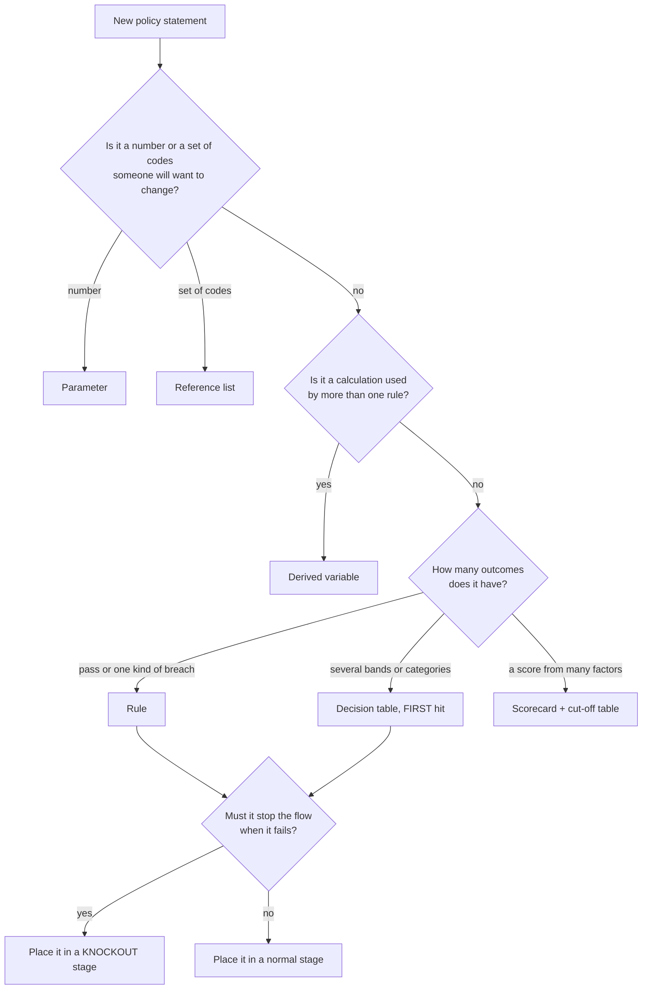
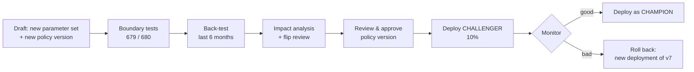

# BRE Platform: Rule Authoring Guide

**Status:** Draft 2 · 2026-10-01
**Audience:** credit-policy authors, business analysts, policy reviewers and risk analysts. No programming background is assumed.
**Covers:** Policy Source Format (PSF) v1 and BEL v1.
**Canonical source:** `00_Decisions_and_Canonical_Terms.md`. Where this guide and that document differ, `00` wins. The exact grammar and semantics are in `03_LLD.md`.

> **Every number in this guide is illustrative.**
> Thresholds such as income ceilings, FOIR caps, LTV slabs and lender caps are shown as *parameters* with example values.
> They are not regulatory statements. Confirm current values with credit policy and compliance before you use them.

---

## How to use this guide

| If you want to… | Read |
|---|---|
| Understand what the engine does with your rules | §1 |
| Read or write an expression | §2 |
| Decide between a rule, a table, a scorecard or a parameter | §3 |
| Copy a working pattern | §4, the cookbook (21 examples) |
| Test, submit and deploy | §5 and §6 |
| Avoid the usual mistakes | §7 |
| Look something up quickly | §8 |

---

## 1. How decisions work

### 1.1 Facts in, decision out

The loan system (LOS) sends the BRE a **fact snapshot**: the application, the people on it, the group, the households, the bureau reports, the collateral and so on. The BRE evaluates the active policy against those facts and returns a **decision**.

The BRE never fetches data itself:
- It does not call the bureau.
- It does not look anything up in another system.
- It does not read the clock. "Today" is always the `asOf` date in the request.

This has three consequences you can rely on:
1. **The same facts, the same policy version and the same `asOf` always give the same decision.** That is why simulations, back-tests and replays are exact.
2. **If a fact is not in the snapshot, the rule cannot see it.** If your rule needs something, it must be part of the fact schema, and the LOS must send it.
3. **Data quality is visible.** Missing data shows up as `DATA_MISSING`; it never silently becomes a pass.

### 1.2 Policies, versions and bundles

| Thing | What it is | Can you edit it? |
|---|---|---|
| **Policy** | A named decision for a product line and a stage, for example `MFI_JLG_CREDIT_UW` | It is just a name |
| **Policy version** | One complete, numbered set of variables, rules, tables, scorecards, the flow and the test cases (v1, v2, v3…) | **Only while it is in `DRAFT`** |
| **Shared assets** | Parameter sets, reference lists, reason codes, authority matrices and fact schemas, each versioned on its own | Each version is edited in draft, then frozen |
| **Bundle** | The sealed, signed package built when a policy version is approved | Never |
| **Deployment** | "Make this bundle live in PROD from this date, in this mode" | Never; you create a new one instead |

A policy version **pins** exact versions of its shared assets, for example `MFI_PARAMS@7`. If you change a parameter, you create a new parameter-set version **and** a new policy version that pins it. This keeps every decision reproducible: "which cap applied to this loan on 3 March?" always has exactly one answer.

### 1.3 Scopes: who a rule is about

Every rule, table and scorecard has a **scope**. When the scope is per-entity, the engine runs the rule once for each entity of that kind.

| Scope | Runs once per… | Typical use |
|---|---|---|
| `APPLICATION` | application | Loan amount, tenure, LTV, eligible amount |
| `PARTY` | person or entity on the application; a flow step can filter by role (APPLICANT, CO_APPLICANT, GUARANTOR, PROMOTER, DIRECTOR, MEMBER) | Age, KYC, screening, bureau checks |
| `GROUP` | JLG/SHG group | Group size, group age, village risk |
| `MEMBER` | group member (a party with role MEMBER) | Member indebtedness, lender count, member score |
| `HOUSEHOLD` | household | Household income ceiling, household repayment obligations |
| `COLLATERAL` | collateral item | Valuation age, eligible collateral type |

Inside a rule, the entity currently being evaluated is available by its scope name: `party`, `member`, `group`, `household` or `collateral`. Top-level facts such as `application`, `parties` and `households` are always available.

When a per-entity rule runs for 10 members, the 10 results are **rolled up** into one step result by an **aggregation**. `WORST` is the default; see §4, example E7.

### 1.4 Rule statuses

Each rule produces one **status** per entity it runs for:

| Status | Meaning | Produced when |
|---|---|---|
| `PASS` | The check holds | `check` is true |
| `DEVIATION` | A policy breach that an authority **may approve** | `check` is false and `onFail.status: DEVIATION` |
| `REFER` | A person must look at the case | `check` is false and `onFail.status: REFER`, or a table row says REFER |
| `FAIL` | A breach that **nobody can approve** | `check` is false and `onFail.status: FAIL` |
| `NOT_APPLICABLE` | The rule does not apply to this case | the `when` precondition is false |
| `DATA_MISSING` | The rule could not decide because a fact was missing | `check` (or `when`) is unknown, and `onMissing` resolves to REFER |
| `ERROR` | Something went wrong while evaluating, for example division by zero or a size limit being exceeded | Always counted as REFER. It also raises an alert to operations. |

### 1.5 From rule statuses to the decision

The **decision** is one of four values. It is worked out from all step results, top to bottom, and **the first matching line wins**:

| # | If any step result is… | Decision |
|---|---|---|
| 1 | `FAIL` | **DECLINE** |
| 2 | `REFER`, `DATA_MISSING` or `ERROR` | **REFER** |
| 3 | `DEVIATION` not covered by a valid deviation approval | **APPROVE_WITH_DEVIATION** |
| 4 | (anything else) | **APPROVE** |

`NOT_APPLICABLE` results are ignored.

`stpEligible` (straight-through processing) is `true` only when the decision is `APPROVE` **and** no deviation was waved through by an earlier approval. Approved deviations are shown with the annotation `DEVIATION_APPROVED`.

Worked examples:

| Rule results | Decision | Why |
|---|---|---|
| PASS, PASS, PASS | APPROVE | Nothing else matched |
| PASS, DEVIATION, PASS | APPROVE_WITH_DEVIATION | Line 3 |
| PASS, DEVIATION, REFER | REFER | Line 2 beats line 3 |
| FAIL, ERROR, DEVIATION | DECLINE | Line 1 beats everything |
| PASS, DATA_MISSING | REFER | Missing data is never a pass |
| NOT_APPLICABLE, PASS | APPROVE | NOT_APPLICABLE is ignored |
| DEVIATION covered by a valid approval, PASS | APPROVE, `stpEligible = false` | Covered deviations do not block; they still prevent STP |

### 1.6 Why errors and missing data never approve

In many older rule engines, a rule that crashed or found no data simply returned nothing, and "nothing failed" was read as "approved". This engine is built the other way round:

- **Missing data** → `DATA_MISSING` → **REFER** by default. You may choose `FAIL` instead (§4, E10), but you can never turn missing data into a pass by accident.
- **Errors** → `ERROR` → **REFER**, plus an operations alert. You cannot configure this.
- **A table with no matching row** → `ERROR` if every input was present, `DATA_MISSING` if any input was missing. The studio also checks tables for gaps before you can submit.
- **A filter that cannot tell whether an item belongs** (for example, a tradeline whose status is missing) → the whole filtered list is missing → `DATA_MISSING` → **REFER**. The item is never silently dropped; see §2.7.

The one trap the engine **cannot** catch for you is an **empty list**. "This member has no open loans" and "the bureau was never pulled" both look like an empty list, and a sum over an empty list is 0. Always pair list-based rules with a data-presence rule (§4, E8 and E10).

### 1.7 Deviations and authority

A `DEVIATION` says: *"this breaches policy, but an authorised person may approve it."* Each deviation carries:

- a **deviation type**, for example `INDEBTEDNESS_CAP` or `FOIR_EXCEEDED`;
- a **measure**: the value that breached, for example the indebtedness of ₹1,92,000;
- a **direction** (`worseWhen: HIGHER` or `LOWER`). This lets an approval be checked later against a new value.

The **authority matrix**, a shared asset, says who may approve each deviation type. Here is an illustrative example:

| Deviation type | Product line | Application amount band | Required level |
|---|---|---|---|
| `INDEBTEDNESS_CAP` | `MFI_JLG` | ≤ ₹10,00,000 | `L2` |
| `INDEBTEDNESS_CAP` | `MFI_JLG` | ₹10,00,000.01 – ₹25,00,000 | `L3` |
| `INDEBTEDNESS_CAP` | `MFI_JLG` | > ₹25,00,000 | `CREDIT_HEAD` |
| `FOIR_EXCEEDED` | `RETAIL_PL` | any | `L2` |
| `AGE_AT_MATURITY` | any | any | `L3` |

The levels and their order (for example `L1 < L2 < L3 < CREDIT_HEAD < CRO < MD`) are defined per tenant. Nothing about the hierarchy is built into the engine.

The tenant's **routing mode** decides how approvals are requested:
- `HIGHEST_ONLY` produces one approval at the highest level required.
- `EACH` produces one approval per deviation.

**The BRE does not run the approval itself.** It tells the LOS which approvals are needed. The LOS workflow collects them and sends them back as `deviationApprovals[]` facts on the next evaluation.

Each approval names the **entity** it was given for (`entityType` + `entityRef`, for example `MEMBER` + `P-0007`), and covers only that entity. An approval covers a deviation only while:
- it is for the same rule, deviation type and entity;
- it has not expired;
- the value has not got worse than the approved value;
- the approver's level is still high enough.

See E19.

> **Severity tiers.** If FOIR 50–55% should need `L2` but 55–60% should need `L3`, use two deviation types (`FOIR_EXCEEDED_MINOR`, `FOIR_EXCEEDED_MAJOR`), produced by a decision table on the FOIR value. The authority matrix then routes each type separately.

### 1.8 Reason codes and customer-facing reasons

Every non-pass outcome carries a **reason code** from the reason-code catalogue:

```yaml
- code: AFF_HH_OBLIGATION_CAP
  category: AFFORDABILITY          # KNOCKOUT | CREDIT | KYC | FRAUD | AFFORDABILITY | COLLATERAL | POLICY
  adverse: true
  internalText: Household repayment obligations exceed the permitted share of household income
  customerText:
    en: Your household's existing and proposed loan repayments are higher than we can lend against.
    hi: आपके परिवार की मौजूदा और प्रस्तावित ऋण किस्तें हमारी उधार सीमा से अधिक हैं।
```

On a decline, the customer-facing reasons are taken from the **adverse** reason codes of the failing rules. At most 4 are used, in rule-priority order. Write customer text that is:
- plain and specific ("existing repayments are too high"), not jargon ("FOIR breach");
- free of internal detail (no thresholds, no scores, no other lenders' names);
- available in every language your tenant has enabled.

**Naming convention for reason codes:** prefix the code with its category: `AFF_` (affordability), `CR_` (credit), `KYC_`, `FRD_` (fraud/screening), `COL_` (collateral), `POL_` (policy), `DATA_` (data missing), `SC_` (scorecard), `AMT_` (amount).

---

## 2. BEL in 15 minutes

BEL (the BRE Expression Language) is how you write conditions and calculations. If you have written spreadsheet formulas, it will feel familiar.

### 2.1 Reading facts

Facts are read by **path**, written with dots:

```
application.requestedAmount          the amount asked for
application.tenureMonths             tenure in months
group.cycleNumber                    the group's lending cycle (1 = first loan)
household.annualIncome               inside a HOUSEHOLD-scope rule
member.dateOfBirth                   inside a MEMBER-scope rule
party.income.monthlyNet              inside a PARTY-scope rule
```

`ext` holds **tenant extension fields**: facts your institution sends that are not part of the standard schema. An example is `group.ext.centreMeetingDay`. They work like any other fact, but the fact-schema version must declare them.

### 2.2 Variables, parameters and lists

| You write | It means | Where it comes from |
|---|---|---|
| `proposedAmount` | A **variable**: a named calculation defined in the policy | `variables:` in the policy version |
| `param.INDEBTEDNESS_CAP` | A **parameter**: a named threshold | The pinned parameter set, which is maker-checked and effective-dated |
| `list.UNSECURED_ACCOUNT_TYPES` | A **reference list**: a named set of values | The pinned reference list |

You can also read the **results of earlier steps**: `scorecard.CODE.score` and `scorecard.CODE.reasons`, `table.CODE.<output>` and `rule.CODE.<output>`. A step can only read results from its own or an **earlier** stage; reading a later stage is a compile error. Reading a step that a knockout skipped gives a missing value.

Rules of thumb:
- **Any number that a policy committee might change is a parameter.** Never type `200000` into a rule.
- **Any set of codes is a list.** Never type `["PL","CC","MFI_JLG", …]` into a rule if the set can grow.
- **Any calculation used twice is a variable.** Variables can use other variables. The studio stops you creating a loop.

### 2.3 Arithmetic and decimals

- All numbers are exact decimals, so 0.1 + 0.2 is exactly 0.3. Money is in rupees with paise (`185000.00`).
- Percentages are written as **fractions**: 50% is `0.50`. A parameter `FOIR_POLICY_MAX = 0.50` means 50%.
- Division keeps 10 decimal places internally.
- **Comparisons use the full, unrounded value.** A FOIR of 0.5000400 is *greater* than 0.50, even though a screen showing two decimals displays "50.00%". If your policy says "rounded to two decimals", round explicitly: `round(foir, 2, HALF_UP) <= param.FOIR_POLICY_MAX`.
- **Prefer multiplication to division in checks.** `emi <= 0.50 * income` cannot divide by zero; `emi / income <= 0.50` can. Division by zero is an `ERROR`, which means REFER plus an alert.

### 2.4 Comparisons and logic

```
=  !=  <  <=  >  >=                 compare
and  or  not                        combine
x in ["A", "B"]                     membership in a literal set
x in list.MFI_LENDER_TYPES          membership in a reference list
x between 18 and 60                 inclusive at both ends: 18 and 60 both match
if c then a else b                  conditional value; if c is unknown, the result is missing
```

### 2.5 Missing values

A fact can be **missing**: the LOS did not send it. BEL follows simple rules:

- Any calculation or comparison that involves a missing value gives **unknown**.
  - `missingIncome * 0.5` → unknown
  - `missingScore >= 700` → unknown
- `and` / `or` still work where the answer is certain: `false and unknown` → false; `true or unknown` → true.
- When a rule's `check` is unknown, the rule's **`onMissing`** decides what happens. The default is REFER, reported as `DATA_MISSING`.
- `isMissing(x)` is true when `x` is missing. It is never unknown.
- `coalesce(a, b, c)` returns the first value that is not missing. Example: `coalesce(application.approvedAmount, application.recommendedAmount, application.requestedAmount)` means "the approved amount if there is one, else the recommended amount, else the requested amount".

### 2.6 Lists, filters and aggregates

Many facts are lists: `parties`, `bureauReports`, `tradelines`, `enquiries`, `dpdHistory`, `collaterals`, `financials`.

**Filter** a list with square brackets. Inside the brackets, `it` means "the current item":

```
member.bureauReports[it.bureau = param.PRIMARY_BUREAU]
tradelines[it.status in list.OPEN_TRADELINE_STATUSES and it.currentBalance > 0]
```

Filters are **fail-closed** when an item's field is missing. Read §2.7 before you filter on any field that can be missing.

**Follow a path through a list** to get a list of values. A path that goes through several lists produces one flat list:

```
member.bureauReports.tradelines.currentBalance      every balance on every tradeline of every report
```

**Aggregate** a list:

| Function | Result | On an empty list |
|---|---|---|
| `count(list)` | number of items. Over a *missing* list (§2.7) it is missing too | `0` |
| `sum(list.field)` | total | `0` |
| `distinctCount(list.field)` | number of different values | `0` |
| `min(list)`, `max(list)`, `avg(list)` | smallest, largest, average | *missing* |
| `first(list)` | first item | *missing* |
| `any(list, cond)` | true if at least one item matches | `false` |
| `all(list, cond)` | true if every item matches | `true` |

`min` and `max` also take a written list of values: `min([foirEligible, ltvEligible, param.HL_PRODUCT_MAX_AMOUNT])`.

> If **any** item's value is missing, `sum`, `min`, `max`, `avg` and `distinctCount` return **missing**. A total is never silently computed over part of the data. `count` counts items, so it is not affected.

**Scope collections.** `parties`, `members` (the parties with role MEMBER, in group order), `households` and `collaterals` are available in every rule. A **per-entity variable** behaves like an extra field on each entity. A wider scope can therefore aggregate it:

```
sum(members.memberTotalIndebtedness)                        in a GROUP rule: the group's total
count(members[it.memberTotalIndebtedness > param.INDEBTEDNESS_SOFT_CAP])
sum(parties[it.role in ["APPLICANT","CO_APPLICANT"]].assessedMonthlyIncome)   in an APPLICATION rule
```

Inside a per-entity rule, the same variable is just a value: `memberTotalIndebtedness`.

### 2.7 Filters are fail-closed

Suppose a member has four tradelines, and one of them arrived from the bureau **without a status**. Should a filter such as `tradelines[it.status in list.OPEN_TRADELINE_STATUSES]` include that tradeline or not? The engine cannot know, so it does neither:

> **If a filter's condition is unknown for any item, the whole filtered list is missing.** Every aggregate over it (`sum`, `count`, …) is missing, so the rule is `DATA_MISSING` and the case goes to **REFER** (unless you chose otherwise in `onMissing`).

**Why not just skip the item?** Many engines, and the FEEL standard, quietly drop items whose condition is unknown. For a debt cap that is **fail-open**. The tradeline with no status may be a ₹60,000 open loan, and dropping it under-counts the member's debt. The member might pass a cap they actually breach, and nobody would ever see why. This engine refuses to guess.

**You decide how such items count** by writing a condition that is never unknown, a *total* predicate. There are three choices:

| Choice | Write | Effect | Use when |
|---|---|---|---|
| **Strict** (default) | `it.status in list.OPEN_TRADELINE_STATUSES` | Any item with a missing status → the list is missing → REFER | A wrong answer either way is costly, and a person can resolve it (E5) |
| **Count it in** | `isMissing(it.status) or it.status in list.OPEN_TRADELINE_STATUSES` | An item with a missing status is treated as open | Debt, obligations and exposure: counting unknown debt is the conservative choice (E4, E12) |
| **Leave it out** | `not isMissing(it.status) and it.status in list.OPEN_TRADELINE_STATUSES` | An item with a missing status is ignored | **Only** when leaving it out is the conservative choice, or another rule catches the missing data. Never to silence REFERs (§7, #13) |

Two details:
- **Certainty still wins.** `false and unknown` is `false`. In `tradelines[it.lenderType in list.MFI_LENDER_TYPES and it.status in list.OPEN_TRADELINE_STATUSES]`, a credit-card tradeline with a missing status is simply excluded, because the first half is already false. Only items whose membership is genuinely undecidable make the list missing.
- `isMissing(x)` is never unknown, so a condition built with it is total. The studio flags every filter over an optional field (one marked `?` in the fact schema) that is not total, so you can make the choice deliberately.

### 2.8 Dates and `asOf`

`asOf` is the decision date sent in the request. If the LOS leaves it out, it defaults to the moment the request was received. Dates are evaluated in the tenant's time zone (default `Asia/Kolkata`). The resolved `asOf` and time zone are stored with the decision. Use `asOf` everywhere you would say "today"; there is no function that reads the system clock.

**Test cases should always set `asOf` explicitly.** Otherwise "today" moves and the tests drift.

```
ageInYears(party.dateOfBirth, asOf)                   completed years today
ageInYears(party.dateOfBirth, addMonths(asOf, application.tenureMonths))   age at maturity
monthsBetween(group.formedOn, asOf)                   completed months since formation
daysBetween(it.date, asOf)                            days since an enquiry
addMonths(asOf, -12)                                  same day twelve months ago
addDays(asOf, -90)                                    ninety days ago
```

`monthsBetween` and `ageInYears` count **completed** months and years, the same way a calendar does:
- Someone born on 2 October 2008 is 17 on 1 October 2026.
- Someone born on **29 February** 2008 completes 18 years on **1 March** 2026 (not on 28 February) in a year with no 29 February.

### 2.9 Text

`startsWith`, `endsWith`, `contains`, `matches` (a regular expression in a safe, linear-time dialect), `upper`, `lower` and `length`. Text comparisons are case-sensitive. Use `upper(x) = "ABC"` when case should not matter.

### 2.10 Unary tests (decision-table cells and scorecard bins)

A cell in a table, or a bin in a scorecard, holds a **test** that is applied to its column's input:

| Test | Matches |
|---|---|
| `< 700`, `<= 700`, `> 700`, `>= 700`, `= "C"`, `!= "C"` | comparisons with the input |
| `[650..700]` | 650 to 700, both ends included |
| `[650..700)` | 650 up to but not including 700 |
| `(650..700]` | above 650, up to and including 700 |
| `in ["A","B"]`, `in list.NAME` | membership |
| `missing` | the input is missing. **The only test that matches a missing value.** |
| `-` | any **present** value. It does **not** match a missing value. |
| `-, missing` | anything at all, present or missing |
| `< 650, > 900` | either test (a comma means OR) |

The right-hand side may be a parameter: `<= param.HL_SLAB1_MAX_LTV`.

**When no row matches:**
- if any of the row's inputs was missing → the table's `onMissing` (DATA_MISSING → REFER by default);
- if every input was present → `ERROR`. That is a gap in your table, and the studio's gap check should have reported it before you submitted.

In multi-input tables, write `-, missing` in every "don't care" cell of a row that must match **whatever** that input is (E17). A plain `-` there quietly turns the row off whenever that input is missing.

### 2.11 What BEL deliberately cannot do

There are no loops, no user-defined functions, no calls to other systems and no access to the clock. Every function comes from a fixed list (§8). These limits are what make policies safe to change without engineering review, and what make the engine's answers reproducible.

There are also built-in safety limits:
- **Lists:** at most 10,000 items, by default.
- **Work:** at most 1,000,000 evaluation steps per decision, by default. This is called the *fuel* limit.

A policy that exceeds either limit gets `ERROR`. In practice you only hit them by filtering very large lists inside other filters.

---

## 3. Choosing the construct

| You want to… | Use | Why |
|---|---|---|
| Hold a threshold that a committee sets | **Parameter** | Changed by maker-checker without touching logic; effective-dated |
| Hold a set of codes (account types, statuses, sectors) | **Reference list** | Grows without changing rules |
| Name a calculation used by several rules | **Derived variable** | Written once; consistent everywhere |
| Express one yes/no policy statement | **Rule** | The simplest construct; one reason code; one onFail |
| Map several **mutually exclusive** bands or categories to different outcomes | **Decision table** (`FIRST`) | One row per band; the studio checks overlaps and gaps |
| Look up a value (a cap, a multiplier) from bands | **Decision table** with outputs, or a variable with `if … then … else` | Readable, and checked for gaps |
| Combine many weak signals into one score | **Scorecard**, plus a cut-off table | Points per characteristic; adverse reasons for free |
| Return a number to the LOS (eligible amount, max tenure) | **Rule `outputs`** | Reported on every decision, pass or fail |
| Stop evaluating when something is fatal | A **`KNOCKOUT` stage** in the flow | Saves work; gives a clear decline reason |



---

## 4. Cookbook

Every example follows the same shape:
- **Statement:** the policy in plain words.
- **Assets:** the variables, parameters, lists, reason codes and deviation types it needs.
- **PSF:** the policy source.
- **Tests:** the facts, the expected rule status, and the expected decision **assuming every other rule passes**.
- **Pitfalls.**

| # | Example | Vertical | Construct |
|---|---|---|---|
| E1 | Village risk category | MFI | Decision table, FIRST |
| E2 | Household annual income ceiling | MFI | Rule, HOUSEHOLD scope |
| E3 | Household repayment obligations | MFI | Rule + variable, HOUSEHOLD scope |
| E4 | Member total indebtedness: soft cap and hard cap | MFI | Two rules, DEVIATION + FAIL, authority matrix |
| E5 | Active MFI lender count | MFI | `distinctCount` |
| E6 | Group size and group age | MFI | Rules with `when` |
| E7 | Group REFERs when too many members deviate | MFI | `THRESHOLD` aggregation |
| E8 | No 30+ DPD in the last 12 months | All | Time-window filter + data-presence rule |
| E9 | Bureau enquiry velocity | All | Date filter, REFER |
| E10 | New-to-credit applicants | All | `when`, `onMissing` |
| E11 | Minimum age and age at maturity | All | Date functions, DEVIATION |
| E12 | Retail FOIR with an income haircut | Retail | `if … then … else`, two rules |
| E13 | Housing-loan LTV slabs | Retail | Two-input decision table |
| E14 | Eligible loan amount | Retail | Computed `outputs` |
| E15 | MSME DSCR and current ratio | MSME | Table with REFER band, multiplication form |
| E16 | Sector exposure | MSME | Caller-supplied portfolio facts |
| E17 | Sanctions / PEP / negative-list knockout | All | KNOCKOUT stage, multi-input table |
| E18 | Application scorecard | MFI | Scorecard + cut-off table |
| E19 | Re-evaluation after a deviation approval | All | `deviationApprovals[]` |
| E20 | Changing a cut-off safely | Retail | Back-test → impact → challenger |
| E21 | Protected attributes | All | Governance override |

---

### E1. Village risk category (corrected version of Draft 1's SHG0003)

**Statement.** The village's risk category determines the outcome:
- A or B: acceptable.
- C: lend only with a deviation approval.
- D or E: do not lend.
- Category missing or unrecognised: a person must check.

**Assets.**
- Fact: `group.villageRiskCategory`.
- Reason codes: `POL_VRM_C`, `POL_VRM_DE`, `DATA_VRM_MISSING`, `POL_VRM_UNKNOWN`.
- Deviation type: `VRM_CATEGORY_C`.

**PSF**

```yaml
decisionTables:
  - code: GRP_VRM_CATEGORY
    name: Village risk category
    scope: GROUP
    hitPolicy: FIRST
    inputs:
      - { name: vrm, expr: group.villageRiskCategory }
    rows:
      - { when: ['missing'],      then: { status: REFER, reasonCode: DATA_VRM_MISSING } }
      - { when: ['in ["A","B"]'], then: { status: PASS } }
      - { when: ['= "C"'],        then: { status: DEVIATION, deviationType: VRM_CATEGORY_C, reasonCode: POL_VRM_C } }
      - { when: ['in ["D","E"]'], then: { status: FAIL, reasonCode: POL_VRM_DE } }
      - { when: ['-'],            then: { status: REFER, reasonCode: POL_VRM_UNKNOWN } }
```

**Tests**

| `villageRiskCategory` | Row hit | Rule status | Decision |
|---|---|---|---|
| `A` | 2 | PASS | APPROVE |
| `B` | 2 | PASS | APPROVE |
| `C` | 3 | DEVIATION (`VRM_CATEGORY_C`) | APPROVE_WITH_DEVIATION |
| `D` | 4 | FAIL | DECLINE |
| `E` | 4 | FAIL | DECLINE |
| *(missing)* | 1 | REFER (`DATA_VRM_MISSING`) | REFER |
| `Z` (not a valid category) | 5 | REFER (`POL_VRM_UNKNOWN`) | REFER |

**Why Draft 1 got this wrong.** Draft 1 wrote these three branches as one `AND` condition. Each branch returned its own outcome when its test was false. So for category A:
- the "C" branch said DEVIATION;
- the "D/E" branch said FAIL;
- AND-ing them produced FAIL.

Every category came out wrong. **Mutually exclusive branches are a table with a hit policy, never an AND.** With `FIRST`, rows are tried top to bottom and the first match decides.

**Pitfalls**
- The final `-` row catches *unexpected* values. Without it, a new category "F" added upstream would cause an `ERROR` at runtime. With it, the case is REFERred with a clear reason. The studio's gap check would also warn you.
- `-` matches only **present** values, so the final row never sees a missing category; row 1 handles that. Without row 1, a missing category would still REFER (no row matches and an input is missing), but without the specific `DATA_VRM_MISSING` reason.
- A deviation approval for `VRM_CATEGORY_C` covers the case only while the category is still `C`; categorical measures must match exactly. If the village is re-graded to `D`, the case declines regardless of the approval.

---

### E2. Household annual income ceiling

**Statement.** A microfinance loan may only go to a household whose annual income is at or below the microfinance ceiling. A household above the ceiling is not eligible for this product.

**Assets.**
- Parameter: `MFI_HH_ANNUAL_INCOME_MAX = 300000.00`. *Illustrative; it mirrors the household-income definition in the RBI microfinance framework. Confirm the current value with compliance.*
- Reason codes: `POL_HH_INCOME_ABOVE_MFI` and `DATA_HH_LINK_MISSING`.

**PSF**

```yaml
rules:
  - code: MFI_HH_INCOME_CEILING
    name: Household income within microfinance ceiling
    scope: HOUSEHOLD
    check: household.annualIncome <= param.MFI_HH_ANNUAL_INCOME_MAX
    onFail: { status: FAIL, reasonCode: POL_HH_INCOME_ABOVE_MFI }
    onMissing: REFER

  - code: MFI_MEMBER_HAS_HOUSEHOLD          # data-integrity companion rule
    name: Every member is linked to a household
    scope: MEMBER
    check: not isMissing(member.householdRef)
    onFail: { status: REFER, reasonCode: DATA_HH_LINK_MISSING }
```

**Tests** (parameter = ₹3,00,000)

| `annualIncome` | Rule status | Decision |
|---|---|---|
| ₹2,40,000 | PASS | APPROVE |
| ₹3,00,000 (exactly at ceiling) | PASS (`<=` includes the boundary) | APPROVE |
| ₹3,00,000.01 | FAIL | DECLINE |
| *(missing)* | DATA_MISSING | REFER |

**Pitfalls**
- A HOUSEHOLD rule only runs for households that are **in the facts**. A member who is not linked to any household escapes E2 entirely. E3 does REFER such a case, because its filter cannot place the member (§2.7), but it cannot say which member is the problem. The companion rule `MFI_MEMBER_HAS_HOUSEHOLD` names the member. Its check uses `isMissing`, which is never unknown, so a missing link produces a clear REFER rather than DATA_MISSING.
- Use `FAIL`, not `DEVIATION`. A household above the ceiling falls outside the product definition; nobody can approve it into eligibility.

---

### E3. Household repayment obligations within a share of household income

**Statement.** The household's total monthly loan repayments, existing plus this proposed loan, must not exceed a set share of its monthly income. "Total" means all loans: microfinance and any other.

**Assets.**
- Variable `hhNewMonthlyInstalment`.
- Parameter: `MFI_HH_OBLIGATION_MAX_PCT = 0.50`. *Illustrative; it mirrors the RBI microfinance framework cap. Confirm the current value with compliance.*
- Reason code: `AFF_HH_OBLIGATION_CAP`.
- Facts:
  - `household.monthlyRepaymentObligations`: existing loans, which the LOS computes and sends.
  - Each member's proposed instalment: `proposedMonthlyInstalment` on the member's party record.

**PSF**

```yaml
variables:
  - name: hhNewMonthlyInstalment
    scope: HOUSEHOLD
    type: Decimal
    expr: >
      sum(members[it.householdRef = household.householdRef].proposedMonthlyInstalment)

rules:
  - code: MFI_HH_OBLIGATION_CAP
    name: Household repayments within permitted share of income
    scope: HOUSEHOLD
    # multiply both sides by 12 instead of dividing annual income by 12: no rounding, no division
    check: >
      (household.monthlyRepaymentObligations + hhNewMonthlyInstalment) * 12
        <= param.MFI_HH_OBLIGATION_MAX_PCT * household.annualIncome
    onFail: { status: FAIL, reasonCode: AFF_HH_OBLIGATION_CAP }
    onMissing: REFER
```

**Tests** (annual income ₹2,40,000; cap 50% → ₹1,20,000 a year, or ₹10,000 a month)

| Existing / month | New / month | (Existing + new) × 12 | Rule status | Decision |
|---|---|---|---|---|
| ₹6,000 | ₹3,500 | ₹1,14,000 | PASS | APPROVE |
| ₹6,500 | ₹3,500 | ₹1,20,000 (at cap) | PASS | APPROVE |
| ₹7,000 | ₹3,500 | ₹1,26,000 | FAIL | DECLINE |
| ₹6,000 | one member's instalment missing | unknown (§2.6: strict sum) | DATA_MISSING | REFER |
| *(missing)* | ₹3,500 | unknown | DATA_MISSING | REFER |
| ₹6,000 | ₹3,500, but **another member of the group has no `householdRef`** | unknown: the filter cannot tell whether that member belongs to this household, so the list is missing (§2.7) | DATA_MISSING | REFER. E2's `MFI_MEMBER_HAS_HOUSEHOLD` also REFERs and names the member. |

**Pitfalls**
- Weekly or fortnightly instalments must be sent as a **monthly equivalent** (weekly × 52 / 12). Do the conversion in one place, in the LOS or a variable, and test it.
- If two members of the same household are in the same group, both instalments count. The filter on `householdRef` handles this; a per-member rule would not.
- Do not "fix" the last test row by writing `not isMissing(it.householdRef) and …`. An unlinked member's instalment would then count towards **no** household: the obligation is under-counted and the cap could pass wrongly. Fix the link in the LOS instead.

---

### E4. Member total indebtedness: soft cap (deviation) and hard cap (decline)

**Statement.**
- A member's total unsecured indebtedness, including their share of this loan, may not exceed the **hard cap**. Above it, decline.
- Between the internal **soft cap** and the hard cap, lend only with a deviation approved at the level the authority matrix sets.

**Assets.**
- Variables: `proposedAmount`, `memberProposedAmount`, `memberUnsecuredOutstanding`, `memberTotalIndebtedness`.
- Parameters: `INDEBTEDNESS_SOFT_CAP = 175000.00` and `INDEBTEDNESS_HARD_CAP = 200000.00`. *Illustrative. The hard cap mirrors an industry/SRO guardrail; confirm the current value.*
- Lists: `UNSECURED_ACCOUNT_TYPES` and `OPEN_TRADELINE_STATUSES`.
- Deviation type: `INDEBTEDNESS_CAP`.
- Reason codes: `AFF_INDEBTEDNESS_SOFT_CAP` and `AFF_INDEBTEDNESS_HARD_CAP`.
- Authority matrix: §1.7.

**PSF**

```yaml
variables:
  - name: proposedAmount
    type: Decimal
    expr: coalesce(application.approvedAmount, application.recommendedAmount, application.requestedAmount)
  - name: memberProposedAmount
    scope: MEMBER
    type: Decimal
    # use the member's own amount when the LOS sends it; otherwise an equal share of the group amount
    expr: coalesce(member.proposedAmount, proposedAmount / count(group.memberPartyRefs))
  - name: memberUnsecuredOutstanding
    scope: MEMBER
    type: Decimal
    # a tradeline with no status is counted as open (conservative for a debt cap; §2.7)
    expr: >
      sum(member.bureauReports[it.bureau = param.PRIMARY_BUREAU].tradelines[
            it.accountType in list.UNSECURED_ACCOUNT_TYPES
        and (isMissing(it.status) or it.status in list.OPEN_TRADELINE_STATUSES)].currentBalance)
  - name: memberTotalIndebtedness
    scope: MEMBER
    type: Decimal
    expr: memberUnsecuredOutstanding + memberProposedAmount

rules:
  - code: MFI_INDEBTEDNESS_HARD_CAP
    name: Member indebtedness within hard cap
    scope: MEMBER
    check: memberTotalIndebtedness <= param.INDEBTEDNESS_HARD_CAP
    onFail: { status: FAIL, reasonCode: AFF_INDEBTEDNESS_HARD_CAP }
    onMissing: REFER

  - code: MFI_INDEBTEDNESS_SOFT_CAP
    name: Member indebtedness within internal soft cap
    scope: MEMBER
    check: memberTotalIndebtedness <= param.INDEBTEDNESS_SOFT_CAP
    onFail:
      status: DEVIATION
      reasonCode: AFF_INDEBTEDNESS_SOFT_CAP
      deviationType: INDEBTEDNESS_CAP
      measure: memberTotalIndebtedness
      worseWhen: HIGHER
    onMissing: REFER
    outputs:
      totalIndebtedness: memberTotalIndebtedness
```

**Tests** (10 members; group amount ₹5,00,000, so each member's share is ₹50,000; required level `L2` from the §1.7 matrix)

| Open unsecured balance | Total | Hard cap | Soft cap | Decision |
|---|---|---|---|---|
| ₹1,20,000 | ₹1,70,000 | PASS | PASS | APPROVE |
| ₹1,30,000 | ₹1,80,000 | PASS | DEVIATION (needs `L2`) | APPROVE_WITH_DEVIATION |
| ₹1,60,000 | ₹2,10,000 | FAIL | DEVIATION | DECLINE (FAIL beats DEVIATION) |
| no open unsecured tradelines | ₹50,000 | PASS | PASS | APPROVE. The sum over an empty list is 0. |
| one open tradeline with `currentBalance` missing | unknown (strict sum) | DATA_MISSING | DATA_MISSING | REFER |
| ₹1,00,000 open + an unsecured tradeline of ₹30,000 with **status missing** | ₹1,80,000: counted as open | PASS | DEVIATION | APPROVE_WITH_DEVIATION |
| an open tradeline with **`accountType` missing** | unknown: the filter cannot tell whether it is unsecured (§2.7) | DATA_MISSING | DATA_MISSING | REFER |
| a **closed** tradeline with `accountType` missing | not affected: `false and unknown` is false, so it is excluded | (as per other tradelines) | (as per other tradelines) | (as per other tradelines) |

**Pitfalls**
- **A deviation can never override a FAIL.** That is why the hard cap is a separate rule. If you modelled both caps as one DEVIATION, an approver could wave through a breach of the guardrail.
- If the bureau report was never pulled, `memberUnsecuredOutstanding` is 0, not missing, and the rule passes. You need the data-presence rule from E8.
- Use one bureau (`param.PRIMARY_BUREAU`). Adding up tradelines from two bureaus double-counts the same loans.
- The filter makes two different choices on purpose. A missing **status** is counted in, because unknown debt is assumed open. A missing **account type** stays strict and REFERs, because counting a possibly-secured loan against an unsecured cap could wrongly decline the member. Write both choices into the policy note.
- To see the **group's** total exposure, a GROUP rule can read `sum(members.memberTotalIndebtedness)` (§2.6, scope collections).

---

### E5. Active MFI lender count

**Statement.** Counting this loan, a member may borrow from no more than a set number of microfinance lenders.

**Assets.**
- Variable: `mfiLenderCount`.
- Parameters:
  - `MAX_MFI_LENDERS = 3` (*illustrative; it mirrors an industry/SRO guardrail; confirm*), including us;
  - `OWN_LENDER_REF`: our own lender identifier as it appears on bureau reports.
- Lists: `MFI_LENDER_TYPES` and `OPEN_TRADELINE_STATUSES`.
- Reason code: `CR_MFI_LENDER_CAP`.
- Fact: `tradelines[].lenderRef`.

**PSF**

```yaml
variables:
  - name: mfiLenderCount
    scope: MEMBER
    type: Integer
    expr: >
      distinctCount(member.bureauReports[it.bureau = param.PRIMARY_BUREAU].tradelines[
            it.lenderType in list.MFI_LENDER_TYPES
        and it.status in list.OPEN_TRADELINE_STATUSES
        and it.lenderRef != param.OWN_LENDER_REF].lenderRef)

rules:
  - code: MFI_LENDER_CAP
    name: Number of MFI lenders within cap (including us)
    scope: MEMBER
    check: mfiLenderCount + 1 <= param.MAX_MFI_LENDERS
    onFail: { status: FAIL, reasonCode: CR_MFI_LENDER_CAP }
```

**Tests** (cap = 3)

| Open MFI tradelines | Distinct other lenders | Count + 1 | Rule status | Decision |
|---|---|---|---|---|
| none | 0 | 1 | PASS | APPROVE |
| lenders X, Y | 2 | 3 | PASS | APPROVE |
| lenders X, Y, Z | 3 | 4 | FAIL | DECLINE |
| lenders X, Y + an existing loan with **us** | 2 (ours is excluded) | 3 | PASS | APPROVE |
| two loans from X, one from Y | 2 | 3 | PASS | APPROVE |
| lenders X, Y + an open MFI tradeline with **`lenderRef` missing** | unknown: the filter cannot tell whether it is ours (§2.7) | unknown | DATA_MISSING | REFER |
| lenders X, Y + an MFI tradeline with **status missing** | unknown: the filter cannot tell whether it is open | unknown | DATA_MISSING | REFER |
| lenders X, Y + a **credit-card** tradeline with status missing | 2: not an MFI lender, so `false and unknown` excludes it | 3 | PASS | APPROVE |

**Pitfalls**
- **The filter stays strict on purpose.** Counting an unknown-status tradeline as open (as E4 does for debt) would push a member over a hard cap, and FAIL them, on the strength of a data gap. A REFER lets a person check the bureau report first. Compare E4: the right choice depends on what a wrong answer costs.
- Without the `!= param.OWN_LENDER_REF` filter, a repeat borrower who already holds a loan with us is counted twice: once on the bureau, and once by the `+ 1`.
- Closed loans that the lender has not yet reported as closed still show as open. Your institution's policy decides whether to trust `status` or also require `currentBalance > 0`. Write that choice into the filter explicitly.

---

### E6. Group size and minimum group age

**Statement.**
- A JLG must have between a minimum and a maximum number of members, and so must an SHG, with different limits.
- A group must have existed for a minimum number of months before its first loan.

**Assets.**
- Parameters (*illustrative*):
  - `JLG_MIN_SIZE = 4`, `JLG_MAX_SIZE = 10`;
  - `SHG_MIN_SIZE = 10`, `SHG_MAX_SIZE = 20`;
  - `MIN_GROUP_AGE_MONTHS = 6`.
- Reason codes: `POL_GROUP_SIZE` and `POL_GROUP_TOO_NEW`.

**PSF**

```yaml
rules:
  - code: GRP_JLG_SIZE
    name: JLG size within limits
    scope: GROUP
    when: group.type = "JLG"
    check: count(group.memberPartyRefs) between param.JLG_MIN_SIZE and param.JLG_MAX_SIZE
    onFail: { status: FAIL, reasonCode: POL_GROUP_SIZE }

  - code: GRP_SHG_SIZE
    name: SHG size within limits
    scope: GROUP
    when: group.type = "SHG"
    check: count(group.memberPartyRefs) between param.SHG_MIN_SIZE and param.SHG_MAX_SIZE
    onFail: { status: FAIL, reasonCode: POL_GROUP_SIZE }

  - code: GRP_MIN_AGE
    name: Group has existed long enough
    scope: GROUP
    when: group.cycleNumber = 1                 # only for a group's first loan
    check: monthsBetween(group.formedOn, asOf) >= param.MIN_GROUP_AGE_MONTHS
    onFail: { status: FAIL, reasonCode: POL_GROUP_TOO_NEW }
```

**Tests** (`asOf` = 2026-10-01)

| Facts | GRP_JLG_SIZE | GRP_SHG_SIZE | GRP_MIN_AGE | Decision |
|---|---|---|---|---|
| JLG, 5 members, cycle 1, formed 2026-03-15 (6 completed months) | PASS | NOT_APPLICABLE | PASS | APPROVE |
| JLG, 3 members | FAIL | NOT_APPLICABLE | (as per facts) | DECLINE |
| SHG, 12 members, cycle 2 | NOT_APPLICABLE | PASS | NOT_APPLICABLE | APPROVE |
| JLG, 5 members, cycle 1, formed 2026-04-15 (5 completed months) | PASS | NOT_APPLICABLE | FAIL | DECLINE |
| `group.type` missing | DATA_MISSING | DATA_MISSING | (as per facts) | REFER |

**Pitfalls**
- **An unknown `when` is not "does not apply".** If `group.type` is missing, the engine cannot know whether the JLG rule applies, so it applies `onMissing` and reports DATA_MISSING. Missing data never turns into NOT_APPLICABLE.
- `monthsBetween` counts **completed** months. 15 March to 1 October is 6 completed months; 15 April to 1 October is 5.

---

### E7. Group-level aggregation: REFER the group when too many members deviate

**Statement.**
- A few members over the soft indebtedness cap (E4) is acceptable with approvals.
- If **20% or more** of the members deviate, the group as a whole needs credit review, not just individual approvals.

**Assets.**
- Parameter: `GROUP_DEVIATION_SHARE_REFER_PCT = 20`. *Illustrative; percent, as used by `THRESHOLD`.*

**PSF (flow)**

```yaml
flow:
  stages:
    - name: ELIGIBILITY
      steps:
        - { ref: MFI_INDEBTEDNESS_HARD_CAP, aggregate: WORST }
        - ref: MFI_INDEBTEDNESS_SOFT_CAP
          aggregate: "THRESHOLD(percent >= param.GROUP_DEVIATION_SHARE_REFER_PCT, DEVIATION) -> REFER"
```

**How it is evaluated**
1. The rule runs for every member, and every member's result is kept and reported.
2. The engine counts the members whose status is `DEVIATION`, divided by the members for whom the rule was applicable.
3. If that share is ≥ the threshold, the **step result is REFER**.
4. Otherwise the step result is the **WORST** member result.

**Tests** (10 members)

| Members DEVIATING | Other members | Step result | Decision |
|---|---|---|---|
| 0 | 10 PASS | PASS | APPROVE |
| 1 (10%) | 9 PASS | DEVIATION (worst) | APPROVE_WITH_DEVIATION |
| 2 (20%) | 8 PASS | REFER (threshold met) | REFER |
| 1 (10%) | 1 DATA_MISSING, 8 PASS | DATA_MISSING (worst) | REFER |

**Pitfalls**
- Members whose deviation is already **covered by a valid approval** do not count towards the threshold (00 S7). Otherwise a group with approved deviations could never clear review.
- **WORST over members** means one member's FAIL declines the whole group. That is correct for the decision. The per-member results tell the LOS **which** member failed, so the field officer can drop that member and re-submit. Do not try to "drop the member" inside the policy.

---

### E8. No 30+ DPD in the last 12 months, with a data-presence rule

**Statement.**
- Decline a member who has been 30 or more days past due on any loan in the last 12 months.
- Before that, make sure the bureau report was actually pulled.

**Assets.**
- Variables: `primaryReport`, `recentHistory` and `recentDelinquencies`.
- Parameters: `PRIMARY_BUREAU` (Text), `DPD_LOOKBACK_MONTHS = 12`, `DPD_SEVERE_THRESHOLD = 30`.
- Reason codes: `DATA_BUREAU_NOT_PULLED` and `CR_RECENT_DPD`.

**PSF**

```yaml
variables:
  - name: primaryReport
    scope: MEMBER
    type: Record
    expr: first(member.bureauReports[it.bureau = param.PRIMARY_BUREAU])
  - name: recentHistory                    # every month in the window, across all tradelines
    scope: MEMBER
    type: List<Record>
    expr: >
      member.bureauReports[it.bureau = param.PRIMARY_BUREAU].tradelines.dpdHistory[
            it.month >= addMonths(asOf, -param.DPD_LOOKBACK_MONTHS)]
  - name: recentDelinquencies              # used by the scorecard in E18
    scope: MEMBER
    type: Integer
    expr: count(recentHistory[it.dpd >= param.DPD_SEVERE_THRESHOLD])

rules:
  - code: DATA_BUREAU_PRESENT
    name: Primary bureau report was pulled
    scope: MEMBER
    check: count(member.bureauReports[it.bureau = param.PRIMARY_BUREAU]) >= 1
    onFail: { status: REFER, reasonCode: DATA_BUREAU_NOT_PULLED }

  - code: CR_NO_RECENT_DPD30
    name: No 30+ DPD in the lookback window
    scope: MEMBER
    check: not any(recentHistory, it.dpd >= param.DPD_SEVERE_THRESHOLD)
    onFail: { status: FAIL, reasonCode: CR_RECENT_DPD }
```

**Why `any` rather than `count(…) = 0`.** `month` is always present, so the window filter in `recentHistory` is total. The DPD test sits inside `any`, which uses three-valued logic:
- one month that is **known** to be 30+ makes `any` true, even if other months are missing;
- if no month is known to be 30+ but some are missing, `any` is unknown.

So a known delinquency declines and an incomplete history REFERs. `count(recentHistory[it.dpd >= 30]) = 0` would REFER both, because one missing month makes the whole filtered list missing (§2.7).

**Tests** (`asOf` = 2026-10-01; window from 2025-10-01; `dpdHistory.month` is the first day of each month)

| Facts | DATA_BUREAU_PRESENT | CR_NO_RECENT_DPD30 | Decision |
|---|---|---|---|
| Report present, all DPD 0 | PASS | PASS | APPROVE |
| DPD 45 in 2026-02 | PASS | FAIL | DECLINE |
| DPD 60 in 2025-08 (outside the window) | PASS | PASS | APPROVE |
| DPD 30 in 2025-10 (first month of the window) | PASS | FAIL | DECLINE |
| DPD **missing** for 2026-03, every other month 0 | PASS | DATA_MISSING (`any` is unknown) | REFER |
| DPD missing for 2026-03 **and** DPD 45 in 2026-02 | PASS | FAIL (a known 45 decides) | DECLINE |
| DPD missing for 2025-06 (outside the window), every other month 0 | PASS | PASS (that month is not in the window) | APPROVE |
| Report present, no tradelines (no-hit) | PASS | PASS | APPROVE (see E10 for NTC handling) |
| **No report pulled** | REFER | PASS (`any` over an empty list is false) | **REFER**, caught only by the presence rule |

**Pitfalls**
- The last row is the reason the presence rule exists. Without it, "never pulled" looks exactly like "perfect history" and the member is approved.
- Bureaus report some months with codes rather than numbers (for example "not reported" or asset-class codes). The LOS must turn these into numbers or leave `dpd` missing; your institution's mapping belongs in the fact-preparation layer. A missing month inside the window REFERs the case (row 5). If your credit policy treats unreported months differently, say so explicitly:
  - as clean: `any(recentHistory, not isMissing(it.dpd) and it.dpd >= …)`;
  - as delinquent: `any(recentHistory, isMissing(it.dpd) or it.dpd >= …)`.

---

### E9. Bureau enquiry velocity

**Statement.** Several credit enquiries in a short period suggest credit-seeking behaviour. More than a set number in the last 90 days goes to a person for review.

**Assets.**
- Parameters: `ENQ_LOOKBACK_DAYS = 90` and `MAX_ENQUIRIES_LOOKBACK = 3`. *Illustrative; the maximum includes our own enquiry for this application.*
- Reason code: `CR_ENQUIRY_VELOCITY`.

**PSF**

```yaml
rules:
  - code: CR_ENQUIRY_VELOCITY
    name: Recent enquiries within limit
    scope: PARTY
    check: >
      count(first(party.bureauReports[it.bureau = param.PRIMARY_BUREAU]).enquiries[
            it.date >= addDays(asOf, -param.ENQ_LOOKBACK_DAYS)]) <= param.MAX_ENQUIRIES_LOOKBACK
    onFail: { status: REFER, reasonCode: CR_ENQUIRY_VELOCITY }
    onMissing: REFER
```

**Tests** (`asOf` = 2026-10-01; window from 2026-07-03)

| Enquiries | In window | Rule status | Decision |
|---|---|---|---|
| 2 in the last month | 2 | PASS | APPROVE |
| 3 in the last month | 3 | PASS | APPROVE |
| 4 in the last month | 4 | REFER | REFER |
| 5 in total; 3 older than 90 days | 2 | PASS | APPROVE |
| 1 dated exactly 2026-07-03 | 1 | PASS (boundary included) | APPROVE |
| no report pulled | `first(…)` missing → unknown | DATA_MISSING | REFER |

**Pitfalls**
- **REFER, not FAIL or DEVIATION.** Enquiries are a signal for a credit officer to examine, not a breach for an authority to approve. See §7, "REFER overuse".
- Your own enquiry for this application appears in the report. Either include it in the threshold (as here) or define the window to exclude the pull date. Document the choice.
- If two bureaus are pulled, the same enquiries may appear in both. Always count from one bureau.

---

### E10. New-to-credit (NTC) applicants: `onMissing` and `when`

**Statement.**
- An applicant with a bureau score must meet the minimum score.
- An applicant the bureau has **no record of** (NTC) is not declined for that reason; instead they are held to a lower amount cap.
- An applicant whose bureau report **was not pulled**, or came back without a score for some other reason, goes to a person.

**The distinction matters:**

| Situation | What the facts look like | What should happen |
|---|---|---|
| Scored | report present, `noHit = false`, `score` present | Apply the score rule |
| Genuine NTC | report present, `noHit = true`, `score` missing | Score rule does not apply; apply the NTC rule |
| Not pulled | no report | REFER |
| Hit but unscorable | report present, `noHit = false`, `score` missing | REFER |

**Assets.**
- Variable: `primaryReport` (from E8).
- Parameters: `MIN_BUREAU_SCORE = 680` and `NTC_MAX_AMOUNT = 50000.00` (*illustrative*).
- Deviation type: `NTC_AMOUNT`.
- Reason codes: `CR_SCORE_BELOW_MIN`, `POL_NTC_AMOUNT` and `DATA_BUREAU_SCORE_MISSING`.

**PSF**

```yaml
rules:
  - code: CR_MIN_BUREAU_SCORE
    name: Bureau score at or above minimum
    scope: MEMBER
    when: primaryReport.noHit = false
    check: primaryReport.score >= param.MIN_BUREAU_SCORE
    onFail: { status: FAIL, reasonCode: CR_SCORE_BELOW_MIN }
    onMissing: REFER

  - code: POL_NTC_AMOUNT_CAP
    name: NTC members held to a lower amount
    scope: MEMBER
    when: primaryReport.noHit = true
    check: memberProposedAmount <= param.NTC_MAX_AMOUNT
    onFail:
      status: DEVIATION
      reasonCode: POL_NTC_AMOUNT
      deviationType: NTC_AMOUNT
      measure: memberProposedAmount
      worseWhen: HIGHER
```

**Tests**

| Case | CR_MIN_BUREAU_SCORE | POL_NTC_AMOUNT_CAP | Decision |
|---|---|---|---|
| Scored 720 | PASS | NOT_APPLICABLE | APPROVE |
| Scored 650 | FAIL | NOT_APPLICABLE | DECLINE |
| NTC, member amount ₹40,000 | NOT_APPLICABLE | PASS | APPROVE |
| NTC, member amount ₹60,000 | NOT_APPLICABLE | DEVIATION | APPROVE_WITH_DEVIATION |
| Not pulled (`primaryReport` missing) | DATA_MISSING (`when` unknown) | DATA_MISSING | REFER |
| Hit, score missing | DATA_MISSING (`check` unknown) | NOT_APPLICABLE | REFER |

**Choosing `onMissing`**

| Value | Use when | Example | Risk |
|---|---|---|---|
| `REFER` (default) | The data should exist and a person can obtain it | Score missing on a hit | None. This is the safe default. |
| `FAIL` | The product cannot be offered without this data, ever | KYC status on a fully digital product | Declines customers for upstream data faults; watch the DATA_MISSING rate |
| `NOT_APPLICABLE` | The rule is genuinely meaningless without the data. Prefer an explicit `when`. | Collateral checks when no collateral is offered on an unsecured product | Hides data problems. Reviewers will question it. |
| `USE_DEFAULT(true\|false)` | Policy states what an *unknown check result* means. The Boolean replaces the unknown `when` or `check` result. | An optional secondary verification that policy says is "not required when not performed", so `USE_DEFAULT(true)` | `USE_DEFAULT(true)` is fail-open by design: it must be in the policy note, and reviewers will question it. **To default an input value** (for example "a count that is not reported means 0"), use `coalesce(x, 0)` in a variable instead. |

**Pitfalls**
- Some bureaus signal "insufficient history" with a sentinel score (for example `-1` or `0`). If the LOS passes that through as a number, `-1 >= 680` is simply false and the applicant FAILs as if they had a terrible score. The fact-preparation layer must turn sentinels into `noHit = true` or a missing score.

---

### E11. Minimum age and age at loan maturity

**Statement.**
- Applicants must be adults when they apply.
- At the end of the loan they must be no older than the maximum age. Exceeding that is a deviation, often accepted with an earning co-applicant.

**Assets.**
- Parameters: `MIN_AGE = 18` and `MAX_AGE_AT_MATURITY = 60` (*illustrative*).
- Deviation type: `AGE_AT_MATURITY`.
- Reason codes: `KYC_UNDER_MIN_AGE` and `POL_AGE_AT_MATURITY`.

**PSF**

```yaml
rules:
  - code: POL_MIN_AGE
    name: Applicant is an adult
    scope: PARTY
    check: ageInYears(party.dateOfBirth, asOf) >= param.MIN_AGE
    onFail: { status: FAIL, reasonCode: KYC_UNDER_MIN_AGE }

  - code: POL_AGE_AT_MATURITY
    name: Age at maturity within limit
    scope: PARTY
    check: ageInYears(party.dateOfBirth, addMonths(asOf, application.tenureMonths)) <= param.MAX_AGE_AT_MATURITY
    onFail:
      status: DEVIATION
      reasonCode: POL_AGE_AT_MATURITY
      deviationType: AGE_AT_MATURITY
      measure: ageInYears(party.dateOfBirth, addMonths(asOf, application.tenureMonths))
      worseWhen: HIGHER

flow:
  stages:
    - name: ELIGIBILITY
      steps:
        - { ref: POL_MIN_AGE, roles: [APPLICANT, CO_APPLICANT], aggregate: WORST }
        - { ref: POL_AGE_AT_MATURITY, roles: [APPLICANT, CO_APPLICANT], aggregate: WORST }
```

**Tests** (`asOf` = 2026-10-01; tenure 24 months, so maturity is 2028-10-01)

| Date of birth | Age today | Age at maturity | POL_MIN_AGE | POL_AGE_AT_MATURITY | Decision |
|---|---|---|---|---|---|
| 1990-05-20 | 36 | 38 | PASS | PASS | APPROVE |
| 1968-10-02 | 57 | 59 (birthday is a day after maturity) | PASS | PASS | APPROVE |
| 1968-10-01 | 58 | 60 (exactly) | PASS | PASS | APPROVE |
| 1966-12-15 | 59 | 61 | PASS | DEVIATION (measure 61) | APPROVE_WITH_DEVIATION |
| 2008-10-02 | 17 | 19 | FAIL | PASS | DECLINE |
| *(missing)* | – | – | DATA_MISSING | DATA_MISSING | REFER |

**Pitfalls**
- Ages are **completed years**: 1 October 2026 is the day *before* the 18th birthday of someone born on 2 October 2008, so they are 17.
- For people born on 29 February, a year is completed on **1 March** in years without a 29 February (§2.8). Someone born on 29 February 2008 is 17 on 28 February 2026 and 18 on 1 March 2026. Add a test case if your book has such customers.
- Use the `roles` filter on the step, not inside the rule. The same rule can then be reused for guarantors with a different parameter.

---

### E12. Retail FOIR with verified income and a haircut on declared income

**Statement.**
- The applicant's total monthly EMIs (existing plus proposed) may not exceed the policy share of assessed monthly income. Breaching the policy share is a deviation.
- Above the hard cap, decline.
- Verified income counts in full; declared (unverified) income counts with a haircut.

**Assets.**
- Variables: `assessedMonthlyIncome`, `existingEmi`, `newEmi`.
- Parameters: `FOIR_POLICY_MAX = 0.50`, `FOIR_HARD_MAX = 0.65`, `DECLARED_INCOME_HAIRCUT = 0.20` (*illustrative*).
- Deviation type: `FOIR_EXCEEDED`.
- Reason codes: `AFF_FOIR_POLICY` and `AFF_FOIR_HARD`.
- Facts: `tradelines[].instalmentAmount` (optional: bureaus do not always report it); `application.proposedMonthlyInstalment`, supplied by the LOS, which owns pricing.

**PSF**

```yaml
variables:
  - name: assessedMonthlyIncome
    scope: PARTY
    type: Decimal
    expr: >
      if party.income.verified
      then party.income.monthlyNet
      else party.income.monthlyNet * (1 - param.DECLARED_INCOME_HAIRCUT)
  - name: existingEmi
    scope: PARTY
    type: Decimal
    # a tradeline with no status is counted as open (conservative; §2.7)
    expr: >
      sum(party.bureauReports[it.bureau = param.PRIMARY_BUREAU].tradelines[
            isMissing(it.status) or it.status in list.OPEN_TRADELINE_STATUSES].instalmentAmount)
  - name: newEmi
    type: Decimal
    expr: application.proposedMonthlyInstalment

rules:
  - code: RET_FOIR_HARD
    name: FOIR within hard cap
    scope: PARTY
    check: existingEmi + newEmi <= param.FOIR_HARD_MAX * assessedMonthlyIncome
    onFail: { status: FAIL, reasonCode: AFF_FOIR_HARD }

  - code: RET_FOIR_POLICY
    name: FOIR within policy
    scope: PARTY
    when: assessedMonthlyIncome > 0            # protects the measure below from division by zero
    check: existingEmi + newEmi <= param.FOIR_POLICY_MAX * assessedMonthlyIncome
    onFail:
      status: DEVIATION
      reasonCode: AFF_FOIR_POLICY
      deviationType: FOIR_EXCEEDED
      measure: (existingEmi + newEmi) / assessedMonthlyIncome
      worseWhen: HIGHER

flow:
  stages:
    - name: AFFORDABILITY
      steps:
        - { ref: RET_FOIR_HARD,   roles: [APPLICANT] }
        - { ref: RET_FOIR_POLICY, roles: [APPLICANT] }
```

**Tests** (new EMI ₹12,000)

| Income | Verified | Assessed | Existing EMI | Total EMI | Policy limit (50%) | Hard limit (65%) | HARD | POLICY | Decision |
|---|---|---|---|---|---|---|---|---|---|
| ₹60,000 | yes | ₹60,000 | ₹15,000 | ₹27,000 | ₹30,000 | ₹39,000 | PASS | PASS | APPROVE |
| ₹60,000 | no | ₹48,000 | ₹15,000 | ₹27,000 | ₹24,000 | ₹31,200 | PASS | DEVIATION (0.5625) | APPROVE_WITH_DEVIATION |
| ₹60,000 | no | ₹48,000 | ₹20,000 | ₹32,000 | ₹24,000 | ₹31,200 | FAIL | DEVIATION | DECLINE |
| ₹0 | yes | ₹0 | ₹0 | ₹12,000 | ₹0 | ₹0 | FAIL | NOT_APPLICABLE | DECLINE |
| ₹60,000 | *(missing)* | unknown | ₹15,000 | ₹27,000 | unknown | unknown | DATA_MISSING | DATA_MISSING | REFER |

**Pitfalls**
- Bureaus do not always report an EMI. If an open tradeline has no `instalmentAmount`, the sum is missing and the case REFERs. That is safe but noisy. The better fix is in fact preparation: estimate the EMI upstream and mark it as estimated.
- This example uses the primary applicant's income only. For **combined** income and obligations, use an APPLICATION-scope rule that aggregates the PARTY-scope variables through the scope collection (§2.6):
  ```
  sum(parties[it.role in ["APPLICANT","CO_APPLICANT"]].existingEmi) + newEmi
    <= param.FOIR_POLICY_MAX * sum(parties[it.role in ["APPLICANT","CO_APPLICANT"]].assessedMonthlyIncome)
  ```
  If any co-applicant's income is missing, the sum is missing and the case REFERs. That is deliberate. Silently skipping one person's income, or one person's EMIs, would produce a FOIR that is simply wrong, in either direction.

---

### E13. Housing-loan LTV slabs

**Statement.** The maximum loan-to-value ratio depends on the loan amount slab. Above the slab's LTV cap, decline. Missing collateral value goes to a person.

**Assets.**
- Variables: `collateralValue` and `ltv`.
- Parameters: *illustrative; they mirror the slab structure of the RBI housing-loan LTV norms. Confirm current values with compliance.*

| Parameter | Value |
|---|---|
| `HL_SLAB1_MAX_AMOUNT` | 3000000.00 |
| `HL_SLAB1_MAX_LTV` | 0.90 |
| `HL_SLAB2_MAX_AMOUNT` | 7500000.00 |
| `HL_SLAB2_MAX_LTV` | 0.80 |
| `HL_SLAB3_MAX_LTV` | 0.75 |

- List: `HL_ELIGIBLE_COLLATERAL_TYPES`.
- Reason codes: `COL_COLLATERAL_MISSING`, `COL_LTV_ABOVE_CAP`, `DATA_AMOUNT_MISSING`.

**PSF**

```yaml
variables:
  - name: collateralValue
    type: Decimal
    expr: sum(collaterals[it.type in list.HL_ELIGIBLE_COLLATERAL_TYPES].marketValue)
  - name: ltv
    type: Decimal
    expr: proposedAmount / collateralValue

rules:
  - code: COL_COLLATERAL_PRESENT
    name: Eligible collateral offered
    scope: APPLICATION
    when: application.productLine = "RETAIL_HL"
    check: count(collaterals[it.type in list.HL_ELIGIBLE_COLLATERAL_TYPES]) >= 1
    onFail: { status: REFER, reasonCode: COL_COLLATERAL_MISSING }

decisionTables:
  - code: COL_HL_LTV_SLAB
    name: LTV within slab cap
    scope: APPLICATION
    when: application.productLine = "RETAIL_HL" and collateralValue > 0     # tables accept `when`, like rules
    hitPolicy: FIRST
    inputs:
      - { name: amount, expr: proposedAmount }
      - { name: ltv,    expr: ltv }
    rows:
      - { when: ['missing', '-, missing'],               then: { status: REFER, reasonCode: DATA_AMOUNT_MISSING } }
      - { when: ['<= param.HL_SLAB1_MAX_AMOUNT', '<= param.HL_SLAB1_MAX_LTV'], then: { status: PASS } }
      - { when: ['<= param.HL_SLAB1_MAX_AMOUNT', '-'],   then: { status: FAIL, reasonCode: COL_LTV_ABOVE_CAP } }
      - { when: ['<= param.HL_SLAB2_MAX_AMOUNT', '<= param.HL_SLAB2_MAX_LTV'], then: { status: PASS } }
      - { when: ['<= param.HL_SLAB2_MAX_AMOUNT', '-'],   then: { status: FAIL, reasonCode: COL_LTV_ABOVE_CAP } }
      - { when: ['-', '<= param.HL_SLAB3_MAX_LTV'],      then: { status: PASS } }
      - { when: ['-', '-'],                              then: { status: FAIL, reasonCode: COL_LTV_ABOVE_CAP } }
```

**Tests**

| Amount | Collateral value | LTV (unrounded) | Row | Status | Decision |
|---|---|---|---|---|---|
| ₹25,00,000 | ₹30,00,000 | 0.8333… | 2 | PASS | APPROVE |
| ₹28,00,000 | ₹30,00,000 | 0.9333… | 3 | FAIL | DECLINE |
| ₹30,00,000 | ₹33,33,333 | 0.90000009 | 3 | **FAIL**: displayed as "90.00%", but above 0.90 | DECLINE |
| ₹50,00,000 | ₹60,00,000 | 0.8333… | 5 | FAIL | DECLINE |
| ₹50,00,000 | ₹64,00,000 | 0.78125 | 4 | PASS | APPROVE |
| ₹1,00,00,000 | ₹1,40,00,000 | 0.7142… | 6 | PASS | APPROVE |
| ₹1,00,00,000 | ₹1,30,00,000 | 0.7692… | 7 | FAIL | DECLINE |
| ₹25,00,000 | eligible collateral, `marketValue` missing | unknown | `when` unknown | DATA_MISSING | REFER |
| ₹25,00,000 | no eligible collateral | – | `when` false → NOT_APPLICABLE; COL_COLLATERAL_PRESENT → REFER | – | REFER |

**Pitfalls**
- The third row is why comparisons use unrounded values. If your credit policy defines LTV as rounded to two decimals, write `round(ltv, 2, HALF_UP)` in the input expression **and** note it in the policy document.
- `when: … collateralValue > 0` would hide a missing collateral **if it stood alone**: with no collateral the table is NOT_APPLICABLE. The separate `COL_COLLATERAL_PRESENT` rule exists to make that case visible. Whenever a `when` can exclude cases for data reasons, add a companion presence rule.
- Order matters with `FIRST`. Slab 2's rows test `amount <= HL_SLAB2_MAX_AMOUNT`, which also matches every slab-1 amount. That is safe only because rows 2–3 have already decided every slab-1 amount. If the slab-2 rows were moved above slab 1, a ₹25 lakh loan at 85% LTV would hit slab 2's FAIL row and be wrongly declined.
- The table has no separate "LTV missing" row. LTV can only be missing if the amount is missing (row 1) or the collateral value is missing (the `when` is then unknown → DATA_MISSING). The studio's reachability check would flag such a row as unreachable.
- Row 1 says `-, missing` in the LTV column, not `-`. When the amount is missing, the LTV is missing too, and a plain `-` matches only **present** values. With `-`, row 1 could never match. The case would still REFER (no row matches and an input is missing), but without the `DATA_AMOUNT_MISSING` reason that tells the reviewer what to fix.

---

### E14. Computed eligible amount (outputs)

**Statement.**
- The eligible amount is the lowest of three figures: the FOIR-based amount, the LTV-based amount and the product maximum.
- It is rounded down to the nearest ₹1,000.
- If the requested amount is above the eligible amount, a person reviews it, and the LOS can offer the eligible amount instead.

**Assets.**
- Variables: `applicant`, `applicantIncome`, `applicantExistingEmi`, `foirEligible`, `ltvEligible`, `eligibleAmount`.
- Parameters: E12's and E13's, plus `HL_PRODUCT_MAX_AMOUNT = 100000000.00` (*illustrative*).
- Fact: `application.emiPerLakh`, the EMI per ₹1,00,000 at the offered rate and tenure, supplied by the LOS, which owns pricing.
- Reason code: `AMT_ABOVE_ELIGIBLE`.

**PSF**

```yaml
variables:
  - name: applicant
    type: Record
    expr: first(parties[it.role = "APPLICANT"])
  - name: applicantIncome
    type: Decimal
    expr: >
      if applicant.income.verified then applicant.income.monthlyNet
      else applicant.income.monthlyNet * (1 - param.DECLARED_INCOME_HAIRCUT)
  - name: applicantExistingEmi
    type: Decimal
    expr: >
      sum(applicant.bureauReports[it.bureau = param.PRIMARY_BUREAU].tradelines[
            isMissing(it.status) or it.status in list.OPEN_TRADELINE_STATUSES].instalmentAmount)
  - name: foirEligible
    type: Decimal
    expr: >
      max([0, (param.FOIR_POLICY_MAX * applicantIncome - applicantExistingEmi)
              / application.emiPerLakh * 100000])
  - name: ltvEligible           # highest amount any slab allows for this collateral value
    type: Decimal
    expr: >
      max([ min([param.HL_SLAB1_MAX_AMOUNT, param.HL_SLAB1_MAX_LTV * collateralValue]),
            min([param.HL_SLAB2_MAX_AMOUNT, param.HL_SLAB2_MAX_LTV * collateralValue]),
            param.HL_SLAB3_MAX_LTV * collateralValue ])
  - name: eligibleAmount
    type: Decimal
    expr: round(min([foirEligible, ltvEligible, param.HL_PRODUCT_MAX_AMOUNT]), -3, DOWN)

rules:
  - code: AMT_WITHIN_ELIGIBLE
    name: Requested amount within eligible amount
    scope: APPLICATION
    when: application.productLine = "RETAIL_HL"
    check: application.requestedAmount <= eligibleAmount
    onFail: { status: REFER, reasonCode: AMT_ABOVE_ELIGIBLE }
    outputs:
      eligibleAmount: eligibleAmount
      foirEligible: round(foirEligible, 2, DOWN)
      ltvEligible: round(ltvEligible, 2, DOWN)
```

**Why `max` of `min`s gives the right LTV figure.** Each slab allows at most the lower of its amount ceiling and its LTV × value. The highest of those figures is the most this collateral can support. A slab that does not really apply can never produce a larger figure than the slab that does.

**Tests** (verified income, `emiPerLakh` ₹900, FOIR policy 50%)

| Income | Existing EMI | Collateral | foirEligible | ltvEligible | Eligible (rounded down) | Requested | Status | Decision |
|---|---|---|---|---|---|---|---|---|
| ₹1,00,000 | ₹10,000 | ₹50,00,000 | ₹44,44,444.44 | ₹40,00,000 (slab 2) | ₹40,00,000 | ₹38,00,000 | PASS | APPROVE |
| ₹1,00,000 | ₹10,000 | ₹50,00,000 | ₹44,44,444.44 | ₹40,00,000 | ₹40,00,000 | ₹42,00,000 | REFER | REFER, outputs eligible ₹40,00,000 |
| ₹1,00,000 | ₹10,000 | ₹80,00,000 | ₹44,44,444.44 | ₹64,00,000 | ₹44,44,000 | ₹45,00,000 | REFER | REFER, outputs eligible ₹44,44,000 |
| ₹30,000 | ₹16,000 | ₹50,00,000 | ₹0 (capacity is negative) | ₹40,00,000 | ₹0 | ₹10,00,000 | REFER | REFER. In a full policy, E12's hard cap would also FAIL, making it DECLINE. |

Arithmetic check for row 1:
- FOIR capacity = 0.50 × 1,00,000 − 10,000 = ₹40,000 a month.
- 40,000 / 900 × 1,00,000 = ₹44,44,444.44.
- Slabs at ₹50,00,000 of collateral: min(30 L, 45 L) = 30 L; min(75 L, 40 L) = 40 L; 0.75 × 50 L = 37.5 L. The maximum is ₹40,00,000.

**Pitfalls**
- **Outputs are reported on every decision, pass or fail.** The LOS uses them to make a counter-offer. They do not change the decision by themselves.
- Without the `max([0, …])`, a negative FOIR capacity would produce a negative "eligible amount".
- `round(x, -3, DOWN)` rounds to thousands, always down. Never round an eligible amount up.
- A later stage can read the result as `rule.AMT_WITHIN_ELIGIBLE.eligibleAmount`, for example to cap a top-up amount.

---

### E15. MSME DSCR and current ratio, with REFER bands

**Statement.**
- **DSCR** (debt-service coverage) from the latest financial year:
  - at or above the pass level → acceptable;
  - between the refer level and the pass level → a credit officer reviews;
  - below the refer level → decline.
- **Current ratio:**
  - at or above the comfort level → acceptable;
  - between 1.0 and the comfort level → review;
  - below 1.0 → decline.

**Assets.**
- Variables: `latestFy`, `fin`, `cashAccrual`, `debtService`, `dscr`.
- Parameters (*illustrative*): `DSCR_PASS_MIN = 1.25`, `DSCR_REFER_MIN = 1.10`, `CURRENT_RATIO_COMFORT_MIN = 1.33`, `CURRENT_RATIO_FLOOR = 1.00`.
- Reason codes: `CR_DSCR_BORDERLINE`, `CR_DSCR_LOW`, `CR_CURRENT_RATIO_LOW`, `CR_CURRENT_RATIO_BELOW_ONE`, `DATA_FINANCIALS_MISSING`.

**PSF**

```yaml
variables:
  - name: latestFy
    type: Integer
    expr: max(business.financials.fiscalYear)
  - name: fin
    type: Record
    expr: first(business.financials[it.fiscalYear = latestFy])
  - name: cashAccrual
    type: Decimal
    expr: fin.pat + fin.depreciation + fin.interestExpense
  - name: debtService                       # annual: existing obligations + proposed instalments
    type: Decimal
    expr: fin.existingDebtService + 12 * application.proposedMonthlyInstalment
  - name: dscr
    type: Decimal
    expr: cashAccrual / debtService

decisionTables:
  - code: MSME_DSCR
    name: Debt-service coverage
    scope: APPLICATION
    when: debtService > 0                   # guards the division in dscr
    hitPolicy: FIRST
    inputs:
      - { name: dscr, expr: dscr }
    rows:
      - { when: ['missing'],                  then: { status: REFER, reasonCode: DATA_FINANCIALS_MISSING } }
      - { when: ['>= param.DSCR_PASS_MIN'],   then: { status: PASS } }
      - { when: ['>= param.DSCR_REFER_MIN'],  then: { status: REFER, reasonCode: CR_DSCR_BORDERLINE } }
      - { when: ['< param.DSCR_REFER_MIN'],   then: { status: FAIL, reasonCode: CR_DSCR_LOW } }

rules:
  - code: MSME_CURRENT_RATIO_COMFORT        # multiplication form: no division by zero
    name: Current ratio at comfort level
    scope: APPLICATION
    check: fin.currentAssets >= param.CURRENT_RATIO_COMFORT_MIN * fin.currentLiabilities
    onFail: { status: REFER, reasonCode: CR_CURRENT_RATIO_LOW }
  - code: MSME_CURRENT_RATIO_FLOOR
    name: Current ratio at least 1.0
    scope: APPLICATION
    check: fin.currentAssets >= param.CURRENT_RATIO_FLOOR * fin.currentLiabilities
    onFail: { status: FAIL, reasonCode: CR_CURRENT_RATIO_BELOW_ONE }
```

**Tests: DSCR** (PAT ₹12 L, depreciation ₹3 L, interest ₹5 L → cash accrual ₹20 L; existing debt service ₹8 L a year)

| New EMI / month | Debt service / year | DSCR | Row | Status | Decision |
|---|---|---|---|---|---|
| ₹50,000 | ₹14 L | 1.4286 | 2 | PASS | APPROVE |
| ₹75,000 | ₹17 L | 1.1765 | 3 | REFER | REFER |
| ₹1,00,000 | ₹20 L | 1.0000 | 4 | FAIL | DECLINE |
| no financials supplied | unknown | unknown | `when` unknown | DATA_MISSING | REFER |

**Tests: current ratio**

| Current assets | Current liabilities | Ratio | COMFORT | FLOOR | Decision |
|---|---|---|---|---|---|
| ₹40 L | ₹25 L | 1.60 | PASS | PASS | APPROVE |
| ₹30 L | ₹25 L | 1.20 | REFER | PASS | REFER |
| ₹20 L | ₹25 L | 0.80 | REFER | FAIL | DECLINE |
| ₹10 L | ₹0 | – | PASS | PASS | APPROVE (no division, so no error) |

**Pitfalls**
- Make sure the "latest year" is the right basis. If the LOS sends both provisional and audited figures, filter on a basis field (an `ext` field, or a fact-schema addition) before taking `max`.
- Your institution's DSCR definition may differ (for example, PAT + depreciation over principal + interest). Write the definition in the rule's description and keep it the same across products.
- The two current-ratio rules form a banded check without division. Prefer this pattern for any ratio whose denominator can be zero.

---

### E16. Sector exposure, using caller-supplied portfolio facts

**Statement.** If lending this amount would take the lender's exposure to the borrower's sector over the board-approved sector limit, a deviation is needed.

**Assets.**
- Facts: `portfolio.sectorExposure {sectorCode, currentAmount, limitAmount, asOf}`, supplied by the LOS from the lender's limit system. `asOf` is the snapshot's own date.
- Parameter: `PORTFOLIO_SNAPSHOT_MAX_AGE_DAYS = 1` (*illustrative*).
- Deviation type: `SECTOR_EXPOSURE`.
- Reason codes: `POL_SECTOR_LIMIT`, `DATA_SECTOR_MISMATCH` and `DATA_PORTFOLIO_STALE`.

**PSF**

```yaml
rules:
  - code: DATA_PORTFOLIO_SECTOR_MATCH
    name: Portfolio exposure is for the borrower's sector
    scope: APPLICATION
    when: application.productLine in ["MSME_TL", "MSME_WC"]
    check: portfolio.sectorExposure.sectorCode = business.sectorCode
    onFail: { status: REFER, reasonCode: DATA_SECTOR_MISMATCH }
    onMissing: REFER

  - code: DATA_PORTFOLIO_FRESH
    name: Portfolio snapshot is recent enough
    scope: APPLICATION
    when: application.productLine in ["MSME_TL", "MSME_WC"]
    check: daysBetween(portfolio.sectorExposure.asOf, asOf) <= param.PORTFOLIO_SNAPSHOT_MAX_AGE_DAYS
    onFail: { status: REFER, reasonCode: DATA_PORTFOLIO_STALE }
    onMissing: REFER

  - code: POL_SECTOR_EXPOSURE
    name: Sector exposure within limit
    scope: APPLICATION
    when: application.productLine in ["MSME_TL", "MSME_WC"]
    check: portfolio.sectorExposure.currentAmount + proposedAmount <= portfolio.sectorExposure.limitAmount
    onFail:
      status: DEVIATION
      reasonCode: POL_SECTOR_LIMIT
      deviationType: SECTOR_EXPOSURE
      measure: (portfolio.sectorExposure.currentAmount + proposedAmount) / portfolio.sectorExposure.limitAmount
      worseWhen: HIGHER
    onMissing: REFER
```

**Tests** (limit ₹500 cr)

| Current exposure | Snapshot age | Proposed | After | MATCH | FRESH | EXPOSURE | Decision |
|---|---|---|---|---|---|---|---|
| ₹480 cr | 0 days | ₹5 cr | ₹485 cr | PASS | PASS | PASS | APPROVE |
| ₹498 cr | 0 days | ₹5 cr | ₹503 cr | PASS | PASS | DEVIATION (measure 1.006) | APPROVE_WITH_DEVIATION |
| *(portfolio facts missing)* | – | ₹5 cr | unknown | DATA_MISSING | DATA_MISSING | DATA_MISSING | REFER |
| ₹480 cr, but for a different sector | 0 days | ₹5 cr | – | REFER | PASS | PASS | REFER |
| ₹480 cr | 3 days | ₹5 cr | ₹485 cr | PASS | REFER | PASS | REFER |

**Why the BRE does not reserve the limit.** The BRE is stateless: it decides on the snapshot it is given. Suppose two ₹5 crore applications arrive at the same moment with exposure at ₹492 crore:
- Both see ₹492 cr + ₹5 cr = ₹497 cr, and both pass.
- Together they take exposure to ₹502 crore.

Reserving limit headroom must be done **atomically, at sanction**, by the lender's limit-management system. The BRE check is an early warning; re-run it at `PRE_DISBURSAL` with fresh portfolio facts.

**Pitfalls**
- Portfolio snapshots go stale. `DATA_PORTFOLIO_FRESH` REFERs a case whose snapshot is older than the parameter; agree the value with whoever runs the limit system.
- Keep the data-consistency rule (`DATA_PORTFOLIO_SECTOR_MATCH`). Without it, a wrong-sector snapshot quietly passes.

---

### E17. Sanctions, PEP and negative-list knockout

**Statement.** Every party on the application is screened upstream. In the BRE:
- a negative-list hit, or a sanctions match at or above the confirmed-match score, **declines immediately**;
- a lower-score sanctions hit, or a PEP hit, goes to compliance review;
- missing screening results go to review.

**Assets.**
- Parameter: `SANCTIONS_CONFIRMED_SCORE = 90` (*illustrative*; the score scale is your screening vendor's).
- Reason codes: `FRD_NEGATIVE_LIST`, `FRD_SANCTIONS_CONFIRMED`, `FRD_SANCTIONS_POTENTIAL`, `KYC_PEP_EDD`, `DATA_SCREENING_MISSING`.

**PSF**

```yaml
decisionTables:
  - code: SCR_SCREENING
    name: Screening outcome
    scope: PARTY
    hitPolicy: FIRST
    inputs:
      - { name: sanctions, expr: party.screening.sanctionsHit }
      - { name: score,     expr: party.screening.matchScore }
      - { name: pep,       expr: party.screening.pepHit }
      - { name: negative,  expr: party.screening.negativeListHit }
    # most severe rows first; "-, missing" = don't care, even if the input is missing
    rows:
      - { when: ['-, missing', '-, missing', '-, missing', '= true'],                          then: { status: FAIL,  reasonCode: FRD_NEGATIVE_LIST } }
      - { when: ['= true', '>= param.SANCTIONS_CONFIRMED_SCORE', '-, missing', '-, missing'],   then: { status: FAIL,  reasonCode: FRD_SANCTIONS_CONFIRMED } }
      - { when: ['missing', '-, missing', '-, missing', '-, missing'],                         then: { status: REFER, reasonCode: DATA_SCREENING_MISSING } }
      - { when: ['-, missing', '-, missing', 'missing', '-, missing'],                         then: { status: REFER, reasonCode: DATA_SCREENING_MISSING } }
      - { when: ['-, missing', '-, missing', '-, missing', 'missing'],                         then: { status: REFER, reasonCode: DATA_SCREENING_MISSING } }
      - { when: ['= true', '-, missing', '-, missing', '-, missing'],                          then: { status: REFER, reasonCode: FRD_SANCTIONS_POTENTIAL } }
      - { when: ['-, missing', '-, missing', '= true', '-, missing'],                          then: { status: REFER, reasonCode: KYC_PEP_EDD } }
      - { when: ['= false', '-, missing', '= false', '= false'],                               then: { status: PASS } }

flow:
  stages:
    - name: KNOCKOUT
      knockout: true                        # any FAIL here stops the flow → DECLINE
      steps:
        - ref: SCR_SCREENING
          roles: [APPLICANT, CO_APPLICANT, GUARANTOR, PROMOTER, DIRECTOR, MEMBER]
          aggregate: WORST
    - name: ELIGIBILITY
      steps: [ ... ]
```

**Tests** (one party; every other party PASS)

| negative | sanctions | score | pep | Row | Status | Flow | Decision |
|---|---|---|---|---|---|---|---|
| false | false | *(missing)* | false | 8 | PASS | continues | APPROVE |
| true | false | *(missing)* | false | 1 | FAIL | **stops** | DECLINE |
| false | true | 96 | false | 2 | FAIL | **stops** | DECLINE |
| false | true | 72 | false | 6 | REFER | continues | REFER |
| false | true | *(missing)* | false | 6 (a hit with no score is a potential match) | REFER | continues | REFER |
| false | false | *(missing)* | true | 7 | REFER | continues | REFER |
| true | true | 72 | true | 1 | FAIL | **stops** | DECLINE |
| true | *(missing)* | *(missing)* | false | 1 (a known negative-list hit decides) | FAIL | **stops** | DECLINE |
| *(screening block missing)* | | | | 3 | REFER | continues | REFER |

**Why every "don't care" cell says `-, missing`.** A plain `-` matches only **present** values (§2.10), and `matchScore` is normally missing when there is no sanctions hit. Suppose row 1 were written `['-', '-', '-', '= true']`. For the common case of a negative-list hit with no sanctions hit (row 2 of the tests), the score is missing, so row 1 would not match, and nor would any other row. "No row matched and an input was missing" gives DATA_MISSING, so a **known** negative-list party would be REFERred instead of declined.

**Pitfalls**
- **Severity order is the policy.** If the potential-sanctions REFER row came before the negative-list FAIL row, a party on both lists would be REFERred instead of declined.
- `FIRST` reports only the first matching reason. If compliance needs every reason (for example, PEP **and** potential sanctions), split them into separate rules in the same stage.
- A REFER in a KNOCKOUT stage does **not** stop the flow. The reviewer sees the complete picture, including how later rules came out. Only FAIL stops it.
- When a FAIL does stop the flow, every step in the later stages is reported as `NOT_APPLICABLE` with reason `SYS_SKIPPED_KNOCKOUT`. Those steps do not affect the decision. Anything that reads their results (for example `rule.CODE.<output>`) sees a missing value.
- The BRE does not adjudicate matches. Deciding whether a potential match is true is a compliance process upstream. The BRE only applies policy to its outcome.

---

### E18. A simple application scorecard with adverse reasons

**Statement.** Score each member on three characteristics, then apply a cut-off:
- at or above the approve level → acceptable;
- between the refer level and the approve level → review;
- below the refer level → decline.

For each member, report up to 3 adverse reasons: the characteristics that cost them the most points.

**Assets.**
- Scorecard `MFI_APP_SCORE_V1`.
- Decision table `MFI_SCORE_CUTOFF`.
- Variables `primaryReport` and `recentDelinquencies` (E8).
- Parameters: `SCORE_APPROVE_MIN = 420` and `SCORE_REFER_MIN = 380` (*illustrative*).
- Reason codes: `SC_BUREAU_SCORE`, `SC_NO_BUREAU_SCORE`, `SC_GROUP_CYCLE_EARLY`, `SC_CYCLE_MISSING`, `SC_RECENT_DELINQUENCY`, `SC_DPD_HISTORY_INCOMPLETE`, `CR_SCORE_BORDERLINE`, `CR_SCORE_LOW`, `DATA_SCORE_MISSING`.

**PSF**

```yaml
scorecards:
  - code: MFI_APP_SCORE_V1
    name: MFI member application score
    scope: MEMBER
    baseScore: 300
    characteristics:
      - name: bureauScore
        expr: primaryReport.score
        reasonCode: SC_BUREAU_SCORE            # used when this characteristic is adverse
        bins:
          - { when: 'missing',    points: 25, reasonCode: SC_NO_BUREAU_SCORE }
          - { when: '< 650',      points: 0 }
          - { when: '[650..700)', points: 30 }
          - { when: '[700..750)', points: 50 }
          - { when: '>= 750',     points: 70 }
      - name: groupCycle
        expr: group.cycleNumber
        reasonCode: SC_GROUP_CYCLE_EARLY
        bins:
          - { when: 'missing', points: 0, reasonCode: SC_CYCLE_MISSING }
          - { when: '= 1',     points: 20 }
          - { when: '[2..3]',  points: 45 }
          - { when: '>= 4',    points: 70 }
      - name: recentDelinquencies
        expr: recentDelinquencies
        reasonCode: SC_RECENT_DELINQUENCY
        bins:
          - { when: 'missing', points: 0, reasonCode: SC_DPD_HISTORY_INCOMPLETE }   # a month in the window had no DPD (E8)
          - { when: '= 0',     points: 60 }
          - { when: '= 1',     points: 20 }
          - { when: '>= 2',    points: 0 }
    adverseReasons: 3

decisionTables:
  - code: MFI_SCORE_CUTOFF
    name: Score cut-off
    scope: MEMBER
    hitPolicy: FIRST
    inputs:
      - { name: score, expr: scorecard.MFI_APP_SCORE_V1.score }      # result reference (§2.2)
    rows:
      - { when: ['missing'],                    then: { status: REFER, reasonCode: DATA_SCORE_MISSING } }
      - { when: ['>= param.SCORE_APPROVE_MIN'], then: { status: PASS } }
      - { when: ['>= param.SCORE_REFER_MIN'],   then: { status: REFER, reasonCode: CR_SCORE_BORDERLINE } }
      - { when: ['< param.SCORE_REFER_MIN'],    then: { status: FAIL,  reasonCode: CR_SCORE_LOW } }

flow:
  stages:
    - name: SCORING
      steps:
        - { ref: MFI_APP_SCORE_V1, aggregate: NONE }
        - { ref: MFI_SCORE_CUTOFF, aggregate: WORST }
```

**How adverse reasons are chosen.** For each characteristic, *shortfall* = the most points it could have earned − the points actually earned. The characteristics with the largest shortfall (above 0) are reported, up to `adverseReasons`. A bin's own `reasonCode` overrides the characteristic's. Maximum points: bureau 70, cycle 70, delinquency 60, so the maximum score is 500.

**Tests**

| Bureau score | Cycle | Recent DPD30 | Points | Score | Cut-off | Adverse reasons (in order) | Decision |
|---|---|---|---|---|---|---|---|
| 720 | 2 | 0 | 50 + 45 + 60 | 455 | PASS | SC_GROUP_CYCLE_EARLY (25), SC_BUREAU_SCORE (20) | APPROVE |
| no-hit | 1 | 0 | 25 + 20 + 60 | 405 | REFER | SC_GROUP_CYCLE_EARLY (50), SC_NO_BUREAU_SCORE (45) | REFER |
| 640 | 1 | 2 | 0 + 20 + 0 | 320 | FAIL | SC_BUREAU_SCORE (70), SC_RECENT_DELINQUENCY (60), SC_GROUP_CYCLE_EARLY (50) | DECLINE |
| 780 | 5 | 0 | 70 + 70 + 60 | 500 | PASS | none | APPROVE |
| 720 | 2 | *(missing: one month in the window has no DPD)* | 50 + 45 + 0 | 395 | REFER | SC_DPD_HISTORY_INCOMPLETE (60), SC_GROUP_CYCLE_EARLY (25), SC_BUREAU_SCORE (20) | REFER |

**Pitfalls**
- **A scorecard is a model, not a rule.** Its bins and points must come from a statistically developed and independently validated model. Your model-risk policy governs changes to it, not just the policy-review workflow. The points above are for illustration only.
- Bins must cover every possible value, including `missing`. A value that matches no bin is an `ERROR`. The studio checks coverage. `recentDelinquencies` is a count over a filtered list, so it is **missing** whenever a month in the window has no DPD (§2.7). Without the `missing` bin, every such member would be an `ERROR`.
- The scorecard produces a score; **it does not set a status**. Only the cut-off table affects the decision. Keep the cut-offs as parameters, so a cut-off change does not mean re-issuing the model.

---

### E19. Re-evaluation after a deviation approval

**Statement.**
- At `CREDIT_UW`, member `P-0007` breached the soft indebtedness cap (E4) at ₹1,80,000. An `L2` officer approved it with a bound of ₹1,85,000, valid for 30 days.
- At `PRE_DISBURSAL` the LOS re-evaluates and sends the approval back as a fact.

**The approval fact**

```json
{
  "deviationType": "INDEBTEDNESS_CAP",
  "ruleCode": "MFI_INDEBTEDNESS_SOFT_CAP",
  "entityType": "MEMBER",
  "entityRef": "P-0007",
  "approvedValue": 185000.00,
  "approvedBy": "u-4412",
  "approvedLevel": "L2",
  "approvalRef": "APR-2026-88812",
  "approvedAt": "2026-10-03T11:20:00+05:30",
  "expiresOn": "2026-11-02"
}
```

**When an approval covers a deviation.** It covers only if **all** of the following hold:
1. the same `ruleCode` and `deviationType`;
2. the same `entityType` and `entityRef`;
3. `asOf` is on or before `expiresOn`;
4. the new measure is **not worse** than `approvedValue` (`worseWhen: HIGHER` means the new measure is ≤ ₹1,85,000);
5. `approvedLevel` is at least the level the authority matrix requires **now**.

Approvals never cover a `FAIL`.

**Tests** (`asOf` = 2026-10-20 unless stated; group amount ₹5,00,000 unless stated; required level `L2`)

| # | Situation | P-0007 measure | Soft-cap result | Hard cap | Decision | `stpEligible` |
|---|---|---|---|---|---|---|
| 1 | Nothing changed | ₹1,80,000 | DEVIATION, annotated **DEVIATION_APPROVED** | PASS | **APPROVE** | false |
| 2 | Member took another loan | ₹1,92,000 | DEVIATION, **not covered** (worse than ₹1,85,000) | PASS | APPROVE_WITH_DEVIATION (new approval needed) | false |
| 3 | `asOf` = 2026-11-05 | ₹1,80,000 | DEVIATION, **not covered** (expired) | PASS | APPROVE_WITH_DEVIATION | false |
| 4 | A loan was closed | ₹1,70,000 | PASS (approval not needed) | PASS | APPROVE | **true** |
| 5 | Member P-0009 now also deviates (₹1,78,000) | ₹1,80,000 | P-0007 covered; **P-0009 not covered** (the approval names P-0007) | PASS | APPROVE_WITH_DEVIATION | false |
| 6 | Group grew; amount now ₹12,00,000, so `L3` is required (P-0007's own amount unchanged) | ₹1,80,000 | DEVIATION, **not covered** (L2 < L3) | PASS | APPROVE_WITH_DEVIATION (needs L3) | false |
| 7 | Member's debt rose sharply | ₹2,05,000 | DEVIATION, not covered | **FAIL** | DECLINE | false |

**Pitfalls**
- **The LOS must send the approval with the exact `entityRef` the BRE reported.** An approval recorded against the group cannot cover a member-level deviation.
- Covered deviations still make `stpEligible` false. A case that needed a human approval is never reported as straight-through.
- Choose expiry periods deliberately. A long expiry lets an approval cover facts that are weeks old; a short one forces re-approval after ordinary delays.

---

### E20. Changing a cut-off safely

**Statement.** Credit policy wants to lower the minimum bureau score for `RETAIL_PL` from 700 to 680.

**The safe sequence**



1. **Draft.**
   - Create parameter-set version `RET_PARAMS@12` with `MIN_BUREAU_SCORE = 680`.
   - Create policy version **v8**, pinning `RET_PARAMS@12`. Everything else is unchanged from v7.
2. **Tests.**
   - Add boundary cases: 679 → FAIL; 680 → PASS. Update any test that assumed 700.
   - Every test must pass before you can submit.
3. **Back-test.** Replay the last 6 months of stored decisions against v8. This is exact, because each decision stored its facts and the engine is deterministic.
4. **Impact analysis** (illustrative figures):

| Decision | Champion v7 | Candidate v8 | Change |
|---|---|---|---|
| APPROVE | 2,61,104 (63.3%) | 2,70,024 (65.5%) | +8,920 |
| APPROVE_WITH_DEVIATION | 38,550 (9.3%) | 39,190 (9.5%) | +640 |
| REFER | 31,207 (7.6%) | 31,459 (7.6%) | +252 |
| DECLINE | 81,519 (19.8%) | 71,707 (17.4%) | −9,812 |
| **Total** | 4,12,380 | 4,12,380 | |

   - **Flips:** 9,812 cases moved away from DECLINE: 8,920 to APPROVE, 640 to APPROVE_WITH_DEVIATION, 252 to REFER. No case moved *towards* DECLINE.
   - **Flip explanation:** every flipped case has a score of 680–699, and in every one the only rule whose status changed is `CR_MIN_BUREAU_SCORE`. Unexplained flips are flagged automatically. An unexplained flip means the version contains a change you did not intend.
5. **Review.**
   - The reviewer approves v8 with the impact report attached.
   - The version needs `minPolicyReviewers` approvals (default 1), and the reviewer cannot be the author.
6. **Challenger.**
   - Create a PROD deployment of v8 in mode `CHALLENGER(1000)`, which is 10% of traffic.
   - A PROD deployment needs `minDeploymentApprovers` (default 2). **Neither the version's author nor its reviewer may approve it.**
   - Assignment is deterministic by application, so an application stays on the same arm at every stage and on every re-evaluation.
7. **Monitor.**
   - The BRE reports the decision mix by arm daily.
   - **Repayment performance** of the newly approved band (for example, 30+ DPD at 3 months on book) comes from the loan-management system, not the BRE. Agree the monitoring period and the success threshold **before** going live.
8. **Promote or roll back.**
   - Promote: create a CHAMPION deployment of v8.
   - Back out: create a new deployment pointing to v7.
   - Either way, every decision pod switches within 30 seconds. Nothing is edited in place.

**Applications already in flight.** If your credit policy says an application that started under v7 must finish under v7, the LOS sends `pinning: { bundleHash: "<v7 hash>" }` on later stages:
- The BRE honours the pin if v7 was the live CHAMPION within the tenant's `grandfatherWindowDays` (default 90).
- Otherwise it returns the problem `pinned-bundle-not-allowed`, and the LOS must re-evaluate under the current policy.

Whether to pin is a credit-policy decision. Write it down.

**Pitfalls**
- **A back-test tells you exactly how decisions change, but not how the new loans will perform.** The 680–699 band was declined before, so there is no repayment history for it. That is what the challenger period is for.
- Do not change two things in one version. If v8 also tightened FOIR, the impact report could not separate the two effects.
- A `SHADOW` deployment, which is evaluated but never decides, is a zero-risk first step when even 10% live exposure is too much.

---

### E21. Protected attributes

**Statement.** Credit decisions must not discriminate on protected characteristics such as religion, caste or gender. The fact schema tags these fields as `protected`.

**What the studio does**
- A rule, table, scorecard or variable that reads a `protected` field **cannot be submitted** unless it references an approved **governance override**.
- An override records who approved it, the business justification, which rules it covers, and an expiry. It appears in the review screen and in governance reports.

**A legitimate use: product eligibility for a women-focused programme.** Many microfinance programmes lend specifically to women. Here gender defines who the product is for; it is not used to score risk.

```yaml
rules:
  - code: POL_PROGRAMME_ELIGIBILITY
    name: Member eligible for the women's livelihood programme
    scope: MEMBER
    governance: { overrideRef: GOV-2026-014 }   # approved governance override
    when: application.productCode = "JLG_WOMEN_LIVELIHOOD"
    check: member.gender = "FEMALE"
    onFail: { status: FAIL, reasonCode: POL_PROGRAMME_ELIGIBILITY }
```

**Tests**

| Product | Member gender | Override | Result |
|---|---|---|---|
| `JLG_WOMEN_LIVELIHOOD` | FEMALE | approved, in date | PASS |
| `JLG_WOMEN_LIVELIHOOD` | MALE | approved, in date | FAIL → DECLINE |
| any other product | any | – | NOT_APPLICABLE |
| (no override referenced) | – | – | **Version cannot be submitted** |

**Pitfalls**
- **Proxies.** Surname, pincode or a community-specific occupation can stand in for a protected attribute. The studio cannot detect every proxy. Reviewers must ask *"could this field be standing in for a protected characteristic?"* for every new variable.
- An override is for **eligibility by product design**, never for **pricing or risk scoring** on a protected attribute. Confirm every override with compliance.

---

## 5. Testing your policy

### 5.1 Test cases

Test cases live inside the policy version. **Every one must pass before the version can be submitted**, and they run again automatically when the reviewer approves.

```yaml
tests:
  - name: One member over the soft cap → deviation needing L2
    asOf: 2026-10-01                                   # always explicit
    facts: { $ref: fixtures/jlg10_one_member_over_soft_cap.json }
    expect:
      decision: APPROVE_WITH_DEVIATION
      rules:
        MFI_INDEBTEDNESS_HARD_CAP: PASS
        MFI_INDEBTEDNESS_SOFT_CAP: DEVIATION
      entities:                                        # per-entity expectations (Appendix A)
        MFI_INDEBTEDNESS_SOFT_CAP: { P-0007: DEVIATION }
      requiredAuthority: { INDEBTEDNESS_CAP: L2 }
      outputs:
        P-0007.totalIndebtedness: 180000.00
```

**Fixtures** are JSON fact snapshots that follow the pinned fact schema, and are validated against it when you save.
- Keep one small **base** fixture per product line, for example a 10-member JLG where everything passes.
- Derive each case by changing as few fields as possible, so the reason for each expected result is obvious.
- Use made-up identities only. **Never paste real customer data into a fixture.**

### 5.2 Coverage the studio expects

| Construct | Minimum tests |
|---|---|
| Rule | One PASS, one case per `onFail` status, and one missing-data case |
| Rule with `when` | `when` true, `when` false (NOT_APPLICABLE) and `when` unknown |
| Filter over an optional field | One case where an item has that field missing, proving your choice: strict REFER, counted in, or left out (§2.7) |
| Comparison with a parameter | **At** the boundary, just inside and just outside |
| Decision table | **Every row hit at least once.** The studio marks unhit rows and flags unreachable ones |
| Scorecard | Every bin hit at least once, including `missing` |
| Per-entity step with `THRESHOLD` | Just below and at the threshold |
| Outputs | At least one test asserting each output value |

The coverage panel shows these as a checklist. A version below the tenant's coverage bar cannot be submitted.

### 5.3 Simulation

**Simulate** runs any facts you paste or pick against the draft, using the same engine as production, and shows the full trace. An illustrative extract:

```
Decision: APPROVE_WITH_DEVIATION   (stpEligible: false)
Stage ELIGIBILITY
  MFI_INDEBTEDNESS_HARD_CAP   [MEMBER ×10]  → PASS (worst)
  MFI_INDEBTEDNESS_SOFT_CAP   [MEMBER ×10]  → DEVIATION (THRESHOLD 10% < 20% → worst)
    P-0007  → DEVIATION  INDEBTEDNESS_CAP, measure 180000.00, required L2
      check  memberTotalIndebtedness <= param.INDEBTEDNESS_SOFT_CAP
             180000.00               <= 175000.00                      → false
      memberTotalIndebtedness = memberUnsecuredOutstanding 130000.00 + memberProposedAmount 50000.00
      memberUnsecuredOutstanding = sum over 2 tradelines: 80000.00 + 50000.00
    P-0001…P-0006, P-0008…P-0010  → PASS
```

Read a trace **from the decision down**:
1. Which step produced the deciding status?
2. Which entity?
3. Which comparison, and what values?

Production decisions can be explained the same way. The trace is regenerated on demand from the stored facts and bundle.

### 5.4 Impact analysis and back-testing

A **back-test** replays a chosen window of stored production decisions against your candidate version. The **impact report** shows:
- the decision mix, champion vs candidate, overall and by product line, segment, branch and stage;
- **flips**: counts and a downloadable list of cases whose decision changed, by from → to;
- **flip explanation**: for each flipped case, the rules whose status changed. Cases whose changes are not traced to rules you edited are listed separately as *unexplained*;
- changes in deviations: count by deviation type, and by required authority level, which shows how much extra work lands on each approval desk;
- changes in reason codes: what customers would now be told.

Back-tests run on encrypted stored facts inside the platform. You see masked results; you never download raw customer data.

### 5.5 Shadow runs

A `SHADOW` deployment evaluates a candidate on **live** traffic, in the background, without affecting any decision. Use it to:
- confirm on today's data that the back-test conclusions still hold;
- shake out data issues that only appear in production (new codes, new fields) before the candidate decides anything;
- compare `DATA_MISSING` rates. A candidate that reads a new fact will show it here first.

---

## 6. Submitting, approval and deployment

### 6.1 Checklist before you submit

- [ ] Every threshold is a parameter, and every code set is a list. There are no literal numbers in checks except 0 and 1.
- [ ] Every rule has a reason code. Every adverse reason code has customer text in every enabled language.
- [ ] Every DEVIATION has a `deviationType`, a `measure` and `worseWhen`. The authority matrix has a row for each new deviation type.
- [ ] `onMissing` is deliberate. Any value other than REFER is explained in the rule's description.
- [ ] Every rule whose `when` or list could hide missing data has a companion presence rule (E8, E13).
- [ ] Every filter over a field that can be missing is deliberate: strict (REFER), counted in, or left out with a reason (§2.7). None is written to silence REFERs.
- [ ] Every "don't care" cell in a multi-input table that must also match a missing input says `-, missing`, not `-` (E17).
- [ ] Per-entity steps have the intended aggregation.
- [ ] Mutually exclusive branches are a `FIRST` table, never an AND of rules.
- [ ] No protected field is used without an approved override.
- [ ] Every test passes and coverage meets the bar.
- [ ] If decision outcomes change, an impact analysis is attached.
- [ ] The change note says *what* changed, *why*, and *what you expect to happen* (for example "approval rate +2–3% in RETAIL_PL; no change elsewhere").

### 6.2 What reviewers look for

- **Intent vs implementation.** Does the PSF do what the credit-policy note says? Read the check, not the name.
- **Boundaries.** `<` vs `<=` matches the written policy ("up to and including").
- **Missing data.** What happens when each fact is absent? Is anything silently NOT_APPLICABLE?
- **Severity.** FAIL for anything nobody may approve; DEVIATION only where the authority matrix allows approval; REFER only where a person can actually add information.
- **Impact.** Do the flips match the intent? Are there unexplained flips?
- **Fairness.** Are there new variables that could be proxies for protected characteristics?

### 6.3 Who may approve what

| Step | Who | How many (default) | Restriction |
|---|---|---|---|
| Approve a policy version | `POLICY_REVIEWER` | `minPolicyReviewers` = 1 | Not the author |
| Approve a PROD deployment | `DEPLOYMENT_APPROVER` | `minDeploymentApprovers[PROD]` = 2 (UAT 1, DEV 0) | Neither the version's author nor its reviewer |
| Expedited (emergency) deployment | `DEPLOYMENT_APPROVER` | 2 | Creates a mandatory post-implementation review |

### 6.4 Deployment and rollback

A **deployment** puts an approved bundle live in one environment from an `effectiveFrom` time, in one of three modes:
- **CHAMPION** decides all traffic;
- **CHALLENGER(n)** decides n basis points of traffic;
- **SHADOW** is evaluated but decides nothing.

Every decision pod switches within **30 seconds** of the effective time.

**Rollback** is a new deployment that points to the previous bundle. It needs the same approvals as any PROD deployment. Use **EXPEDITED** when the situation is an emergency.

Nothing is ever edited in place, so the history of what was live, and when, is complete.

---

## 7. Anti-patterns and common mistakes

| # | Anti-pattern | Why it hurts | Do this instead |
|---|---|---|---|
| 1 | **Comparing a rounded value without saying so.** The screen shows 90.00% but the true value is 0.90000009. | The rule fails and the author thinks the engine is wrong. | Comparisons use unrounded values. If policy says "rounded to 2 dp", write `round(x, 2, HALF_UP)` explicitly and document it (E13). |
| 2 | **AND-ing mutually exclusive branches** (Draft 1's SHG0003) | Each false branch contributes its own outcome, and the combination is wrong for every input (E1). | A decision table with `hitPolicy: FIRST`. |
| 3 | **Hard-coded thresholds**, such as `<= 200000` in a check | Changing a cap becomes a logic change, and the value is invisible to reviewers who check parameters. | `param.INDEBTEDNESS_HARD_CAP`. |
| 4 | **Catch-all rows that hide data problems**, such as a `-, missing` row (or a `-` row) returning PASS | Missing or unexpected values sail through as passes. | Put explicit `missing` rows first. Make the `-` row REFER with a `POL_…_UNKNOWN` reason, or enumerate the remaining values explicitly (E17, row 8). Remember that `-` alone does not match missing (§2.10); a row meant to catch everything needs `-, missing`. |
| 5 | **Overusing REFER** for things a policy could decide | Review queues fill up; "REFER" stops meaning anything; and approval authority is bypassed. | FAIL if nobody may approve; DEVIATION if an authority may; REFER only when a person can add information the facts lack. |
| 6 | **Per-entity rules without the right aggregation** | One member's DEVIATION is lost, or a group is declined when policy wanted review. | Choose `WORST` or `THRESHOLD(…)` deliberately (E7). Remember that per-member results always reach the LOS. |
| 7 | **Huge lists in bundles** (a blacklist of 5 million identifiers) | Bundles are capped at 100,000 list entries; large lists also slow deployment. | The upstream screening service checks the large list and sends a fact such as `negativeListHit` (E17). |
| 8 | **Rules that depend on the wall clock** ("today", "this month") | The same facts give different answers on different days; back-tests and replays break. | `asOf` everywhere. There is no clock function, and tests always set `asOf`. |
| 9 | **Trusting empty lists** | "No report pulled" looks like "clean history" (E8). | Pair every list-based rule with a presence rule. |
| 10 | **Dividing by something that can be zero** | `ERROR` → REFER plus an alert on every such case. | Multiplication form (E3, E15), or a `when` guard that has a companion presence rule. |
| 11 | **Two changes in one version** | The impact analysis cannot separate the effects. | One policy change per version where outcomes change. |
| 12 | **A deviation where a hard limit is meant** | An approver can approve a regulatory breach. | A separate FAIL rule for the hard limit (E4). |
| 13 | **Excluding items with missing fields to make REFERs go away**, for example `tradelines[not isMissing(it.status) and it.status in list.OPEN_TRADELINE_STATUSES]` in a debt sum | The tradeline with no status is silently dropped. Debt is under-counted and a cap can pass that should not. This is exactly the fail-open behaviour the engine's filters are built to prevent (§2.7). | Count unknowns in for debt and exposure (`isMissing(it.status) or …`, E4), or keep the filter strict and fix the data upstream. Leave items out only when that is the conservative choice, and say why. |
| 14 | **Using `count(xs[cond]) = 0` to mean "none of them"** when `cond` reads a field that can be missing | One missing value makes the filtered list missing, so a case with a **known** breach REFERs instead of declining. | `not any(xs, cond)`. `any` decides as soon as one item is known to match (E8). |

---

## 8. Quick reference

**Statuses and decision precedence**

| Rule statuses | Decision (the first line that matches wins) |
|---|---|
| PASS · DEVIATION · REFER · FAIL · NOT_APPLICABLE · DATA_MISSING · ERROR | 1. any FAIL → **DECLINE** |
| Annotation: DEVIATION_APPROVED | 2. any REFER / DATA_MISSING / ERROR → **REFER** |
| `onMissing`: REFER (default) · FAIL · NOT_APPLICABLE · USE_DEFAULT(true\|false) | 3. any uncovered DEVIATION → **APPROVE_WITH_DEVIATION** |
| An unknown `when` → `onMissing` (never NOT_APPLICABLE) | 4. otherwise → **APPROVE** |

**BEL**

| Kind | Items |
|---|---|
| Arithmetic | `+ - * /`, unary `-`, `round(x, scale, mode)`: scale may be negative (`-3` = thousands); modes `HALF_UP`, `HALF_EVEN`, `DOWN`, `UP`, `CEILING`, `FLOOR` |
| Compare / logic | `= != < <= > >=`, `and or not`, `in [..]`, `in list.X`, `between a and b`, `if c then a else b` |
| Missing | `isMissing(x)`, `coalesce(a, b, …)` |
| Lists | `xs[cond with it]`, `count`, `sum`, `min`, `max`, `avg`, `distinctCount`, `any(xs, c)`, `all(xs, c)`, `first`, `[a, b, c]` |
| Filters | **Fail-closed:** a condition that is unknown for any item makes the whole list missing. Make the choice explicit with `isMissing(it.f) or …` (count in) or `not isMissing(it.f) and …` (leave out). `any` and `all` use three-valued logic |
| Dates | `asOf`, `ageInYears(d, on)`, `monthsBetween(a, b)`, `daysBetween(a, b)`, `addMonths(d, n)`, `addDays(d, n)` |
| Text | `startsWith`, `endsWith`, `contains`, `matches`, `upper`, `lower`, `length` |
| References | `application.…`, `party`/`member`/`group`/`household`/`collateral`, variables, `param.X`, `list.X` |
| Scope collections | `parties`, `members`, `households`, `collaterals`; per-entity variables are fields on them, e.g. `sum(members.memberTotalIndebtedness)` |
| Results of earlier steps | `scorecard.CODE.score`, `scorecard.CODE.reasons`, `table.CODE.<output>`, `rule.CODE.<output>`. Same or earlier stage only; missing if the step was skipped by a knockout |

**Unary tests:** `< x` · `<= x` · `> x` · `>= x` · `= x` · `!= x` · `[a..b]` · `(a..b)` · `[a..b)` · `(a..b]` · `in [..]` · `in list.X` · `missing` (only this matches a missing value) · `-` (any **present** value) · `-, missing` (anything) · `t1, t2` (OR). No row matches → `onMissing` if an input was missing, otherwise `ERROR`.

**Hit policies:** `FIRST` · `UNIQUE` · `PRIORITY` · `COLLECT(SUM|MIN|MAX|COUNT|LIST)`

**Aggregations:** `WORST` (default) · `ALL_MUST_PASS` · `THRESHOLD(count|percent <op> n, STATUS) -> STATUS` · `NONE`

**PSF skeleton** (shorthand: `?` marks an optional field; this is not literal YAML)

```text
policy: <POLICY_CODE>
version: <n>
productLines: [<PRODUCT_LINE>]
stage: <STAGE>
factSchema: lending-facts@<x.y.z>
assets: { parameterSet: <SET>@<v>, referenceLists: [<LIST>@<v>], reasonCodes: <CAT>@<v>, authorityMatrix: <M>@<v> }
variables:      [ { name, type, scope?, expr } ]
rules:          [ { code, name, scope, when?, check, onFail{status, reasonCode, deviationType?, measure?, worseWhen?}, onMissing?, outputs? } ]
decisionTables: [ { code, name, scope, when?, hitPolicy, inputs[{name, expr}], rows[{when[...], then{...}}] } ]
scorecards:     [ { code, name, scope, baseScore, characteristics[{name, expr, reasonCode?, bins[{when, points, reasonCode?}]}], adverseReasons } ]
flow:           { stages: [ { name, knockout?, steps: [ { ref, roles?, aggregate? } ] } ] }
tests:          [ { name, asOf, facts, expect{decision, rules?, entities?, requiredAuthority?, outputs?} } ]
```

---

## 9. Glossary

| Term | Meaning |
|---|---|
| **AA** | Account Aggregator: consent-based sharing of bank-statement data |
| **asOf** | The decision date. The engine's only notion of "today" |
| **Back-test** | Replaying stored past decisions against a candidate version |
| **Bundle** | The sealed, signed form of an approved policy version |
| **Champion / Challenger / Shadow** | Deployment modes: decides all traffic / decides a slice / decides nothing |
| **DoP / authority matrix** | Delegation of powers: who may approve which deviation |
| **DPD** | Days past due |
| **DSCR** | Debt-service coverage ratio |
| **ETB / NTB** | Existing-to-bank / new-to-bank customer |
| **FOIR** | Fixed-obligation-to-income ratio |
| **Fuel** | The engine's per-decision limit on evaluation work |
| **JLG / SHG** | Joint liability group / self-help group |
| **KNOCKOUT stage** | A flow stage that stops evaluation on any FAIL |
| **LTV** | Loan-to-value ratio |
| **NTC** | New to credit: no bureau history (a bureau "no-hit") |
| **PEP** | Politically exposed person |
| **PSF** | Policy Source Format: the YAML form of a policy version |
| **STP** | Straight-through processing: decided with no human step |
| **Unary test** | A one-sided test in a table cell or scorecard bin, such as `>= 700` |

---

## Appendix A. Additions to canonical terms

Only one item used in this guide is still not defined in `00`. Everything else from the earlier list has been adopted there (§3.9 and the §3.10 BEL additions).

| # | Addition | Used in |
|---|---|---|
| A1 | Test-case `expect` keys beyond `decision` and `rules`: `entities` (per-entity status, keyed by `entityRef`), `requiredAuthority` (deviation type → level) and `outputs` (keyed `<entityRef>.<output>` for per-entity steps, or `<output>` for APPLICATION scope) | §5.1 |

## Appendix B. Semantics: this guide's former assumptions → 00 rulings

The semantics this guide relies on are now binding in `00 §3.10`, rows S1–S13. The guide follows `00` throughout.

| Former | Now | Outcome |
|---|---|---|
| B1 unknown `when` → `onMissing` | S1 | Adopted as written |
| B2 empty-list and missing-element aggregates | S2 | Adopted as written |
| B3 filter drops items whose condition is unknown (FEEL-style) | S3 | **Decided differently.** Filters are fail-closed: the whole list becomes missing. See §2.7, E4, E5, E8 and anti-patterns #13 and #14. |
| B4 nested paths flatten | S4 | Adopted as written |
| B5 `-` matches missing; no-match rule | S5 | **Decided differently.** `-` matches present values only, and `-, missing` matches both. The no-match rule was adopted. See §2.10, E13 and E17. |
| B6 WORST ordering | S6 | Adopted as written |
| B7 THRESHOLD denominator and approved deviations | S7 | Adopted; S7 also confirms that `percent` takes whole numbers |
| B8 deviation coverage | S8 | Adopted, together with the `entityType` + `entityRef` match |
| B9 division by zero, `measure` evaluation | S9 | Adopted as written |
| B10 date semantics; 29 February | S10 | **Refined.** `java.time.Period`: a 29 February birthday completes on **1 March** in a common year (this guide had guessed 28 February). See §2.8 and E11. |
| B11 month and fiscal-year types; percent convention | S7, S10 | Adopted as written |
| B12 scorecard adverse reasons | S11 | Adopted as written |
| B13 knocked-out steps "not evaluated" | S12 | **Refined.** Reported as `NOT_APPLICABLE` with reason `SYS_SKIPPED_KNOCKOUT`. See E17. |
| B14 outputs always evaluated | S9 | Adopted as written |
| B15 wider scopes cannot aggregate per-entity variables | S13 | **Decided differently.** Scope collections (`members`, `parties`, `households`, `collaterals`) expose per-entity variables. See §2.6, E3, E4 and E12. |
