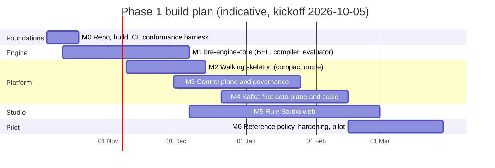
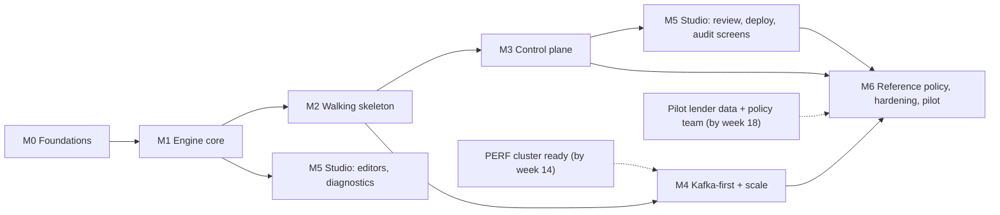

# BRE Platform: Build Plan (from scratch)

**Document:** `05_Build_Plan.md` · **Version:** 1.0-draft · **Date:** 2026-10-01
**Builds:** the Draft 2 specification (`00`–`04`). If this plan and the specification disagree, the specification wins and this plan is corrected.
**Starting point:** nothing exists yet. There is no code and no repository; the workspace has an empty `BRE/` folder.

---

## 1. Summary

We build the platform in **seven milestones**: M0 to M6 make up Phase 1 (the MFI MVP), and Phases 2 and 3 follow.

The order is chosen so that the riskiest and most central part, the **rule engine**, is built first against an executable specification. The platform is then **running end to end on a laptop by week 10**, long before it is complete. From that point every milestone adds capability to a system that already works; we never sit on a codebase that only compiles.

| | |
|---|---|
| **Phase 1 (MVP: MFI JLG/SHG)** | ≈ 26 weeks with a team of about 9 (§7). It ends at the PRD §12.1 exit criteria. |
| **First end-to-end decision** | Week 10 (M2). REST → engine → durable record → `GET` → replayed explanation, on a laptop, with no Docker. |
| **Engine complete** | Week 9 (M1): 100% of the LLD §13 conformance vectors pass, and the fail-closed property test passes. |
| **Production-scale proof** | Week 20 (M4): 5,000 decisions/s at p99 ≤ 100 ms on a production-like cell. |
| **Pilot-ready** | Week 26 (M6): the full MFI reference policy, a pen test, a DR drill, and a parallel run with a pilot lender. |

---

## 2. Build principles

| # | Principle | What it means in practice |
|---|---|---|
| P1 | **The specification is executable** | The LLD §13 conformance vectors and the 00 §3.10 semantics (S1–S13) become a JUnit suite **before** the engine is written. The engine is "done" when that suite is green, not when it looks finished. |
| P2 | **Walking skeleton early** | By M2 one thin path works end to end. Everything after that thickens a running system. |
| P3 | **Run it at every milestone** | Every milestone's exit includes a demonstrated end-to-end run, not just green unit tests. A milestone that compiles but has never run is not done. |
| P4 | **Engine purity** | `bre-engine-core` has zero framework dependencies and never reads the clock (LLD §1.2). ArchUnit enforces this in CI from day one. |
| P5 | **Ports and adapters** | Every infrastructure choice is an adapter behind a port, so we start with the simplest adapter and swap to the production one by configuration. The ports are `DecisionLog` (PostgreSQL outbox ↔ Kafka), `ObjectStore` (filesystem ↔ S3/MinIO), `KmsPort` (local dev keys ↔ Vault/KMS/HSM), `IdempotencyStore` (PostgreSQL ↔ Valkey) and `Identity` (dev JWT ↔ OIDC). |
| P6 | **Fail-closed is a CI gate** | The property test "no combination of ERROR / DATA_MISSING / REFER / FAIL can produce APPROVE" (PRD AC-MODEL-016) runs on every build from M1. |
| P7 | **Performance budget from day one** | JMH benchmarks for the engine run in CI with regression thresholds. Load tests start in M2, not at the end. |
| P8 | **Independent stack** | Maven Central and npm only. No platform plugins or private registries are inherited from other codebases. Our own Gradle build, our own conventions. |
| P9 | **Security is built in, not bolted on** | Expression safety (fuzzing), tenant isolation tests, PII-free logging and signed bundles are part of the milestone where each capability first appears. |

---

## 3. Starting environment (verified 2026-10-01)

| Fact | Consequence for the plan |
|---|---|
| System JDK is 17. Gradle toolchain auto-provisioning works: JDK 21 is already provisioned and the foojay API is reachable. | The build declares a **Java 25 toolchain**, and Gradle downloads JDK 25 automatically. No system install is needed. |
| Gradle 9.6.1 distribution is cached | Use the Gradle 9.6.x wrapper. |
| Node 20.18.1, npm 10.8.2 | **Upgrade to Node 22 LTS for `studio-web`**, installed in the user's own directory with no sudo. Current Vite releases need Node ≥ 20.19. |
| Maven Central, npm, GitHub and foojay are reachable. `gh` is logged in. | Dependencies resolve normally. A private GitHub repository can be created when you approve it. |
| 16 cores, 125 GB RAM, 465 GB free | Ample for local builds, embedded databases and laptop-scale load tests. |
| **No Docker or Podman.** Only the `psql` client is installed. | Local integration tests use **embedded** infrastructure from Maven Central: real PostgreSQL binaries through `io.zonky.test:embedded-postgres`, an in-JVM Kafka KRaft broker through `spring-kafka-test`, a filesystem object store and local signing keys. CI (GitHub Actions has Docker) also runs Testcontainers profiles. **Production-scale tests (M4) need a real cluster**; see the infrastructure decision in §11. |
| Empty `BRE/` folder in the workspace | Proposed repository root (§4). |

---

## 4. Repository and engineering setup

**Repository:** `BRE/` becomes the git root of **`bre-platform`**, laid out exactly as in LLD §1.1 (`build-logic/`, `libs/`, `services/`, `apps/studio-web/`, `tools/bre-cli/`, `tests/`). A private GitHub remote is created only when you say so.

| Area | Choice |
|---|---|
| Build | Gradle 9.6 Kotlin DSL; version catalog `gradle/libs.versions.toml`; convention plugins in `build-logic/` (`bre.java-library`, `bre.spring-service`, `bre.contracts`); Java 25 toolchain; `-Werror` |
| Framework | Spring Boot 4.x BOM (services only), virtual threads on |
| Code quality | Spotless (google-java-format), Error Prone, ArchUnit (the LLD §1.2 rules), JaCoCo with a coverage gate on `libs/` |
| Engine-specific libraries | `re2j` (regex), `snakeyaml-engine` (YAML 1.2 for PSF), a JSON Schema 2020-12 validator, `zstd-jni`. Nothing else is in the engine path. |
| Testing | JUnit 5, AssertJ, **jqwik** (property-based), **Jazzer** (fuzzing the BEL parser and type checker), JMH, Gatling (Java DSL), embedded-postgres, `spring-kafka-test`; Testcontainers in CI only |
| Persistence | PostgreSQL 17; schema migrations with Flyway (community edition); the LLD §5 DDL becomes the first migrations |
| Contracts | OpenAPI 3.1, `.proto` with buf breaking-change checks, AsyncAPI 3.0, event JSON Schemas, in `libs/bre-contracts` |
| Supply chain | CycloneDX SBOM per artifact, licence scan, dependency vulnerability scan, Renovate for updates |
| CI (GitHub Actions) | On every PR: build, unit tests, conformance, ArchUnit, a JMH smoke run with thresholds, embedded integration tests, SBOM. Nightly: Testcontainers integration, Jazzer fuzz runs, a longer JMH run. Weekly: load test on the PERF cell (from M4). |
| Repo hygiene | `docs/adr/` (ADRs carried from Architecture §14), CODEOWNERS, PR template with a Definition-of-Done checklist, protected `main`, conventional commits |
| Local dev | `tools/devstack`: one command starts embedded PostgreSQL (plus embedded Kafka when needed) and the services in compact mode, seeded with a demo tenant and the MFI sample policy |

---

## 5. Milestones (Phase 1)

*The dates are indicative, assuming a team as in §7 starting 2026-10-05. Milestones overlap by design; the critical path is §6.*

### M0 · Foundations (weeks 1–2)

**Goal:** a repository in which correct work is easy and incorrect work fails CI.

| ID | Task | Done when |
|---|---|---|
| M0-01 | `git init` in `BRE/`; Gradle 9.6 wrapper; `settings.gradle.kts` with every module from LLD §1.1 as an empty shell | `./gradlew build` passes on an empty skeleton |
| M0-02 | `build-logic` convention plugins: Java 25 toolchain, Spotless, Error Prone, JaCoCo, CycloneDX | A Java 25 toolchain is auto-provisioned; formatting violations fail the build |
| M0-03 | ArchUnit rules from LLD §1.2: engine purity, no clock or randomness in the engine, no fact values in logs, no cross-service internals | Each rule has a deliberately failing fixture that proves it fires |
| M0-04 | `tests/engine-conformance`: JSON vector format plus a JUnit runner. Import **every LLD §13 vector**, and the 00 §3.14 PSF example, as data. | The runner executes them all, and all fail with "engine not implemented" |
| M0-05 | Fail-closed property-test harness (jqwik), with a fake engine to prove it can catch a fail-open | It fails on a deliberately fail-open stub |
| M0-06 | GitHub Actions pipelines (PR, nightly), PR template, CODEOWNERS, ADR folder seeded with ADR-001..015 | A PR shows every check |
| M0-07 | `docs/` in the repo links to Draft 2. `CONTRIBUTING.md` holds the Definition of Done (§8). | — |

**Exit:** green CI on the skeleton; the conformance runner lists every vector as pending.

### M1 · Rule engine `bre-engine-core` (weeks 2–9): the critical core

**Goal:** a pure, deterministic, fail-closed engine that passes the whole specification.

| ID | Task | Spec | Done when |
|---|---|---|---|
| M1-01 | Value model (`DecimalV`, `Missing`, …), decimal semantics (MathContext, division scale 10 HALF_EVEN, `round` modes), date semantics (`java.time.Period`) | LLD §3.4–3.7, S10 | Decimal and date vectors pass |
| M1-02 | Lexer and hand-written recursive-descent parser for BEL; unary-test parser; positioned error messages | LLD §3.1–3.3 | Grammar vectors pass; Jazzer runs 1 h with no crash |
| M1-03 | Binder and type checker: scopes, scope collections, result references, namespaces (`param.`, `list.`), protected-field detection | LLD §3.8, §4.3, S13 | `BEL-0xx` diagnostic vectors pass |
| M1-04 | Variable and result-reference DAG, cycle detection, topological order | LLD §4.2 | Cycle vectors pass |
| M1-05 | Lowering to a closure tree; fuel meter; list-size cap; closed function registry | LLD §3.9–3.10, §4.4 | Function and fuel vectors pass |
| M1-06 | Three-valued logic and missing-value semantics: strict aggregates; fail-closed filters; `if` with an unknown condition → missing | LLD §3.5, S1–S3 | S1, S2 and S3 vectors pass |
| M1-07 | Components: rules (`when`/`check`/`onFail`/`onMissing`/`measure`/`outputs`), decision tables with every hit policy, scorecards with adverse reasons | LLD §4.6, S5, S9, S11 | Component vectors pass |
| M1-08 | Flow execution, per-entity iteration, aggregation (WORST, ALL_MUST_PASS, THRESHOLD, NONE), knockout skipping | LLD §4.5, §4.7, S6, S7, S12 | Aggregation vectors pass |
| M1-09 | Decision precedence, `stpEligible`, deviation coverage, authority resolution (HIGHEST_ONLY / EACH), customer-reason selection, champion/challenger hashing | LLD §4.8–4.11, S8 | Decision and deviation vectors pass; **fail-closed property test passes at 10⁶ cases** |
| M1-10 | Static checks: decision-table overlap and gap analysis (interval and enumerated domains), unreachable rows, unused variables, protected-attribute use, unknown references, cost | LLD §4.13 | `CHK-0xx` vectors pass |
| M1-11 | Explanation trace recorder (on by request, zero cost when off) | LLD §4.12 | The trace's final decision always equals the decision |
| M1-12 | `bre-ir-json`: IR codec, PSF YAML ↔ IR, BRE-JCS canonical JSON, IR JSON Schema validation | LLD §2.2–2.5 | Round-trip tests; the 00 §3.14 PSF compiles and evaluates |
| M1-13 | `bre-bundle`: bundle format, SHA-256 hash, Ed25519 sign and verify, trust store; load-time self-test | LLD §2.6, §8.6 | A tampered byte fails verification; rebuilds are byte-identical |
| M1-14 | `bre-fact-model`: canonical fact JSON Schema v1, single-pass `FactReader`, classification tags, prohibited-data detector (raw Aadhaar, raw PAN) | 00 §3.9, LLD §9.1 | Schema vectors pass; raw Aadhaar is rejected |
| M1-15 | `tools/bre-cli`: `psf lint | compile | test | bundle | verify`, offline | LLD §1.1 | An analyst can test a PSF file locally |
| M1-16 | JMH benchmarks: 100-rule policy; 1,000-rule, 40-member group | Arch §6.1.6, §15.1 | Evaluation p99 ≤ 0.5 ms (100 rules) and ≤ 50 ms (G40), with thresholds in CI |

**Exit:**
1. **100% of the conformance vectors pass.**
2. The fail-closed property test passes.
3. Jazzer finds nothing in a 1-hour run.
4. The JMH budgets are met.
5. `bre-cli` compiles, tests and bundles the sample MFI policy.

### M2 · Walking skeleton, compact mode (weeks 6–10)

**Goal:** one real decision, end to end, durable and replayable, on a laptop.

| ID | Task | Done when |
|---|---|---|
| M2-01 | `bre-platform-common`: tenant context, UUIDv7 (with locator bits), problem+json, OTel helpers, PII log guard | Unit tests pass |
| M2-02 | Flyway migrations for the `bre_ctl` subset (tenants, policies, versions, bundles, deployments, active_pointers) and `bre_dec` (decisions, decision_facts, idempotency_keys, outbox), with partitioning as in LLD §5 | Migrations apply on embedded PostgreSQL 17 |
| M2-03 | `policy-registry` (minimal): import PSF → compile → auto-approve (DEV only) → build and sign bundle → create deployment → active pointer; `GET /v1/active-pointers` with ETag and long-poll | A policy goes live in DEV with one API call |
| M2-04 | `decision-service`: `POST /v1/decisions` and `GET /v1/decisions/{id}`; policy resolution and pinning; `PointerWatcher` and `BundleCache` with verify and atomic swap; `OutboxDecisionLog` (PostgreSQL-first); PostgreSQL `IdempotencyStore` | The decision is durable before the 200; a retry returns the same `decisionId` |
| M2-05 | `GET /v1/decisions/{id}/explanation` by replay | The replay equals the stored outcome |
| M2-06 | Facts encryption with **local dev keys** behind `KmsPort`; masked view | Facts are unreadable in the database without the key |
| M2-07 | `tools/devstack`: one command; seeds a demo tenant and the MFI JLG sample policy | A fresh clone reaches a first decision with one command |
| M2-08 | Smoke load test (Gatling) at 500 decisions/s locally; first latency profile | A report is stored in CI artefacts |

**Exit (demo):**
1. A 5-member JLG group application gets a correct `APPROVE_WITH_DEVIATION`.
2. The retry is idempotent.
3. The explanation replays.
4. Restarting the service loses nothing.
5. A policy change via the registry takes effect without a restart.

### M3 · Control plane and governance (weeks 9–16)

**Goal:** the complete authoring-to-production lifecycle with maker-checker, multi-tenancy and audit.

| ID | Task | Done when |
|---|---|---|
| M3-01 | Full `bre_ctl` schema (LLD §5.2) including RLS, the hash-chained `audit_log` and the governance overrides | The RLS cross-tenant test suite passes |
| M3-02 | `studio-service`: policies and versions lifecycle (`DRAFT → IN_REVIEW → APPROVED`, request changes, discard, archive), clone, PSF import/export, semantic diff | PRD FR-LIFE-001..003, FR-AUTH-008/009 ACs pass |
| M3-03 | Shared assets with maker-checker and effective dating: parameter sets (including `REGULATORY` tags), reference lists, reason codes, authority matrices (routing mode pinned), fact schemas | FR-MODEL-003/007/008, FR-DEV-002 ACs pass |
| M3-04 | Test cases, coverage, submit gates (tests, coverage, static checks, change note, committee reference); simulation API with trace; batch simulation | FR-TEST-001..005, FR-TEST-010 ACs pass |
| M3-05 | Segregation of duties: reviewer ≠ editor; deployment approver ≠ author or reviewer; `minPolicyReviewers` and `minDeploymentApprovers[env]` | FR-LIFE-003/006 ACs pass |
| M3-06 | Registry: deployments with per-environment approvals, scheduling at `effectiveFrom`, uniqueness of the ACTIVE CHAMPION, rollback, EXPEDITED with a PIR task, signed manifests, serving heartbeat and rollout status | FR-LIFE-005..011 ACs pass; **rollback converges in ≤ 30 s across 3 pods** |
| M3-07 | Bundle export and import between installations (ORIGIN/IMPORT signatures) | A tampered bundle is rejected on import |
| M3-08 | `tenant-admin-service`: tenants, environments, settings, quotas, cell assignment (single cell for now) | FR-ADM-001/003/005 ACs pass |
| M3-09 | Identity: OIDC resource server for users (Keycloak in CI) and OAuth2 client credentials for systems; dev JWT locally; MFA policy hook | FR-INT-008 ACs pass |
| M3-10 | `bre.studio.audit.v1` events (outbox in compact mode) | FR-AUD-005 AC passes |

**Exit (demo):** PRD journey **J1** runs end to end through the APIs. Three distinct users take the policy from draft to PROD to rollback, and the audit trail shows every step with diffs.

### M4 · Kafka-first data plane and production scale (weeks 12–20)

**Goal:** the production data path, proven at NFR scale on real infrastructure.

| ID | Task | Done when |
|---|---|---|
| M4-01 | `KafkaDecisionLog`: `acks=all`, idempotent producer, protobuf `recorded.v1` (CloudEvents binary), `delivery.timeout` aligned with the API deadline; fail-closed 503 when Kafka is unavailable | Tests on the embedded KRaft broker; a broker-kill test |
| M4-02 | `decision-sink`: Kafka → hot store (daily partitions × tenant hash; facts table with 14-day retention), de-duplication on `(tenant_id, request_id)`; partition-maintenance job | The sink catches up after a 1-hour outage with no loss |
| M4-03 | Archive writer: Parquet + zstd, hourly manifests with checksums, Object Lock on S3/MinIO; filesystem adapter in dev | Archive files validate; Object Lock is verified on MinIO |
| M4-04 | Envelope encryption with real KMS/Vault adapters; per-principal keys; crypto-shredding endpoint (`POST /v1/admin/erasures`) | Shredded facts are undecryptable; the decision metadata survives |
| M4-05 | Valkey adapters for idempotency and rate limits; gateway token buckets; adaptive concurrency; weighted fair share; priority classes | A noisy-neighbour test keeps the other tenant within SLO |
| M4-06 | `decision-worker` (async ingress `POST /v1/decisions:async` + Kafka consumer, DLQ, idempotent) and bulk jobs | FR-EXEC-009/010 ACs pass (pulled forward from Phase 2 because the infrastructure exists) |
| M4-07 | Replay-verification job (≥ 10,000/day), outcome guardrails, drift and ERROR-rate monitors | An injected mismatch alerts |
| M4-08 | Observability: OpenTelemetry traces, metrics and logs; Grafana dashboards; SLOs with burn-rate alerts | The dashboards show a load test live |
| M4-09 | Helm charts per cell, Argo CD, Strimzi (Kafka), CloudNativePG, PDBs, topology spread, HPA/KEDA | A cell deploys from Git |
| M4-10 | **PERF cell load and chaos tests:** NFR-PERF-01/02, NFR-SCALE-01/02, broker loss, AZ loss, hot store down, registry down, KMS down | The targets are met, or the gaps are documented with fixes planned |

**Exit:** a production-like cell sustains **5,000 decisions/s at p99 ≤ 100 ms**. The chaos suite shows RPO 0 for acknowledged decisions. The convergence SLO holds under load.

### M5 · Rule Studio web (weeks 10–22, in parallel)

**Goal:** a business user authors, tests, submits and deploys policy with no engineering help (AC-AUTH-001).

| ID | Task | Done when |
|---|---|---|
| M5-01 | App shell: React + TypeScript + Vite, routing, OIDC login (`oidc-client-ts`), role-aware navigation, masking everywhere | Login works and roles gate the screens |
| M5-02 | Monaco BEL language: Monarch syntax highlighting; diagnostics and autocomplete from the backend compile API (debounced, ≤ 500 ms); fact-path browser | FR-AUTH-002/003/004 ACs pass |
| M5-03 | Rule and variable editors; decision-table grid with gap and overlap highlighting; scorecard editor (Phase 2 flag); flow editor | FR-AUTH-005/007 ACs pass |
| M5-04 | PSF diff (Monaco diff editor), version history, clone | FR-AUTH-008/009 ACs pass |
| M5-05 | Test runner with coverage; simulation console with a trace view; batch simulation upload | FR-TEST-001..004/010 ACs pass |
| M5-06 | Review inbox (comments on rules and rows), submit and approve; deployment console with per-pod convergence; rollback button | J1 can be done entirely in the UI |
| M5-07 | Assets screens: parameters (regulatory register), lists, reason codes, authority matrix | Maker-checker is visible in the UI |
| M5-08 | Decision lookup (masked; unmask with a reason), explanation viewer, audit trail | J7 and J8 can be done in the UI |
| M5-09 | Playwright end-to-end tests for J1, J3, J4, J7 and J8; an axe accessibility audit | Green in CI |
| M5-10 | Usability sessions with 3 or more credit-policy analysts | RK1 assessed; fixes scheduled |

**Exit:** a policy analyst with no engineering access completes J1 in the UI. This is the first point at which K2, "changes made with no engineering involvement", can be measured.

### M6 · Reference policy, hardening and pilot (weeks 20–26)

| ID | Task | Done when |
|---|---|---|
| M6-01 | Author the **complete MFI JLG/SHG reference policy** (PRD §5.2, M1–M18; sourcing, KYC, credit underwriting and pre-disbursal) in PSF, with full test cases. This is the acceptance suite. | Every test passes; coverage ≥ 90% |
| M6-02 | Security: threat-model review, an external pen test, a secrets audit, SBOM review, an expression-safety campaign (Jazzer for 24 h) | No open critical or high findings |
| M6-03 | DR drill: region failover of the data plane and control-plane restore; backup restore including decryption | Evidence recorded against NFR-DR-01/02 |
| M6-04 | Runbooks: incident, rollback, key rotation, cell add, tenant onboarding; the on-call rota | Reviewed by SRE |
| M6-05 | Integration guide and sandbox tenant for the pilot's LOS team; fact-schema validation CLI for their CI | The pilot integrator gets a first sandbox decision within 1 hour |
| M6-06 | **Pilot parallel run:** at least 4 weeks of shadow or parallel decisions against the pilot lender's documented policy; every difference explained | PRD §12.1 exit criterion 3 |
| M6-07 | Compliance sign-off on the regulatory parameters and the PRD §10 controls | Signed |

**Exit = PRD §12.1 Phase 1 exit criteria.**

---

## 6. Critical path and dependencies

- **Critical path:** M0 → M1 → M2 → M3 → M6. A slip in the engine moves everything, which is why it gets the strongest engineers and starts in week 2.
- **External dependencies** (the dashed lines) must be secured early:
  - a production-like cluster for M4, by week 14;
  - a pilot lender with a documented policy and anonymised historical applications, by week 18.

---

## 7. Team and ways of working

### 7.1 Proposed team for Phase 1

| Role | Count | Owns |
|---|---|---|
| Tech lead / architect | 1 | Architecture, ADRs, engine design reviews, critical-path decisions |
| Backend engineers, engine | 3 | M1 (BEL, compiler, evaluator, static checks), `bre-cli`, conformance |
| Backend engineers, platform | 2 | M2, M3, M4 services |
| Frontend engineers | 2 | M5 Rule Studio |
| SRE / platform engineer | 1 | CI, Helm, Argo CD, Kafka and PostgreSQL operators, observability, PERF cell, DR |
| QA / performance engineer (SDET) | 1 | E2E journeys, Gatling, chaos, Playwright |
| Security engineer | 0.5 | Threat model, fuzzing, key management, pen-test coordination |
| Product owner | 1 | Backlog, acceptance, pilot relationship |
| Credit-policy SME (pilot lender or in-house) | 0.5 | Reference policy, test cases, usability sessions |
| UX designer | 0.5 | Studio flows and usability |

**Effort estimate for Phase 1:** about 140 engineer-weeks (M0 ≈ 4, M1 ≈ 24, M2 ≈ 8, M3 ≈ 24, M4 ≈ 28, M5 ≈ 30, M6 ≈ 22). That fits the team above over about 26 weeks with healthy slack.

### 7.2 Building it together (Claude Code + you)

The plan also works with me implementing and you reviewing:
- I build milestone by milestone in `BRE/`, starting with M0 and M1.
- Each milestone ends with a **demonstrated run and a written report**: what works, what was verified, what is not done.
- Independent modules (for example the fact model, the bundle library and the CLI) can be built in parallel by sub-agents. The engine core stays single-owner for coherence.
- Nothing is pushed to a remote, and no external service is touched, without your go-ahead.
- Real-infrastructure work (M4-09/10, M6-02/03/06) needs environments and people that a local session does not have. Those tasks need your team and your infrastructure decision (§11).

### 7.3 Cadence

Two-week sprints, each ending in a live demo of the running system. Every milestone has an exit review against its "Done when" column. ADRs are written for any change to a Draft 2 decision, and `00` is updated first.

---

## 8. Definition of Done (every task)

1. The code follows the Draft 2 specification. Any deviation is recorded in an ADR, and `00` is updated.
2. There are unit tests. Engine work has conformance vectors and property tests where the behaviour is algebraic.
3. CI is green: ArchUnit, formatting, Error Prone, coverage gate, JMH thresholds, SBOM and licence scan.
4. **The work has been run end to end in `devstack`** (from M2 onwards), and the PR description says how.
5. There are no secrets, PII or fact values in logs or test fixtures (synthetic fixtures only, LLD §9.7).
6. API, event or schema changes are reflected in `bre-contracts`, with breaking-change checks passing.
7. User-visible behaviour has an entry in the Authoring Guide or the integration guide.

---

## 9. Test strategy by layer

| Layer | Tool | Runs | Gate |
|---|---|---|---|
| Unit | JUnit 5, AssertJ | Every PR | Coverage ≥ 85% on `libs/` |
| Engine conformance | JSON vectors + JUnit runner | Every PR | 100% pass |
| Property-based | jqwik (fail-closed, decimal algebra, aggregation monotonicity) | Every PR | Pass |
| Fuzzing | Jazzer (BEL parser, type checker, PSF decoder) | Nightly (1 h); 24 h before release | No crash, hang or exception escape |
| Integration | embedded-postgres, embedded Kafka KRaft; Testcontainers in CI | PR (embedded), nightly (Testcontainers) | Pass |
| Contract | OpenAPI and JSON Schema validation, buf breaking check, AsyncAPI validation | Every PR | Pass |
| End-to-end journeys | API scripts for J1–J8; Playwright for the UI | Nightly | Pass |
| Performance | JMH (engine), Gatling (API) | PR smoke; weekly on the PERF cell | NFR thresholds |
| Chaos | Chaos Mesh on the PERF cell (failure modes from Architecture §10.1) | Each milestone from M4 | RPO/RTO met |
| Security | Dependency scan, ZAP baseline, cross-tenant RLS suite, expression-safety suite | PR + nightly | No high or critical findings |

---

## 10. Build risks and mitigations

| # | Risk | Mitigation |
|---|---|---|
| BR1 | BEL takes longer than planned, or has semantic bugs | Conformance vectors before code (P1); hand-written parser with a small grammar; property tests and fuzzing; senior engineers on M1; the tech lead reviews every semantic decision against 00 S1–S13 |
| BR2 | Some library does not yet support Java 25 or Spring Boot 4 (for example Error Prone or JaCoCo versions) | Verify in M0-02. Fall back per tool, for example running Error Prone on the newest JDK it supports while targeting 25. Avoid Lombok entirely: records cover it. |
| BR3 | No Docker locally | Embedded PostgreSQL and Kafka for local tests; Testcontainers in CI; a real cluster for M4 |
| BR4 | Production-scale numbers cannot be proven without real infrastructure | The infrastructure decision (§11) by week 8; the PERF cell ready by week 14 |
| BR5 | Studio usability falls short of business users (PRD RK1) | Usability sessions in M5; decision tables preferred over free-form BEL; strong autocomplete |
| BR6 | No pilot lender in time | Start the pilot search now; the synthetic reference policy and fixtures make M0–M5 independent of the pilot |
| BR7 | Scope creep from Phase 2/3 into Phase 1 | The PRD phase column is the contract. Anything pulled forward (such as M4-06) is a deliberate, recorded decision. |
| BR8 | "It compiles but never ran" | P3: every milestone exit is a demo of a running system, and `devstack` from M2 makes running cheap |

---

## 11. Decisions needed

| # | Decision | Default if not decided | Needed by |
|---|---|---|---|
| BD1 | **Who builds:** Claude Code with you reviewing (§7.2), a team (§7.1), or both | I start M0 and M1 in `BRE/`; the plan doubles as the team roadmap | Now |
| BD2 | **Repository:** `BRE/` as the git root of `bre-platform`; private GitHub repository under which account or organisation | Local git only until you say otherwise | Now (local); M0-06 (remote) |
| BD3 | **Product name and Java package root** (`dev.bre` is a placeholder) | Keep `dev.bre`; rename mechanically later | Before M2 |
| BD4 | **Infrastructure for DEV, UAT and PERF:** which cloud (India region) or on-prem Kubernetes | — | Week 8 (for M4) |
| BD5 | **Licence:** proprietary or open source | Proprietary, all rights reserved | Before the first external share |
| BD6 | **Pilot lender** | Synthetic reference policy until one is found | Week 18 |

---

## 12. After Phase 1 (outline)

| Phase | Weeks (indicative) | Scope (PRD §12.2–12.3) |
|---|---|---|
| **2: Retail and MSME, evidence** | 27–42 | Retail and MSME catalogues and reference policies; COLLATERAL scope; scorecards and the model register; back-test, impact analysis and shadow; gRPC; compact-mode packaging for on-prem; cell moves; BYOK; drift and deviation MIS; analytics feed; decision dossier; erasure handling |
| **3: Scale-out product** | 43–60 | Champion/challenger and the performance-outcomes feed; starter packs; Fact Connectors (bureau, KYC, AA) as a separate component; DMN import/export; embedded SDK; webhooks; model monitoring; two-region active-active as the SaaS default; tenant offboarding |

---

## 13. The first two weeks, concretely

| Day | Work | Output |
|---|---|---|
| 1 | M0-01, M0-02: repository, wrapper, convention plugins, JDK 25 toolchain | A green empty build |
| 2 | M0-03: ArchUnit rules with failing fixtures | Purity rules enforced |
| 3–4 | M0-04: conformance vector format; import every LLD §13 vector and the 00 §3.14 PSF | Every vector pending |
| 5 | M0-05, M0-06: property harness; CI pipelines | PR checks visible |
| 6–7 | M1-01: value model, decimal, dates | Decimal and date vectors green |
| 8–10 | M1-02: lexer, parser, unary tests, error positions; first Jazzer run | Grammar vectors green |

At the end of week 2, the report shows the first passing conformance vectors, the CI pipeline and the plan for weeks 3–4.
